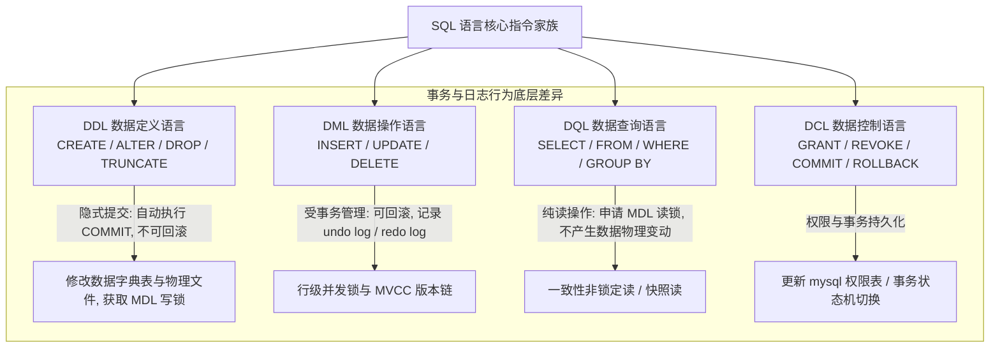
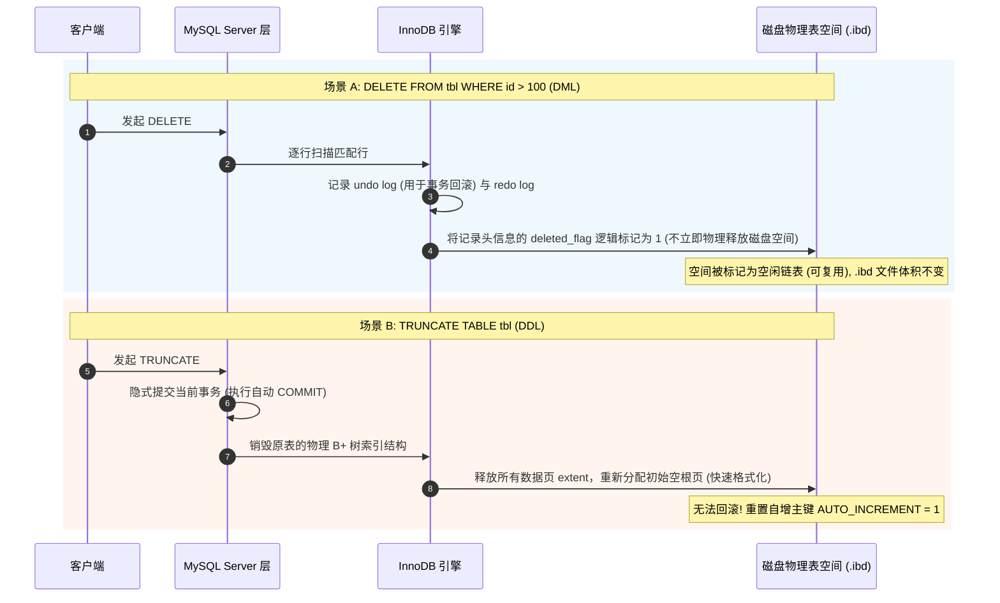

# 初级-SQL语言分类DDL-DML-DQL-DCL与基础语法规则

结构化查询语言（SQL - Structured Query Language）是与关系型数据库沟通的标准指令规范。在实际企业级工程开发与社招考查中，仅仅记住几个简单的增删改查关键字远远不够。必须深刻理解 SQL 语言的**四大功能分类（DDL、DML、DQL、DCL）**，掌握各类语句在底层事务机制、元数据锁（MDL）以及持久化存储日志（redo/undo/binlog）中的不同物理行为。

---

## 一、核心底层机制与全景架构

### 1.1 SQL 语言四大分类及其职能全景图



### 1.2 `DELETE`、`TRUNCATE` 与 `DROP` 底层物理时序对比

这三者虽然都具备“清空/删除”语义，但在操作系统底层与磁盘文件层面的执行流转有着天壤之别：



---

## 二、源码级实战推导：四类语句标准语法与执行行为

### 2.1 四大类核心语句标准操作范式

```sql
-- ==========================================
-- 1. DDL (Data Definition Language) 数据定义
-- ==========================================
-- 创建数据库（指定安全字符集）
CREATE DATABASE IF NOT EXISTS mall_db 
DEFAULT CHARACTER SET utf8mb4 
COLLATE utf8mb4_unicode_ci;

-- 创建用户订单表
CREATE TABLE IF NOT EXISTS mall_db.t_order (
    id BIGINT UNSIGNED NOT NULL AUTO_INCREMENT COMMENT '订单主键ID',
    order_no VARCHAR(64) NOT NULL COMMENT '业务订单流水号',
    user_id BIGINT UNSIGNED NOT NULL COMMENT '购买用户ID',
    pay_amount DECIMAL(10, 2) NOT NULL DEFAULT 0.00 COMMENT '实付金额',
    status TINYINT NOT NULL DEFAULT 0 COMMENT '状态: 0待付, 1已付, 2取消',
    created_at DATETIME NOT NULL DEFAULT CURRENT_TIMESTAMP COMMENT '创建时间',
    updated_at DATETIME NOT NULL DEFAULT CURRENT_TIMESTAMP ON UPDATE CURRENT_TIMESTAMP COMMENT '修改时间',
    PRIMARY KEY (id),
    UNIQUE KEY uk_order_no (order_no),
    KEY idx_user_status (user_id, status)
) ENGINE=InnoDB DEFAULT CHARSET=utf8mb4 COMMENT='用户订单主表';

-- 动态修改表结构 (加字段)
ALTER TABLE mall_db.t_order ADD COLUMN pay_time DATETIME NULL COMMENT '实际支付时间' AFTER status;

-- ==========================================
-- 2. DML (Data Manipulation Language) 数据操作
-- ==========================================
-- 插入数据（单条/批量）
INSERT INTO mall_db.t_order (order_no, user_id, pay_amount, status) 
VALUES ('ORD20261117001', 10086, 99.00, 1),
       ('ORD20261117002', 10087, 199.50, 0);

-- 幂等插入/冲突更新 (UPSERT 技巧)
INSERT INTO mall_db.t_order (order_no, user_id, pay_amount, status)
VALUES ('ORD20261117001', 10086, 99.00, 1)
ON DUPLICATE KEY UPDATE pay_amount = VALUES(pay_amount);

-- 条件更新
UPDATE mall_db.t_order SET status = 1, pay_time = NOW() WHERE order_no = 'ORD20261117002';

-- 条件删除
DELETE FROM mall_db.t_order WHERE status = 2 AND created_at < DATE_SUB(NOW(), INTERVAL 30 DAY);

-- ==========================================
-- 3. DQL (Data Query Language) 数据查询
-- ==========================================
SELECT id, order_no, pay_amount 
FROM mall_db.t_order 
WHERE user_id = 10086 AND status = 1 
ORDER BY id DESC 
LIMIT 10;

-- ==========================================
-- 4. DCL (Data Control Language) 权限与事务控制
-- ==========================================
-- 创建受限只读业务账号
CREATE USER 'reporter_user'@'192.168.1.%' IDENTIFIED BY 'StrongPassword!2026';
-- 授予查询权限
GRANT SELECT ON mall_db.* TO 'reporter_user'@'192.168.1.%';
-- 刷新权限缓存立即生效
FLUSH PRIVILEGES;
```

---

## 三、社招高频硬核连环追问

### 追问 1：在事务中执行了 `ALTER TABLE` 或 `CREATE TABLE`，为什么后续执行 `ROLLBACK` 无法撤销刚才的操作？

> **考官意图**：考察候选人对 DDL 语句底层“隐式提交（Implicit Commit）”机制的理解。

**回答硬核要点**：
- **隐式提交机制**：
  - MySQL 规定，所有 DDL 语句（包括 `CREATE`、`ALTER`、`DROP`、`TRUNCATE`、`RENAME` 等）**严禁包含在用户手动开启的显式事务中**。
  - 当执行到 DDL 语句的第一行时，MySQL Server 会无条件自动在内部触发一次 `COMMIT`，将当前事务中之前已经执行的所有 DML 语句强行持久化入盘；接着执行 DDL 操作修改数据字典；DDL 成功后再次隐式触发一次 `COMMIT`。
- **后果**：
  - 因此，DDL 无法回滚，且它会强行破坏上层原本希望通过事务保持原子性的业务上下文。在业务事务代码中**绝对严禁**夹杂执行 DDL 脚本。

---

### 追问 2：详述 `DELETE`、`TRUNCATE` 与 `DROP` 的核心区别与性能损耗对比？

> **考官意图**：考察候选人对三种删除指令在日志量、锁级别、磁盘空间回收与自增 ID 影响维度的全景掌握。

**回答硬核要点**：

| 评估维度 | `DELETE FROM table` | `TRUNCATE TABLE table` | `DROP TABLE table` |
| :--- | :--- | :--- | :--- |
| **所属语言分类** | **DML**（数据操作） | **DDL**（数据定义） | **DDL**（数据定义） |
| **事务与回滚** | 可回滚（详细记录 undo log） | **不可回滚**（隐式提交） | **不可回滚**（隐式提交） |
| **执行速度/开销** | 慢（按行逐行扫描与写日志，万级数据耗时数秒） | 极快（直接丢弃物理数据页重建空根页） | 极快（直接删除物理 `.ibd` 与 `.frm` 文件） |
| **磁盘空间（碎片）** | **不释放磁盘空间**（仅打删除标记，`.ibd` 文件不缩小） | **立即释放空间**（重置文件大小为初始 16KB/96KB） | **彻底释放空间**（文件从文件系统直接删除） |
| **自增主键计数器** | 保持原有 `AUTO_INCREMENT` 最大值继续递增 | **强制重置**为 1 | 表结构不复存在 |
| **触发器（Trigger）** | 会逐行激活 `AFTER DELETE` 触发器 | 不会激活任何触发器 | 不会激活触发器 |

---

### 追问 3：为什么生产环境中执行 `DELETE FROM table WHERE ...` 删除了 1000 万行数据后，磁盘剩余空间完全没有增加？

> **考官意图**：考察 InnoDB 逻辑页组织、空闲链表（Free List）与页空洞（Page Holes）物理机制。

**回答硬核要点**：
1. **删除标记机制**：
   - InnoDB 引擎在执行 `DELETE` 时，为了保证并发性能与事务可回滚性，**绝不会把磁盘扇区重新擦除并归还给操作系统**。
   - 底层仅是在行记录的 `Record Header` 中将 `deleted_flag` 状态位置为 1，并将该物理记录挂载到当前数据页内部的**垃圾链表（Garbage Link List）**上。
2. **空间复用机制**：
   - 这块空间被标记为“可复用”，后续若有满足尺寸的新记录 `INSERT` 进来，可直接覆写该槽位。但从操作系统层面看，`.ibd` 物理文件大小纹丝不动。
3. **彻底释放物理空间的 SOP**：
   - 必须执行表空间重构整理碎片：`OPTIMIZE TABLE table_name;` 或 `ALTER TABLE table_name ENGINE=InnoDB;`。
   - 原理：InnoDB 会在后台创建一个全新的干净临时表，将未被删除的存活记录顺序拷贝过去，重构 B+ 树紧凑索引，最后原子替换旧表文件并删除旧文件，从而真正将磁盘空间释放还给 OS。

---

## 四、生产级避坑指南与排障 SOP

### 4.1 生产级 SQL 开发避坑清单

| 违规写法 | 致命后果 | 工业级解决方案 |
| :--- | :--- | :--- |
| **`UPDATE / DELETE` 漏写 `WHERE` 条件** | 全表数据被意外全量清洗或覆写，引发最高等级 P0 故障 | 客户端开启安全更新模式：`SET sql_safe_updates = 1;`（禁止无 WHERE 或非主键条件的全表修改） |
| **单次批量 `INSERT` 超过 5 万条** | 超过 `max_allowed_packet` 限制报错，且单个大事务锁住整段自增锁引发阻塞 | 拆解为每批 500 ~ 1000 条的分批写入循环 |
| **生产大表直接运行 `ALTER TABLE` 加字段** | 触发长时间排他 MDL 写锁，阻塞所有后续增删改查请求，导致连接池瞬间被打爆 | 严禁直接跑 DDL！必须使用无锁工具（`gh-ost` 或 `pt-online-schema-change`）进行无损表结构变更 |
| **滥用 `TRUNCATE` 清空从库同步表** | 导致主从复制中断或主从数据物理裂变 | 清理历史数据采用带索引条件的滑动时间窗口小批量分批 `DELETE` |

### 4.2 生产环境表碎片率检查与无损紧凑重构 SOP

在批量清理历史数据后，使用以下脚本快速检查并紧凑回收磁盘：

```sql
-- 1. 查看全库所有表的物理数据大小、索引大小以及浪费的空洞碎片大小
SELECT 
    table_name AS '表名',
    ROUND((data_length + index_length) / 1024 / 1024, 2) AS '总占用空间(MB)',
    ROUND(data_length / 1024 / 1024, 2) AS '数据空间(MB)',
    ROUND(index_length / 1024 / 1024, 2) AS '索引空间(MB)',
    ROUND(data_free / 1024 / 1024, 2) AS '可回收碎片空间(MB)'
FROM information_schema.tables 
WHERE table_schema = 'mall_db' 
ORDER BY data_free DESC;

-- 2. 对碎片率超过 30% 且空洞大于 1GB 的表执行物理空间回收（低峰期执行）
OPTIMIZE TABLE mall_db.t_order;
```
