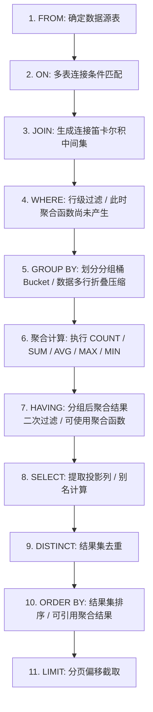
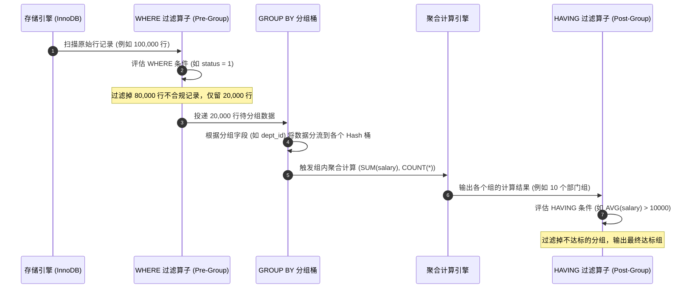

# 初级-分组查询GROUP-BY与聚合函数HAVING及ONLY_FULL_GROUP_BY避坑

在数据统计、财务对账与报表分析中，**分组查询（`GROUP BY`）与聚合函数**是 SQL 使用频率最高但也极易爆出暗坑的领域。初学者往往混淆 `WHERE` 与 `HAVING` 的边界、被 `COUNT(*)` 与 `COUNT(列名)` 的差异绊倒，并在 MySQL 5.7+ 升级后被突如其来的 **Error 1055 (`ONLY_FULL_GROUP_BY`)** 搞得焦头烂额。本文深度拆解分组查询的底层执行机制、聚合函数三值逻辑、1055 报错的工程根治方案，以及 `GROUP_CONCAT` 的数据截断排障。

---

## 一、核心底层机制与全景架构

### 1.1 分组聚合查询逻辑执行流水线全景图

SQL 的逻辑执行顺序与代码书写顺序完全不同。分组查询在 Server 层遵循严格的流式管道管线：



### 1.2 `WHERE` 与 `HAVING` 物理过滤时序流转对比



---

## 二、源码级实战推导：聚合函数特性与分组实战

### 2.1 常用核心聚合函数行为速查矩阵

| 聚合函数 | 核心功能 | 是否忽略 `NULL` 值 | 生产高频踩坑点 |
| :--- | :--- | :--- | :--- |
| **`COUNT(*)`** | 统计结果集的总物理行数 | **不忽略**（包含整行全为 NULL 的行） | 官方标准统举行数最优语法，InnoDB 底层专门优化 |
| **`COUNT(1)`** | 统计常量 1 的出现次数 | **不忽略** | 性能与 `COUNT(*)` 毫厘无差，优化器内部等价处理 |
| **`COUNT(列名)`** | 统计指定列**非 NULL** 的行数 | **自动忽略 `NULL`** | 若该列有 5 行为 NULL，统计结果会自动少 5 行！ |
| **`SUM(列名)`** | 计算指定列数值总和 | **自动忽略 `NULL`** | 全表为 NULL 或空表时，返回 `NULL` 而不是 `0`（需 `IFNULL` 包裹） |
| **`AVG(列名)`** | 计算指定列数值平均值 | **自动忽略 `NULL`** | **分母会自动排除 NULL 所在行**，极易导致统计平均数偏大！ |
| **`MAX / MIN`** | 查找指定列最大/最小值 | **自动忽略 `NULL`** | 空表或全为 NULL 时返回 `NULL` |
| **`GROUP_CONCAT`** | 将分组内的多行字符串拼成单行 | **自动忽略 `NULL`** | 默认超过 1024 字节被**静默截断丢弃**！ |

---

### 2.2 基础多列分组与聚合业务实战

```sql
-- 场景：按“部门”和“岗位”双维度统计员工总数、平均薪资，且仅保留平均薪资大于 8000 的高薪岗位组
SELECT 
    dept_id,
    job_title,
    COUNT(*) AS total_staff,
    COUNT(commission_pct) AS commission_staff_count, -- 仅统计有提成的员工数
    IFNULL(SUM(salary), 0.00) AS total_payroll,
    ROUND(AVG(salary), 2) AS avg_salary,
    MAX(salary) AS max_salary,
    MIN(salary) AS min_salary,
    GROUP_CONCAT(employee_name ORDER BY salary DESC SEPARATOR '、') AS top_performers
FROM mall_db.t_employee
WHERE status = 1 -- 1. 先用 WHERE 排除已离职员工 (降低参与分组的数据量)
GROUP BY dept_id, job_title -- 2. 按照部门和岗位联合分组
HAVING avg_salary >= 8000.00 -- 3. 再用 HAVING 过滤聚合后的薪资指标
ORDER BY avg_salary DESC; -- 4. 最后按平均薪水降序排列
```

---

## 三、社招高频硬核连环追问

### 追问 1：升级到 MySQL 5.7 或 8.0 后，很多原本正常的 SQL 突然报错 `Error 1055 (42000): Expression #1 of SELECT list is not in GROUP BY clause...`，根本原因是什么？

> **考官意图**：考察候选人对 `ONLY_FULL_GROUP_BY` 规范、关系代数数学确定性与踩坑治理。

**回答硬核要点**：
- **历史弱类型隐患（非确定性结果）**：
  - 在 MySQL 5.6 及以前，默认允许以下写法：
    ```sql
    SELECT id, dept_id, user_name, MAX(salary) FROM t_user GROUP BY dept_id;
    ```
  - 当一个部门有多名员工时，`user_name` 既未包含在 `GROUP BY` 中，也没有被聚合函数包裹。此时 MySQL 会**随机、不确定性地抽取该组物理存储中的某一行**填充 `user_name`！
  - 这导致展示出的姓名与 `MAX(salary)` 对应的员工根本对不上号，引发严重的业务数据错乱与审计事故。
- **`ONLY_FULL_GROUP_BY` 核心规范**：
  - 强制要求：**`SELECT` 投影列表中的所有非聚合列，必须严格包含在 `GROUP BY` 子句中**（或者该列在逻辑上与 `GROUP BY` 中的主键存在唯一函数依赖）。
- **工程级优雅治理方案（严禁暴力修改 sql_mode）**：
  1. **方案 A（标准规约）**：仅查询分组字段与聚合字段，或将业务列补入 `GROUP BY`；
  2. **方案 B（显式声明随机值）**：若业务确实不在乎展示该组哪条名字，使用显式语义函数 `ANY_VALUE(user_name)`；
  3. **方案 C（子查询关联）**：先按 `dept_id` 分组查出 `MAX(salary)`，再通过 `INNER JOIN` 关联回主表取对应人员明细。

---

### 追问 2：为什么说“能写在 `WHERE` 里的过滤条件，绝对不能写在 `HAVING` 里”？底层性能差距有多大？

> **考官意图**：考察查询执行管道、临时表体积膨胀与索引过滤时机。

**回答硬核要点**：
- **性能维度的巨大鸿沟**：
  - **`WHERE` 过滤发生在分组之前**：存储引擎可以直接利用 B+ 树索引快速裁剪无关行（Index Range Scan），完全不把无效数据读入内存；
  - **`HAVING` 过滤发生在分组之后**：所有行记录必须全部读出、在内存中开辟临时表（Temporary Table）、计算 Hash 桶并执行全量聚合之后，才在最后阶段将不达标的分组丢弃。
- **反例反证**：
  ```sql
  -- 极慢反例：把行级过滤写在 HAVING 里 (全量扫描并分组 1000 万行后再丢弃!)
  SELECT dept_id, COUNT(*) FROM t_employee 
  GROUP BY dept_id 
  HAVING dept_id = 10;

  -- 极速正例：索引精准下推，存储引擎仅检索 dept_id=10 的几百行数据参与聚合
  SELECT dept_id, COUNT(*) FROM t_employee 
  WHERE dept_id = 10 
  GROUP BY dept_id;
  ```

---

### 追问 3：生产中使用 `GROUP_CONCAT` 拼接用户标签或订单详情时，为什么数据量一大后尾部字符串“静默被截断”？

> **考官意图**：考察系统级隐藏参数与数据静默损坏排查能力。

**回答硬核要点**：
- **根本原因**：
  - MySQL 对 `GROUP_CONCAT` 的返回字节长度设置了全局硬上限，由参数 **`group_concat_max_len`** 严格控制，**默认值仅为 1024 字节**！
  - 当一组拼接的字符串超过 1024 字节时，MySQL 既不报错也不告警，而是**直接强行将超出部分物理切除丢弃**（静默截断），导致应用层反序列化 JSON 出现乱码破损。
- **工业级排障与解决 SOP**：
  - 在当前会话或全局动态调大该阈值（如调整为 10MB）：
    ```sql
    SET GLOBAL group_concat_max_len = 10485760;
    SET SESSION group_concat_max_len = 10485760;
    ```
  - 并在 `my.cnf` 中固化配置：`group_concat_max_len = 10M`。

---

## 四、生产级避坑指南与排障 SOP

### 4.1 生产级分组聚合避坑清单

| 易错场景 | 致命后果 | 工业级最佳实践 |
| :--- | :--- | :--- |
| **`AVG(score)` 计算平均分** | 缺考人员（`score` 为 NULL）被自动剔除，分母变小，平均分被非正常拉高 | 若缺考计 0 分，必须使用 `AVG(IFNULL(score, 0))` |
| **`SUM(amount)` 统计无数据行** | 空表或无匹配行时返回 `NULL`，直接注入 Java `Double` 触发 `NullPointerException` | 强规范包裹：`IFNULL(SUM(amount), 0.00)` |
| **对高基数列执行 `GROUP BY`** | 如对毫秒时间戳或用户身份证分组，内存临时表瞬间暴增至数百 MB 触发磁盘 filesort | 限制分组维度粒度（如按天截断 `DATE(create_time)`）并建立组合索引 |
| **`COUNT(DISTINCT col)` 大数据量** | 触发全内存去重，在千万级表上导致执行时间超过数十秒 | 引入 HyperLogLog 算法、Redis 计数器或离线数仓（ClickHouse）预计算 |

### 4.2 分组查询内部临时表（Using temporary）排障 SOP

使用 `EXPLAIN` 审查分组查询的物理代价：

```sql
-- 1. 查看分组查询执行计划
EXPLAIN 
SELECT dept_id, COUNT(*) 
FROM mall_db.t_employee 
GROUP BY dept_id;

-- 2. 诊断排查标准：
-- 若 Extra 列显示 "Using temporary; Using filesort":
-- 说明当前分组列 dept_id 上没有索引，MySQL 不得不建立内部内存临时表进行排序和去重统计！

-- 3. 极速调优方案：
-- 为 dept_id 建立索引: ALTER TABLE t_employee ADD INDEX idx_dept (dept_id);
-- 重新 EXPLAIN，Extra 变为 "Using index"，临时表与排序全部消除，耗时降低 90%+！
```
