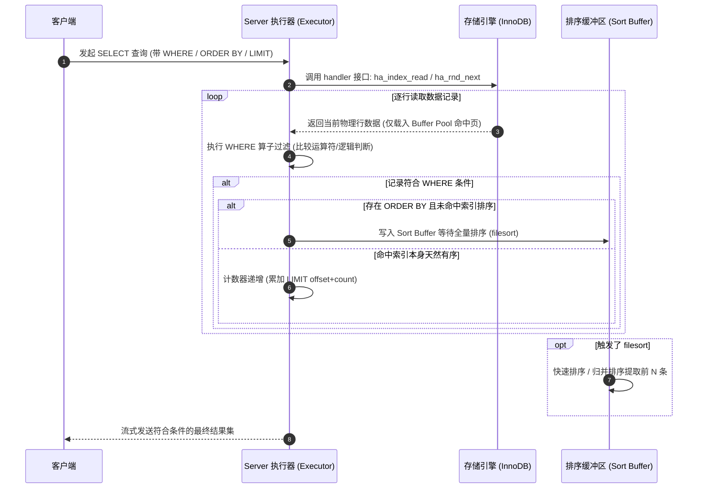

# 初级-单表基础查询与条件过滤WHERE-ORDER-LIMIT与运算符

在 SQL 的世界中，**数据检索（Data Retrieval）**是业务调用频次最高的操作。单表查询看似入门简单，但绝大多数慢查询与生产故障（如全表扫描、CPU 100%、索引失效）都源于对过滤条件（`WHERE`）、排序规则（`ORDER BY`）、分页截取（`LIMIT`）以及逻辑运算符底层执行机制的理解不透彻。本文深入拆解单表查询的执行流转、运算符优先级、NULL 值比对陷阱以及高效排序与分页技巧。

---

## 一、核心底层机制与全景架构

### 1.1 单表查询 Server 层与存储引擎数据流转时序

一条看似简单的单表过滤查询，在 MySQL 内部并不是一次性把全量数据加载出来再过滤，而是遵循流式迭代机制：



---

## 二、源码级实战推导：运算符、优先级与核心语法

### 2.1 运算符优先级与括号显式隔离

在包含 `AND` 和 `OR` 的复杂条件中，**`AND` 的物理优先级天然高于 `OR`**。如果不显式加圆括号 `()`，极易引发严重的数据泄露或越权漏洞：

```sql
-- 危险的逻辑漏洞示例：希望查询“租户100内，状态为已付或已发货的订单”
-- 错误写法（由于 AND 优先级高，被解析为：tenant_id=100 且 status=1，或者任意租户的 status=2！）
SELECT * FROM t_order 
WHERE tenant_id = 100 AND status = 1 OR status = 2;

-- 工业级标准正确写法：必须强制使用小括号明确逻辑隔离
SELECT * FROM t_order 
WHERE tenant_id = 100 AND (status = 1 OR status = 2);
```

---

### 2.2 核心查询算子与标准用法

```sql
-- 1. 精确比较与安全不等号
SELECT id, user_id, amount FROM t_order WHERE status = 1;
SELECT id, user_id FROM t_order WHERE status != 2; -- 或使用标准 SQL 的 <>

-- 2. 连续闭区间过滤 (BETWEEN ... AND ...)
-- 注意：BETWEEN 是全闭区间 [100, 500]，包含边界值 100 与 500
SELECT id, pay_amount FROM t_order WHERE pay_amount BETWEEN 100.00 AND 500.00;

-- 3. 离散集合查询 (IN 与 NOT IN)
SELECT id, status FROM t_order WHERE status IN (1, 3, 5);

-- 4. 模糊匹配 (LIKE) 与通配符
-- % 匹配任意 0 个或多个字符；_ 匹配单个字符
SELECT id, user_name FROM t_user WHERE user_name LIKE '张%';      -- 走索引 (前缀匹配)
SELECT id, user_name FROM t_user WHERE user_name LIKE '%科技%';    -- 不走普通索引 (全表扫描)

-- 5. 排序与多列优先级
-- 先按 status 升序排列，相同状态下按 created_at 降序排列
SELECT id, status, created_at 
FROM t_order 
ORDER BY status ASC, created_at DESC;

-- 6. 分页截取 (LIMIT offset, count)
-- LIMIT 0, 10 表示提取前 10 条（第 1 页）
-- LIMIT 20, 10 表示跳过前 20 条，提取接下来的 10 条（第 3 页）
SELECT id, order_no FROM t_order ORDER BY id DESC LIMIT 20, 10;
```

---

## 三、社招高频硬核连环追问

### 追问 1：为什么大厂开发规范强制明令禁止写 `SELECT *`？它到底在底层损耗了什么？

> **考官意图**：考察覆盖索引（Covering Index）、网络 I/O 吞吐、解析开销与应用层反序列化性能。

**回答硬核要点**：
1. **彻底丧失覆盖索引优化（Covering Index）机会**：
   - 如果二级联合索引 `(user_id, status)` 已经包含了查询所需的全部字段，查询只需扫描二级索引树即可直接返回（`Using index`），避免了访问主键聚簇索引。
   - 一旦写了 `SELECT *`，即使命中了二级索引，由于必须获取整行全部字段，**强制触发二次回表（Random Disk I/O）**查询聚簇索引，性能相差数倍甚至数十倍。
2. **严重的网络 I/O 与内存开销**：
   - 表中若包含 `TEXT`、`BLOB`、长 JSON 或大量无用字段，`SELECT *` 会将庞大的冗余字节从存储引擎拉入 Buffer Pool，并通过网络网卡传输给应用服务器，极易打爆网卡带宽。
3. **架构隐性破坏**：
   - 后续若对表新增大字段，原本正常运行的旧 SQL 查询耗时会突然暴增，破坏系统稳定性。

---

### 追问 2：为什么执行 `SELECT * FROM table WHERE id NOT IN (1, 2, NULL)` 会永远返回空结果集（Empty Set）？

> **考官意图**：考察 SQL 三值逻辑（Three-Valued Logic）与 NULL 值比对的物理陷阱。

**回答硬核要点**：
- **底层展开推导**：
  - `id IN (1, 2, NULL)` 在优化器内部被等价展开为：
    $$(id = 1) \text{ OR } (id = 2) \text{ OR } (id = \text{NULL})$$
  - 相应地，`id NOT IN (1, 2, NULL)` 依据德·摩根定律被等价展开为：
    $$(id \neq 1) \text{ AND } (id \neq 2) \text{ AND } (id \neq \text{NULL})$$
- **致命陷阱**：
  - 在标准 SQL 中，任何值与 `NULL` 进行算术比较（如 `id != NULL`），其计算结果**永远是 `UNKNOWN`（未知）**，而不是 `TRUE`！
  - 表达式中只要包含一个 `AND UNKNOWN`，整个复合逻辑表达式的最终布尔值就永远无法为 `TRUE`。
  - 因此该查询**被优化器直接判定为永假条件**，导致一行数据都查不出来！
- **防御准则**：在执行 `NOT IN` 前，必须前置确保子查询或集合中**彻底过滤掉了 NULL 值**，或改用 `NOT EXISTS`。

---

### 追问 3：在执行分页查询 `ORDER BY create_time LIMIT 0, 10` 时，为什么很多开发者反馈“换页时出现了重复数据或数据丢失”？

> **考官意图**：考察排序算法稳定性、快速排序与行物理地址不确定性。

**回答硬核要点**：
- **排序不稳定的根因**：
  - `create_time` 列并不是唯一的，存在多条记录的创建时间完全一样（如同一秒内产生）。
  - MySQL 的查询优化器在执行排序时，如果排序字段的值完全相同，且**未指定唯一的二次排序字段**，优化器对相同值行记录的物理读取顺序是不受任何保障的（取决于索引叶子页存储顺序或并行执行时序）。
  - 用户查询第 1 页时，某条记录排在第 10 名；当翻到第 2 页执行 `LIMIT 10, 10` 时，内部重走排序，该记录可能又被排列在第 11 名，导致用户在第二页再次看到它（数据重复），而原本应该显示的记录被挤掉（数据丢失）。
- **终极解决方案**：
  - **在排序字段后必须显式追加唯一列（如主键 ID）作为二次稳定排序决胜项**：
    `ORDER BY create_time DESC, id DESC LIMIT 0, 10;`，确保在任何情况下排序序列物理唯一且绝对确定。

---

## 四、生产级避坑指南与排障 SOP

### 4.1 生产级单表查询避坑对照表

| 常见写法 | 隐形地雷 | 工业级解决方案 |
| :--- | :--- | :--- |
| **`WHERE status = 1 OR mobile = '138...'`** | `OR` 两侧字段如果只有一个有索引，会导致全表扫描 | 改用 `UNION ALL` 拆分合并，让每个分支分别利用独立索引 |
| **`WHERE LEFT(user_no, 4) = '2026'`** | 在索引列上使用函数计算，导致索引树无法二分检索 | 改为范围前缀查询：`WHERE user_no LIKE '2026%'` |
| **`LIMIT 1000000, 10` 深分页查询** | 存储引擎必须扫描并回表 1000010 行数据再丢弃前 100 万行，耗时数秒 | 改用“子查询覆盖索引延迟关联”或“基于上次最大 ID 连续扫描（游标分页）” |
| **`WHERE is_vip != 1`** | 不等于判定（`!=` / `<>`）通常无法利用常规索引范围查找 | 若该状态区分度低，重新设计业务状态机或建立覆盖索引 |

### 4.2 EXPLAIN 检查查询过滤与排序是否高效 SOP

任何编写完成的单表查询，提交前必须使用 `EXPLAIN` 验证两项核心指标：

```sql
-- 1. 查看查询执行计划
EXPLAIN 
SELECT id, user_id, pay_amount 
FROM mall_db.t_order 
WHERE user_id = 10086 AND status = 1 
ORDER BY id DESC 
LIMIT 10;

-- 2. 关键审查项判定：
-- A. 查看 type 列: 确保为 ref / range / index_merge，坚决杜绝 ALL (全表扫描)
-- B. 查看 Extra 列:
--    - 出现 "Using index": 命中覆盖索引，表现最完美！
--    - 出现 "Using filesort": 说明排序未能利用索引自然顺序，必须评估是否需要为 (user_id, status, id) 建立组合索引！
```
