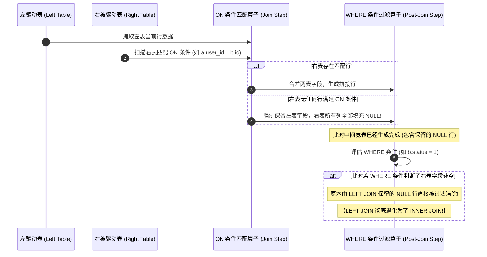

# 初级-基础多表连接查询INNER-LEFT-RIGHT与笛卡尔积避坑

在关系型数据库设计中，范式化拆表使得数据分散在不同的数据实体中。**多表连接（JOIN）**是重新聚合业务全貌的核心语法。然而，许多初级开发者由于没有吃透连接集合论的物理本质，频繁掉入**“笛卡尔积数据爆炸”**、**“`LEFT JOIN` 莫名其妙退化为 `INNER JOIN`”**以及**“`ON` 与 `WHERE` 过滤时机混淆”**的严重泥潭。本文深入拆解各类基础连接的集合交并语义、底层执行流转与生产级避坑法则。

---

## 一、核心底层机制与全景架构

### 1.1 基础连接关系文氏图（Venn Diagram）与集合论全景

```mermaid
graph TD
    subgraph 关系型多表连接四大集合形态
        A1[INNER JOIN 内连接: 仅保留两表满足 ON 条件的交集 A ∩ B]
        A2[LEFT JOIN 左外连接: 保留左表 A 全集, 右表 B 无匹配项填充 NULL]
        A3[RIGHT JOIN 右外连接: 保留右表 B 全集, 左表 A 无匹配项填充 NULL]
        A4[FULL JOIN 全外连接: 保留 A ∪ B 并集, 任意一侧无匹配填充 NULL]
    end

    subgraph 笛卡尔积陷阱 (Cartesian Product)
        B1[左表 A: 10,000 行] -->|漏写 ON 连接条件或连接条件永真| C1[笛卡尔积生成器: A × B]
        B2[右表 B: 10,000 行] -->|漏写 ON 连接条件或连接条件永真| C1
        C1 -->|生成 10,000 × 10,000 = 1 亿行中间临时数据!| D1[内存/磁盘撑爆, 服务端瞬间卡死掉线]
    end
```

### 1.2 `LEFT JOIN` 中 `ON` 与 `WHERE` 的物理过滤时序流转

这是初学者最容易发生逻辑混淆的致命分水岭：



---

## 二、源码级实战推导：四大基础连接标准语法与模拟

### 2.1 基础连接标准语法范例

```sql
-- 1. INNER JOIN (内连接: 严格两表交集)
-- 业务场景：仅查询已经分配了所属部门的员工信息
SELECT e.id, e.name, d.dept_name 
FROM t_employee e
INNER JOIN t_department d ON e.dept_id = d.id;

-- 2. LEFT JOIN (左外连接: 以左表为主)
-- 业务场景：查询所有员工，即使该员工暂未分配部门（d.dept_name 显示 NULL）
SELECT e.id, e.name, d.dept_name 
FROM t_employee e
LEFT JOIN t_department d ON e.dept_id = d.id;

-- 3. RIGHT JOIN (右外连接: 以右表为主)
-- 业务场景：查询所有部门，包括没有任何员工的空壳部门
-- 工业级规约：建议一律调整表的前后顺序改写为 LEFT JOIN，保持团队从左到右阅读习惯一致
SELECT e.id, e.name, d.dept_name 
FROM t_employee e
RIGHT JOIN t_department d ON e.dept_id = d.id;

-- 等价改写为工业级标准 LEFT JOIN:
SELECT e.id, e.name, d.dept_name 
FROM t_department d
LEFT JOIN t_employee e ON d.id = e.dept_id;

-- 4. 模拟 FULL JOIN (全外连接)
-- MySQL 原生不支持 FULL OUTER JOIN 语法，必须通过 UNION 合并 LEFT 与 RIGHT 结果集
SELECT e.name, d.dept_name FROM t_employee e LEFT JOIN t_department d ON e.dept_id = d.id
UNION
SELECT e.name, d.dept_name FROM t_employee e RIGHT JOIN t_department d ON e.dept_id = d.id;

-- 5. 自连接 (Self Join: 一张表与自身关联)
-- 业务场景：查询员工及其直属上级领导姓名（上下级关系存储在同一张表中）
SELECT 
    emp.name AS employee_name,
    IFNULL(leader.name, '公司最高决策者') AS manager_name
FROM t_employee emp
LEFT JOIN t_employee leader ON emp.manager_id = leader.id;
```

---

## 三、社招高频硬核连环追问

### 追问 1：在 `LEFT JOIN` 查询中，把过滤条件写在 `ON` 后面和写在 `WHERE` 后面，有什么本质区别？

> **考官意图**：考察候选人对外连接结果集生成原理与隐式退化机制的掌握深度。

**回答硬核要点**：
- **核心本质区别**：
  - **`ON` 是连接生成条件**：决定右表如何与左表关联。**无论 `ON` 后的条件是真是假，左表的记录行数绝对一行都不会减少**！当右表无匹配时，右表字段填充 `NULL` 返回。
  - **`WHERE` 是连接后的结果集过滤条件**：在连接宽表全部拼装完成后执行过滤，不满足 `WHERE` 的行将被无条件直接丢弃。
- **致命陷阱（LEFT JOIN 隐式退化）**：
  ```sql
  -- 场景需求：查询所有用户的订单，且订单状态必须为已支付 (status = 1)
  -- 错误写法：写在 WHERE 里
  SELECT u.name, o.order_no 
  FROM t_user u 
  LEFT JOIN t_order o ON u.id = o.user_id 
  WHERE o.status = 1;
  ```
  - **后果**：对于没有订单的用户，右表字段全是 `NULL`。执行到 `WHERE o.status = 1` 时，`NULL = 1` 判定为 `UNKNOWN` 直接被排除。结果导致“没有订单的用户”全部被误杀，**`LEFT JOIN` 彻底退化成了 `INNER JOIN`**！
  - **正确写法**：必须把针对右表的补充限制条件直接放在 `ON` 子句中：
    ```sql
    SELECT u.name, o.order_no 
    FROM t_user u 
    LEFT JOIN t_order o ON u.id = o.user_id AND o.status = 1;
    ```

---

### 追问 2：什么是“笛卡尔积（Cartesian Product）”？在生产环境中它是如何被意外触发的？

> **考官意图**：考察数据库全连接内存溢出（OOM）事故与防范意识。

**回答硬核要点**：
- **数学本质**：
  - 表 A 有 $M$ 行，表 B 有 $N$ 行。若未指定任何连接条件，两表的每一行都会无脑与另一表的所有行进行排列组合，输出行数为 $M \times N$。
- **意外触发的三大场景**：
  1. **漏写连接条件**：写成了隐式连接却漏掉 WHERE：`SELECT * FROM t_a, t_b;`；
  2. **连接条件永真**：误写成了 `ON 1 = 1`；
  3. **连接字段严重重复**：虽然写了 `ON a.type = b.type`，但 `type` 字段基数极低（例如只有 1 和 2 两种值，每个值各有 5 万行），导致产生 $50000 \times 50000 = 25$ 亿行数据！
- **破坏力**：瞬间吃光服务器内存，使 MySQL 进程陷入疯狂的临时表磁盘写入（`Creating sort index / Copying to tmp table`），连接池被完全占满，业务彻底瘫痪。

---

### 追问 3：在多表关联中，为什么大厂强制要求：**“超过 3 张表的 JOIN 必须严厉审查甚至禁止，且驱动表字段与被驱动表关联列必须有索引”**？

> **考官意图**：考察 MySQL 底层嵌套循环连接（Nested-Loop Join）算法开销与分布式解耦演进。

**回答硬核要点**：
1. **嵌套循环复杂度指数暴增**：
   - MySQL 传统执行多表 JOIN 采用**嵌套循环连接算法（NLJ / BNLJ）**。关联表数量每增加 1 张，查询优化器排列组合选择最优执行路径的代价（$N!$ 阶乘级复杂度）暴增；
   - 若关联字段未加索引，底层采用 **块嵌套循环（Block Nested-Loop Join）**，频繁全表扫描外存并填充 `join_buffer`，引发严重的 CPU 100%。
2. **微服务与架构扩展受阻**：
   - 跨多表的大型关联 SQL 将核心业务强行绑定在单台数据库的单体架构上。一旦未来需要垂直拆分微服务（拆分为用户中心、订单中心、商品中心），跨服务的 SQL JOIN 将完全无法执行，重构代价无法估量。

---

## 四、生产级避坑指南与排障 SOP

### 4.1 生产级多表连接避坑对照表

| 常见错误写法 | 潜在生产事故 | 工业级解决方案 |
| :--- | :--- | :--- |
| **`FROM a, b WHERE a.id = b.id` 逗号隐式连接** | 极易漏写 WHERE 条件导致笛卡尔积失控，且代码语义不规范 | 强制统一使用显式标准语法：`FROM a INNER JOIN b ON a.id = b.id` |
| **被驱动表的关联字段没有建立索引** | 导致外层循环驱动表的每一行都要对被驱动表执行全表扫描 | **被驱动表（右表）的关联字段必须强制建立索引** |
| **关联字段字符集或字段类型不一致** | 例如 A 表关联列是 `utf8mb4_unicode_ci`，B 表关联列是 `utf8mb4_general_ci` | 字符集隐式类型转换会导致被驱动表的索引彻底失效！必须统一字符集和字段类型 |
| **主从多对多关联导致结果行数翻倍** | 用户表与用户角色表关联，一个用户匹配多个角色导致重复统计金额 | 先在子查询中按主键执行聚合去重，再与外层表进行 1:1 关联 |

### 4.2 差集查询（找“只存在于 A 但不存在于 B 的数据”）经典优化 SOP

查找“注册了但从未下过单的用户”，严禁使用 `NOT IN`（存在 NULL 陷阱且性能低下），推荐使用 **`LEFT JOIN ... WHERE ... IS NULL`**：

```sql
-- 极速且安全的差集查询范式：反连接 (Anti-Join)
EXPLAIN 
SELECT u.id, u.user_name 
FROM mall_db.t_user u
LEFT JOIN mall_db.t_order o ON u.id = o.user_id
-- 核心：当右表主键为 NULL 时，说明该用户没有任何订单记录匹配
WHERE o.id IS NULL;
```
