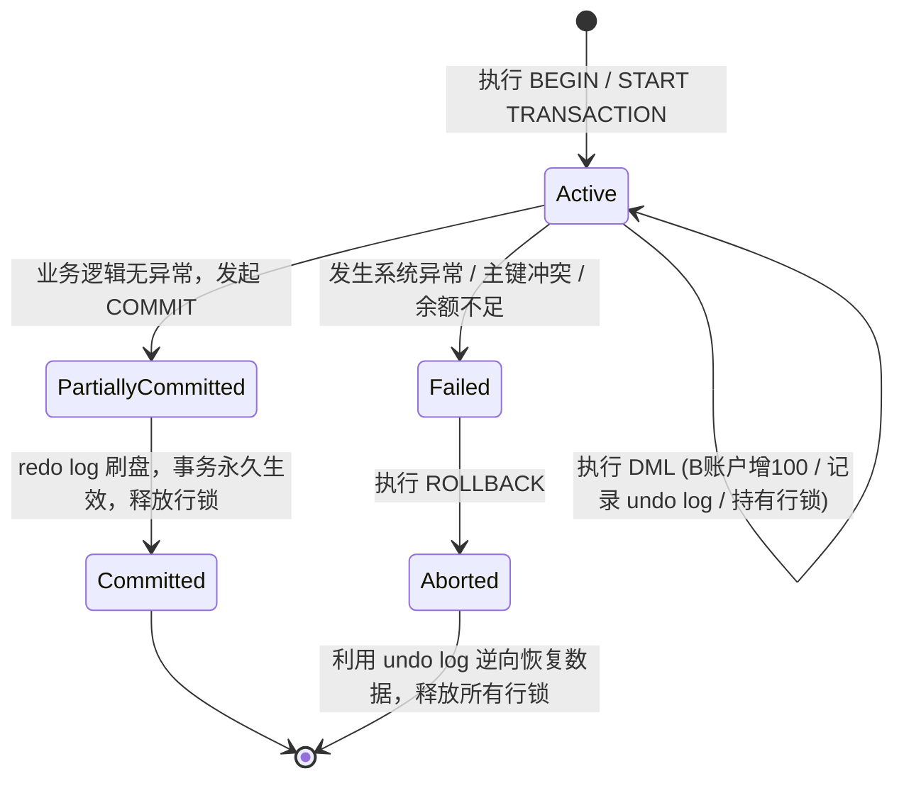

# 初级-数据库事务入门与手动提交回滚COMMIT-ROLLBACK

在银行转账、电商下单扣库存、积分结算等高频资产操作中，多个 SQL 语句必须作为一个不可分割的整体执行。**事务（Transaction）**就是关系型数据库用来保证操作“要么全部成功，要么全部失败”的核心机制。许多初级工程师只知道“加个 `@Transactional` 注解”，却不清楚 MySQL 默认的**自动提交（`autocommit`）机制**、保存点（`SAVEPOINT`）的局部回滚逻辑，以及由于忘记提交或长事务引发的线上行锁大面积阻塞灾难。

---

## 一、核心底层机制与全景架构

### 1.1 经典转账业务事务状态机生命周期图



### 1.2 自动提交模式（`autocommit`）流转对比

```mermaid
sequenceDiagram
    autonumber
    participant App as 应用程序 / 客户端
    participant Server as MySQL Server
    participant Engine as InnoDB 引擎

    rect rgb(240, 248, 255)
    Note over App,Engine: 场景 A: autocommit = 1 (默认开启自动提交)
    App->>Server: 发送单条 SQL: UPDATE t_account SET balance = balance - 100 WHERE id = 1;
    Server->>Engine: 执行更新并记录 redo/undo
    Server->>Engine: 【隐式自动触发 COMMIT!】
    Engine-->>App: 数据立即固化入盘，无法执行 ROLLBACK 回滚!
    end

    rect rgb(255, 245, 238)
    Note over App,Engine: 场景 B: 显式开启事务 (BEGIN / START TRANSACTION)
    App->>Server: 发送 BEGIN; (临时挂起单语句自动提交)
    App->>Server: UPDATE A 扣减 100;
    App->>Server: UPDATE B 增加 100;
    alt 校验通过
        App->>Server: 发送 COMMIT; -> 正式持久化
    else 业务异常
        App->>Server: 发送 ROLLBACK; -> 彻底还原现场
    end
    end
```

---

## 二、源码级实战推导：标准事务语法与保存点控制

### 2.1 基础事务控制与保存点（SAVEPOINT）语法范式

在复杂业务流程中，如果某一步非核心操作（如发送营销短信、累加赠送积分）失败，我们希望**仅回滚这部分操作，而不影响核心转账的成功**。此时可借助保存点（Savepoint）实现**局部回滚**：

```sql
-- 1. 查看与设置当前会话的自动提交状态
SHOW VARIABLES LIKE 'autocommit'; -- 默认值是 'ON' (即 1)
-- 若在连接池中手动管理，可临时关闭：SET autocommit = 0;

-- 2. 模拟电商下单扣款与赠送积分核心事务流
START TRANSACTION; -- 或使用 BEGIN;

-- 步骤 A: 扣减用户账户余额 500 元
UPDATE mall_db.t_account 
SET balance = balance - 500.00 
WHERE user_id = 10086 AND balance >= 500.00;

-- 校验若扣减失败（如余额不足受影响行数为0），业务端触发 ROLLBACK;

-- 步骤 B: 扣减商品库存 1 件
UPDATE mall_db.t_inventory 
SET stock = stock - 1 
WHERE goods_id = 9988 AND stock >= 1;

-- 步骤 C: 设立事务保存点 (Savepoint)
SAVEPOINT sp_before_points;

-- 步骤 D: 尝试为用户累加积分 (假设此处抛出了主键冲突或其他非致命异常)
INSERT INTO mall_db.t_user_points (user_id, points) VALUES (10086, 50);

-- 若仅此步骤发生异常，执行局部回滚：
-- 回滚至保存点（步骤 A 与 B 保持不变，步骤 D 被干净撤销）
ROLLBACK TO SAVEPOINT sp_before_points;

-- 步骤 E: 核心业务无误，最终正式提交事务
COMMIT; -- 释放持有的所有行锁，数据正式永久入库
```

---

## 三、社招高频硬核连环追问

### 追问 1：在 MySQL 中，如果一个事务开启了 `BEGIN`，执行了几条更新，但由于程序 Bug 既没有调用 `COMMIT` 也没有调用 `ROLLBACK`，会发生什么严重后果？

> **考官意图**：考察候选人对“长事务（Long-Running Transaction）”、行锁长时间占用与 `undo log` 膨胀的系统级认知。

**回答硬核要点**：
1. **行锁长期被霸占，引发大面积锁等待超时（Lock Wait Timeout）**：
   - 该事务更新过的所有记录行，其**排他行锁（X 锁）会一直驻留在内存中直到连接断开**！
   - 后续任何其他正常业务若需要修改这几行数据，都会被强行阻塞挂起，等待超时（默认 50 秒）后抛出 `Error 1205: Lock wait timeout exceeded`，整个业务流水线瞬间被连环堵死。
2. **`undo log` 无法清理，表空间无限膨胀**：
   - 为了给其他读操作提供 MVCC 多版本快照一致性读，该长事务启动时建立的 `ReadView` 会导致其依赖的 `undo log` 版本链**永远无法被后台 Purge 垃圾回收线程清理**。
   - 导致全局共享表空间（`ibdata1`）或独立 undo 表空间体积疯狂膨胀，迅速吃满服务器磁盘。
3. **连接被终止后的最终命运**：
   - 若客户端进程退出、连接超时断开，MySQL 内部的连接断开钩子会自动执行**隐式 `ROLLBACK`**，撤销未提交的数据并释放锁。

---

### 追问 2：如果在 Spring 中使用了 `@Transactional`，但在方法内部通过 `try-catch` 把异常吃掉了，事务还会自动回滚吗？

> **考官意图**：考察应用层事务切面（AOP）与数据库底层事务驱动的衔接机制。

**回答硬核要点**：
- **绝对不会回滚！**
- **底层驱动原理解析**：
  - Spring 的声明式事务 `@Transactional` 底层基于 AOP 动态代理机制。
  - 代理拦截器的工作逻辑是：在业务方法执行前调用 `connection.setAutoCommit(false)`；然后执行业务逻辑；**只有当捕获到未被处理的运行时异常（默认 `RuntimeException` 或 `Error`）向外抛出时，拦截器的 `catch` 块才会调用底层的 `connection.rollback()`**。
  - 如果开发者在业务代码内部使用 `try-catch` 把异常吞掉了，代理对象认为该方法已经“平稳成功执行完毕”，于是在后续正常调用 `connection.commit()`，导致脏数据被错误持久化！
- **修复方案**：
  - 方案 A：在 `catch` 块中处理完毕后，将异常重新抛出：`throw new BusinessException(...)`；
  - 方案 B：显式手动标记当前事务为回滚状态：`TransactionAspectSupport.currentTransactionStatus().setRollbackOnly();`。

---

### 追问 3：数据库突然断电关机（Crash），正在执行且未提交的事务，在下次重启时是如何被自动撤销回滚的？

> **考官意图**：考察 Crash-Safe 机制与 undo log / redo log 在实例崩溃恢复阶段的角色分工。

**回答硬核要点**：
- **恢复流水线（Crash Recovery）**：
  1. **前滚恢复（Roll-Forward）**：
     - MySQL 重启时，InnoDB 引擎首先扫描物理磁盘上的 `redo log`，将所有已经落盘的 redo 物理修改重做到内存 Buffer Pool 中，把数据恢复到断电发生瞬间的完整内存镜像（无论该事务当时是否提交）。
  2. **回滚未完成事务（Roll-Back）**：
     - 恢复完成后，InnoDB 检查事务状态槽（Transaction Slots）与 `binlog` 的两阶段提交标记；
     - 凡是在断电前**只有 undo log 和 redo log，但未完成最终提交（没有对应的 binlog 提交记录）的未决事务**，InnoDB 会利用其在内存中重建的 `undo log` 版本链，**反向执行相反的逆向逻辑操作**（例如把断电前插入的行物理删除，把修改的值还原回旧值），彻底将脏数据冲刷回滚，保证原子性。

---

## 四、生产级避坑指南与排障 SOP

### 4.1 生产级事务开发避坑清单

| 常见违规写法 | 致命后果 | 工业级最佳实践 |
| :--- | :--- | :--- |
| **在事务中调用第三方远程 RPC/HTTP 接口** | 第三方网络延迟或超时（如 5 秒），导致数据库事务被强行拉长为 5 秒的长事务，锁住行记录 | **严禁在数据库事务中进行任何网络 I/O！** 必须遵循“前置准备参数 $\rightarrow$ 调用第三方接口 $\rightarrow$ 最后开启极速纯本地事务落库”原则 |
| **大批量更新放在单个大事务中** | 一次性更新 100 万行，产生海量 undo 并在锁管理器中分配数百万锁结构，直接卡死数据库 | 采用大事务拆分（Batch Chunking）：循环每批更新 500 行，独立提交一个小事务 |
| **忘记配置事务超时时间** | 偶发死锁或资源争抢时，事务无限期挂起不退出 | 在事务框架中显式声明超时限制：`@Transactional(timeout = 10)` |

### 4.2 线上未提交长事务排查与紧急阻断 SOP

当线上遭遇大面积行锁等待告警时，使用以下系统级诊断视图秒级定位凶手：

```sql
-- 1. 查看当前处于活跃状态、且执行时间超过 10 秒的长事务（找出源头 trx_mysql_thread_id）
SELECT 
    t.trx_id,
    t.trx_state,
    t.trx_started,
    TIMESTAMPDIFF(SECOND, t.trx_started, NOW()) AS duration_seconds,
    t.trx_mysql_thread_id AS processlist_id,
    t.trx_query
FROM information_schema.innodb_trx t
WHERE TIMESTAMPDIFF(SECOND, t.trx_started, NOW()) > 10
ORDER BY duration_seconds DESC;

-- 2. 若发现某个连接持有锁超过数分钟不释放，直接强行 KILL 释放资源
KILL 10582; -- 传入上一步查出的 processlist_id
```
