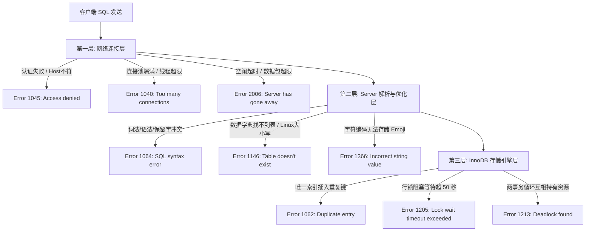

# 初级-新手常见报错排查指南与高频Error根治SOP

在日常业务开发、联调测试与生产运维中，MySQL 的报错往往具有非常明确的错误状态码（Error Code）与状态文本（SQLSTATE）。然而，很多初级工程师面对控制台喷出的英文堆栈常常手足无措，甚至盲目去重启数据库，导致现场被二次破坏。深入理解 **1045（权限被拒）、1040（连接数耗尽）、1064（语法错误）、1062（主键/唯一冲突）、1205（锁等待超时）、2006（服务端失联）、1146（表不存在/大小写敏感）** 等高频异常的物理诱因与标准排障 SOP，是研发自驱排障的必备素养。

---

## 一、核心底层机制与全景架构

### 1.1 MySQL 错误产生生命周期全景链路图

客户端发送的 SQL 语句在流转过程中，不同层级负责捕获和抛出特定类型的错误代码：



---

## 二、高频核心错误根因深度剖析与根治 SOP

### 2.1 高频十大错误诊断与排障速查表

| 错误代码 | 官方标准描述 | 真实物理诱因深度剖析 | 生产级标准根治 SOP |
| :--- | :--- | :--- | :--- |
| **`1045 (28000)`** | *Access denied for user* | 1. 密码错误；2. 用户未获得客户端当前访问 IP 的 Host 授权白名单 | 执行 `SELECT user, host FROM mysql.user;` 确认白名单，执行 `CREATE USER 'u'@'%' IDENTIFIED BY '...';` |
| **`1040 (HY000)`** | *Too many connections* | 活跃+空闲连接总数突破 `max_connections` 阈值，拒绝所有新连接 | 利用保留的超管连接登录，查看 `SHOW FULL PROCESSLIST;`，KILL 异常连接，在 `my.cnf` 中调大 `max_connections` |
| **`1064 (42000)`** | *You have an error in your SQL syntax* | 1. 字段名命中保留关键字（如 `order`, `desc`, `group`）；2. 混用了中文逗号或单引号；3. 括号未闭合 | 给保留字列名强制加上反引号（`` `order` ``），核对高亮报错附近前一个词的标点符号 |
| **`1062 (23000)`** | *Duplicate entry 'xxx' for key* | 违反了 `PRIMARY KEY` 或 `UNIQUE KEY` 唯一性，并发写入了重复数据 | 业务层捕获 `DuplicateKeyException` 做重试；或使用 `INSERT ... ON DUPLICATE KEY UPDATE` 幂等写入 |
| **`1205 (HY000)`** | *Lock wait timeout exceeded* | 目标行记录被另一个未提交的长事务持有排他锁（X 锁），等待超 50 秒超时 | 查询 `information_schema.innodb_trx` 定位持有锁的源头线程，KILL 掉僵死事务 |
| **`2006 (CR_SERVER_GONE_AWAY)`** | *MySQL server has gone away* | 1. 连接空闲时间超过了服务端的 `wait_timeout`；2. 发送的数据包（大SQL/大图片）超过了 `max_allowed_packet` | 1. 应用连接池开启心跳探测（`testWhileIdle=true`）；2. 在 `my.cnf` 中将 `max_allowed_packet` 调大至 `64M` |
| **`1366 (HY000)`** | *Incorrect string value* | 表或列采用了旧版的 `utf8`（仅支持最多 3 字节），插入了 4 字节的 Emoji 或生僻字 | 执行 `ALTER TABLE 表名 CONVERT TO CHARACTER SET utf8mb4 COLLATE utf8mb4_unicode_ci;` |
| **`1146 (42S02)`** | *Table 'xxx' doesn't exist* | Windows 开发环境表名不区分大小写，但部署到 Linux 生产机后 Linux 文件系统严格区分大小写 | 在初始化 MySQL 时在 `my.cnf` 配置 `lower_case_table_names = 1`（生产严禁中途修改！），并在代码中统一规范全小写表名 |
| **`1406 (22001)`** | *Data too long for column* | 插入的字符串实际物理长度超过了列声明的 `VARCHAR(N)` 长度 | 评估业务扩展性，适度扩容该列长度，或在应用层前置加入字符串最大截断校验 |
| **`1213 (40001)`** | *Deadlock found when trying to get lock* | 两个并发事务交替争抢彼此已经锁定的记录行，触发了死锁检测（Deadlock） | 业务代码内部规范更新顺序（按主键升序访问），大事务拆分为小事务，并在应用层添加失败重试机制 |

---

## 三、社招高频硬核连环追问

### 追问 1：在 Linux 环境下，为什么本地 Windows 或 Mac 测试正常的表名，发布到生产后报错 `Table doesn't exist`？为什么不能在生产环境随时修改 `lower_case_table_names`？

> **考官意图**：考察操作系统文件系统特性、数据字典与系统级关键参数的不可逆性。

**回答硬核要点**：
1. **操作系统底层文件系统的本质差异**：
   - Windows 与 macOS（默认 APFS）对文件路径名是**大小写不敏感（Case-Insensitive）**的；
   - Linux（Ext4/XFS）文件系统**严格区分大小写（Case-Sensitive）**。因为 MySQL 中每个表在磁盘上对应具体的物理文件名（如 `t_order.ibd`），在 Linux 下请求 `T_ORDER` 自然无法找到物理文件。
2. **为什么生产严禁中途修改 `lower_case_table_names`**：
   - 在 MySQL 8.0 中，`lower_case_table_names` **必须且只能在数据库初次初始化（`mysqld --initialize`）时指定**！
   - 一旦数据字典创建完成，在运行中的实例上强行修改该参数，会导致 MySQL 在下次启动时直接拒绝拉起并报错闪退，因为现有数据字典中记录的大小写元数据与新的匹配规则发生了不可调和的逻辑冲突。

---

### 追问 2：线上突发报错 `Error 1205: Lock wait timeout exceeded`，如何顺藤摸瓜秒级揪出“持有锁不释放的元凶 SQL”？

> **考官意图**：考察高并发锁争抢排查工具链与 `information_schema` 核心系统视图实战。

**回答硬核要点**：
- **经典三表联查排查 SOP**：
  在 MySQL 5.7+ / 8.0 中，利用系统事务与锁视图，通过以下高阶排查 SQL 秒级关联出**谁在等锁、谁持有锁、元凶是哪条 SQL**：
  ```sql
  SELECT 
      r.trx_id AS waiting_trx_id,
      r.trx_mysql_thread_id AS waiting_thread,
      r.trx_query AS waiting_query,
      b.trx_id AS blocking_trx_id,
      b.trx_mysql_thread_id AS blocking_thread,
      b.trx_query AS blocking_query,
      TIMESTAMPDIFF(SECOND, b.trx_started, NOW()) AS blocking_duration_seconds
  FROM performance_schema.data_lock_waits w
  JOIN information_schema.innodb_trx b ON b.trx_id = w.blocking_engine_transaction_id
  JOIN information_schema.innodb_trx r ON r.trx_id = w.requesting_engine_transaction_id;
  ```
  拿到 `blocking_thread` 进程 ID 后，直接运行 `KILL [blocking_thread]` 立即强行释放锁，业务秒级恢复。

---

### 追问 3：为什么会出现“明明数据库还有 100GB 内存，却突然报 `Error 1040: Too many connections`”？有哪些隐藏特权机制可以自救？

> **考官意图**：考察候选人对管理连接保留端口（Admin Port）与网络连接耗尽时的容灾手段。

**回答硬核要点**：
1. **参数与内存的脱钩**：
   - `max_connections` 只是一个业务逻辑上的计数阈值，由参数显式约束，并不代表系统物理内存真的耗尽了。
2. **MySQL 内置的“保留管理员连接（Super Privilege）”**：
   - 当连接数达到 `max_connections`（如 500）时，普通业务账号确实再也无法建立连接。
   - 但是 MySQL 官方在设计时，**专门为具备 `CONNECTION_ADMIN` 或 `SUPER` 权限的特权账号（如 `root`）额外保留了 1 个专属连接名额**（总连接数最大可达 `max_connections + 1`）。
   - 只要超级管理员在内网终端执行 `mysql -u root -p`，即可通过这最后一个特权名额顺利登入数据库，执行 `SHOW PROCESSLIST` 与 `KILL` 进行排障。
3. **MySQL 8.0 专属运维端口（Admin Port）**：
   - 在 `my.cnf` 中配置独立的管理端口：`admin_port = 33062` 与 `admin_address = 127.0.0.1`。无论 3306 业务端口被刷爆到多严重，管理端口始终提供专用网络通道，确保运维不失联。

---

## 四、生产级排障脚本与实用工具

### 4.1 生产级快速体检脚本（排查错误日志与核心状态）

```bash
# 1. 实时查看 MySQL 物理错误日志 (Error Log)
# 查看最近 100 行致命告警与错误
tail -n 100 /var/log/mysql/error.log | grep -E "ERROR|Warning"

# 2. 检查当前实例发生过的被拒绝连接统计 (Aborted Connects)
mysql -u root -p -e "SHOW GLOBAL STATUS LIKE 'Aborted_%';"
# 若 Aborted_connects 持续增长，说明有大量客户端因握手失败、密码错误或超时被强制切断

# 3. 检查当前死锁日志细节 (Deadlock Details)
mysql -u root -p -e "SHOW ENGINE INNODB STATUS\G" | grep -A 30 "LATEST DETECTED DEADLOCK"
```
