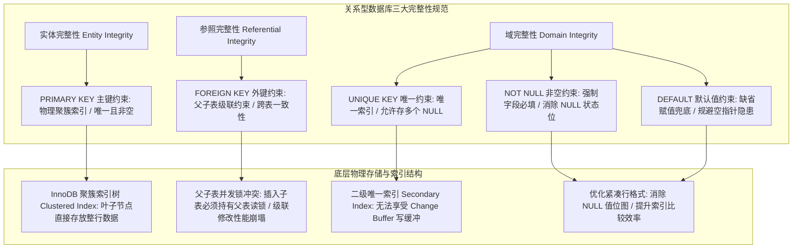
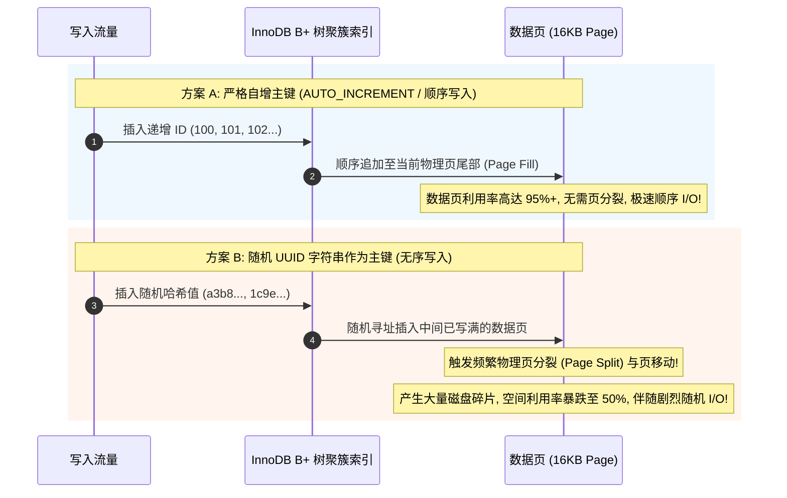

# 初级-表完整性约束主键-外键-唯一-非空与默认值实战

在关系型数据库的世界中，**数据完整性（Data Integrity）**是保证业务数据真实、精准、一致的基石。MySQL 通过一套严密的约束机制（Constraint）来防御脏数据入库。然而在工业级高并发生产环境中，约束的使用有着极严苛的权衡取舍：例如，**为什么大厂普遍强制禁止在数据库层面建立物理外键（Foreign Key）？为什么大厂强制规定所有列必须声明 `NOT NULL DEFAULT ...`？**本文深度拆解五大约束的底层实现机理与工程落地避坑原则。

---

## 一、核心底层机制与全景架构

### 1.1 关系型数据库三大完整性与五大约束全景图



### 1.2 主键选型对 B+ 树物理写入的影响



---

## 二、源码级实战推导：约束的标准声明与工业级建表规范

### 2.1 生产级建表约束范例

遵循阿里巴巴 Java 开发手册与大厂工业级规范，约束应具备以下标准定义：

```sql
CREATE TABLE mall_db.t_user_account (
    -- 1. 主键约束 (PRIMARY KEY): 推荐使用自增 BIGINT 或分布式雪花 ID
    id BIGINT UNSIGNED NOT NULL AUTO_INCREMENT COMMENT '自增主键ID',
    
    -- 2. 唯一约束 (UNIQUE KEY): 保证业务标识全局唯一
    user_name VARCHAR(32) NOT NULL DEFAULT '' COMMENT '用户登录名',
    mobile VARCHAR(16) NOT NULL DEFAULT '' COMMENT '手机号码',
    
    -- 3. 非空 (NOT NULL) + 默认值 (DEFAULT): 杜绝 NULL 值入库
    email VARCHAR(64) NOT NULL DEFAULT '' COMMENT '电子邮箱',
    account_balance DECIMAL(12, 2) NOT NULL DEFAULT 0.00 COMMENT '账户可用余额',
    vip_level TINYINT UNSIGNED NOT NULL DEFAULT 0 COMMENT '会员等级: 0普通, 1黄金, 2钻石',
    status TINYINT NOT NULL DEFAULT 1 COMMENT '状态: 1正常, 2冻结, 3注销',
    is_deleted TINYINT UNSIGNED NOT NULL DEFAULT 0 COMMENT '软删除标记: 0未删, 1已删',
    
    -- 审计字段标配
    created_at DATETIME NOT NULL DEFAULT CURRENT_TIMESTAMP COMMENT '创建时间',
    updated_at DATETIME NOT NULL DEFAULT CURRENT_TIMESTAMP ON UPDATE CURRENT_TIMESTAMP COMMENT '更新时间',
    
    -- 约束声明区
    PRIMARY KEY (id),
    UNIQUE KEY uk_user_name (user_name),
    UNIQUE KEY uk_mobile_deleted (mobile, is_deleted) -- 结合软删除的唯一索引技巧
) ENGINE=InnoDB DEFAULT CHARSET=utf8mb4 COMMENT='用户核心资产账户表';
```

---

## 三、社招高频硬核连环追问

### 追问 1：为什么《阿里巴巴 Java 开发手册》中明文规定：**“强制要求在数据库层面不得使用外键与级联，一切外键概念必须在应用层逻辑中解决”**？

> **考官意图**：考察候选人对高并发性能扩展、分库分表边界以及死锁防御的工程认知。

**回答硬核要点**：
1. **严重的并发性能与锁等待（Locking Overhead）**：
   - 插入子表数据时，为了校验外键合法性，MySQL 必须在底层自动向父表对应行申请**共享读锁（S 锁）**；
   - 在高并发写入场景下，大量事务同时并发插入子表，会导致父表记录被长期加锁阻塞，从而引发极高的锁等待超时（Lock Wait Timeout）甚至**大面积死锁**。
2. **阻碍分布式架构演进与分库分表**：
   - 外键约束仅在单机单实例同一个数据库内生效。随着业务规模扩大，一旦需要对父表与子表进行**垂直拆分或水平分库分表**（如父表在 `user_db`，子表在 `order_db`），物理外键将彻底瘫痪失效。
3. **运维与数据洗涤的巨大阻碍**：
   - 在进行数据备份恢复、历史归档数据大批量迁移（ETL）或者误删恢复时，级联删除（CASCADE DELETE）极易引发“删一行动辄全库连环清空”的重大生产灾难，且导数时必须严格按父子拓扑顺序导入，运维极其痛苦。

---

### 追问 2：为什么大厂普遍要求建表字段尽量声明 `NOT NULL DEFAULT '' / 0`？字段允许为 `NULL` 到底有什么底层物理害处？

> **考官意图**：考察 NULL 标志位存储结构、三值逻辑运算与聚合函数三大暗坑。

**回答硬核要点**：
1. **物理存储开销增大（NULL Bit Mask）**：
   - InnoDB 的 Compact / Dynamic 行格式中，若表中存在允许为 NULL 的列，行记录头部必须额外开辟 **“NULL 值列表（位图，按 8 列向上取整占用 1 个或多个字节）”**，无形中浪费存储空间。
2. **破坏聚合统计（COUNT 陷阱）**：
   - `COUNT(列名)` 会自动**忽略该列为 NULL 的记录**！
   - 例如全表 100 条数据，其中 10 条 `age` 为 NULL，执行 `SELECT COUNT(age)` 返回的是 90 而非 100，容易引发业务报表统计严重失准。
3. **索引存储与三值逻辑（Three-Valued Logic）混乱**：
   - SQL 中 `NULL` 不等于任何值，甚至 `NULL = NULL` 的判断结果也是 `UNKNOWN` 而非 `TRUE`。只能用 `IS NULL` 判空；
   - 在复合联合索引中，含有 NULL 值的列会让优化器评估索引扫描行数（Cardinality）产生偏差，影响最佳索引选择。

---

### 追问 3：一张表中已经有了 `id` 自增主键，为什么很多涉及软删除（逻辑删除）的表，唯一索引容易“失效”？如何破解？

> **考官意图**：考察复合唯一索引在逻辑删除（Soft Delete）场景下的经典冲突破局方案。

**回答硬核要点**：
- **冲突现象**：
  - 业务表有唯一字段 `mobile`。用户先注册了账号 A（`is_deleted = 0`），随后点击注销（`is_deleted = 1`）。
  - 若此时该用户再次使用同一个手机号重新注册新账号，若唯一索引仅建在 `mobile` 上，直接报错 `1062 Duplicate entry`；
  - 若将唯一索引改为复合索引 `UNIQUE (mobile, is_deleted)`：若该手机号注销过两次，由于第二次注销时 `is_deleted` 还是 1，依然会触发唯一键冲突！
- **三大工业级解决方案**：
  1. **方案 A（删除标记记录主键 ID）**：定义 `delete_token BIGINT DEFAULT 0`。未删除时固定为 0；删除时，将 `delete_token` 更新为当前行自身主键 `id` 的值，并建立 `UNIQUE (mobile, delete_token)`。因为每次删除生成的 `delete_token` 绝对唯一，彻底打破冲突！
  2. **方案 B（删除标记记录微秒时间戳）**：删除时 `deleted_at = UNIX_TIMESTAMP()`，未删除时固定为 0，建立 `UNIQUE (mobile, deleted_at)`。
  3. **方案 C（物理归档）**：软删除采用真实物理迁移，将注销记录 `INSERT INTO t_user_history` 并从原表物理 `DELETE`。

---

## 四、生产级避坑指南与排障 SOP

### 4.1 生产级约束设计避坑对照表

| 约束类型 | 错误设计模式 | 工业级解决方案 |
| :--- | :--- | :--- |
| **主键选型** | 使用 36 位随机 UUID 字符串作为主键 | 强烈推荐使用单调自增整型（`BIGINT`）或有序分布式 ID（如时间戳前缀的雪花 ID） |
| **外键关联** | 使用 `FOREIGN KEY ... ON DELETE CASCADE` | 彻底移除物理外键定义，在应用层通过 Spring 声明式事务由业务代码负责一致性联动 |
| **唯一索引** | 依赖应用层 `SELECT count(*)` 判重后再 `INSERT` | 高并发下存在严重幻读并发漏洞！必须由数据库唯一索引作为最终防御兜底，配合 `try-catch DuplicateKeyException` |
| **默认值配置**| 字符列允许为 NULL 且无默认值 | 统一声明 `NOT NULL DEFAULT ''`，整型声明 `NOT NULL DEFAULT 0` |

### 4.2 唯一索引冲突（Error 1062）线上排查与处理 SOP

当线上业务日志突发唯一索引报错时，按以下流水线定位：

```sql
-- 1. 查找重复键冲突的具象数据（如排查是哪一个手机号发生了冲突）
SELECT mobile, count(*) 
FROM mall_db.t_user_account 
GROUP BY mobile 
HAVING count(*) > 1;

-- 2. 查看表当前的所有索引定义与约束细节
SHOW INDEX FROM mall_db.t_user_account;

-- 3. 安全修复：在已存在重复数据的表上添加唯一索引前，先清洗掉旧的重复垃圾数据（保留最新 ID）
DELETE t1 FROM mall_db.t_user_account t1
INNER JOIN mall_db.t_user_account t2
WHERE t1.id < t2.id AND t1.mobile = t2.mobile;
```
