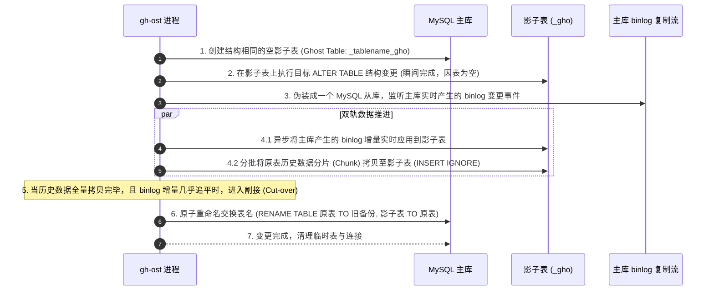

# 大表无锁 DDL 工具与生产备份恢复 SOP

在用户体量快速扩张的系统中，为千万级以上的大表新增字段、修改索引或调整列类型是极其高危的运维操作。直接在终端执行一条简单的 `ALTER TABLE`，轻则导致主从延迟数小时，重则因持有元数据写锁（MDL）阻塞业务数小时造成全站雪崩。

本篇系统拆解主流大表在线无锁 DDL 工具原理及生产级备份容灾 SOP。

---

## 1. 为什么不能在生产直接 ALTER TABLE？

在千万级数据大表上直接执行 `ALTER TABLE` 会带来三大毁灭性打击：

1. **元数据锁（MDL）雪崩**：申请 MDL 排他写锁，阻塞后续所有业务 CRUD，导致数据库连接池秒级打满。
2. **磁盘空间翻倍与 I/O 打满**：MySQL 很多 DDL（尤其是涉及修改字段类型的）底层采用 `COPY` 或 `INPLACE+Rebuild` 模式，需要将整张表的数据全量重写一份到临时文件，磁盘剩余空间不足时直接导致磁盘爆满。
3. **主从同步延迟巨大**：
   - 假设主库执行这条 DDL 花费了 30 分钟；
   - 只有当主库完全执行完并提交后，该 DDL 才会写入 binlog 并推送到从库；
   - **从库的 SQL 线程只能在从库上同样单线程苦苦回放执行这 30 分钟！**
   - 导致整个从库在接下来的 30 分钟内延迟飙升到 1800 秒，所有读写分离服务全部失效！

---

## 2. 业界两大主流无锁在线 DDL 工具深度对比

为了彻底解决大表变更难题，业界诞生了两大标杆级工具：Percona 的 **`pt-online-schema-change`** 和 GitHub 的 **`gh-ost`**。

| 对比维度 | `pt-online-schema-change` | `gh-ost` (GitHub 开源，首选推荐) |
|:---|:---|:---|
| **核心机制** | **基于 MySQL 触发器（Trigger）** | **基于 binlog 异步流式监听（无触发器！）** |
| **主库性能侵入** | 较高（每个增删改都触发额外的触发器执行） | **极低**（直接伪装成从库消费 binlog，对主库无额外负载） |
| **行锁与死锁风险**| 触发器执行会竞争主库行锁，高并发下极易死锁 | **几乎为零**（异步回放与原表完全解耦） |
| **可控性与限流** | 较弱 | **极强**（支持通过交互终端动态调整速度、随时一键暂停/恢复） |

---

## 3. gh-ost 核心架构工作机制全景

`gh-ost` 彻底摒弃了触发器方案，其底层巧妙利用了 **binlog 复制流**：

### 3.1 核心优势总结
- **不锁原表**：全程只在影子表上操作，原表持续承载正常高并发业务写入。
- **自动节流（Throttling）**：如果发现主从延迟超过指定阈值（如 1 秒）或主库 CPU 超过 80%，`gh-ost` 会自动主动暂停历史数据拷贝，优先保障业务系统稳定。

---

## 4. 生产备份恢复标准 SOP（逻辑备份 vs 物理热备）

### 4.1 备份方案选型对比
- **中小数据量（< 50GB）**：使用 **`mysqldump --single-transaction`** 逻辑备份，导出纯文本 SQL，跨版本兼容性好。
- **海量大数据（> 50GB ~ 数 TB）**：必须使用 **`Percona XtraBackup`（PXB）** 物理热备。直接基于底层 16KB 数据页文件块和活跃 redo log 进行物理拷贝，备份与恢复速度比逻辑导出快 10 倍以上！

### 4.2 生产备份与演练四大黄金军规
1. **军规一：备份文件存在不等于可以恢复！**
   - 生产环境必须定期（如每周/每月）在隔离环境进行**全流程恢复演练测试**，确保备份文件未损坏且能成功启动实例。
2. **军规二：全量备份 + 增量 binlog 归档双保险**
   - 每天夜间执行一次全量物理热备；
   - 开启 `binlog` 归档并实时同步备份到异地对象存储（如跨区域 OSS），确保能够精确恢复到故障前一秒的任意时间点（Point-in-Time Recovery）。
3. **军规三：备份动作永远优先在从库执行**
   - 绝不在承载高频写入的核心主库上跑大型备份任务，将备份 I/O 压力完全隔离在从库。
4. **军规四：生产操作三思而行**
   - 任何人工线上修复或数据订正，必须在同一个事务中遵循：“确认环境 $\to$ 备份受影响数据 $\to$ 带 `LIMIT` 小批量执行 $\to$ 核验结果 $\to$ 提交”的严格流程。
