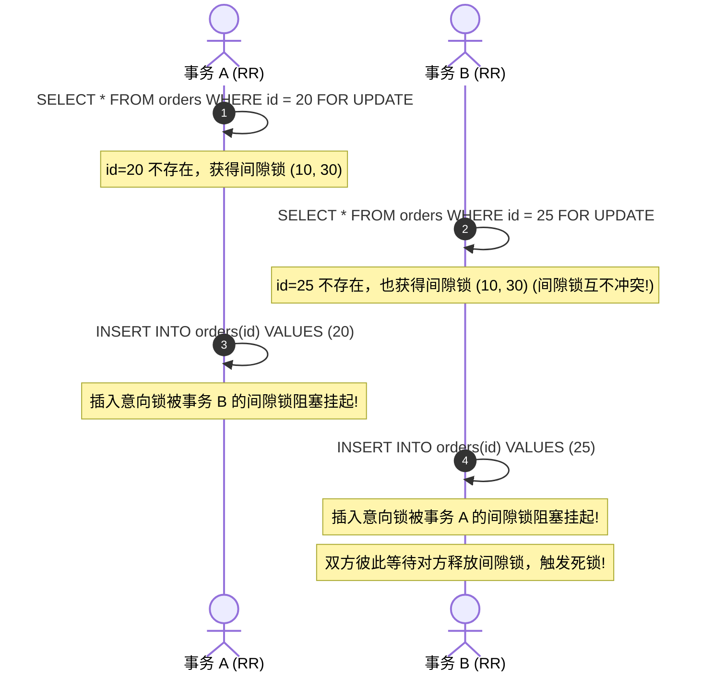

# 死锁的本质、排查与防范实战

在高并发业务系统（如电商下单、账户扣款、抢券）中，数据库死锁（Deadlock）是极容易突发的线上严重异常。在社招面试中，死锁不仅是基础理论题，更是深度考察候选人“线上故障定位与排障能力”的必问考点。

---

## 1. 死锁的本质与必要条件

死锁是指两个或多个事务在执行过程中，**因争夺相同的物理锁资源而造成的一种互相等待、若无外力介入将永久无法向前推进的僵局**。

死锁发生的四个经典必要条件：
1. **互斥条件**：资源排他，同一时刻只能有一个事务持有排他锁（X 锁）。
2. **请求与保持条件**：事务持有了部分锁资源，同时还在尝试申请新的锁。
3. **不可剥夺条件**：已经获取到的锁不能被外部强行剥夺，只能由事务自身提交或回滚释放。
4. **循环等待条件**：存在一个事务等待链，如 $T_1 \to T_2 \to T_1$ 形成闭环。

> **InnoDB 死锁检测机制（`innodb_deadlock_detect`）**：  
> InnoDB 默认开启死锁检测。通过构建事务等待图（Wait-for Graph），一旦发现存在有向环，InnoDB 会**立刻以极小的代价主动选择一个“Undo 量最小”的事务作为牺牲者进行自动回滚**，抛出错误：  
> `ERROR 1213 (40001): Deadlock found when trying to get lock; try restarting transaction`。

---

## 2. 生产高发死锁四大经典场景深度剖析

### 2.1 场景一：交叉相反顺序更新死锁（最常见）
- **业务场景**：转账或两张表关联更新。
  - 事务 A：先锁账户 1，再锁账户 2。
  - 事务 B：先锁账户 2，再锁账户 1。
- **演进过程**：
  1. 事务 A 执行 `UPDATE account SET balance=balance-100 WHERE id=1;`（成功拿到 `id=1` 的 X 记录锁）；
  2. 事务 B 执行 `UPDATE account SET balance=balance-50 WHERE id=2;`（成功拿到 `id=2` 的 X 记录锁）；
  3. 事务 A 尝试执行 `UPDATE account ... WHERE id=2;`（被事务 B 阻塞挂起）；
  4. 事务 B 尝试执行 `UPDATE account ... WHERE id=1;`（被事务 A 阻塞挂起）；
  - **闭环形成，瞬间触发死锁！**

---

### 2.2 场景二：间隙锁与插入意向锁死锁（极隐蔽，RR 级别高发）
很多人误以为只有并发 `UPDATE` 才会死锁，其实**并发 `INSERT` 在 RR 级别下极其容易发生死锁**！

假设表 `orders` 现有记录 `id: 10, 30`。两事务并发插入不存在的数据：



---

## 3. 手把手拆解 `SHOW ENGINE INNODB STATUS` 死锁日志

当生产出现死锁异常时，第一动作就是在数据库中执行：
```sql
SHOW ENGINE INNODB STATUS\G
```
找到 `------------------------ LATEST DETECTED DEADLOCK ------------------------` 区域，这是还原死锁现场的最核心线索。

### 3.1 死锁日志关键结构拆解

```text
------------------------
LATEST DETECTED DEADLOCK
------------------------
2026-11-16 16:30:00 0x70000a89c000
*** (1) TRANSACTION:
TRANSACTION 123456, ACTIVE 2 sec starting index read
mysql tables in use 1, locked 1
LOCK WAIT 3 lock struct(s), heap size 1136, 2 row lock(s)
MySQL thread id 101, OS thread handle 1231454, query id 8888 localhost root updating
UPDATE orders SET status = 2 WHERE id = 2
*** (1) WAITING FOR THIS LOCK TO BE GRANTED:
RECORD LOCKS space id 5 page no 4 n bits 72 index PRIMARY of table `mall`.`orders` 
trx id 123456 lock_mode X locks rec but not gap waiting
Record lock, heap no 3 PHYSICAL RECORD: n_fields 5; compact format;
 0: len 8; hex 8000000000000002; asc ;; (id = 2)

*** (2) TRANSACTION:
TRANSACTION 123457, ACTIVE 3 sec starting index read
MySQL thread id 102, OS thread handle 1231455, query id 8889 localhost root updating
UPDATE orders SET status = 2 WHERE id = 1
*** (2) HOLDS THE LOCK(S):
RECORD LOCKS space id 5 page no 4 n bits 72 index PRIMARY of table `mall`.`orders` 
trx id 123457 lock_mode X locks rec but not gap
Record lock, heap no 3 PHYSICAL RECORD: n_fields 5; compact format;
 0: len 8; hex 8000000000000002; asc ;; (持有 id = 2 的记录锁)
*** (2) WAITING FOR THIS LOCK TO BE GRANTED:
RECORD LOCKS space id 5 page no 4 n bits 72 index PRIMARY of table `mall`.`orders` 
trx id 123457 lock_mode X locks rec but not gap waiting
Record lock, heap no 2 PHYSICAL RECORD: n_fields 5; compact format;
 0: len 8; hex 8000000000000001; asc ;; (正在申请等待 id = 1 的记录锁)

*** WE ROLL BACK TRANSACTION (1)
```

### 3.2 读懂死锁日志的三大步骤
1. **看事务与持锁状态**：
   - 查看 `(2) HOLDS THE LOCK(S)`：清晰显示事务 2 当前已经持有 `id = 2` 的 X 记录锁（`lock_mode X locks rec but not gap`）。
2. **看等待锁对象**：
   - 事务 1 正在申请 `id = 2` 的 X 锁（被事务 2 卡住）。
   - 事务 2 正在申请 `id = 1` 的 X 锁（被事务 1 卡住）。
3. **看裁判结果**：
   - `*** WE ROLL BACK TRANSACTION (1)`：InnoDB 判定回滚事务 1，解除死锁，事务 2 顺利继续执行。

---

## 4. 生产防范与规避死锁 6 大军规

1. **严格统一业务加锁顺序**：如果业务逻辑涉及多行记录修改，在所有代码路径中必须遵循**完全一致的主键升序排序加锁规则**（例如使用 Java 将待更新的 `List<Long> ids` 执行 `Collections.sort(ids)` 后再循环更新）。
2. **尽量缩小事务范围，避免大事务**：严禁在事务中进行 RPC 远程网络调用、文件上传或慢计算；事务内只保留核心数据库更新，随用随关。
3. **隔离级别降级至 Read Committed（RC）**：如果业务允许，将隔离级别从 RR 降为 RC，全局关停绝大部分普通间隙锁，彻底杜绝间隙锁引发的并发死锁。
4. **合理建立覆盖索引，杜绝无索引更新**：确保 `UPDATE`、`DELETE` 的 `WHERE` 条件精准命中索引，避免退化为全表行锁。
5. **对热点数据单行扣减采用原子更新**：
   ```sql
   -- 推荐做法：单行原子更新，直接依赖引擎行锁排队，避免 SELECT FOR UPDATE 带来的长事务持锁
   UPDATE mall_stock SET stock = stock - 1 WHERE product_id = 100 AND stock >= 1;
   ```
6. **应用端具备死锁自动重试机制**：由于高并发下死锁无法 100% 理论绝迹，后端业务框架（如 Spring Retry）对于死锁异常（`MySQLTransactionRollbackException`）应具备退避重试（Backoff Retry）机制，保证用户端感知无抖动。
