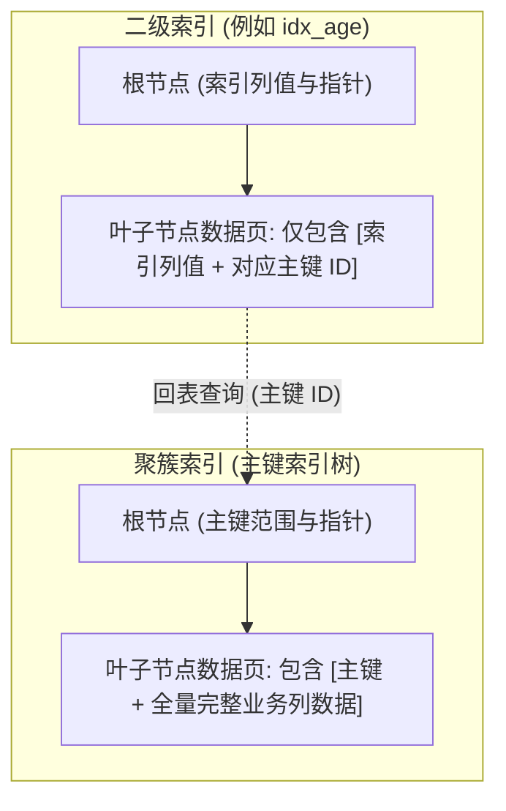

# 索引分类物理组织与查询加速机制

索引不仅是“加快查询的工具”，更深刻地决定了数据在磁盘上的物理组织形式。理解聚簇索引、二级索引、覆盖索引、最左匹配与索引下推（ICP）的底层机制，是写出极致性能 SQL 的核心素养。

---

## 1. 索引的分类与物理组织形态

在 InnoDB 存储引擎中，索引就是数据本身。按物理存储形态划分，索引主要分为 **聚簇索引** 和 **二级索引**。



### 1.1 聚簇索引（Clustered Index / 主键索引）
- **特点**：B+ 树的叶子节点直接存放**完整的数据行（包含该表的所有列字段）**。“索引即数据，数据即索引”。
- **唯一性**：一张 InnoDB 表**只能有且仅有 1 个聚簇索引**。
- **构建规则**：
  1. 若显式声明了 `PRIMARY KEY`，该主键即为聚簇索引。
  2. 若无主键，选择表中第一个声明为 `NOT NULL` 的 `UNIQUE` 索引作为聚簇索引。
  3. 若两者皆无，InnoDB 会自动在后台创建一个 6 字节的隐式自增列 `DB_ROW_ID` 作为聚簇索引。

### 1.2 二级索引（Secondary Index / 辅助索引 / 非聚簇索引）
- **特点**：叶子节点**不存放完整的行数据**，而只存放**【该索引列的值 + 对应记录的聚簇索引主键值】**。
- 一张表可以建立多个二级索引（如联合索引、前缀索引）。

---

## 2. 查询加速与执行机制核心三要素

### 2.1 回表（Table Lookup）与覆盖索引（Covering Index）

#### 什么是回表？
当通过二级索引查询数据时：
```sql
-- 假设在 age 列上建立了二级索引 idx_age
SELECT id, name, age, phone FROM users WHERE age = 25;
```
1. 先检索 `idx_age` 二级索引树，在叶子节点中找到 `age = 25` 对应的行，获取其主键 `id = 1001`；
2. **拿着主键 `id = 1001`，重新去聚簇索引树从根节点走一遍查找**，最终在聚簇索引叶子页中提取整行（拿到 `name` 和 `phone`）。
- 这个**拿着主键重回主键索引树抓取完整数据的过程，被称为“回表”**。回表意味着产生额外的离散随机磁盘 I/O。

#### 什么是覆盖索引？
如果一条查询语句所需要返回的所有列（SELECT 列表）以及条件列（WHERE 列表），**全部已经包含在当前的二级索引树中**，那么执行引擎就不需要再回表：
```sql
-- 假设建立了联合索引 idx_age_name (age, name)
SELECT id, age, name FROM users WHERE age = 25;
```
- 在 `idx_age_name` 树的叶子节点上，天然存在 `age`、`name` 以及主键 `id`。
- 执行器直接从二级索引叶子节点提取数据并返回，**回表次数为 0**！
- 在 `EXPLAIN` 执行计划中，`Extra` 列会明确显示 **`Using index`**（代表命中覆盖索引）。

---

### 2.2 最左前缀匹配原则全场景深度剖析

对于多列联合索引（如 `INDEX idx_a_b_c (a, b, c)`），B+ 树在物理排序时是严格按照**从左到右依次排序**的：
- 先按 `a` 绝对有序排序；
- 只有在 `a` 相等的情况下，`b` 才有序；
- 只有在 `a` 和 `b` 同时相等的情况下，`c` 才有序。

因此，索引的命中严格遵循**最左前缀匹配**：

```sql
-- 联合索引: idx_a_b_c (a, b, c)

-- 1. 全值匹配：完美命中全部索引 (a, b, c 顺序被优化器自动纠偏)
SELECT * FROM t WHERE a = 1 AND b = 2 AND c = 3; -- 命中 a, b, c

-- 2. 命中部分最左前缀
SELECT * FROM t WHERE a = 1;                     -- 命中 a
SELECT * FROM t WHERE a = 1 AND b = 2;           -- 命中 a, b

-- 3. 跨列破坏最左前缀
SELECT * FROM t WHERE a = 1 AND c = 3;           -- 仅命中 a，c 无法用于树查找索引走法

-- 4. 彻底未命中最左列：完全无法走索引 (全表扫描)
SELECT * FROM t WHERE b = 2 AND c = 3;           -- 索引彻底失效

-- 5. 范围查询打断后续列
SELECT * FROM t WHERE a = 1 AND b > 2 AND c = 3; -- a 走索引，b 走范围索引，c 无法走索引树查找！
```

> **核心军规**：建立联合索引时，必须将**区分度最高（唯一性最高）、等值查询频次最高**的列放在最左侧！

---

### 2.3 索引下推（Index Condition Pushdown, ICP）

这是 MySQL 5.6 引入的划时代查询优化技术。

#### 场景设定：
存在联合索引 `idx_name_age (name, age)`，执行如下查询：
```sql
SELECT * FROM users WHERE name LIKE '张%' AND age = 30;
```
由于 `name LIKE '张%'` 是范围模糊查询，根据最左原则，`age` 列无法用于在 B+ 树上进行二分查找。

#### 没有 ICP 时（MySQL 5.5 及之前）：
1. 存储引擎层根据 `name LIKE '张%'` 找到所有符合条件的二级索引记录（假设有 10 万个姓张的人）；
2. **盲目发起 10 万次回表**，将 10 万行完整数据全部读取并传递给 Server 层；
3. Server 层在内存中逐行过滤 `age = 30` 的记录。**99% 的回表 I/O 是完全浪费的！**

#### 开启 ICP 时（MySQL 5.6+ 默认开启）：
1. 存储引擎层在遍历 `idx_name_age` 索引树时，由于索引叶子节点上**已经同时存在 `age` 字段**；
2. 存储引擎层在**发起回表之前，先在索引内部判断 `age 是否等于 30`**；
3. 只有同时满足 `name LIKE '张%'` 且 `age = 30` 的极少数记录，才会发起回表！
- **效果**：回表次数直接从 10 万次骤降到几百次，性能提升数十倍。
- 在 `EXPLAIN` 执行计划中，`Extra` 列会显示 **`Using index condition`**。

---

## 3. 普通索引 vs 唯一索引：Change Buffer 机制与选型权衡

在业务建表时，对于具有唯一约束的字段（如身份证号、工号），是建普通二级索引好，还是建唯一索引好？

### 3.1 读性能对比：微乎其微
- 普通索引找到第一条记录后，需要沿着链表再向后读取一条以确认是否有重复值。
- 唯一索引找到第一条即可立即停止。
- 由于记录在同一个 16KB 内存数据页内，多读一次指针的 CPU 耗时几乎可以忽略不计。

### 3.2 写性能对比：Change Buffer 的巨大威力
- **什么是 Change Buffer？**
  当需要更新或插入一条记录时，若目标数据页**不在 Buffer Pool 内存中**：
  - 如果是**普通索引**：InnoDB **不需要**立刻从磁盘将数据页读取到内存，而是直接将这次更新操作缓存在 **`Change Buffer`** 内存中，立即向应用返回写入成功！等未来该数据页被真正读取时（Merge 操作），再将变更合并进去。写性能极其恐怖。
  - 如果是**唯一索引**：为了校验唯一性，InnoDB **必须无条件将目标页从磁盘加载到内存**，无法享受 Change Buffer 带来的写加速！

> **生产权衡**：
> - 读多写少、业务强要求去重的场景，建**唯一索引**（防止并发脏写）。
> - 归档日志、流水记录、写多读少场景，优先使用**普通索引**以最大化发挥 Change Buffer 的异步写缓冲威力。
