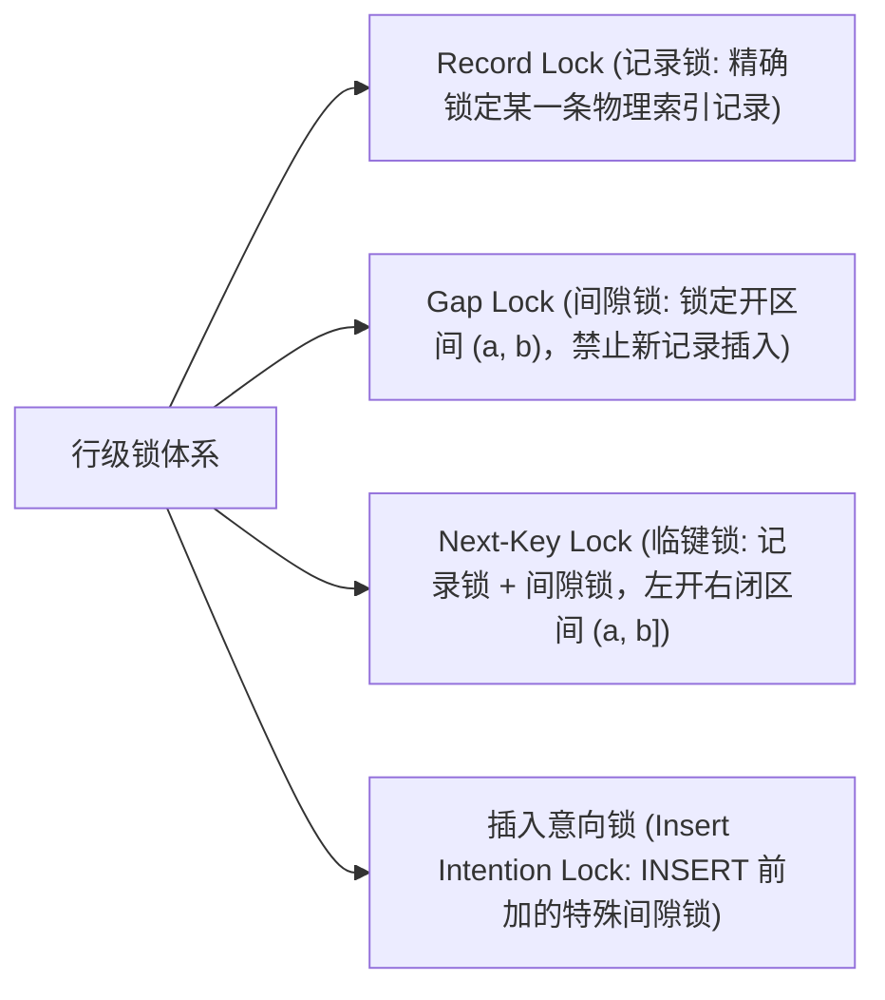

# 行锁分类：记录锁、间隙锁与 Next-Key Lock

在 MySQL 的 InnoDB 存储引擎中，行锁（Row-Level Lock）并不是直接锁定磁盘物理行的某几个字节，**行锁的本质是锁在“索引项”上的**！

理解记录锁、间隙锁、Next-Key Lock 与插入意向锁的区别及其互斥矩阵，是搞定高并发事务冲突与加锁规则的关键基石。

---

## 1. InnoDB 四大行级锁核心概念

InnoDB 的行级锁主要有 4 种物理表现形态：



### 1.1 记录锁（Record Lock）
- **锁定范围**：仅锁定**单条索引记录本身**。
- **示例**：
  ```sql
  SELECT * FROM users WHERE id = 1 FOR UPDATE; -- 精确锁住 id = 1 这条记录
  ```
- **互斥特性**：标准的排他锁（X）或共享锁（S）。两个事务不能同时持有同一行的 X 锁。

### 1.2 间隙锁（Gap Lock）
- **锁定范围**：锁定**两个索引记录之间的开区间 `(a, b)`**，不包含记录边界本身。
- **核心职责**：**唯一的目的就是阻止其他事务向这个间隙中执行 `INSERT`，从而在 RR 隔离级别下消灭幻读**。
- **核心特性：间隙锁之间互不互斥！**
  - 事务 A 执行 `WHERE id BETWEEN 5 AND 10 FOR UPDATE`，锁定了 `(5, 10)` 间隙。
  - 事务 B 同样可以对 `(5, 10)` 加上间隙锁。
  - **两者可以和谐共存，因为间隙锁的目标是“防守新插入”，而不是“限制别人读取或加锁防守”**。

### 1.3 临键锁（Next-Key Lock）
- **定义**：**`Next-Key Lock = Record Lock + 记录前面的 Gap Lock`**。
- **锁定范围**：**前开后闭区间 `(a, b]`**。
- **InnoDB 默认加锁单位**：在可重复读（Repeatable Read）隔离级别下，**InnoDB 的基本加锁单位始终是 Next-Key Lock**！只有在特定满足优化条件时，才会退化为单纯的“记录锁”或“间隙锁”。

### 1.4 插入意向锁（Insert Intention Lock）
- **定义**：这是一种特殊的间隙锁，仅在事务执行 **`INSERT` 操作之前由引擎自动加上**。
- **工作机制**：如果准备插入的位置当前存在其他的 `Gap Lock` 或 `Next-Key Lock`，则 `INSERT` 必须挂起等待，并在该间隙上标记一个“插入意向锁”，表示“我想往这个区间插数据，正在排队等待间隙释放”。
- **并发能力**：如果多个事务向同一个间隙的不同位置插入数据，插入意向锁之间**互不排斥**，可以高并发并发写入。

---

## 2. 行级锁互斥兼容矩阵全景

在评估并发冲突时，必须清楚不同行锁之间的互斥规则：

| 当前已持有锁 \ 申请加锁 | Record Lock (X) | Gap Lock (X/S) | Next-Key Lock (X) | 插入意向锁 (Insert Intention) |
|:---|:---:|:---:|:---:|:---:|
| **Record Lock (X)** | **冲突（排队）** | 兼容 | **冲突（排队）** | 兼容 |
| **Gap Lock (X/S)** | 兼容 | **兼容** | 兼容 | **冲突（被阻塞）** |
| **Next-Key Lock (X)**| **冲突（排队）** | **兼容** | **冲突（排队）** | **冲突（被阻塞）** |
| **插入意向锁 (Insert)** | 兼容 | 兼容 | 兼容 | **兼容** |

> **关键规则提炼**：
> 1. **间隙锁（Gap）唯一的敌人是“插入意向锁”**！只要某个区间被加了间隙锁，任何往这个区间插数据的 `INSERT` 就会被硬生生卡住。
> 2. **间隙锁和间隙锁之间永远不冲突**！这就是导致死锁的高危温床（多个事务都对同一区间持有 Gap 锁，随后双方都尝试在该区间执行 INSERT，彼此等待对方释放 Gap 锁，瞬间爆发死锁）。

---

## 3. 生产实践：区间范围判定案例

假设表 `test` 中现有主键 `id` 数据为：`10, 20, 30`。

在 RR 隔离级别下，整张表的所有潜在 Next-Key Lock 区间划分如下：
1. $(-\infty, 10]$
2. $(10, 20]$
3. $(20, 30]$
4. $(30, +\infty)$（在物理上由虚拟的 `Supremum` 记录代表上限）

### 案例演练：
- 事务 A 执行：`SELECT * FROM test WHERE id = 20 FOR UPDATE;`
  - 针对唯一主键等值查询且记录存在，Next-Key Lock `(10, 20]` 退化为**记录锁：只锁 `id = 20`**。
  - 其他事务依然可以自由向 `(10, 20)` 和 `(20, 30)` 插入数据。
- 事务 A 执行：`SELECT * FROM test WHERE id = 15 FOR UPDATE;`
  - `id = 15` 在表中不存在！Next-Key Lock 寻找落在 $(10, 20]$ 区间，因记录不存在，退化为**间隙锁：锁定 `(10, 20)`**。
  - 此时任何事务向 `id = 11 ~ 19` 插入数据都会被直接阻塞挂起！

---

## 4. 社招高频面试追问

### Q1：为什么 RC 隔离级别下极少看到间隙锁？
- 在 **Read Committed（读已提交）** 隔离级别下，MySQL 默认只保留 Record Lock（记录锁），**全局关闭了普通的间隙锁和 Next-Key Lock**（除非存在外键约束检查或唯一键冲突）。
- 这一特性使得 RC 级别下的并发写吞吐量远高于 RR，死锁频率也大大降低。

### Q2：`SELECT * FROM t FOR UPDATE` 没有命中任何索引，会加什么锁？
- 如果查询条件没有索引，MySQL 只能进行全表扫描。
- 在 **RR 隔离级别**下，存储引擎会对**全表的所有主键记录加上 X 记录锁，并且对所有主键间隙加上间隙锁**！相当于整张表被彻底锁死，期间其他任何事务的增删改全部无法进行，甚至查询也会被阻塞！
- 在 **RC 隔离级别**下，虽然扫描阶段也会锁行，但在 Server 层判断不符合条件后，会**立刻提前释放非匹配行的行锁**（半一致性读特性），影响范围大幅减小。
