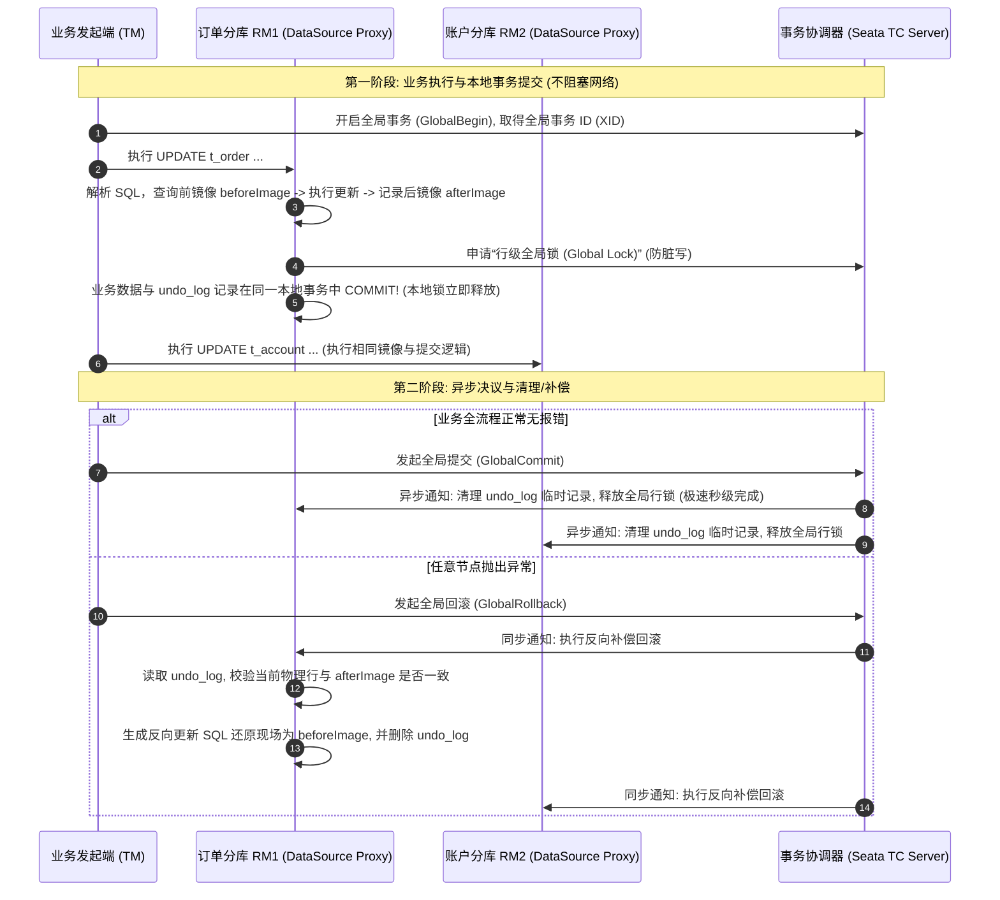

# 资深-分库分表分布式事务Seata与Saga及柔性事务落地

在单体数据库时代，依靠 InnoDB 的 ACID 特性即可轻松实现转账或订单结算的数据一致性。然而，随着海量业务突破单库吞吐瓶颈，一旦对数据库执行了**垂直拆分（拆微服务库）或水平分库分表（Sharding）**，原有的本地数据库事务机制瞬间土崩瓦解：两个更新语句分别打在不同的物理数据库实例上，任何单侧的异常都会引发不可逆的数据撕裂。深入理解从**刚性事务（XA/2PC）**到**柔性事务（BASE 理论、Seata AT/TCC、Saga 与本地消息表）**的底层演进与实战落地，是架构师的核心硬核考点。

---

## 一、核心底层机制与全景架构

### 1.1 分布式事务主流解决方案全景技术矩阵

```mermaid
graph TD
    DistTx[分布式事务解决方案架构] --> Strict[刚性事务 (CP 强一致)]
    DistTx --> Soft[柔性事务 (AP 最终一致性)]

    Strict --> XA[MySQL 原生 XA 协议 / 2PC<br/>跨网络全局锁 / 性能差 / 资源长期锁定]

    Soft --> AT[Seata AT 模式: 无侵入 / 全局锁 + undo_log 物理镜像补偿]
    Soft --> TCC[Seata TCC 模式: 业务侵入高 / Try-Confirm-Cancel 两阶段提交]
    Soft --> Saga[Saga 状态机模式: 适合长事务与外部老系统 / 正向操作 + 逆向补偿]
    Soft --> Msg[可靠消息最终一致性: 本地消息表 / RocketMQ 事务消息]
```

### 1.2 Seata AT 模式底层二阶段提交与补偿执行时序

Seata AT 模式之所以能够做到业务代码“零侵入”，其核心在于通过代理数据源（DataSource Proxy），在业务执行 DML 的同时**自动生成前镜像（beforeImage）与后镜像（afterImage）**并写入专属的 `undo_log` 表：



---

## 二、源码级实战推导：Seata AT 核心脏写防御与 undo_log 表

### 2.1 生产级 `undo_log` 表结构定义

在每一个分片物理数据库中，必须前置初始化 Seata 专用的回滚日志表：

```sql
CREATE TABLE IF NOT EXISTS mall_db.undo_log (
    id BIGINT UNSIGNED NOT NULL AUTO_INCREMENT,
    branch_id BIGINT NOT NULL COMMENT '分支事务ID',
    xid VARCHAR(128) NOT NULL COMMENT '全局事务XID',
    context VARCHAR(128) NOT NULL COMMENT '上下文',
    rollback_info LONGBLOB NOT NULL COMMENT '前镜像与后镜像序列化二进制数据',
    log_status INT NOT NULL COMMENT '状态: 0正常, 1防御性回滚',
    log_created DATETIME(6) NOT NULL COMMENT '创建时间',
    log_modified DATETIME(6) NOT NULL COMMENT '修改时间',
    PRIMARY KEY (id),
    UNIQUE KEY uk_undo_log (xid, branch_id)
) ENGINE=InnoDB DEFAULT CHARSET=utf8mb4 COMMENT='Seata AT模式事务补偿日志表';
```

---

### 2.2 本地消息表（Outbox Pattern）高可靠异步最终一致性设计

对于跨业务域、跨团队、吞吐量极端庞大且容忍秒级延迟的交易链路，**本地消息表模式**是架构稳定性最高、无任何分布式死锁隐患的终极方案：

```sql
-- 在业务主库中设计事务 Outbox 消息表 (与业务订单在同一个本地事务写入)
CREATE TABLE mall_db.t_transaction_outbox (
    id BIGINT UNSIGNED NOT NULL AUTO_INCREMENT,
    biz_type VARCHAR(32) NOT NULL COMMENT '业务类型: ORDER_PAY_SUCCESS',
    biz_id VARCHAR(64) NOT NULL COMMENT '业务关联流水号',
    payload JSON NOT NULL COMMENT '事件上下文Payload',
    status TINYINT NOT NULL DEFAULT 0 COMMENT '投递状态: 0待发送, 1发送成功, 2已死信',
    retry_count INT NOT NULL DEFAULT 0 COMMENT '重试投递次数',
    next_retry_time DATETIME NOT NULL COMMENT '下次重试时间',
    created_at DATETIME NOT NULL DEFAULT CURRENT_TIMESTAMP,
    updated_at DATETIME NOT NULL DEFAULT CURRENT_TIMESTAMP ON UPDATE CURRENT_TIMESTAMP,
    PRIMARY KEY (id),
    KEY idx_status_retry (status, next_retry_time)
) ENGINE=InnoDB DEFAULT CHARSET=utf8mb4 COMMENT='本地事务消息表(出件箱)';
```

**执行时序推导**：
1. **订单支付本地事务**：`UPDATE t_order SET status = 1` 与 `INSERT INTO t_transaction_outbox` 处于同一个 MySQL 本地事务中，**100% 保证本地业务与待发消息同生共死**；
2. **后台异步扫表发 MQ**：定时任务拉取 `status = 0` 的消息投递至 RocketMQ；
3. **下游积分服务消费**：保证幂等消费后，调用接口将状态置为 `status = 1`。

---

## 三、社招高频硬核连环追问

### 追问 1：在 Seata AT 模式下，什么是“脏写（Dirty Write）”？Seata 是如何利用“全局锁（Global Lock）”彻底防御脏写的？

> **考官意图**：考察分布式并发控制、隔离级别穿透风险与悲观锁设计。

**回答硬核要点**：
- **脏写灾难场景**：
  - 分布式事务 A 开启，将价格从 100 改为 80（一阶段本地事务直接 COMMIT 释放了本地行锁）；
  - 此时一个普通的非 Seata 管理的后台更新 SQL 或并发事务 B 进来，将价格直接从 80 改为了 60 并提交；
  - 随后事务 A 发生异常触发二阶段回滚，如果事务 A 依据 `undo_log` 中的前镜像无脑将价格强制还原回 100，**事务 B 的更新就会被无情覆盖抹杀（造成严重脏写）**！
- **Seata 的全局锁防御机制**：
  1. 在一阶段本地事务提交前，Seata 必须先向 TC 服务器申请该记录主键的**全局行锁（Global Lock）**；
  2. 若未能获取全局锁，本地事务会重试等待，直到超时自动回滚，禁止提交；
  3. 二阶段回滚时，Seata 会比对当前数据库中该行的真实值与 `afterImage`（后镜像）；若二者不相等，判定为发生脏写，立即阻断自动回滚，转入人工介入报警，杜绝数据错乱。

---

### 追问 2：为什么 MySQL 原生提供的 XA 两阶段提交（刚性事务）在互联网高并发生产中几乎被全面禁用？

> **考官意图**：考察传统 2PC 协议性能天花板与同步阻塞死穴。

**回答硬核要点**：
1. **同步阻塞与锁资源长期驻留（Resource Lock）**：
   - XA 在一阶段 `XA PREPARE` 之后，数据库在存储引擎内部必须**牢牢持有该行记录的排他行锁与读写资源**，等待全局事务协调者（Coordinator）发送 `XA COMMIT`。
   - 跨网络 RPC 通信一旦发生网络抖动、延迟或协调者宕机，整个数据库的行锁将被长达数分钟甚至数小时冻结挂起，导致后续所有并发访问全部超时崩溃。
2. **吞吐量呈断崖式下跌**：
   - 测试表明，开启 XA 事务后，MySQL 的 QPS/TPS 相比普通本地事务下降 **70%~90%**，根本无法承受“双十一”等大促瞬时高并发流量冲击。

---

### 追问 3：Saga 模式与 TCC 模式有什么核心区别？在什么业务场景下架构师必须选 Saga？

> **考官意图**：考察分布式长事务模型设计与异构系统集成选型。

**回答硬核要点**：
- **核心区别**：
  - **TCC 模式**：需要侵入业务代码实现 `Try`（资源预留/冻结）、`Confirm`（真正扣除）、`Cancel`（释放预留）。业务粒度极细，强依赖服务提供方配合改造；
  - **Saga 模式**：基于**状态机或编排引擎**，每个微服务仅提供一个正向操作接口（$T_1, T_2, ...$）和一个对应的补偿操作接口（$C_1, C_2, ...$）。一旦第 $K$ 步失败，状态机逆向依次调用 $C_{k-1}, ..., C_1$ 执行业务级对冲冲正。
- **必须选 Saga 的典型场景**：
  - **跨企业、跨机构的超长外部链路**（如调用银行转账通道、调用中国民航中航信机票预订系统）：外部第三方接口绝不可能为你暴露底层的 `Try/Cancel` 资源冻结接口，只能调用其正式接口，并在失败时调用其退款/撤回接口进行补偿。

---

## 四、生产级避坑指南与排障 SOP

### 4.1 分布式事务生产避坑矩阵

| 架构模式 | 致命隐患 | 工业级解决方案 |
| :--- | :--- | :--- |
| **Seata AT 模式** | 高并发热点行（如秒杀爆品库存）争抢全局锁，导致 TC 成为严重瓶颈 | 针对热点高并发扣库存业务降级使用 **Redis Lua 脚本原子预扣**，异步消息同步数据库 |
| **TCC 模式** | **空回滚**（Try 未执行，Cancel 先到达）与 **悬挂**（Cancel 执行完，迟到的 Try 才到达） | 在 TCC 事务控制表中引入幂等标记，Try 执行前检查 Cancel 记录，Cancel 执行前检查 Try 记录 |
| **本地消息表** | 定时任务高频全表扫描 `t_transaction_outbox` 引发主库 CPU 飙升 | 消息表建立复合索引 `(status, next_retry_time)`，历史已成功数据每日归档清理 |

### 4.2 本地消息表重试机制代码模板

```java
// 定时调度器：轮询待投递且到达重试时间的消息
@Scheduled(fixedDelay = 2000)
public void retryOutboxMessages() {
    List<OutboxMsg> pendingMsgs = outboxMapper.selectPending(LocalDateTime.now(), 100);
    for (OutboxMsg msg : pendingMsgs) {
        try {
            // 投递至 RocketMQ
            rocketMQTemplate.syncSend(msg.getTopic(), msg.getPayload());
            // 标记成功并持久化
            outboxMapper.updateStatus(msg.getId(), Status.SUCCESS);
        } catch (Exception e) {
            // 指数退避算法: 下次重试时间递增 (2s, 4s, 8s, 16s...)
            int retries = msg.getRetryCount() + 1;
            if (retries >= 5) {
                outboxMapper.markDeadLetter(msg.getId()); // 转入死信人工报警
            } else {
                long delaySeconds = (long) Math.pow(2, retries);
                outboxMapper.updateRetry(msg.getId(), retries, LocalDateTime.now().plusSeconds(delaySeconds));
            }
        }
    }
}
```
