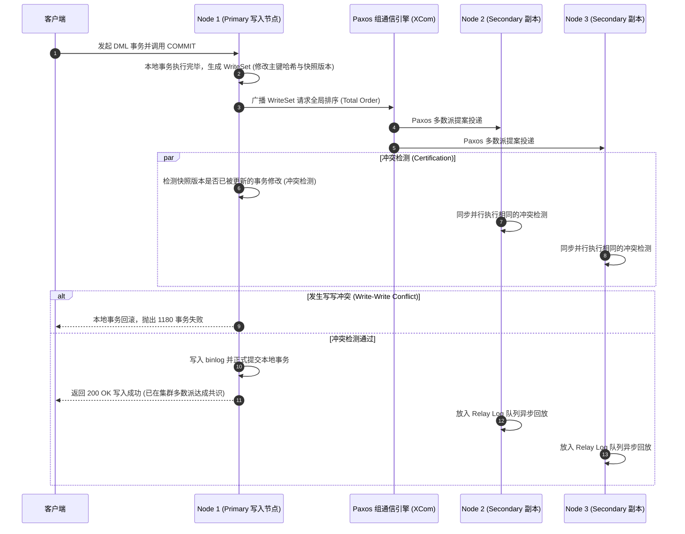

# 资深-高可用复制架构Orchestrator与组复制MGR选型实战

在金融级与互联网核心数据库架构中，单点故障（SPOF）是绝对不可容忍的底线事故。MySQL 高可用架构经历了从早期的“Keepalived + 双主”、到广泛应用的“MHA（Master High Availability）”、再到现代化的“Orchestrator 智能拓扑治理”与官方原生“**MGR（MySQL Group Replication 组复制）**”的代际演进。深入理解基于 Raft 与 Paxos 分布式共识协议的高可用选型、自动故障转移（Failover）时序与防脑裂（Split-Brain）机制，是资深数据库架构师的核心标杆。

---

## 一、核心底层机制与全景架构

### 1.1 主流高可用架构代际演进对比

```mermaid
graph TD
    subgraph 传统时代: MHA 架构 (逐步淘汰)
        A1[MHA Manager 节点] -->|SSH 探测与 Perl 脚本| B1[Master 主库]
        A1 -->|SSH 远程调用| B2[Slave 1]
        A1 -->|SSH 远程调用| B3[Slave 2]
        A1 -->|VIP 漂移 / 依赖外部脚本| C1[脑裂隐患: 偶发双主双写导致数据永久损坏]
    end

    subgraph 现代化: Orchestrator 智能拓扑架构
        D1[Orchestrator Raft 集群 3节点] -->|HTTP / 直接 SQL 探测| E1[拓扑拓扑状态图]
        D1 -->|崩溃自动感知| E2[智能重连下游从库 / 修正 GTID 位点]
        D1 -->|Raft 投票共识| E3[防脑裂安全 Failover 挂载新主]
    end

    subgraph 下一代金融级: MySQL MGR 组复制 (原生强一致)
        F1[MySQL Node 1] <--->|Paxos / XCom 协议组通信| F2[MySQL Node 2]
        F2 <--->|Paxos / XCom 协议组通信| F3[MySQL Node 3]
        F1 & F2 & F3 -->|多数派 Quorum 确认后统一提交| G1[RPO=0 绝不丢数据 / 秒级自愈]
    end
```

### 1.2 MGR 事务原子广播与全序冲突检测（Certification）时序

MGR 彻底摒弃了传统半同步复制（Semi-Sync）在存储引擎层之后的低效等待，将一致性共识提前到了**事务提交前的组通信阶段**：



---

## 二、源码级实战推导：MGR 与 Orchestrator 核心选型配置

### 2.1 生产级 MGR 单主模式（Single-Primary）核心配置

生产环境强烈推荐采用**单主模式（Single-Primary）**，避免多主并发写写冲突导致的高频事务回滚：

```ini
[mysqld]
# 1. 基础配置
server_id = 1
binlog_format = ROW
binlog_checksum = NONE
gtid_mode = ON
enforce_gtid_consistency = ON
master_info_repository = TABLE
relay_log_info_repository = TABLE

# 2. MGR 核心插件加载
plugin-load-add = group_replication.so

# 3. 组复制拓扑与网络参数
group_replication_group_name = "aaaaaaaa-aaaa-aaaa-aaaa-aaaaaaaaaaaa" # 集群唯一 UUID
group_replication_start_on_boot = OFF                                 # 严禁开机自启，防止误加入孤岛集群
group_replication_local_address = "192.168.1.101:33061"               # XCom 通信专用端口
group_replication_group_seeds = "192.168.1.101:33061,192.168.1.102:33061,192.168.1.103:33061"
group_replication_bootstrap_group = OFF

# 4. 模式选型与流控
group_replication_single_primary_mode = ON                            # 开启单主模式
group_replication_enforce_update_everywhere_checks = OFF

# 5. 多数派节点存活检测与网络分区防御 (超时 5 秒判定离线)
group_replication_member_expulsion_timeout = 5
```

---

## 三、社招高频硬核连环追问

### 追问 1：为什么传统 MHA 架构会面临“脑裂（Split-Brain）”的致命风险？它与基于 Raft 的 Orchestrator 有何本质区别？

> **考官意图**：考察分布式脑裂成因、网络分区（Network Partition）与多数派选主机制。

**回答硬核要点**：
1. **MHA 缺乏分布式共识（Single-Point Failure）**：
   - MHA Manager 节点通常是单节点部署。如果 MHA Manager 与 Master 之间的网络发生偶发抖动，但业务应用与 Master 依然连通，MHA 就会**误判 Master 宕机**。
   - MHA 会强行将某个从库提升为新主库，并通知 VIP（虚拟 IP）漂移；但旧主库并未真正死亡，导致线上瞬间出现**两个都在接受写入的“主库”（脑裂）**！两边的数据各自产生不同的主键和 binlog，造成无法逆转的物理数据永久污染。
2. **Orchestrator 的 Raft 多数派保障**：
   - Orchestrator 采用自身内部的三节点 Raft 集群；
   - 必须有超过半数（$\frac{N}{2} + 1$）的探测节点共同确认 Master 真正死机，才会触发 Failover；
   - 在提升新主前，会通过 STONITH 或强行关闭旧主的网络端口（Fencing）彻底封杀旧主写权限，从算法层面根除脑裂。

---

### 追问 2：MGR 在网络发生分区（如 3 节点集群断网形成 1+2 分区）时，各个子分区会如何表现？能继续提供读写吗？

> **考官意图**：考察 CAP 定理在 Paxos 组复制中的物理落地与可用性降级。

**回答硬核要点**：
- **多数派分区（2 个节点的一侧）**：
  - 节点数量为 2，占总数 3 节点的 $\frac{2}{3} > 50\%$，满足法定人数（Quorum）；
  - 该分区能够正常达成 Paxos 共识，如果是 Primary 所在侧，**继续提供正常的读写服务**；若 Primary 在另一侧，自动在 2 个节点中选举出新 Primary。
- **孤岛少数派分区（1 个节点的一侧）**：
  - 节点数量仅占 $\frac{1}{3} \le 50\%$，无法凑齐多数派确认；
  - 该节点**立即自我锁定，彻底拒绝任何写操作（DML/DDL 报只读错误）**，仅允许只读甚至完全阻断连接，防止产生脏数据，坚决捍卫强一致性。

---

### 追问 3：为什么 MGR 多主模式（Multi-Primary）在工业级生产实践中极少被采用？

> **考官意图**：考察多主并发写写冲突检测成本与业务实际落地可行性。

**回答硬核要点**：
1. **写写冲突率暴增导致事务大面积回滚**：
   - 多主模式下，每个节点都能接受并发写请求。若节点 A 和节点 B 同时修改同一行记录，在最终全局认证阶段，后到达的事务会被**无情强行回滚**！在高并发场景下，业务端会收到大量的 `Transaction rollback` 异常，吞吐量暴跌。
2. **严格的 DDL 限制**：
   - 多主模式下执行 DDL 会直接锁死全集群，且多主模式不支持连续的自增主键步长递增（极易产生自增锁竞争），对表必须有严格的主键要求；
3. **架构共识**：
   - 生产环境中，**“单主读写，多副本只读分流”**是兼顾强一致性、高可用与高吞吐的黄金法则。

---

## 四、生产级避坑指南与排障 SOP

### 4.1 高可用集群生产避坑清单

| 架构隐患 | 致命灾难 | 工业级解决方案 |
| :--- | :--- | :--- |
| **MGR 节点数配置为偶数（如 2 节点或 4 节点）** | 当出现 1:1 或 2:2 对等网络切分时，没有任何一侧能凑齐多数派，整个集群全部瘫痪 | **集群节点数必须强制为奇数（3 或 5 节点）**，确保切分后必有一侧占优 |
| **表缺少主键（No Primary Key）** | MGR 无法提取 WriteSet 进行 Paxos 冲突检测，直接拒绝更新该表并抛错 | 开启参数：`sql_require_primary_key = ON`，禁止任何无主键表创建 |
| **网络延迟过大（跨城部署跨机房）** | 每一个事务提交都必须等跨城网络 Paxos 确认，事务 RT（响应时延）从 2ms 飙升至 50ms | MGR 仅适合**同城双活或同机房低延迟局域网**（网络延迟 < 5ms）；跨城灾备采用异步/半同步复制 |

### 4.2 MGR 集群状态实时巡检 SOP

通过性能模式视图，秒级核查集群各节点健康状态：

```sql
-- 1. 查看当前组复制成员状态与健康角色
SELECT 
    member_id,
    member_host,
    member_port,
    member_state,  -- 必须为 ONLINE，若显示 RECOVERING 或 UNREACHABLE 说明异常
    member_role,   -- PRIMARY (主库) 或 SECONDARY (从库)
    member_version
FROM performance_schema.replication_group_members;

-- 2. 检查各节点冲突检测队列积压情况 (若队列大于 1000 说明副本节点回放滞后)
SELECT 
    member_id,
    count_transactions_in_queue,
    count_transactions_checked,
    count_conflicts_detected
FROM performance_schema.replication_group_member_stats;
```
