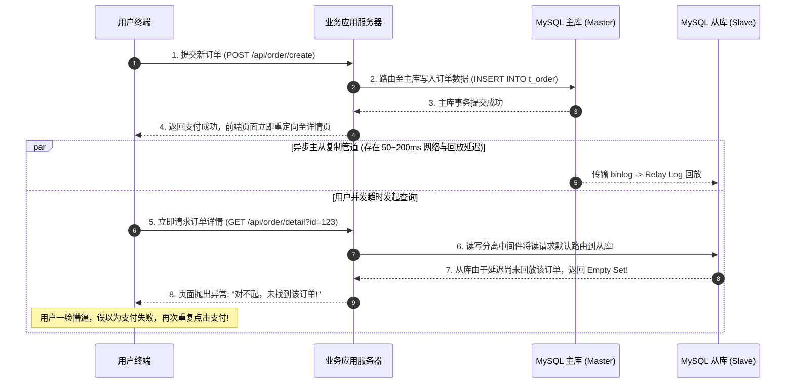
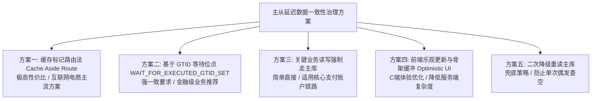

# 资深-高并发读写分离架构与主从数据一致性解决方案

为了应对互联网业务“读多写少（读写比通常达 10:1 甚至更高）”的高并发特征，**读写分离（Read-Write Splitting）**是性价比最高的扩展架构：主库专司事务写入，通过 binlog 复制到多个从库承担海量查询请求。然而，由于异步复制天然存在物理延迟，由此引发了分布式系统中最经典的致命体验痛点：**“写完立刻读不到（读到旧数据或报错订单不存在）”**。深入理解主从延迟数据一致性治理模型，掌握从“缓存标记路由”到“基于 GTID 等待位点”的五大工业级解决方案，是资深架构师的核心考核项。

---

## 一、核心底层机制与全景架构

### 1.1 读写分离架构全景与主从延迟数据撕裂时序



---

## 二、源码级实战推导：五大工业级解决方案

### 2.1 方案对比与适用场景全景矩阵



---

### 2.2 方案一：分布式缓存标记路由法（Cache Aside Route）源码落地

**算法与设计思想**：
当用户在主库完成写操作后，立即在 Redis 中设置一个具有短暂 TTL（如 1 秒）的**防延迟特征标记**。在接下来的 1 秒内，该用户发起的后续读请求自动降级强制路由到主库；1 秒过后标记失效，自动平滑切回从库轮询。

```java
// Spring 读写分离动态数据源路由切面示例
public class DynamicDataSourceAspect {

    @Autowired
    private StringRedisTemplate redisTemplate;

    public void beforeQuery(JoinPoint point) {
        Long userId = SecurityContext.getUserId();
        String redisKey = "WRITE_LAG_MARK:" + userId;

        // 检查用户在最近 1 秒内是否有过写操作
        Boolean hasRecentWrite = redisTemplate.hasKey(redisKey);
        if (Boolean.TRUE.equals(hasRecentWrite)) {
            // 强制切换当前线程数据源至 MASTER 真实主库
            DynamicDataSourceContextHolder.setDataSourceType(DataSourceType.MASTER);
        } else {
            // 正常分流至 SLAVE 读从库
            DynamicDataSourceContextHolder.setDataSourceType(DataSourceType.SLAVE);
        }
    }

    public void afterWriteSuccess() {
        Long userId = SecurityContext.getUserId();
        String redisKey = "WRITE_LAG_MARK:" + userId;
        // 写入成功后设置 1 秒过期时间 (足以覆盖 99.9% 的正常主从复制延迟)
        redisTemplate.opsForValue().set(redisKey, "1", Duration.ofMillis(1000));
    }
}
```

---

### 2.3 方案二：基于 MySQL 8.0 GTID 等待位点同步（`WAIT_FOR_EXECUTED_GTID_SET`）

对于必须保证绝对一致性、但又不希望把所有读流量都压死在主库上的核心接口，可利用 MySQL 原生提供的 GTID 函数在从库端进行**阻塞式等待回放**：

```sql
-- 步骤 1: 在主库完成更新后，获取当前事务提交的全局唯一 GTID
-- SELECT @@GLOBAL.gtid_executed; 假定获得 '3aaaaaaa-4444-5555-6666-777777777777:1-500'

-- 步骤 2: 读请求路由至从库前，先在从库执行等待校验函数
-- 语法: WAIT_FOR_EXECUTED_GTID_SET(gtid_set, timeout_seconds)
SELECT WAIT_FOR_EXECUTED_GTID_SET('3aaaaaaa-4444-5555-6666-777777777777:500', 0.5);

-- 底层执行结果返回：
-- 0: 成功！表示从库已经完全回放到了该事务，数据绝对新鲜，可安全放行读取从库！
-- 1: 超时！表示 0.5 秒内从库仍未追平，触发应用层报警或降级直连主库兜底！
```

---

## 三、社招高频硬核连环追问

### 追问 1：如果采用“从库读不到，再二次查询主库”的兜底方案，在生产高并发下会有什么致命风险？

> **考官意图**：考察击穿防护、恶性放大循环与架构防御认知。

**回答硬核要点**：
- **缓存穿透式主库雪崩（Avalanche Loop）**：
  - 如果主从复制因为某个大事务或网络抖动出现了 5 秒的持续延迟，所有用户的读请求在从库必然 100% 全部查空！
  - 此时“二次查主”策略会诱发**全网 100% 的海量读流量瞬间全部调头疯狂砸向主库**。
  - 原本只需要支撑每秒几百写的主库，瞬间被涌入的数万 QPS 读请求彻底压垮打爆，引发数据库 CPU 100%、连接数耗尽并彻底瘫痪，使读写分离的削峰降压设计形同虚设。
- **治理规则**：
  - 严禁盲目“二次查主”！若使用必须配置严格的主库令牌桶限流（RateLimiter）与熔断降级。

---

### 追问 2：读写分离中间件选型：客户端代理（ShardingSphere-JDBC）与服务端代理（MyCat / ShardingSphere-Proxy）各自利弊与选型取舍？

> **考官意图**：考察基础架构选型视野与性能损耗评测。

**回答硬核要点**：

| 对比维度 | 客户端直连模式（ShardingSphere-JDBC） | 服务端代理模式（MyCat / Proxy） |
| :--- | :--- | :--- |
| **部署架构** | 无独立中间件进程，作为 Jar 包直接嵌入 Java 应用内存 | 独立的外部中间件服务，部署独立的 Proxy 集群 |
| **网络时延（RT）** | **0 额外网络跳转**，应用直接通过 Socket 连接 MySQL | **多一次网络跳数（App $\rightarrow$ Proxy $\rightarrow$ MySQL）**，额外增加 1~3ms 时延 |
| **跨语言支持** | 仅支持 Java 技术栈 | 跨语言通用（支持 PHP、Go、Python、Node 等） |
| **运维与监控** | 零运维成本，但升级需重启所有应用微服务 | 需独立维护 Proxy 集群的高可用与内存，运维成本高 |
| **大厂选型共识** | **Java 体系企业首选 ShardingSphere-JDBC**，追求极限吞吐；异构混合语言团队选 Proxy |

---

### 追问 3：在什么业务场景下，架构师应当拍板“根本不走读写分离，直接强制走主库”？

> **考官意图**：考察架构师的业务敏感度与克制设计思维。

**回答硬核要点**：
1. **涉及资金资产核验的核心写后读链路**：
   - 用户充值到账、提现余额扣减、下订单支付状态更新、密码修改与权限变更。这些数据要求 100% 的强一致性，容不得半点主从复制延迟；
2. **读写比极低（写多读少）的流水表**：
   - 比如操作审计日志表、消息推送记录表、高频设备心跳上报表，读操作很少，盲目读写分离反而增加了连接池与网络开销；
3. **并发写入本身不高的小型企业内部管理后台**：
   - 没必要为了“炫技”引入读写分离，增加分布式主从延迟的治理成本，保持单库单写最稳定可靠。

---

## 四、生产级避坑指南与排障 SOP

### 4.1 生产级读写分离排障对照表

| 故障现象 | 根因深度剖析 | 工业级解决方案 |
| :--- | :--- | :--- |
| **从库 `Seconds_Behind_Master` 持续飙升至数千秒** | 1. 业务在主库执行了耗时 10 分钟的大事务；2. 从库未开启多线程并行复制 | 拆解主库大事务，从库配置 `slave_parallel_workers = 8` 与 `slave_parallel_type = LOGICAL_CLOCK` |
| **读写分离后主库依然压力巨大** | 开启了 Spring 事务的方法默认走主库，开发者给纯读方法误加了 `@Transactional` | 纯读查询显式标记 `@Transactional(readOnly = true)`，配置中间件将只读事务自动分流至从库 |
| **用户刷新页面不断在“有数据”与“无数据”之间跳跃** | 存在多个从库，从库 A 复制已完成，从库 B 严重滞后，轮询分发到了不同从库 | 配置基于健康度的动态权重路由，将延迟超过 1 秒的从库自动摘除隔离 |

### 4.2 从库复制延迟与健康状态实时检测脚本

```sql
-- 1. 查看从库复制延迟秒数 (Seconds_Behind_Master)
SHOW SLAVE STATUS\G

-- 重点审查字段：
-- Slave_IO_Running: Yes  (I/O 线程正常拉取 binlog)
-- Slave_SQL_Running: Yes (SQL 线程正常回放 relay log)
-- Seconds_Behind_Master: 0 (若此数值大于 1，中间件应启动路由熔断)

-- 2. 检查多线程并行复制回放线程状态 (MySQL 8.0+)
SELECT 
    thread_id, service_type, count_transactions 
FROM performance_schema.replication_applier_status_by_worker;
```
