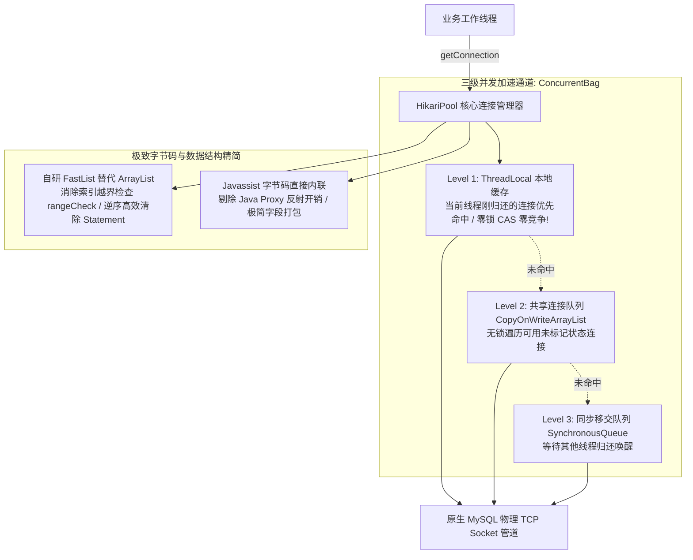
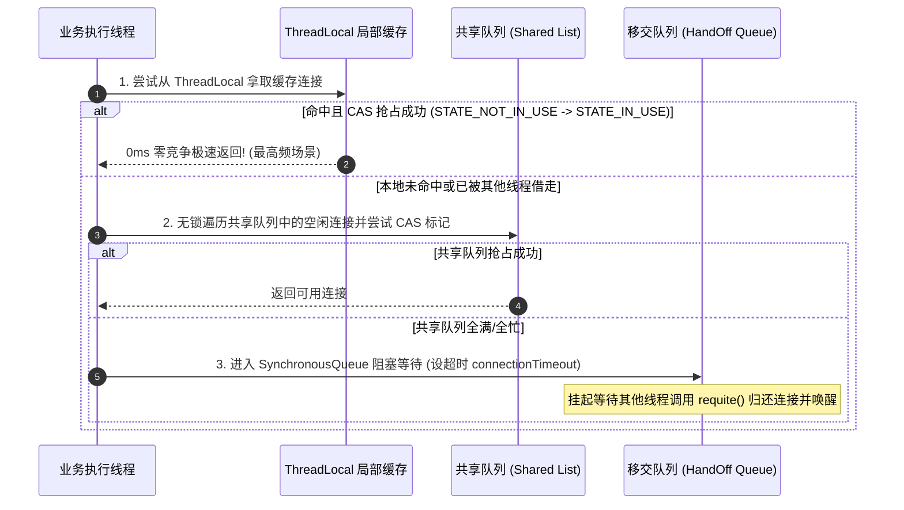

# 资深-高性能数据库连接池HikariCP核心原理与生产调优

在现代 Java 后端微服务与高并发架构中，数据库连接池是应用程序与 MySQL 物理节点之间最重要的中枢管道。从早期基于常规同步锁的 DBCP、c3p0，到阿里的 Druid，再到 Spring Boot 官方全量钦定为默认连接池的 **HikariCP**（日文意为“光”，号称世界上最快的连接池）。深入理解 HikariCP 在**字节码级别、无锁并发容器（ConcurrentBag）、自研数据结构（FastList）**上的极限压榨设计，以及生产环境参数的数学推导调优，是资深架构师的必修硬核内功。

---

## 一、核心底层机制与全景架构

### 1.1 HikariCP 极速吞吐架构全景图

HikariCP 的核心架构完全围绕“零同步等待、无垃圾内存、CPU 缓存友好”进行极致工程重构：



### 1.2 `ConcurrentBag` 借还连接物理时序流转

`ConcurrentBag` 是 HikariCP 自研的高性能无锁并发容器，借连接（`borrow`）严格遵循三层加速链路：



---

## 二、源码级实战推导：FastList 优化与连接池容量数学公式

### 2.1 为什么自研 `FastList` 能碾压 JDK 的 `ArrayList`？

在 JDBC 执行 `Statement.close()` 时，连接池必须将该 Statement 从 Connection 的追踪列表中安全移除：

```java
// JDK 原生 ArrayList.remove(Object o) 的低效实现
public boolean remove(Object o) {
    // 痛点 1: 从头到尾正序线性扫描 (for i = 0; i < size; i++)
    // 但实际业务中，最后创建的 Statement 往往最先关闭，正序查找代价极高
    for (int index = 0; index < size; index++)
        if (o.equals(elementData[index])) {
            fastRemove(index);
            return true;
        }
    return false;
}
```

**HikariCP 自研 `FastList` 的微观物理重构**：
1. **逆序遍历（Reverse Scan）**：
   JDBC 资源遵循后进先出（LIFO）原则，`FastList` 从尾部向前扫描（`for (int i = size - 1; i >= 0; i--)`），单次命中率高达 99%，查找时间从 $O(N)$ 降到 $O(1)$；
2. **剔除范围越界检查（Eliminate `rangeCheck`）**：
   JDK 的 `ArrayList.get(index)` 每次调用都会强行执行一次 `rangeCheck(index)` 分支判断。`FastList` 去掉了这行多余的 CPU 分支预测代码，JIT 编译器可将其直接内联优化为单条机器指令！

---

### 2.2 为什么连接池不是设得越大越好？容量数学经验公式推导

很多初级工程师在系统面临慢 SQL 时，第一反应就是“把连接池从 20 调大到 200，甚至 500”，结果反而导致 MySQL 瞬间彻底瘫痪崩溃。

**PostgreSQL / MySQL 官方权威经验公式**：

$$\text{Maximum Pool Size} = ((\text{CPU Cores} \times 2) + \text{Effective Spindle Count})$$

- $\text{CPU Cores}$：数据库服务器物理 CPU 核心数；
- $\text{Effective Spindle Count}$：有效磁盘主轴数（对于现代高速 NVMe SSD 固态硬盘，通常取值为 1~2）。

**实战推导范例**：
- 对于一台主流的 **16 核 CPU + NVMe SSD** 的数据库服务器：
  $$\text{推荐最大连接数} = (16 \times 2) + 1 = 33$$
- **物理成因**：
  在不涉及重度磁盘 I/O 阻塞的情况下，同时运行的线程数超过 CPU 核心数后，**多余的线程只能被迫进行激烈的上下文切换（Context Switch）**。1000 个并发线程同时争抢 16 个核心，CPU 绝大部分时钟周期全在切换寄存器和内核栈，有效计算吞吐量不升反降。

---

## 三、社招高频硬核连环追问

### 追问 1：既然数据库最大推荐连接数只有 30~50 个，那上游微服务有 20 个实例，每个实例该如何分配 `maximumPoolSize`？

> **考官意图**：考察候选人在分布式微服务集群与单点数据库之间的容量规划能力。

**回答硬核要点**：
1. **全局连接预算（Global Connection Budget）**：
   - 设 MySQL 服务端配置的 `max_connections = 1000`；
   - 必须预留 20% 连接给管理运维、监控与数据同步工具，剩余可用配额约 800；
2. **集群平摊计算**：
   - 若上游有 20 个微服务容器实例，每个实例的 `maximumPoolSize` 建议设置为：
     $$\text{单节点连接数} = \frac{800 \times 60\%}{20} \approx 20 \sim 25$$
3. **分流隔离（Connection Pool Isolation）**：
   - 针对读多写少业务，核心写库连接池保持在 10~15；从库读连接池保持在 20~30，既防止突发流量打满 MySQL，又保证连接池能够快速弹性复用。

---

### 追问 2：生产环境中，为什么 `maxLifetime` 必须强制小于 MySQL 服务端的 `wait_timeout`？相差多少最安全？

> **考官意图**：考察连接生命周期、网络管道假死与优雅退役机制。

**回答硬核要点**：
- **致命竞争（Race Condition）**：
  - 若 MySQL 的 `wait_timeout = 600` 秒，而 HikariCP 的 `maxLifetime = 600` 秒；
  - 当一个连接在空闲 599.9 秒时被客户端取出使用，在网络传输的毫秒瞬间，**MySQL 服务端判定 600 秒超时并单方面切断了该连接**；
  - 客户端发送请求立刻触发 `Broken Pipe / Connection reset by peer`，导致线上接口报错。
- **最佳生产配置规范**：
  - **`maxLifetime` 必须比服务端的 `wait_timeout` 至少小 30 ~ 60 秒**！
  - 例如 `wait_timeout = 600` 秒，HikariCP 的 `maxLifetime` 应设定为 `540000` 毫秒（540秒），由客户端连接池主动在其寿终正寝前优雅退役并重建新连接。

---

### 追问 3：为什么很多高并发系统强烈建议配置 `minimumIdle == maximumPoolSize`（固定大小连接池）？

> **考官意图**：考察冷启动性能、连接创建尖刺与资源抖动抑制。

**回答硬核要点**：
- **动态创建连接的巨大开销**：
  - 建立一个物理 TCP 连接伴随着三次握手、MySQL 权限验证、分配线程、协商字符集等，耗时通常长达 10~30ms；
- **毛刺（Latency Spike）与性能骤降**：
  - 若 `minimumIdle = 5`，而大促秒杀瞬间并发打进来需要 50 个连接，线程池被迫在瞬间并发发起 45 次建连握手，直接将建立连接的延迟叠加到用户端，引发接口响应时间剧烈毛刺；
- **固定连接池优势**：
  - 将 `minimumIdle` 设为与 `maximumPoolSize` 相等，连接池在冷启动初始化后**始终维持稳定数量的健康长连接**，彻底消除动态伸缩带来的性能波动。

---

## 四、生产级避坑指南与排障 SOP

### 4.1 生产级 HikariCP 核心配置对照表

```yaml
spring:
  datasource:
    type: com.zaxxer.hikari.HikariDataSource
    hikari:
      pool-name: MallHikariCP
      # 1. 核心容量配置 (建议根据业务吞吐压测后固定大小)
      maximum-pool-size: 20
      minimum-idle: 20
      
      # 2. 等待连接超时时间 (默认30秒太长! 生产建议设 3 秒，快速失败避免请求堆积)
      connection-timeout: 3000
      
      # 3. 连接最大存活时间 (必须比 MySQL wait_timeout 小 30秒以上)
      max-lifetime: 540000 # 9分钟 (对应服务端 10分钟)
      
      # 4. 空闲超时 (仅在 minimumIdle < maximumPoolSize 时生效)
      idle-timeout: 300000 # 5分钟
      
      # 5. 连接有效性保活与探活
      keepalive-time: 60000 # 每分钟发一次心跳防止防火墙切断空闲 Socket
      validation-timeout: 2000
      connection-test-query: SELECT 1
```

### 4.2 线上连接池打满排查与指标监控 SOP

当监控大盘告警 `ConnectionTimeoutException: Connection is not available` 时，按以下顺序排查：

```sql
-- 1. 查看 MySQL 端是否被慢查询堵死 (找出处于锁定或超长执行的 SQL)
SELECT id, user, host, db, command, time, state, info 
FROM information_schema.processlist 
WHERE command != 'Sleep' AND time > 3 
ORDER BY time DESC;

-- 2. 检查当前实例全局并发活跃线程数
SHOW STATUS LIKE 'Threads_running';

-- 3. 开启 HikariCP JMX 指标暴露，在 Prometheus / Grafana 查看:
--    - ActiveConnections: 活跃工作连接数
--    - IdleConnections: 空闲连接数
--    - PendingThreads: 排队等待借连接的业务线程数 (此指标 > 0 必须立即告警!)
```
