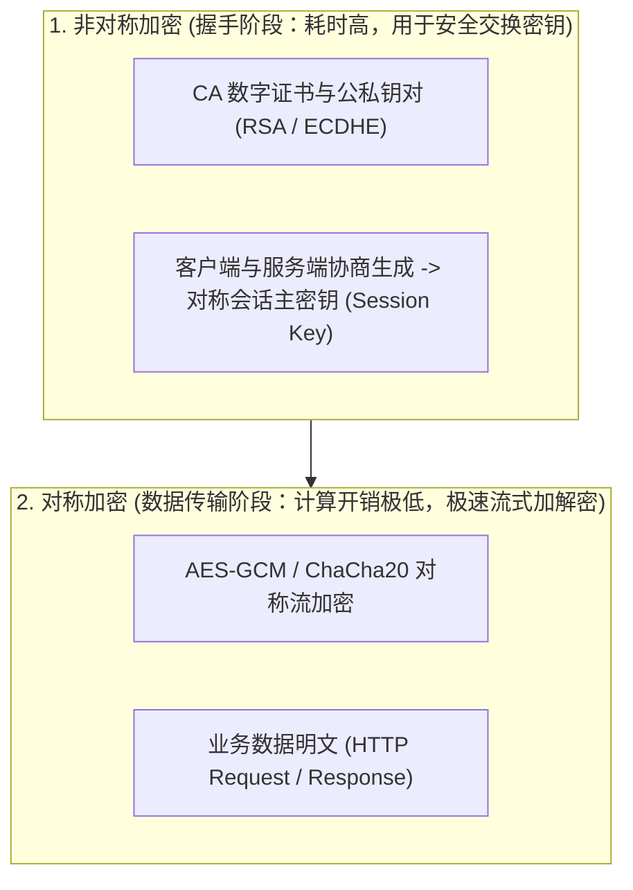
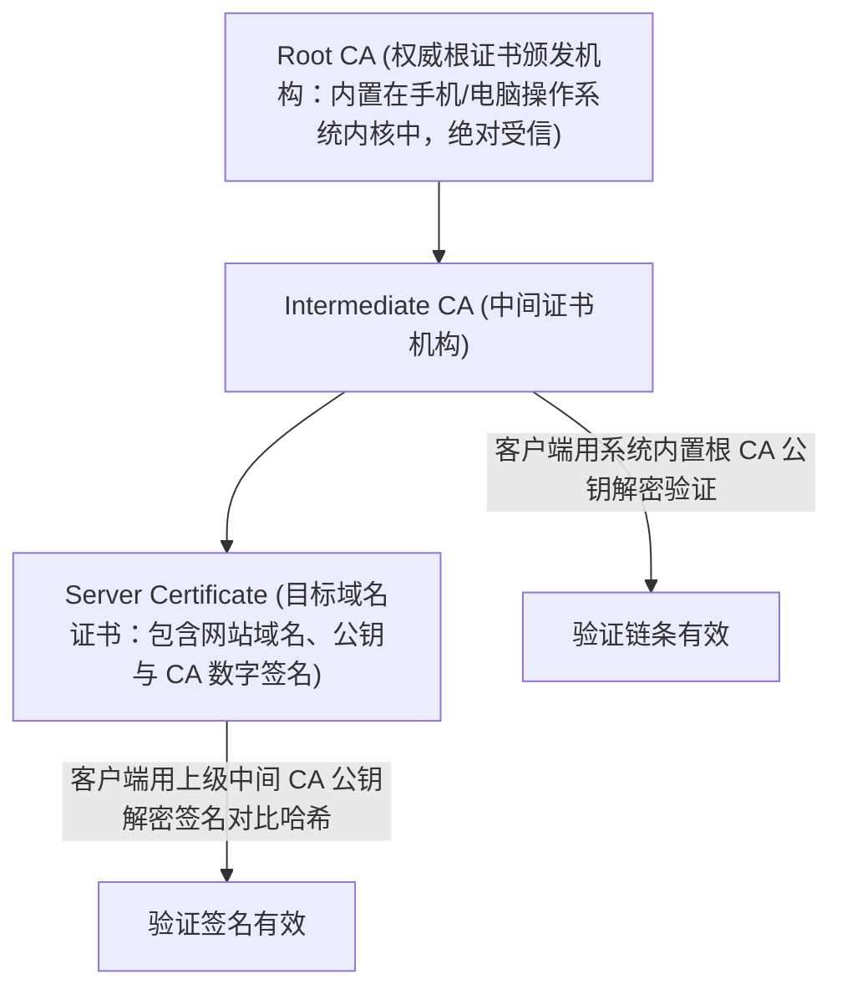
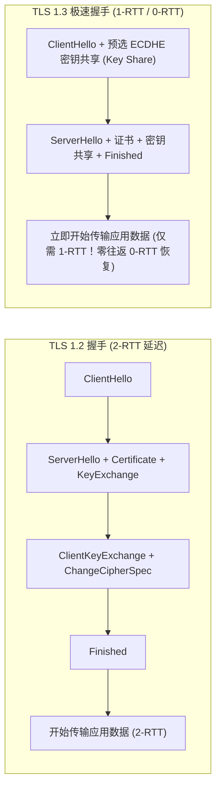

# HTTPS 加密原理：TLS 握手全时序与数字证书链解密

HTTP 协议基于明文传输，极易遭到网络中间人攻击（MITM）、数据窃听与恶意内容篡改。**HTTPS（HTTP over TLS/SSL）** 通过在应用层与传输层之间引入安全传输层，实现了数据的**保密性（防窃听）**、**完整性（防篡改）**与**身份真实性（防钓鱼假冒）**。

本篇将系统剖析对称与非对称混合加密模型、数字证书 CA 信任链以及 TLS 1.2 对比 TLS 1.3 极速握手的物理全时序。

---

## 1. 混合加密模型（Hybrid Cryptosystem）物理架构

- **非对称加密**（如 RSA、ECDHE）：用于在握手阶段安全认证身份并协商出“对称会话密钥”；
- **对称加密**（如 AES-256、ChaCha20）：在握手完成后，后续的海量 HTTP 报文全部采用对称密钥进行超高速加解密，兼顾安全与吞吐性能。

---

## 2. 数字证书与 CA 证书链验证机制

为什么客户端能够确信收到的公钥确实属于目标网站，而不是黑客伪造的？

### 数字签名生成过程
1. CA 机构将证书持有者信息、公钥与有效期等明文内容进行 **SHA-256 哈希计算**，生成唯一的摘要；
2. CA 机构使用其保密的**私钥**对该哈希摘要进行加密，生成“数字签名”，并附在证书尾部下发；
3. 客户端使用系统内置的 **CA 公钥** 解密该签名并与明文计算出的哈希比对，只要完全一致，即证明该证书未经任何篡改。

---

## 3. TLS 1.2 对比 TLS 1.3 握手时序演进

### TLS 1.3 的重大突破
1. **握手时间减半（1-RTT）**：将算法协商与密钥共享合并到第一个往返完成；
2. **支持 0-RTT 会话恢复**：二次访问时可携带 Early Data 实现零延迟直接发请求；
3. **废弃弱加密套件**：彻底移除 RSA 密钥交换（不支持前向安全）、MD5、SHA-1 以及 RC4 等不安全算法，强制推行具备前向安全（Forward Secrecy）的 ECDHE 算法。
