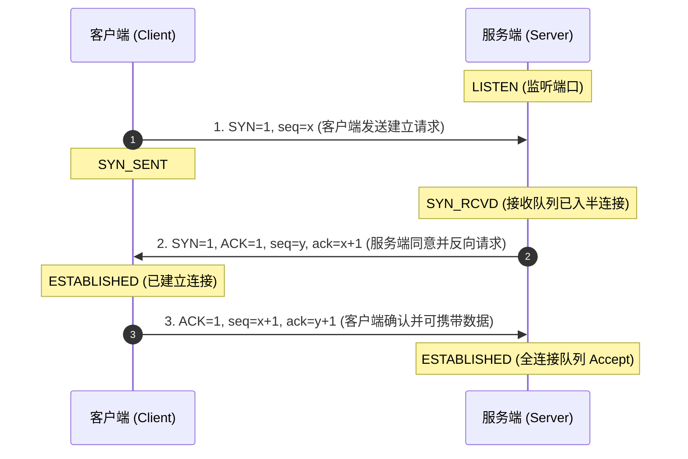
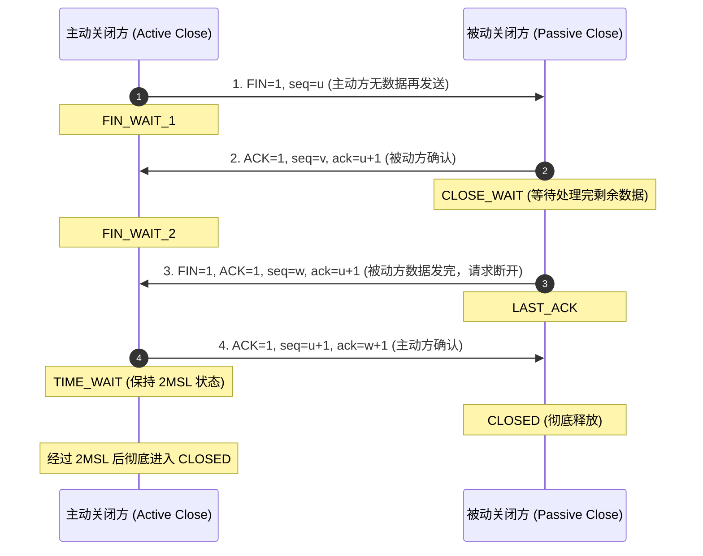

# TCP 三次握手、四次挥手状态机与 TIME_WAIT 根治全解

传输控制协议（TCP）是承载现代互联网可靠传输的基石。在社招资深架构与后端高并发面试中，**TCP 连接的建立与断开状态机**、**TIME_WAIT 与 CLOSE_WAIT 的物理成因**以及**内核网络参数调优**是必考的核心硬核深水区。

---

## 1. TCP 三次握手建立连接物理时序



### 核心面试硬核追问
- **为什么必须是“三次握手”，两次不行吗？**
  1. **防止已失效的历史连接请求报文突然又传送到了服务端**引发误判（如旧报文因网络阻塞滞留，在连接释放后才到达服务器，两次握手会直接建立无效虚假连接浪费资源）；
  2. **双方必须互相确认各自的初始序列号（ISN）**并确认双方均具备正常的双向收发能力。

---

## 2. TCP 四次挥手释放连接物理时序



---

## 3. 生产级痛点：大量 TIME_WAIT 与 CLOSE_WAIT 根治

### 3.1 大量 TIME_WAIT 产生的成因与调优
- **成因**：**主动发起关闭连接的一方**在发送最后一个 ACK 后，必须停留在 `TIME_WAIT` 状态持续 **2MSL（Maximum Segment Lifetime，通常为 60s 或 120s）**。
- **为什么需要 2MSL？**
  1. 保证最后一个 ACK 能够安全到达被动关闭方（若 ACK 丢失，被动方重发 FIN，2MSL 允许主动方再次重发 ACK）；
  2. 允许网络中所有因路径延迟产生的旧连接报文在 2MSL 内全部在网络中自然消亡，防止新创建的相同五元组连接收到旧数据串包。
- **生产调优 SOP**：
  - 开启 HTTP Keep-Alive 复用长连接，减少频繁短连接主动断开；
  - Linux 内核参数优化（`/etc/sysctl.conf`）：
    ```ini
    net.ipv4.tcp_tw_reuse = 1          # 允许将处于 TIME_WAIT 状态的套接字重新用于新的出向连接
    net.ipv4.tcp_max_tw_buckets = 20000 # 限制系统 TIME_WAIT 套接字的最大数量，超额自动销毁
    ```

### 3.2 大量 CLOSE_WAIT 产生的成因与代码排查
- **成因**：**被动关闭方收到了对方发来的 FIN 并回复了 ACK，但自己的业务代码由于死锁、线程池打满或未调用 `socket.close()`，迟迟没有发送第三步的 FIN**！
- **危害与排障**：`CLOSE_WAIT` **没有任何超时机制**，会一直永久占用系统的文件描述符（FD）。排查关键是检查应用代码中 I/O 连接池泄漏或耗时堵塞。
