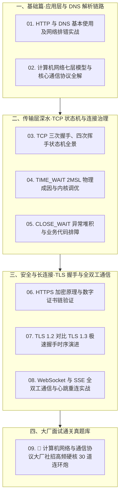

# 网络与通信协议全解全景指南

欢迎来到 **网络与通信协议全景进阶专栏**。

在分布式系统、微服务集群、现代前端与高并发全栈架构中，计算机网络是整个软件大厦最底层的生命线。无论是大厂面试中的“从浏览器输入 URL 到页面渲染的完整链路”，还是生产环境中的“TCP TIME_WAIT 打爆连接池”、“TLS 握手过慢”与“长连接断连丢包”，深入掌握计算机网络协议都是架构师不可替代的基本功。

---

## 🗺️ 网络与通信协议全景进阶技术图谱

---

## 📚 专栏章节索引

### 一、基础篇·应用层与 DNS 解析链路
1. [01. HTTP 与 DNS 基本使用及排错实战](/doc/Network/HTTP与DNS基本使用及排错)
2. [02. 计算机网络与核心通信协议全解](/doc/Network/计算机网络与核心通信协议全解)

### 二、传输层深水·TCP 状态机与连接治理
3. [03. TCP 三次握手、四次挥手状态机与 TIME_WAIT 根治全解](/doc/Network/TCP三次握手四次挥手状态机与TIME_WAIT根治全解)

### 三、安全与长连接·TLS 握手与全双工通信
4. [04. HTTPS 加密原理：TLS 握手全时序与数字证书链解密](/doc/Network/HTTPS加密原理TLS握手全时序与数字证书链解密)
5. [05. WebSocket 与 SSE 全双工实时通信与心跳重连高并发实战](/doc/Network/WebSocket与SSE全双工实时通信与心跳重连高并发实战)

### 四、大厂面试通关真题库
6. [06. 🎯 计算机网络与通信协议大厂社招高频硬核 30 道连环炮全景通关](/doc/Network/计算机网络与通信协议大厂社招高频硬核30道连环炮)
