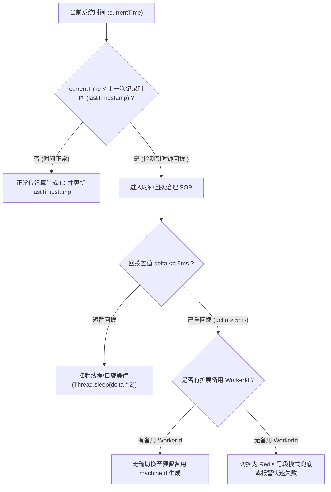

# 分布式全局唯一 ID 生成方案：Snowflake 雪花算法与时钟回拨治理

在大型分布式微服务、分库分表与金融级订单系统中，每个数据实体必须拥有全局唯一且**趋势递增（Monotonically Increasing）**的业务主键。如果主键随机无序（如原生 UUID），会导致 MySQL InnoDB 的 B+ 树索引频繁触发页分裂（Page Split）与磁盘随机 I/O，严重拖慢写入性能。

本篇系统拆解 UUID、数据库号段模式（Leaf/TinyID）、Redis 自增以及 Twitter **Snowflake（雪花算法）**的物理位结构与时钟回拨工业级治理。

---

## 1. 主流分布式 ID 生成方案全景技术选型

| 方案类别 | 实现原理 | 优点 | 缺点 / 瓶颈 |
| :--- | :--- | :--- | :--- |
| **UUID** | 基于网卡 MAC、时间戳与随机数 | 本地生成，零网络 I/O，性能极高 | **36 位字符串占用空间大，完全无序，B+ 树页分裂严重** |
| **数据库自增 ID** | `REPLACE INTO` 或集中序列库 | 绝对单调递增，数值型主键 | 单点故障，每次获取需经过网络与磁盘写入，抗不住高并发 |
| **号段模式 (Leaf)** | 每次从 DB 批量加载一段 ID（如 1000 个）缓存到内存 | 性能极高，容忍 DB 短暂宕机 | 依然依赖 DB 步长分配，依赖预加载机制 |
| **Redis incr** | `INCRBY` 原子操作 | 性能高，单调递增 | 依赖 Redis 集群高可用，RDB/AOF 异步落盘可能丢步长 |
| **Snowflake 雪花算法** | 本地 64-bit 整数位运算生成 | **高性能、纯本地内存计算、全局趋势递增** | **依赖机器物理时钟，服务器时钟回拨会导致 ID 重复** |

---

## 2. Snowflake 64-bit 结构物理拆解

```text
+--------------------------------------------------------------------------+
| 1 bit 符号位 | 41 bits 时间戳 (毫秒级) | 10 bits 机器标识 | 12 bits 序列号 |
+--------------------------------------------------------------------------+
  固定为 0      约可使用 69 年 (2^41 ms)   支持 1024 个节点   每毫秒生成 4096 个
```

- **1 bit 符号位**：固定为 0，保证生成的 Long 类型整数始终为正数；
- **41 bits 时间戳**：记录相对于自定义纪元（Epoch）的毫秒差，支持连续运行约 $2^{41} / (1000 \times 3600 \times 24 \times 365) \approx 69$ 年；
- **10 bits 机器 ID**：支持分配给 $2^{10} = 1024$ 个独立的服务器/工作节点；
- **12 bits 序列号**：同一毫秒内的自增计数器，单台服务器单毫秒并发吞吐量达到 $2^{12} = 4096$ 个 ID（每秒并发可达 400 万+）。

---

## 3. 生产级时钟回拨（Clock Move Backwards）四大防范治理

分布式服务器通常使用 NTP 协议同步授时。若系统发生夏令时调整、闰秒或 NTP 错误对齐导致本地时钟向后回退，雪花算法极易生成与过去完全相同的 ID！



### 生产级容灾设计规范
1. **轻微回拨（$\le 5\text{ms}$）**：直接通过自旋等待或休眠回拨差值的 2 倍时间，等待系统时钟追赶平滑；
2. **中度回拨（$5\text{ms} < \Delta \le 1\text{s}$）**：利用 10 bits 机器 ID 的高位划分出“备份机器号”，一旦检测到回拨，立即将机器码切到备用码生成；
3. **严重回拨（$\Delta > 1\text{s}$）**：拒绝生成并立即触发 P1 级告警，自动降级至数据库号段模式兜底。
