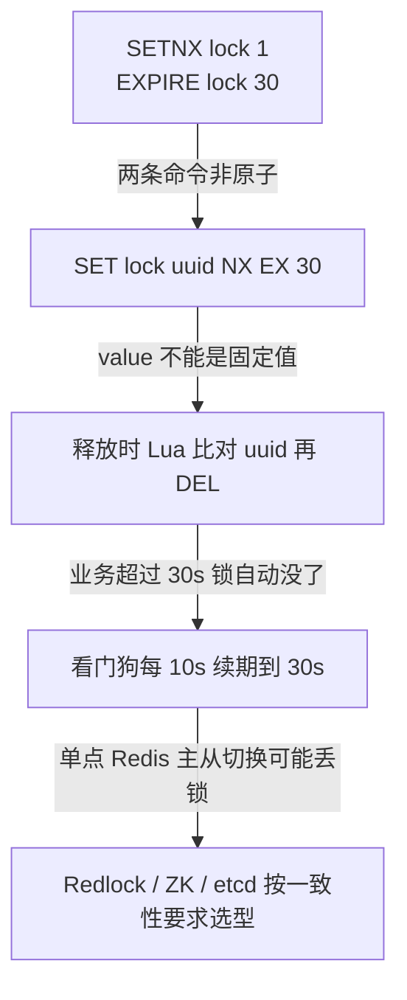
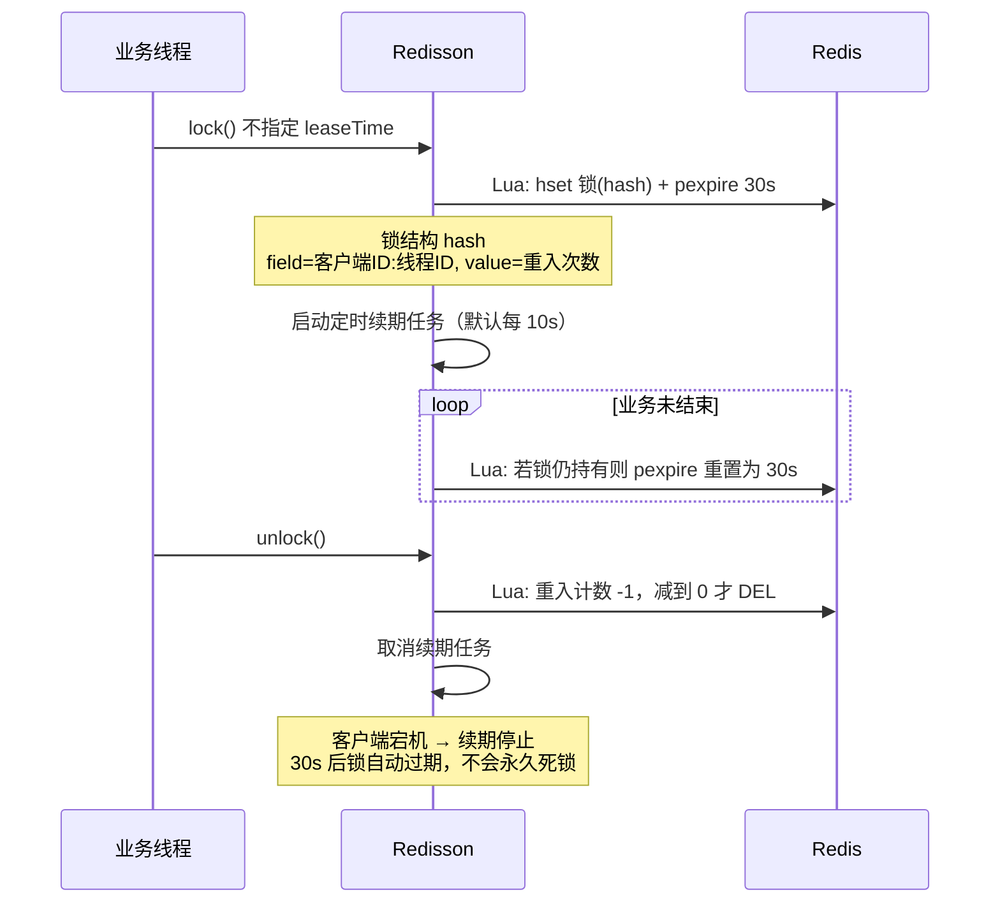

# 分布式锁与 Redisson 源码全解

## 使用入口：先解决问题，再做验证

在多实例共享资源上协调互斥。

**先做基本操作**：先确认数据库约束能否解决，再测试 tryLock、超时和 finally 释放，最后研究续期与故障模型。初次学习可先完成[本模块基础实践](/doc/SystemDesign/系统设计基本方法与可靠性实践)。

**再逐步深入**：基本 API 与输入输出 → 常见失败和使用边界 → 场景排查与优化 → 本文机制分析与源码。面试先讲用途和自己的操作过程，再回答场景与原理追问。

> **一句话看懂**：一个可靠的分布式锁要同时满足**互斥、可重入、不误删他人锁、死锁可自动释放、业务超时不提前释放**——SETNX 只解决了第一点，剩下四点才是面试真正考的。

## 30 秒速览

| 演进阶段 | 命令 / 方案 | 解决了什么 | 还剩什么问题 |
| :--- | :--- | :--- | :--- |
| ① 朴素版 | `SETNX key value` + `EXPIRE key 30` | 互斥 | 两条命令非原子，中间宕机 → **永久死锁** |
| ② 原子版 | `SET key value NX EX 30` | 互斥 + 自动过期 | 业务执行超过 30s → **锁提前释放**，B 进场与 A 并发 |
| ③ 安全解锁 | `value = 随机 UUID` + Lua 比对后删 | 不会误删他人的锁 | 仍未能解决业务超时 |
| ④ 生产版 | **Redisson 看门狗自动续期** | 业务不结束就一直续期 | 需理解续期机制与宕机后的收敛 |
| ⑤ 强一致 | ZK 临时顺序节点 / etcd Lease | 无「提前释放」问题 | 性能低于 Redis，运维成本高 |

---

## 一、SETNX 演进：每一步在补什么坑



### 为什么解锁必须用 Lua

```java
// ❌ 错误：GET 与 DEL 之间锁可能已过期并被别人拿到，结果删的是别人的锁
if (uuid.equals(redisTemplate.opsForValue().get(lockKey))) {
    redisTemplate.delete(lockKey);
}

// ✅ 正确：比对 + 删除在 Redis 单线程内原子完成
String lua = "if redis.call('GET', KEYS[1]) == ARGV[1] then " +
             "  return redis.call('DEL', KEYS[1]) " +
             "else return 0 end";
redisTemplate.execute(new DefaultRedisScript<>(lua, Long.class),
        Collections.singletonList(lockKey), uuid);
```

`value` 必须是**每次加锁唯一的随机值**（UUID + 线程标识），否则无法区分「自己的锁」和「别人重入后拿到的锁」。

---

## 二、Redisson 看门狗（WatchDog）源码脉络



| 源码要点 | 说明 |
| :--- | :--- |
| 数据结构 | 用 **Hash** 而非 String：`field` = `客户端ID:线程ID`，`value` = 重入次数，天然支持**可重入** |
| 默认超时 | `internalLockLeaseTime = 30s`（`watchdogTimeout`） |
| 续期周期 | `30 / 3 = 10s`，由 `Timeout` 定时任务递归调度 |
| 触发条件 | **只有不显式传 `leaseTime` 时才启用看门狗**；传了 leaseTime 就按固定时长，不续期 |
| 释放 | `unlock` 时先减重入计数，为 0 才 `DEL` 并发布解锁消息，唤醒等待线程 |
| 宕机收敛 | 客户端进程没了 → 续期任务没了 → 30s 后锁自动过期 |

```java
RLock lock = redissonClient.getLock("order:lock:" + orderId);
try {
    // ✅ 不传 leaseTime，启用看门狗；业务多久就锁多久
    lock.lock();
    doBusiness();
} finally {
    // 必须判断当前线程仍持有锁，避免锁已过期时抛 IllegalMonitorStateException
    if (lock.isHeldByCurrentThread()) lock.unlock();
}

// ⚠️ 这个写法没有看门狗：30s 到点强制释放，业务没跑完也会有第二个线程进场
lock.lock(30, TimeUnit.SECONDS);
```

> **最高频的坑**：`lock.lock(30, SECONDS)` 看似「设置了超时更安全」，实际关闭了看门狗，反而更容易出现并发穿插。要自动续期就用无参 `lock()`。

---

## 三、Redlock 争议与 Fencing Token

单主 Redis 有个无法回避的问题：**主节点写入锁后、尚未同步到从节点时宕机**，从节点升主，另一个客户端也能拿到同一把锁，互斥被破坏。

| 方案 | 做法 | 结论 |
| :--- | :--- | :--- |
| **Redlock** | 向 N 个（通常 5）**独立** Redis 实例依次加锁，超过半数成功且总耗时 < 锁有效期才算成功 | 提高了容错，但 Martin Kleppmann 指出：进程 GC 停顿 / 时钟跳跃仍可能破坏互斥，争议未平息 |
| **Fencing Token** | 每次拿锁返回一个**单调递增序号**，写存储时带上，存储层拒绝比已见过的更小序号 | 从「锁」转移到「资源层」保证正确性，是更彻底的思路，但要求存储支持版本校验 |
| **ZK / etcd** | 临时顺序节点 + Watch；etcd 用 Lease + Revision | 一致性强、无提前释放问题，但吞吐低于 Redis |

**选型结论（面试要敢下判断）**：
- 绝大多数业务（防重复提交、定时任务单实例执行）：**单主 Redis + Redisson 足够**，配合业务层幂等兜底，即使极端情况下锁失效也不会造成资损。
- 涉及资金、库存等「错了就是资损」的场景：**不要只依赖分布式锁**，用 DB 唯一索引 / 乐观锁 / 状态机做最终防线（见 [幂等设计](/doc/SystemDesign/幂等性设计与重复请求治理)）。
- 要求强一致且有 ZK/etcd 运维能力：直接用它们，别自己实现 Redlock。

---

## 四、生产五大翻车点（速查）

| 翻车点 | 现象 | 规避 |
| :--- | :--- | :--- |
| 非原子设置过期 | 服务宕机后锁永久不释放 | `SET ... NX EX` 或 Redisson |
| 业务超时锁提前释放 | 两个线程同时进入临界区 | 看门狗续期，别用固定 leaseTime |
| 误删他人锁 | A 超时后 B 加锁，A 结束时把 B 的锁删了 | value 用唯一随机值 + Lua 比对删除 |
| 锁粒度太粗 | 所有订单共用一把锁，QPS 塌方 | 按业务 ID 细分（`order:lock:{orderId}`） |
| 锁内嵌长耗时远程调用 | 持锁时间不可控，续期也救不回来 | 锁内只做必要的状态判断，IO 放到锁外 |

> 这五点在 [后端核心避坑与生产实战全解](/doc/Java/后端核心避坑与生产实战全解) 第一节有事故级复现，可对照阅读。本篇聚焦**源码机制与选型**，两篇互补。

---

## 五、高频追问与回答要点

| 追问 | 高分特征 | 低分特征 |
| :--- | :--- | :--- |
| 「`SETNX` 就够了？」 | 逐条说出互斥、死锁、误删、超时、重入五个缺口及各自解法 | 答「加个过期时间就行」 |
| 「看门狗什么时候不生效？」 | 指出显式传 `leaseTime` 会关闭续期，并解释为什么这反而更危险 | 只背「每 10 秒续一次」 |
| 「Redisson 怎么实现可重入？」 | 说出 Hash 结构 + field 为客户端/线程 ID + value 记重入次数 | 答「用计数器」但不说结构 |
| 「Redis 锁挂了怎么办？」 | 谈主从切换丢锁 → Redlock 争议 → Fencing Token → 最终用业务幂等兜底 | 答「Redis 很稳定不会挂」 |
| 「锁粒度怎么定？」 | 按业务主键细分，并说明粗粒度的性能代价与细粒度的死锁风险 | 只答「越细越好」 |

> 答题框架见 [系统设计前言](/doc/SystemDesign/前言)；幂等兜底见 [幂等性设计与重复请求治理](/doc/SystemDesign/幂等性设计与重复请求治理)；SpringCloud 中的分布式事务见 [微服务核心组件与架构实战](/doc/Java/Spring/SpringCloud微服务核心组件与架构实战)。
