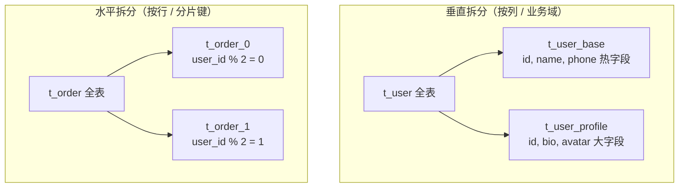
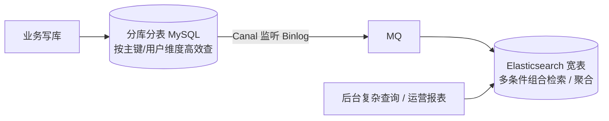
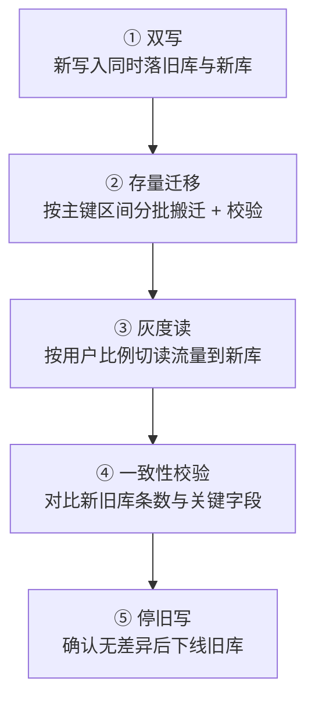

# 分库分表与全局主键设计

## 使用入口：先解决问题，再做验证

在实际单库瓶颈下扩展存储。

**先做基本操作**：先优化索引、归档和单库容量，确认必须分片后验证分片键与迁移，再研究路由与跨片事务。初次学习可先完成[本模块基础实践](/doc/SystemDesign/系统设计基本方法与可靠性实践)。

**再逐步深入**：基本 API 与输入输出 → 常见失败和使用边界 → 场景排查与优化 → 本文机制分析与源码。面试先讲用途和自己的操作过程，再回答场景与原理追问。

> **一句话看懂**：分库分表是**最后手段**——它用「查询能力受限 + 运维复杂度」换「写入与存储容量」。在动手分片之前，索引、缓存、读写分离、归档这几步通常能多撑一个数量级。

## 30 秒速览

| 问题 | 结论 |
| :--- | :--- |
| 什么时候该分 | 单表数据量过大导致索引树变深、DDL 锁表时间不可接受、单机写入 TPS 到顶 |
| 先做什么 | 索引优化 → 缓存 → 读写分离 → 冷热归档 → **最后才分片** |
| 垂直 vs 水平 | 垂直按**列/业务**拆（大字段、业务域），水平按**行**拆（分片键取模/范围） |
| 分片键怎么选 | 选**最高频查询条件**且数据分布均匀的字段，一旦选定极难更改 |
| 最大的代价 | 跨分片 join / 分页 / 排序 / 全局事务 / 扩容迁移 |
| 主键怎么办 | 不能用自增 ID，用雪花算法或号段模式（见 [SpringCloud 第六节](/doc/Java/Spring/SpringCloud微服务核心组件与架构实战)） |

---

## 一、先别急着分：优化路径


**MySQL 单表并没有「必须分」的硬阈值**。B+ 树三层可支撑千万级行且查询仍是 3 次 IO；真正的临界点往往是**写入并发、DDL 锁表时长、备份恢复时间**，而不是行数本身。面试时主动说出这点，比背「500 万就要分」高一个档次。

---

## 二、垂直拆分 vs 水平拆分



| 维度 | 垂直拆分 | 水平拆分 |
| :--- | :--- | :--- |
| 拆什么 | 列 / 业务表 | 行 |
| 解决 | 大字段行溢出、热点列、业务耦合 | 单表行数过大、写入吞吐与存储容量 |
| 代价 | 需要 join 回查 | **跨分片查询、路由、扩容** |
| 常作为 | 第一步 | 第二步 |

大字段垂直拆分的建表军规见 [高并发大字段建表规范与生产场景](/doc/MySQL/高并发大字段建表规范与生产场景)。

---

## 三、分片键：最不可逆的决策

| 候选键 | 优点 | 致命问题 |
| :--- | :--- | :--- |
| `user_id` 取模 | 同一用户数据落同一片，「我的订单」查询高效 | 按 `order_id` / 商家维度查就要**全分片扫描** |
| `order_id` 取模 | 分布均匀 | 查某用户全部订单需广播 |
| 按时间范围 | 天然冷热分离、易归档 | **近期数据全挤在最新分片**，热点写 |
| 按租户 ID | 多租户场景天然隔离 | 大租户数据倾斜 |

**异构索引表（基因法）是标准解法**：主表按 `user_id` 分片，另建一张按 `order_id` 分片的映射表；或把分片基因嵌入 `order_id`（生成 ID 时末几位直接带 `user_id` 的分片值），这样两个维度都能直接路由，无需全分片扫描。

```text
order_id 生成时： [时间戳][机器][序列][shardGene = user_id % 分片数]
  → 按 user_id 查：user_id % N 定位
  → 按 order_id 查：取末位 shardGene 直接定位
```

### 分片数怎么定

取模分片建议选 **2 的幂**（如 16 / 32 / 64），扩容时可用「翻倍扩位」：从 2 库变 4 库只需迁移一半数据，且 `hash % 2^n` 的路由规则可通过位运算平滑演进。直接取模一个质数会让后续扩容变成全量重排。

---

## 四、ShardingSphere 执行链路


| 模式 | 部署 | 适用 |
| :--- | :--- | :--- |
| `ShardingSphere-JDBC` | Jar 包嵌在应用内 | **主流**，无额外网络跳转，性能好，但与语言绑定 |
| `ShardingSphere-Proxy` | 独立代理服务 | 多语言异构、DBA 集中管控，多一跳网络开销 |

---

## 五、跨分片的五道难题（面试主战场）

| 难题 | 为什么难 | 解法 |
| :--- | :--- | :--- |
| **跨分片分页** | `LIMIT 100000, 10` 在每个分片都要取 100010 条再归并，内存爆炸 | 禁止深分页：改用**游标/书签**（`WHERE id > last_id LIMIT n`）；或只允许按分片键分页 |
| **跨分片排序** | 全局有序需要把所有分片结果汇总重排 | 归并排序（各分片已有序则流式归并）；限制只按分片键排序 |
| **跨分片 join** | 关联表可能在不同库 | 小表做**广播表**冗余到每库；同规则绑定表（ER 表）；或在应用层拆成两次查询组装 |
| **跨分片事务** | 本地事务只覆盖单片 | 尽量把同一业务的数据放同片；确实跨片时用 Seata AT / 柔性事务 + 最终一致（见 [硬核考点第七章](/doc/Java/Java后端与分布式高频硬核考点全解)） |
| **全局唯一主键** | 各分片自增会撞号 | 雪花算法 / 号段模式 / 基因法 ID |

**核心答题思路**：分片的代价不是「配置复杂」，而是**放弃了一部分关系型数据库的查询能力**。所以设计时要主动说明「哪些查询被禁止、哪些用异构表补、哪些走 ES 宽表」。

### 复杂检索交给 ES



把「按 10 个条件任意组合筛选 + 分页」这类需求从 MySQL 剥离到 ES，是分片后最标准的配套设计（ Canal 监听 Binlog 的实现见 [Redis 双写一致性](/doc/Java/Redis高并发缓存与一致性实战)）。

---

## 六、扩容迁移：不停机怎么做



| 风险点 | 处理 |
| :--- | :--- |
| 双写期间数据不一致 | 以旧库为准，记录差异日志定时补偿 |
| 迁移打爆线上 DB | 限速 + 只在低峰期跑，按主键区间小批量 |
| 回滚 | 保留旧库至少一个完整业务周期，随时可切回 |
| 分片规则变更 | 新规则必须对历史数据可重算，否则旧数据无法定位 |

---

## 七、高频追问与回答要点

| 追问 | 高分特征 | 低分特征 |
| :--- | :--- | :--- |
| 「单表多少行该分？」 | 指出无硬阈值，真正瓶颈是写入 TPS / DDL / 备份时间，并先走索引→缓存→读写分离→归档 | 背「500 万」 |
| 「分片键选错了怎么办？」 | 说清极难更改，用异构索引表 / 基因法 / ES 宽表补，并给出双写迁移路径 | 答「加个索引」 |
| 「跨分片分页怎么处理？」 | 禁止深分页、改游标，解释为什么 `LIMIT offset` 会内存爆炸 | 答「用 ShardingSphere 自动处理」 |
| 「分库后主键怎么生成？」 | 雪花 / 号段，并说明时钟回拨与 workerId 重复风险 | 答「UUID」 |
| 「分库分表最大的代价是什么？」 | 主动说「放弃部分查询与事务能力」，并给出补偿设计 | 只说「运维麻烦」 |

> 答题框架与容量估算见 [系统设计前言](/doc/SystemDesign/前言)；雪花算法与时钟回拨的完整代码见 [SpringCloud 第六节](/doc/Java/Spring/SpringCloud微服务核心组件与架构实战)；MySQL 索引与 MVCC 见 [MySQL 事务隔离与 MVCC 原理](/doc/MySQL/MySQL事务隔离与MVCC原理)。
