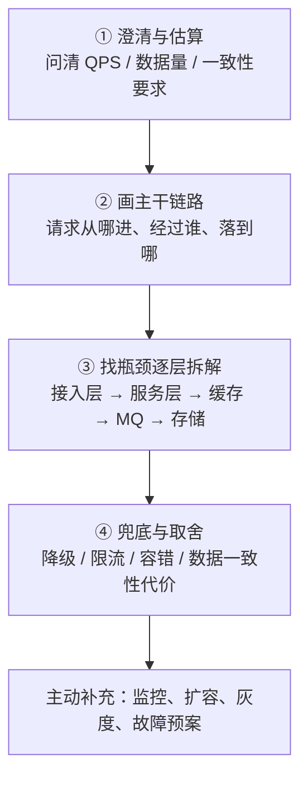
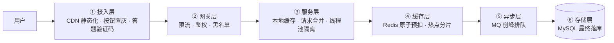

# 系统设计专题 · 前言

## 先会使用，再逐步深入

从[本模块的基础实践](/doc/SystemDesign/系统设计基本方法与可靠性实践)开始，先说明技术解决的业务问题，完成基本 API、最小流程和失败验证；再阅读本页后续专题。

学习与面试都按 **用途 → 基本使用 → 常见场景与边界 → 排错与优化 → 原理与源码 → 方案取舍** 推进。每个知识点至少能给出一个正常操作、一个失败案例和验证证据。

全库覆盖情况与跨模块路线见[知识库检查与分层学习地图](/doc/知识库检查与分层学习地图)。

> **一句话看懂**：系统设计题不考「你背了多少组件」，考的是**在明确约束下做取舍**——先估算量级，再定瓶颈，然后给方案时主动说出「这个方案的代价是什么」。

## MVP 场景与升级边界

系统设计应从最小可运行方案开始，再根据数据和故障证据升级：

| 场景 | MVP 方案 | 升级信号 |
|---|---|---|
| 普通 CRUD | 单体应用 + MySQL + 索引 + 事务 | 单库容量、写入吞吐或发布隔离成为瓶颈 |
| 热点读取 | MySQL 索引 + 本地缓存 | 重复读取明显、延迟目标无法满足时引入 Redis |
| 耗时任务 | 应用内任务表 + 定时扫描 | 任务量和重试需求增加时引入消息队列 |
| 秒杀和库存 | 条件更新 + 唯一键 + 限流 | 热点集中、排队和削峰需求出现时引入 Redis/MQ |
| 多服务协作 | 单体模块化 | 团队、发布和扩容边界稳定后拆分微服务 |

任何方案都应明确：数据最终写入位置、失败后的重试方式、重复请求的处理方式、监控指标和回滚路径。

## 一、四步答题框架（照着走不会冷场）

| 步骤 | 常被忽略的点 | 高分表达 |
| :--- | :--- | :--- |
| ① 估算 | 一上来就说「用 Redis + MQ」 | 「先先给出每用户请求数、峰值假设与延迟目标，再用实测容量确认存储是否为瓶颈」 |
| ② 链路 | 只画组件不画数据流向 | 明确区分**同步链路**（必须即时返回）与**异步链路**（可接受延迟） |
| ③ 拆解 | 每层都堆一遍组件 | 说清**每一层拦掉了多少流量**，这是「削峰」的量化依据 |
| ④ 取舍 | 只讲优点 | 「最终一致性会带来短暂的数据不一致窗口，业务上可接受，因为……」 |

## 二、容量估算速查（面试白板必备）

| 换算 | 经验值 |
| :--- | :--- |
| 日活 → 平均 QPS | `DAU × 每用户操作数 × 每操作请求数 ÷ 86400`；峰值依据实际流量曲线 |
| 并发估算 | 稳定条件下近似 `吞吐 × 平均处理时间`，分别估算同步与异步链路 |
| 单机容量 | 按实际硬件、查询、数据规模、连接池与延迟目标压测，没有固定 QPS 保证 |
| 存储估算 | 数据 + 索引 + 日志 + 副本 + 增长，分别估算，不套统一放大倍数 |

估算用于验证容量假设，数量级误差可能改变方案，应检查峰值、延迟、故障余量与增长的敏感性。

## 三、逐层削峰模型

**每一层都要能回答「它拦掉/吸收了多少流量」**。比如 10 万 QPS 进来，CDN + 前端限流拦到 2 万，网关限流放到 5000，Redis 原子扣减只让 1000 个有效请求进 MQ，DB 最终只写 1000 单——这就是完整答案。

## 四、覆盖哪些能力域

系统设计的面远比几篇文章宽，这里按**能力域**划分，每个域对应一类经典题；**具体有哪些篇以左侧目录为准，表格只给入口**。

| 能力域 | 对应经典题 | 核心抓手 | 入口示例 |
| :--- | :--- | :--- | :--- |
| **流量治理** | 「设计一个秒杀系统」「怎么限流」 | 逐层削峰、超卖与少卖、热点库存分片、四种限流算法、Redis Lua | [秒杀全链路设计](/doc/SystemDesign/高并发秒杀系统全链路设计) |
| **一致性与幂等** | 「接口怎么保证幂等」「重复请求怎么防」 | 幂等 vs 防重、全链路幂等矩阵、状态机与唯一键 | [幂等性设计](/doc/SystemDesign/幂等性设计与重复请求治理) |
| **并发控制** | 「分布式锁怎么实现」「看门狗原理」 | SETNX 演进、续期、Redlock 争议 | [分布式锁与 Redisson](/doc/SystemDesign/分布式锁与Redisson源码全解) |
| **存储扩展** | 「单表千万级怎么办」「怎么平滑扩容」 | 分片键选择、跨分片查询、全局主键、双写迁移 | [分库分表与全局主键](/doc/SystemDesign/分库分表与全局主键设计) |

> **这一栏的定位**：给的是**答题骨架和取舍依据**，不是组件手册。组件怎么用去 Java 板块，底层原理去 MySQL 板块。

## 五、与既有内容的关系（避免重复阅读）

| 已有点 | 位置 |
| :--- | :--- |
| 缓存穿透/击穿/雪崩、Canal 双写一致性 | [Redis 高并发缓存与一致性实战](/doc/Java/Redis高并发缓存与一致性实战) |
| 分布式锁五大生产翻车点、MySQL 锁体系 | [后端核心避坑与生产实战全解](/doc/Java/后端核心避坑与生产实战全解) |
| MQ 消息不丢失、消费端幂等 | [MQ 消息队列与延迟任务实战](/doc/Java/MQ消息队列与延迟任务实战) |
| 接口防重放（Sign + Nonce + Timestamp）、XSS/CSRF | [接口防刷与全栈安全攻防实战](/doc/Fullstack/接口防刷与全栈安全攻防实战) |
| 分布式事务 Seata AT/XA、CAP 定理 | [Java后端与分布式高频硬核考点全解](/doc/Java/Java后端与分布式高频硬核考点全解) |
| 雪花算法与时钟回拨 | [SpringCloud 微服务核心组件与架构实战](/doc/Java/Spring/SpringCloud微服务核心组件与架构实战) 第六节 |

> 本专题负责把上面这些**知识点串成一条可答辩的架构主线**，细节实现请按链接回查原文。

## 六、边界：这个专题不做什么

- **不写组件教程**。Redis、MQ、Dubbo、MySQL 的用法与调优在 [Java 板块](/doc/Java/前言) 和 [MySQL 板块](/doc/MySQL/MySQL底层原理日志体系与BufferPool)。
- **不追求覆盖所有设计题**。目前集中在「高并发 + 一致性 + 存储扩展」这条主线上；消息队列的可靠投递设计、多级缓存架构、异地多活与单元化、服务网格等题目暂时空缺，后续按实际遇到顺序补。
- **不提供「标准答案」**。系统设计没有唯一解，每篇给的是「约束 → 瓶颈 → 方案 → 代价」这条推理链，照抄方案不如照抄推理方式。
