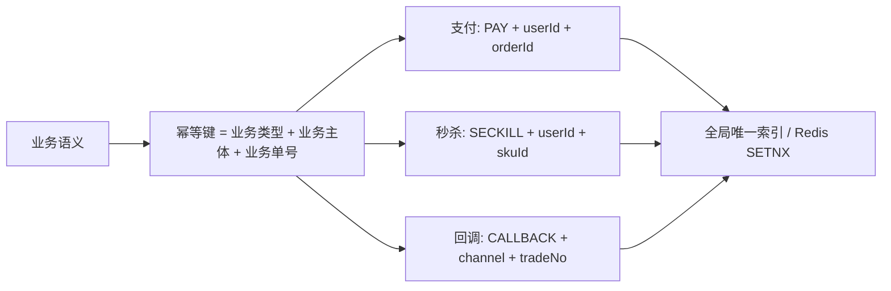
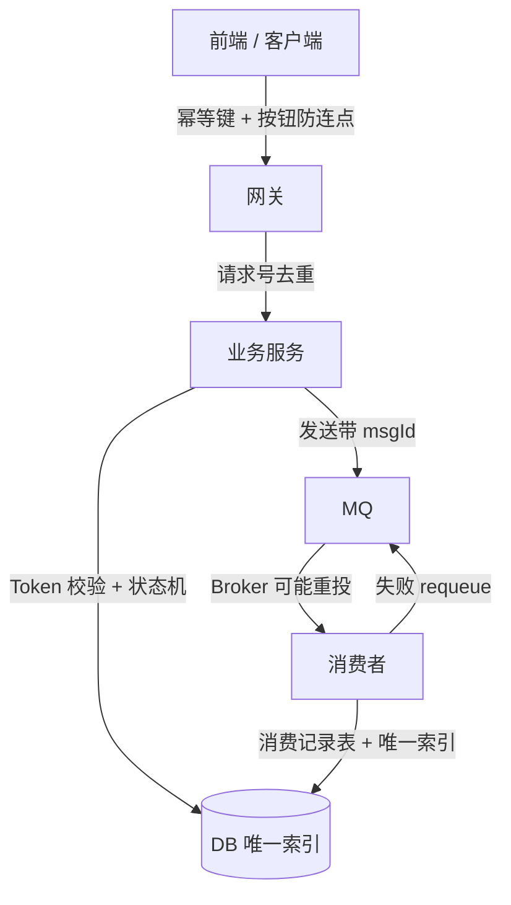

# 幂等性设计与重复请求治理

## 使用入口：先解决问题，再做验证

使重试与重复投递不造成重复业务结果。

**先做基本操作**：先设计稳定业务键和数据库唯一/状态约束，测试并发与响应丢失，再比较去重记录与协议。初次学习可先完成[本模块基础实践](/doc/SystemDesign/系统设计基本方法与可靠性实践)。

**再逐步深入**：基本 API 与输入输出 → 常见失败和使用边界 → 场景排查与优化 → 本文机制分析与源码。面试先讲用途和自己的操作过程，再回答场景与原理追问。

> **一句话看懂**：**幂等 = 同一个请求执行 N 次，结果和副作用与执行 1 次相同**；**防重 = 尽量不让第 2 次发生**。两者要一起做——防重在入口挡，幂等在落库兜底。

## 30 秒速览

| 场景 | 重复从哪来 | 首选方案 |
| :--- | :--- | :--- |
| 用户连点、前端重试 | 同一请求发多次 | Token 令牌 / 前端幂等键 |
| 网络抖动、网关超时重试 | 上游重发 | 全局唯一请求号 + 去重表 |
| MQ 消息重投 | Broker 重发 / 消费失败 requeue | 消费端唯一索引 + 状态机 |
| 定时任务重复执行 | 多实例同时触发 | 分布式锁 + 业务状态判断 |
| 支付回调重复通知 | 第三方多次推送 | 唯一索引 + 订单状态机 CAS |

---

## 一、幂等键怎么设计



**三条原则**：
1. **由业务语义决定，不要用纯随机 UUID**——UUID 每次都不同，反而挡不住重复。
2. **作用域要写清**：同一用户同一订单幂等，但不同订单之间不能互相挤掉。
3. **要设有效期但别太短**：Redis 去重集合一般保留 24h ~ 7 天（覆盖最大重试窗口），DB 唯一索引则永久保留。

---

## 二、四种主流方案对比

| 方案 | 实现 | 优点 | 局限 |
| :--- | :--- | :--- | :--- |
| **数据库唯一索引** | `UNIQUE KEY uk_biz (biz_type, biz_id)` | **最可靠**，DB 层强约束，任何绕过都挡得住 | 只能防「插入重复」，更新类操作要配状态机 |
| **Token 令牌** | 进入页面先领 token，提交时携带并删除 | 从源头防连点，体验好 | 需要额外一次请求；token 必须与用户/业务绑定 |
| **状态机 + 乐观锁** | `UPDATE ... SET status=? WHERE id=? AND status=旧值` | 天然幂等，还能防乱序 | 要求业务有明确状态流转 |
| **去重表 / Redis SETNX** | 记录已处理的幂等键 | 通用、性能好 | Redis 方案存在删除后重复消费窗口，需 DB 兜底 |

> **生产铁律：Redis 去重一定要配 DB 唯一索引双保险**。Redis 是缓存，可能过期、可能被误删、主从切换可能丢数据，只有 DB 唯一索引是最终防线。

### 方案一：唯一索引兜底（最简、最硬）

```sql
CREATE TABLE t_order (
  id            BIGINT PRIMARY KEY,
  order_no      VARCHAR(64) NOT NULL,
  user_id       BIGINT NOT NULL,
  biz_type      VARCHAR(32) NOT NULL,
  biz_id        VARCHAR(64) NOT NULL,
  status        TINYINT NOT NULL DEFAULT 0,
  UNIQUE KEY uk_biz (biz_type, biz_id)   -- 幂等防线
);
```

```java
try {
    orderMapper.insert(order);                 // 重复请求在这里直接抛 DuplicateKeyException
} catch (DuplicateKeyException e) {
    return orderMapper.selectByBiz(bizType, bizId); // 返回首次结果，而非报错给上游
}
```

**关键细节**：捕获唯一键冲突后要**返回首次成功的结果**（幂等语义要求「结果一致」），不能简单返回「重复请求」错误，否则上游重试依旧失败，形成死循环。

### 方案二：Token 令牌（防连点）

```java
// 1. 进入下单页：服务端生成 token 存 Redis，返回前端
String token = UUID.randomUUID().toString();
redisTemplate.opsForValue().set("order:token:" + userId + ":" + token, "1", 10, TimeUnit.MINUTES);

// 2. 提交订单：Lua 原子「校验 + 删除」，防并发下同一 token 被用两次
String lua = "if redis.call('GET', KEYS[1]) == '1' then " +
             "  return redis.call('DEL', KEYS[1]) " +
             "else return 0 end";
Long ok = redisTemplate.execute(new DefaultRedisScript<>(lua, Long.class),
        Collections.singletonList("order:token:" + userId + ":" + token));
if (ok == null || ok == 0) throw new RepeatSubmitException("请勿重复提交");
```

「先 GET 再 DEL」两步分开写在并发下会同时放行两个请求，必须用 Lua 或 `GETDEL`（Redis 6.2+）保证原子。

### 方案三：状态机 CAS（天然幂等、还能防乱序）

```sql
-- 只有「待支付(0)」才能变成「已支付(1)」，重复回调影响行数为 0，直接忽略
UPDATE t_order SET status = 1, pay_time = NOW()
WHERE order_no = ? AND status = 0;
```

支付回调乱序（「已退款」通知比「已支付」先到）也能被状态机挡住，这是唯一索引做不到的事。

---

## 三、全链路幂等矩阵



| 链路节点 | 重复来源 | 幂等手段 |
| :--- | :--- | :--- |
| 客户端 → 网关 | 用户连点、超时自动重试 | 前端禁用按钮、客户端生成 `requestId` 并在重试时**复用同一个 ID** |
| 网关 → 服务 | 网关重试、负载均衡重发 | 请求号去重（短窗口） |
| 服务 → DB | 并发、代码 bug | 唯一索引 + 状态机 CAS |
| 服务 → MQ | 生产者确认超时重发 | 消息携带业务唯一 `msgId`，Broker 侧去重或消费者幂等 |
| MQ → 消费者 | requeue、重平衡、手动重投 | **消费记录表 + 唯一索引**，或业务状态机 |

**最容易漏的一环**：客户端超时重试时如果**重新生成 requestId**，服务端所有幂等手段全部失效。幂等键必须在第一次发起时就确定，并在整个重试周期内保持不变。

### MQ 消费端幂等模板

```java
@Transactional(rollbackFor = Exception.class)
public void onMessage(OrderMsg msg) {
    // 1. 消费记录表，(msg_id) 唯一索引 —— 重复投递在此被挡
    try {
        consumeRecordMapper.insert(new ConsumeRecord(msg.getMsgId()));
    } catch (DuplicateKeyException e) {
        return; // 已消费过，直接 ACK
    }
    // 2. 业务幂等：状态机 CAS
    int rows = orderMapper.updateStatusToPaid(msg.getOrderNo(), 0, 1);
    if (rows == 0) return; // 状态已流转，忽略
    // 3. 后续业务……
}
```

> 「先插消费记录再处理业务」必须与业务在**同一个本地事务**里，否则记录插入成功但业务失败回滚，这条消息就永久丢失了。更完整的「消息 100% 不丢失」链路见 [MQ 消息队列与延迟任务实战](/doc/Java/MQ消息队列与延迟任务实战)。

---

## 四、与「防重放」的区别（易混淆）

| 维度 | 幂等 | 防重放（Sign + Nonce + Timestamp） |
| :--- | :--- | :--- |
| 目的 | 副作用不重复 | 识别并拒绝被截获后重发的**非法请求** |
| 面向 | 正常用户的重试、系统内重投 | 攻击者伪造/重放 |
| 手段 | 唯一索引、状态机、去重表 | 签名验签 + Nonce 去重 + 时间戳窗口 |
| 位置 | 业务服务 / 存储层 | 网关 / 安全过滤器 |

防重放的签名校验实现见 [接口防刷与全栈安全攻防实战](/doc/Fullstack/接口防刷与全栈安全攻防实战)。

---

## 五、高频追问与回答要点

| 追问 | 高分特征 | 低分特征 |
| :--- | :--- | :--- |
| 「幂等和防重有什么区别？」 | 明确「重复发生后副作用一致」vs「不让重复发生」，并说明要一起做 | 当成同义词 |
| 「只加 Redis SETNX 够吗？」 | 指出缓存不可靠，必须 DB 唯一索引兜底；且要说明过期时间怎么定 | 答「够，Redis 是原子的」 |
| 「唯一键冲突后该返回什么？」 | **返回首次成功的结果**，否则上游重试死循环 | 答「抛个重复异常」 |
| 「支付回调乱序怎么办？」 | 状态机 CAS 按状态流转，乱序请求影响行数为 0 直接忽略 | 只答「加锁」 |
| 「超时重试时幂等键怎么生成？」 | 第一次生成后全程复用，绝不在重试时重新生成 | 答「每次请求生成 UUID」 |

> 答题框架见 [系统设计前言](/doc/SystemDesign/前言)；秒杀中的一人一单见 [高并发秒杀系统全链路设计](/doc/SystemDesign/高并发秒杀系统全链路设计)；分布式锁见 [分布式锁与Redisson源码全解](/doc/SystemDesign/分布式锁与Redisson源码全解)。
