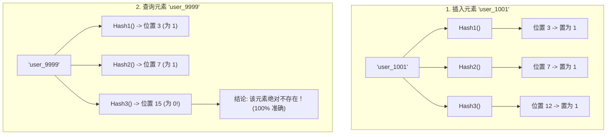

# 海量数据处理架构：布隆过滤器 BloomFilter 与 Top-K 高频统计

在海量数据（10 亿+ 用户、百亿级日志或数亿 URL）场景下，受限于服务器有限的内存（例如仅有 2GB~4GB RAM），传统的 Hash 表（`HashMap` / `HashSet`）由于需要存储完整的原始字符串，极易引发内存溢出（OOM）。

掌握**空间换时间极致优化的概率型数据结构 —— 布隆过滤器（BloomFilter）**，以及**海量数据 Top-K 统计架构**，是面试高频场景题的压轴杀手锏。

---

## 1. 布隆过滤器（BloomFilter）物理原理与误判率推导

布隆过滤器由一个极长的**二进制位数组（Bit Array）**与一组（$k$ 个）互不相关的**哈希函数（Hash Functions）**组成。



### 核心物理定律
- **若所有哈希位均为 1**：该元素**可能存在**（存在一定的假阳性误判率 False Positive Rate）；
- **只要有任意一个哈希位为 0**：该元素**绝对不存在**（零假阴性，100% 确定不存在）。

### 经典应用场景
1. **抵御缓存穿透**：在访问 Redis / MySQL 之前，先查布隆过滤器。若判定不存在，直接拒绝，彻底阻断黑客利用不存在的恶意 ID 穿透打爆数据库；
2. **海量爬虫 URL 去重**：数十亿抓取 URL，若存入内存需要上百 GB，使用布隆过滤器仅需几百 MB。

---

## 2. 海量数据 Top-K 高频统计工程级解决方案

### 经典面试场景题：在 100 亿条搜索记录日志中，统计出搜索频次最高的 Top 10 关键词（仅给 2GB 内存）

```mermaid
flowchart TD
    BigFile["100 亿条日志文件 (约 100GB 大文件)"]
    
    BigFile -->|1. Hash 分流: hash(word) % 1000| Partitions["切分成 1000 个小文件 (每个约 100MB，可载入内存)"]
    
    Partitions --> P1["小文件 1 -> 内存 HashMap 统计词频 -> 小顶堆求局部 Top 10"]
    Partitions --> P2["小文件 2 -> 内存 HashMap 统计词频 -> 小顶堆求局部 Top 10"]
    Partitions --> Pn["小文件 1000 -> 内存 HashMap 统计词频 -> 小顶堆求局部 Top 10"]
    
    P1 --> Merge["归并 1000 个局部 Top 10 (共 10000 个候选词)"]
    P2 --> Merge
    Pn --> Merge
    
    Merge --> FinalHeap["维护大小为 10 的全局小顶堆 (Min-Heap)"]
    FinalHeap --> Out["最终输出全局前 10 搜索热词！"]
```

### 核心解题三大步
1. **分而治之（Hash 取模分流）**：
   顺序读取 100GB 大文件，对每个词计算 `hash(word) % 1000`，分流到 1000 个小文件中。相同的词一定会被路由到同一个小文件中；
2. **单机内存统计（HashMap 统计）**：
   每个小文件仅 100MB，直接读入单机内存，用 `HashMap<String, Integer>` 统计局部词频；
3. **小顶堆筛选（Min-Heap）**：
   维护一个大小为 $K=10$ 的小顶堆。遍历小文件的词频，若当前频次大于堆顶，则弹出堆顶并插入当前词；1000 个小文件的局部 Top 10 汇总后再次归并，得出全局 Top 10。
