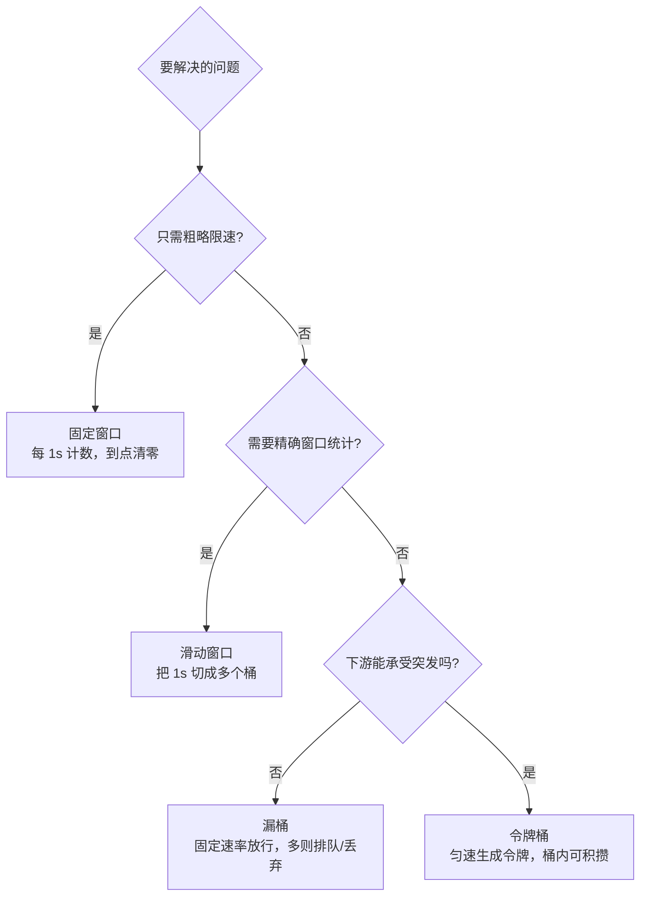
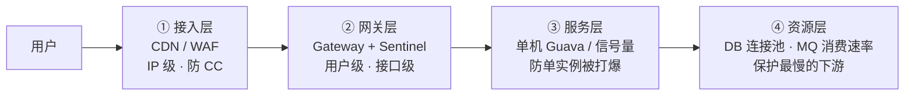

# 限流算法与分布式限流实战

## 使用入口：先解决问题，再做验证

保护有限处理能力并给超额请求明确反馈。

**先做基本操作**：先测容量、定义维度和阈值，验证允许/拒绝/依赖故障，再比较窗口、令牌桶与 Lua。初次学习可先完成[本模块基础实践](/doc/SystemDesign/系统设计基本方法与可靠性实践)。

**再逐步深入**：基本 API 与输入输出 → 常见失败和使用边界 → 场景排查与优化 → 本文机制分析与源码。面试先讲用途和自己的操作过程，再回答场景与原理追问。

> **一句话看懂**：限流不是「把 QPS 卡住」这么简单——四种算法的差别在于**能否应对临界突刺**、**是否允许突发流量**、以及**能否在分布式下精确计数**。

## 30 秒速览

| 算法 | 是否解决临界突刺 | 允许突发 | 实现复杂度 | 典型落地 |
| :--- | :---: | :---: | :--- | :--- |
| 固定窗口计数器 | 否 | 是（边界可翻倍） | 最低 | 简单脚本、低频接口 |
| **滑动窗口计数器** | **是** | 部分 | 中 | Sentinel QPS 统计、网关限流 |
| 漏桶（Leaky Bucket） | 是 | 否，恒定速率输出 | 中 | 需要严格平滑流量、保护下游 |
| 令牌桶（Token Bucket） | 是 | **是，允许一定突发** | 中 | Guava RateLimiter、Sentinel Warm Up |

---

## 一、四种算法到底差在哪



### 固定窗口的临界突刺（必考）

限流 100 QPS，窗口按整秒切分：

```text
  第 1 秒:  ████████████████████  (最后 100ms 涌入 100 个请求)
  第 2 秒:  ████████████████████  (前 100ms 又涌入 100 个请求)
                    ▲
            200ms 内实际承载 200 QPS，计数器却认为两个窗口都「合规」
```

**滑动窗口**把 1 秒切成 N 个桶（如 10 个 100ms），统计时永远只看「当前时间点往前 1 秒」覆盖的桶，边界突刺就无处可藏。这正是 Sentinel `LeapArray` 的做法（秒级 `sampleCount=2`，每桶 500ms，详见 [SpringCloud 第三节](/doc/Java/Spring/SpringCloud微服务核心组件与架构实战)）。

### 漏桶 vs 令牌桶：方向相反

| 维度 | 漏桶 | 令牌桶 |
| :--- | :--- | :--- |
| 类比 | 水桶底部固定小孔漏水 | 匀速往桶里放令牌，请求取到令牌才放行 |
| 输出 | **恒定速率**，无论输入多猛 | 平时匀速，但桶里积攒的令牌可支持**一次突发** |
| 突发流量 | 一律排队或丢弃 | 允许（上限 = 桶容量） |
| 适合 | 下游处理能力极刚性（如第三方接口配额） | 互联网业务常态：平时平稳，偶有脉冲 |

> 高分回答要点：**令牌桶更常用，因为它兼顾了「保护下游」与「不误伤正常突发」**；而 Sentinel 的「排队等待」是漏桶、「Warm Up」是令牌桶变体。

---

## 二、手写滑动窗口计数器（单机）

```java
public class SlidingWindowLimiter {
    private final int windowMs;      // 窗口总长，如 1000
    private final int bucketMs;      // 单桶长度，如 100
    private final int maxCount;      // 窗口内最大请求数
    private final AtomicIntegerArray buckets;
    private final int bucketNum;

    public SlidingWindowLimiter(int windowMs, int bucketMs, int maxCount) {
        this.windowMs = windowMs;
        this.bucketMs = bucketMs;
        this.maxCount = maxCount;
        this.bucketNum = windowMs / bucketMs;
        this.buckets = new AtomicIntegerArray(bucketNum);
    }

    public boolean tryAcquire() {
        long now = System.currentTimeMillis();
        int idx = (int) ((now / bucketMs) % bucketNum);
        long currentBucketTime = (now / bucketMs) * bucketMs;

        // 该桶若属于上一轮窗口，先清零（环形数组复用，避免对象回收）
        // 生产实现需额外维护 lastBucketTime[] 判断是否需要重置
        int sum = 0;
        for (int i = 0; i < bucketNum; i++) sum += buckets.get(i);
        if (sum >= maxCount) return false;

        buckets.incrementAndGet(idx);
        return true;
    }
}
```

**局限**：单机内存计数，多实例部署时每个实例各算各的，实际总流量 = 阈值 × 实例数。所以分布式场景必须把计数收敛到 Redis。

---

## 三、分布式限流：Redis + Lua

```lua
-- rate_limit.lua：滑动窗口精确计数，Redis 单线程保证原子
local key        = KEYS[1]
local now        = tonumber(ARGV[1])   -- 当前毫秒时间戳
local windowMs   = tonumber(ARGV[2])
local limit      = tonumber(ARGV[3])
local member     = ARGV[4]             -- 唯一请求标识（now + 随机串）

-- 1. 移除窗口外的旧请求
redis.call('ZREMRANGEBYSCORE', key, 0, now - windowMs)
-- 2. 统计窗口内请求数
local current = tonumber(redis.call('ZCARD', key))
if current >= limit then
    return 0                            -- 拒绝
end
-- 3. 记录本次请求
redis.call('ZADD', key, now, member)
redis.call('PEXPIRE', key, windowMs)   -- 关键：一定要设过期，防冷 key 常驻
return 1                                -- 放行
```

| 生产注意点 | 说明 |
| :--- | :--- |
| 必须 `PEXPIRE` | 否则不再访问的用户 key 永久占用内存 |
| 时钟依赖 | 多应用实例系统时钟不一致会让窗口边界错乱，需 NTP 对齐 |
| 大 key 风险 | 高 QPS 下 ZSet 元素暴涨，应改用「分桶计数 + INCR」近似方案降内存 |
| Redis 不可用 | **fail-open（放行）还是 fail-close（拒绝）要按业务定**：支付类倾向 fail-close，浏览类倾向 fail-open |

```java
// Spring 侧调用（Lua 脚本预加载，避免每次传全文）
DefaultRedisScript<Long> script = new DefaultRedisScript<>(LUA, Long.class);
Long ok = redisTemplate.execute(script,
    Collections.singletonList("rate:order:create:" + userId),
    String.valueOf(System.currentTimeMillis()), "1000", "20",
    UUID.randomUUID().toString());
if (ok == null || ok == 0) throw new RateLimitException("请求过于频繁");
```

---

## 四、分级限流：不要只在一层做



| 层级 | 粒度 | 典型阈值依据 |
| :--- | :--- | :--- |
| 接入层 | IP / 地域 | 单 IP 每秒请求数，防刷与爬虫 |
| 网关层 | 用户 / 接口 / 业务方 | 按 SLA 配额，支持动态配置下发 |
| 服务层 | 实例 / 线程池并发数 | 单机压测得出的最大安全并发 |
| 资源层 | 连接池 / 消费速率 | DB 最大连接数、下游接口配额 |

**层级之间要对齐**：网关限流阈值必须 ≤ 所有实例单机阈值之和，否则网关放过来的流量会先在服务层被拒，白白浪费资源。同理，超时时间必须短于上游熔断判定窗口（见 [SpringCloud 雪崩治理](/doc/Java/Spring/SpringCloud微服务核心组件与架构实战)）。

---

## 五、高频追问与回答要点

| 追问 | 高分特征 | 低分特征 |
| :--- | :--- | :--- |
| 「固定窗口有什么问题？」 | 画出临界突刺，说明 200ms 内可能放行 2 倍阈值 | 只答「不够精确」 |
| 「滑动窗口和令牌桶什么关系？」 | 明确前者是**统计手段**、后者是**放行策略**，不是同一层概念 | 把两者当并列算法挑一个 |
| 「分布式限流为什么用 Lua？」 | 多命令（清理 + 计数 + 写入 + 过期）必须原子，否则并发下超发 | 答「Lua 快」（快不是主因） |
| 「限流阈值怎么定？」 | 全链路压测得单机水位 → 留 30% 余量 → 配置中心动态可调 + 灰度验证 | 答「拍一个 1000」 |
| 「被限流的请求怎么处理？」 | 区分：返回 429 + Retry-After / 排队等待 / 降级兜底，并说明不能静默吞掉 | 只答「直接拒绝」 |

> 答题框架与容量估算见 [系统设计前言](/doc/SystemDesign/前言)；秒杀场景见 [高并发秒杀系统全链路设计](/doc/SystemDesign/高并发秒杀系统全链路设计)；Sentinel 生产规则持久化见 [SpringCloud 第三节](/doc/Java/Spring/SpringCloud微服务核心组件与架构实战)。
