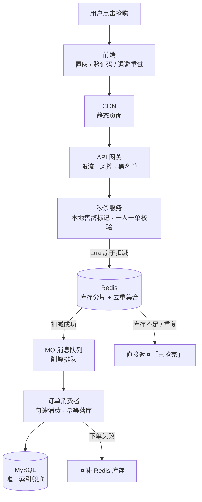
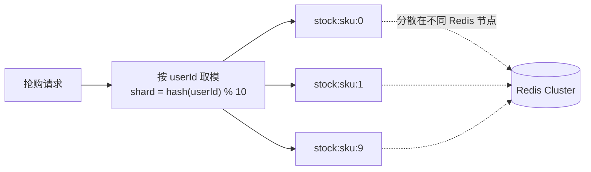

# 高并发秒杀系统全链路设计

## 使用入口：先解决问题，再做验证

在突发流量下正确创建订单与扣库存。

**先做基本操作**：先用条件更新、唯一键与入口限流验证不超卖，再根据峰值实测增加缓存/MQ 和补偿。初次学习可先完成[本模块基础实践](/doc/SystemDesign/系统设计基本方法与可靠性实践)。

**再逐步深入**：基本 API 与输入输出 → 常见失败和使用边界 → 场景排查与优化 → 本文机制分析与源码。面试先讲用途和自己的操作过程，再回答场景与原理追问。

> **一句话看懂**：秒杀的本质是**逐层削峰**——把 10 万 QPS 的瞬时流量，一层层拦到 MySQL 实际能扛的几百 TPS，且**绝不让无效请求走到数据库**。

## 30 秒速览

| 关键问题 | 结论 |
| :--- | :--- |
| 瓶颈在哪 | **不在应用服务器，在数据库行锁**（同一 SKU 库存行的竞争） |
| 核心手法 | 请求尽量在最前面被拦掉，有效请求先在 Redis 原子预扣，再异步落库 |
| 超卖怎么防 | Redis Lua 原子扣减 / DB `WHERE stock > 0` 乐观条件更新 |
| 少卖怎么防 | 异步下单失败必须**回补库存**，且要有对账兜底 |
| 热点库存怎么办 | 库存分片 `stock_0 ~ stock_9`，把单行热点拆成 10 个 key |
| 能不能不用 MQ | 小规模可以；一旦 DB 写入能力低于峰值，必须靠 MQ 排队削峰 |

---

## 一、先估算，再设计

假设：商品 1000 件库存，活动页 100 万 UV，开抢瞬间峰值 10 万 QPS。

| 层 | 承载 | 剩余流量 | 手段 |
| :--- | :--- | :--- | :--- |
| 客户端 | — | 10 万 → 3 万 | 按钮置灰、倒计时校准、答题/验证码、**随机重试退避** |
| CDN | 静态页 | 3 万 → 2 万 | 页面静态化，动态部分走单独接口 |
| 网关 | 2 万 | 2 万 → 5000 | 用户维度限流、黑名单、IP 限流 |
| 服务层 | 5000 | 5000 → 1000 | 本地缓存标记「已售罄」直接返回，请求不穿透 |
| Redis 预扣 | 1000 | **1000（有效）** | Lua 原子扣减 + 一人一单去重 |
| MQ | 1000 | 平滑成 200 TPS | 消息队列缓冲，消费者按 DB 能力匀速拉取 |
| MySQL | 200 TPS | 1000 单最终落库 | 唯一索引兜底防重 |

**关键判断**：1000 件库存意味着 99% 的请求注定失败。因此设计的第一原则是**尽早判失败**，而不是让所有请求都走完整链路去竞争同一行库存。

---

## 二、全链路架构



**同步链路只到 Redis 为止**：用户拿到「抢购排队中」即返回；真正的订单创建、余额扣减、库存最终扣减都在 MQ 后面异步完成。前端再轮询或用 SSE 获取最终结果。

---

## 三、超卖与少卖：两个方向都要防

### 超卖（卖超了）

```lua
-- seckill_deduct.lua：Redis Lua 保证「查库存 + 扣减 + 去重」原子执行
local stockKey = KEYS[1]                    -- seckill:stock:{skuId}:{shard}
local userKey  = KEYS[2]                    -- seckill:users:{skuId}
local userId   = ARGV[1]

-- 1. 一人一单去重（防同一用户重复抢）
if redis.call('SISMEMBER', userKey, userId) == 1 then
    return -1                                -- 已参与
end
-- 2. 库存判断
local stock = tonumber(redis.call('GET', stockKey) or '0')
if stock <= 0 then
    return 0                                 -- 已售罄
end
-- 3. 原子扣减 + 记录用户
redis.call('DECR', stockKey)
redis.call('SADD', userKey, userId)
return 1                                     -- 抢购成功，进入 MQ
```

```sql
-- MySQL 最后一道防线：条件更新，杜绝任何并发下的超卖
UPDATE t_sku_stock SET stock = stock - 1
WHERE sku_id = ? AND stock > 0;
-- 影响行数为 0 即说明库存已空，回滚订单
```

- **Redis 与 DB 双防线都要有**：Redis 挂了或数据被误刷时，DB 的条件更新是最后保险。
- 用 `DECR` 而非「先 GET 再 SET」，后者在并发下必然超卖。

### 少卖（库存没卖完）

| 场景 | 后果 | 处理 |
| :--- | :--- | :--- |
| MQ 消息丢失 | Redis 扣了但没落库 | 生产者 confirm + 消息持久化 + 本地消息表 |
| 消费者下单失败（余额不足、风控拒绝） | 库存被白占 | **回补 Redis 库存 + 移除用户去重集合**，且回补也要幂等 |
| 用户抢到后未支付 | 库存被占 30 分钟 | 延迟队列到期自动关单并回补（见 [MQ 延迟任务](/doc/Java/MQ消息队列与延迟任务实战)） |
| 缓存与 DB 不一致 | 长期少卖 | 定时对账任务：`Redis 剩余 + 已支付订单数 == 总库存` |

> 面试官追问「超卖和少卖哪个更严重」时要说清：**超卖是资损/客诉，必须硬防；少卖是体验问题，可通过对账回补收敛**。所以架构上优先把超卖防线做死。

---

## 四、热点库存分片

单个 SKU 的库存是一个 Redis key，10 万 QPS 全打在**同一个 Redis 节点的一个 key** 上，会触发单实例 CPU 瓶颈与网络热点。



| 要点 | 说明 |
| :--- | :--- |
| 初始化 | 1000 件库存均分成 10 份，每片 100 件 |
| 路由 | 按 `userId` 取模固定分片，同一用户始终落在同一片 |
| 单片售罄 | 不要直接返回失败，应**尝试其他分片**或做全局余量汇总，否则会出现「明明还有库存却提示抢完」 |
| 总库存查询 | 用单独的汇总 key 或异步累加，避免每次 `MGET` 10 个分片 |

---

## 五、兜底与降级

| 故障 | 降级动作 |
| :--- | :--- |
| Redis 不可用 | 网关直接返回「活动太火爆，稍后再试」，**绝不放流量打 DB** |
| MQ 积压 | 消费者横向扩容 + 限流消费速率；积压超过阈值时暂停新扣减 |
| DB 压力过大 | 关闭非核心写入（日志、埋点），订单创建走简化流程 |
| 下游支付超时 | 订单置为「待支付」，异步重试，不做同步阻塞 |
| 全链路过载 | 活动页直接静态化降级为「已结束」，保住站点其他业务 |

**熔断与隔离要前置**：秒杀服务必须独立部署、独立线程池、独立数据库连接池，绝不能和常规交易服务共用，否则秒杀一挂会拖垮整个商城（参见 [SpringCloud 雪崩治理](/doc/Java/Spring/SpringCloud微服务核心组件与架构实战) 第六节）。

---

## 六、高频追问与回答要点

| 追问 | 高分特征 | 低分特征 |
| :--- | :--- | :--- |
| 「为什么不在 DB 直接扣库存？」 | 指出同一 SKU 行锁竞争 + 连接数耗尽，峰值 TPS 远低于 DB 承载 | 只答「DB 慢」 |
| 「Redis 扣减和 DB 落库不一致怎么办？」 | 讲清最终一致 + 对账回补 + 唯一索引兜底，明确业务能接受的不一致窗口 | 答「用分布式事务强一致」（性能会被拖垮） |
| 「为什么用 MQ？」 | 削峰：把瞬时 1000 TPS 拉平成 DB 能承受的 200 TPS，并解耦下单与支付 | 只答「异步提高性能」 |
| 「热点 key 怎么处理？」 | 库存分片 + 本地售罄标记 + 请求不穿透，三层一起说 | 只答「加 Redis 集群」 |
| 「一人一单怎么保证？」 | Redis Set 去重 + DB `(user_id, sku_id)` 唯一索引双层防重 | 只靠前端按钮置灰 |

> 答题框架见 [系统设计前言](/doc/SystemDesign/前言)；限流细节见 [限流算法与分布式限流实战](/doc/SystemDesign/限流算法与分布式限流实战)；幂等落库见 [幂等性设计与重复请求治理](/doc/SystemDesign/幂等性设计与重复请求治理)。
