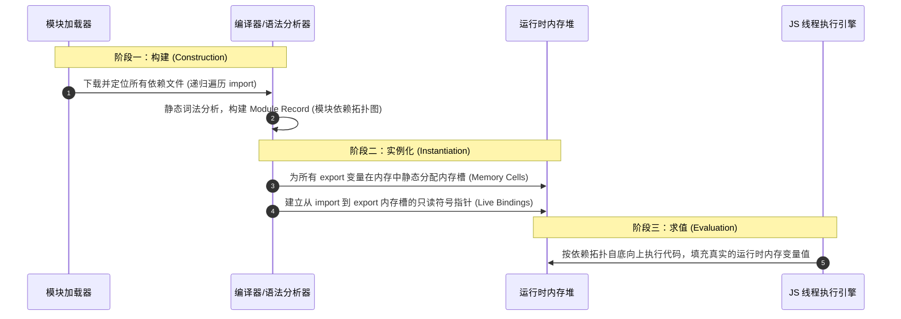
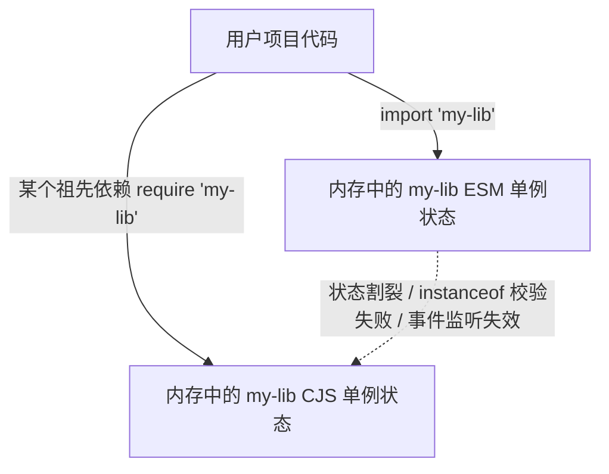

# JavaScript 模块化规范与扩展名深度对比（.js / .mjs / .cjs）

> **核心目标**：彻底理清现代 JavaScript 模块系统在 Node.js、浏览器以及现代前端构建工具（Vite / Webpack / Rollup）中的行为差异。剖析 `.js`、`.mjs`、`.cjs` 的底层语义、执行时序、互操作陷阱与双包隐患，提供企业级库开发与工程配置的标准避坑范式。

---

## 一、为什么需要三种扩展名？演进全景图

在早期的 JavaScript 生态中，浏览器端长期缺乏原生模块机制，而 2009 年诞生的 Node.js 率先采纳了 **CommonJS (CJS)** 作为服务端默认模块标准。直到 2015 年，ECMAScript 官方正式推出 **ES Modules (ESM)** 标准。

由于两者在设计哲学（**动态运行时求值** vs **静态编译期解析**）上存在不可调和的底层差异，Node.js 从 v12 开始正式引入了显式扩展名与 `package.json` 中的 `"type"` 字段来消除二义性：

```mermaid
flowchart TD
    File["输入文件扩展名"] --> ExtCheck{扩展名判断}
    
    ExtCheck -- ".mjs" --> ForceESM["强制以 ES Modules (ESM) 解析<br/>支持 import / export，启用严格模式"]
    ExtCheck -- ".cjs" --> ForceCJS["强制以 CommonJS (CJS) 解析<br/>支持 require / module.exports"]
    ExtCheck -- ".js" --> PkgCheck["向上寻找最近的 package.json"]
    
    PkgCheck --> TypeCheck{package.json 中<br/>是否有 type 字段？}
    TypeCheck -- '"type": "module"' --> ResolveESM["解析为 ES Modules (ESM)"]
    TypeCheck -- '"type": "commonjs" 或缺省' --> ResolveCJS["解析为 CommonJS (CJS)"]

    style ForceESM fill:#e1f5fe,stroke:#03a9f4,stroke-width:2px
    style ForceCJS fill:#fff3e0,stroke:#ff9800,stroke-width:2px
    style ResolveESM fill:#e1f5fe,stroke:#03a9f4,stroke-width:2px
    style ResolveCJS fill:#fff3e0,stroke:#ff9800,stroke-width:2px
```

---

## 二、三者核心差异与决策矩阵

下表总结了 `.js`、`.mjs` 与 `.cjs` 在 Node.js、浏览器与构建工具环境下的完整行为差异：

| 维度对比 | `.cjs` (CommonJS) | `.mjs` (ES Module) | `.js` (动态判定) |
| :--- | :--- | :--- | :--- |
| **标准制定者** | Node.js 社区驱动 (2009) | TC39 ECMA 官方标准 (ES2015) | 随环境与配置动态决定 |
| **模块解析时机** | **运行时（动态同步加载）** | **编译时（静态结构解析）** | 取决于解析为 ESM 还是 CJS |
| **核心语法** | `require()` / `module.exports` | `import` / `export` / 动态 `import()` | 根据所在环境支持对应语法 |
| **内置上下文变量** | 提供 `__dirname`、`__filename`、`module`、`exports`、`require` | **无** `__dirname` / `__filename`，使用 `import.meta` | CJS 模式有；ESM 模式无 |
| **顶层 this 指向** | 指向当前模块的 `exports` 对象 | 指向 `undefined` | 对应模式的 this 表现 |
| **模式要求** | 默认非严格模式（可显式加 `"use strict"`） | **强行默认严格模式**（无需显式声明） | ESM 默认严格，CJS 默认非严格 |
| **顶层 Await** | ❌ 原生不支持（必须包裹在 async IIFE 中） | ✅ 原生支持 Top-Level Await (TLA) | 仅当被解析为 ESM 时支持 |
| **值传递特性** | **值的浅拷贝（值复制）** | **实时只读引用绑定（Live Bindings）** | 依模式而定 |
| **Tree-Shaking 支持** | ❌ 极度困难（动态导出无法静态死代码消除） | ✅ 原生支持静态依赖图死代码剔除 | 仅在 ESM 模式下支持物理剪枝 |
| **浏览器原生支持** | ❌ 无法直接原生运行（需打包或 SystemJS） | ✅ `<script type="module" src="...">` | 需由服务器 MIME 及 `<script>` 类型决定 |

---

## 三、底层运行机制深度剖析

### 3.1 CommonJS (`.cjs`)：函数包装器与值拷贝机制

在 Node.js 中，每一个 `.cjs` 文件在被 `require` 加载并执行前，都会被 V8 外层自动包裹在一个匿名函数中：

```javascript
// Node.js 内部对 CommonJS 源码的物理包裹结构
(function (exports, require, module, __filename, __dirname) {
  // 你的 .cjs 源代码在这一层运行
  const a = 1;
  module.exports = { a };
});
```

这也解释了为什么 `.cjs` 内部能随时使用 `__dirname`、`__filename` 以及为什么顶层的 `this === exports`。

#### 值拷贝陷阱演示
CommonJS 导出的本质是对 `module.exports` 对象的属性拷贝。一旦导出完成，模块内部变量后续的自增或修改**不会同步反映到外部引用者**中：

```javascript
// counter.cjs
let count = 0;
function increment() { count++; }
module.exports = { count, increment };

// main.cjs
const { count, increment } = require('./counter.cjs');
console.log(count); // 0
increment();
console.log(count); // 依然是 0！因为 count 是基本类型的值浅拷贝
```

---

### 3.2 ES Modules (`.mjs`)：三阶段时序与实时只读引用（Live Bindings）

ESM 规范严格按照三个物理阶段流转：



#### 实时引用（Live Bindings）实战证明
在 ESM (`.mjs`) 中，`import` 接收的不是值的快照，而是一个**直接指向源模块内部变量内存槽的只读引用**：

```javascript
// counter.mjs
export let count = 0;
export function increment() {
  count++; // 源模块内部写操作
}

// main.mjs
import { count, increment } from './counter.mjs';

console.log(count); // 0
increment();
console.log(count); // 1！外部读操作直接映射到了源模块的内存变更！

// 尝试在外部直接修改绑定：
// count = 2; // 抛出 TypeError: Assignment to constant variable.
```

---

## 四、Node.js 关键避坑与运行时差异

### 4.1 陷阱一：`.mjs` 中缺失 `__dirname` 与 `__filename`

由于 ESM 规范不仅运行于 Node.js，更作为 W3C/ECMA 跨平台标准运行于浏览器端，不存在操作系统本地绝对路径的概念，因此废弃了全局变量 `__dirname` 和 `__filename`。

#### 标准替代方案（双版本兼顾）：

**Node.js 20.11.0+ 原生语法（推荐）：**
```javascript
// 在 .mjs 或 "type": "module" 下原生支持
console.log(import.meta.filename); // 当前文件的绝对物理路径
console.log(import.meta.dirname);  // 当前文件所在目录的绝对物理路径
```

**传统 Node.js LTS 跨平台标准兼容写法：**
```javascript
import { fileURLToPath } from 'node:url';
import { dirname } from 'node:path';

const __filename = fileURLToPath(import.meta.url);
const __dirname = dirname(__filename);

console.log(__filename);
console.log(__dirname);
```

---

### 4.2 陷阱二：ESM 与 CJS 互相加载的规则与边界

#### 1. ESM (`.mjs`) 加载 CJS (`.cjs`)：
Node.js 允许 ESM 直接 `import` CJS 模块。Node 内部使用 `cjs-module-lexer` 库静态扫描 CJS 导出：

```javascript
// cjs-lib.cjs
module.exports = {
  foo: 'hello',
  bar: () => 123
};

// app.mjs
// 1. 默认导入总是稳妥的：
import cjsLib from './cjs-lib.cjs';
console.log(cjsLib.foo);

// 2. 静态命名导出通常由 lexer 解析成功：
import { foo, bar } from './cjs-lib.cjs';

// 3. ⚠️ 动态导出命名可能解析失败：
// 如果 CJS 是在运行时动态赋予 module.exports（例如 Object.assign(module.exports, ...)）
// cjs-module-lexer 无法静态分析，导致具名 import 报 SyntaxError！
// 兜底方案：使用 createRequire
import { createRequire } from 'node:module';
const require = createRequire(import.meta.url);
const dynamicPkg = require('./dynamic-cjs.cjs');
```

#### 2. CJS (`.cjs`) 加载 ESM (`.mjs`)：
长期以来，在 CommonJS 中使用 `require('./esm.mjs')` 会直接抛出 `ERR_REQUIRE_ESM` 致命错误，必须借助异步 `import()`：

```javascript
// 在旧版本 Node.js 的 .cjs 中引入 ESM
async function run() {
  const { default: chalk } = await import('chalk');
  console.log(chalk.green('Loaded ESM inside CJS'));
}
run();
```

> **Node.js 22+ 最新演进**：
> Node.js v22.0.0 引入了 `--experimental-require-module` 标志（在 Node.js v23 中默认启用），允许在 CommonJS 中同步执行 `require('./esm-file.mjs')`！  
> **限制条件**：被引用的 ESM 模块图谱中**绝不能包含顶层 Await (Top-Level Await)**，一旦检测到 TLA，Node.js 依然会抛出异常。

---

### 4.3 陷阱三：双包陷阱（Dual Package Hazard）

当一个开源 npm 库同时提供 ESM 产物（供 Vite/Rollup 打包）与 CJS 产物（供 Node.js 老项目运行）时，如果不加规范，很容易引发**双包陷阱**：



**危害**：如果该库内部维护了全局单例（如 Redux Store、Vue 响应式系统、全局 Symbol、缓存字典），双包加载会导致内存中存在两个隔离的状态实例，导致 `instance instanceof CustomClass` 为 `false`。

**工业级防范 SOP（Wrapper 方案）**：
让 ESM 构建入口只作为一份薄薄的包装层，底层实际逻辑统一引入并绑定 CJS 实现：

```javascript
// dist/index.cjs (业务真身)
class Store { /* 单例逻辑 */ }
module.exports = { Store, instance: new Store() };

// dist/index.mjs (纯代理包装层，确保运行时内存单例唯一)
import cjs from './index.cjs';
export const Store = cjs.Store;
export const instance = cjs.instance;
export default cjs;
```

---

## 五、现代前端工程配置标准（package.json 条件导出）

在现代 Monorepo 或 NPM 公共库开发中，利用 `package.json` 的 `exports` 条件导出可以彻底杜绝文件扩展名识别混乱：

```json
{
  "name": "my-modern-library",
  "version": "1.0.0",
  "type": "module",
  "main": "./dist/index.cjs",
  "module": "./dist/index.mjs",
  "types": "./dist/index.d.ts",
  "exports": {
    ".": {
      "types": {
        "import": "./dist/index.d.mts",
        "require": "./dist/index.d.cts"
      },
      "import": "./dist/index.mjs",
      "require": "./dist/index.cjs"
    },
    "./package.json": "./package.json"
  },
  "scripts": {
    "build": "tsup src/index.ts --format cjs,esm --dts"
  }
}
```

> **规则注意**：
> 1. `exports` 字段中的 `types` 必须放在 `import` 和 `require` 的**最上方**，否则旧版本 TypeScript 编译器无法优先匹配到正确的类型声明文件；
> 2. `.d.mts` 对应 ESM 类型的声明，`.d.cts` 对应 CJS 类型的声明。

---

## 六、大厂高频面试真题与追问速查

### Q1：为什么 Vite 本地开发构建比 Webpack 快成百上千倍？与 `.mjs` 有何联系？
> **参考回答**：  
> Webpack 的底层思路是“先抓取并递归分析所有模块依赖，在内存中完成 Bundle 打包，再启动服务器”。  
> 而 Vite 在本地开发阶段基于**浏览器原生支持的 ES Modules (`<script type="module">` / `.mjs`)**。Vite 只需启动一个轻量级的 Connect 静态服务器，当浏览器解析到页面的 `import` 时才按需发起 HTTP 请求，Vite 服务端利用 esbuild 对第三方依赖进行预构建转换，对源码按需单文件转换后直出浏览器。避免了全量打包的计算开销。

### Q2：ESM 中的 Tree-Shaking 为什么在 CommonJS 中几乎无法工作？
> **参考回答**：  
> 1. **静态解析 vs 动态加载**：ESM 的 `import` 和 `export` 语法是完全静态的，不能包裹在 `if` 分支或函数体中，在编译阶段（AST 分析）即可准确推导出无用死代码导出；
> 2. **CJS 的动态不确定性**：CommonJS 的 `require(path)` 支持动态计算路径（如 `require('./plugin/' + name)`），且 `module.exports` 是一个普通 JS 对象，可以在运行时被随意修改、重写或通过循环动态赋值（如 `for (let k in obj) exports[k] = ...`），打包工具无法在构建期准确判断某个属性是否绝对未被使用，因此无法安全进行死代码摇树裁剪。

### Q3：如果在 `"type": "module"` 的项目中，某个遗留配置文件（如旧版 `postcss.config.js`）依然写了 `module.exports` 会怎样？如何修复？
> **参考回答**：  
> 会直接报错抛出 `ReferenceError: module is not defined in ES module scope`。  
> **修复方式**：
> 1. **重命名扩展名**：将 `postcss.config.js` 重命名为 `postcss.config.cjs`，显式告知 Node.js 与构建工具该文件依然遵循 CommonJS 规范；
> 2. **改写为 ESM 语法**：将 `module.exports = { plugins: [...] }` 改写为 `export default { plugins: [...] }`。
