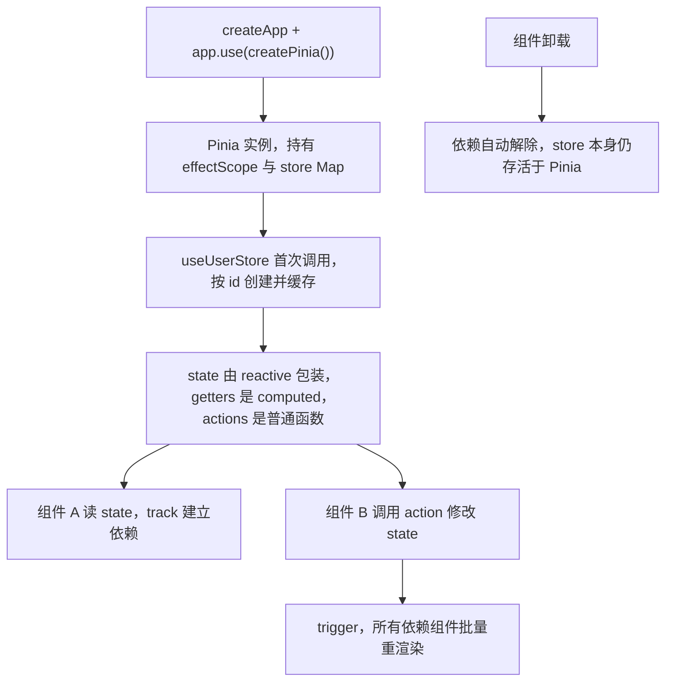

# Pinia 状态管理与架构实战

## 使用入口：先解决问题，再做验证

管理跨组件和跨页面共享状态。

**先做基本操作**：先定义 store 的 state/action、在两页共享和退出清理，验证 storeToRefs 与持久化，再讲机制。初次学习可先完成[本模块基础实践](/doc/Vue/Vue组件与页面基本使用)。

**再逐步深入**：基本 API 与输入输出 → 常见失败和使用边界 → 场景排查与优化 → 本文机制分析与源码。面试先讲用途和自己的操作过程，再回答场景与原理追问。

## 基本使用：两种 store 定义方式

```ts
// ① 选项式：结构清晰，$reset 开箱可用，适合团队规范统一
export const useUserStore = defineStore('user', {
  state: () => ({ token: '', profile: null as Profile | null, perms: [] as string[] }),
  getters: {
    isLogin: (s) => !!s.token,
    displayName: (s) => s.profile?.nick ?? '游客',
    // 需要用到其他 getter 时只能用普通函数，且必须显式标注返回类型（TS 循环推导）
    hasPerm: (s) => (code: string) => s.perms.includes(code),
  },
  actions: {
    async login(form: LoginForm) {
      const { token } = await api.login(form)
      this.token = token                       // action 里 this 指向 store，可直接改
      this.profile = await api.getProfile()
    },
    logout() { this.$reset() },
  },
})
```

```ts
// ② setup 式：可用 composable / watch / 私有变量，灵活度最高
export const useCartStore = defineStore('cart', () => {
  const items = shallowRef<CartItem[]>([])
  const total = computed(() => items.value.reduce((n, i) => n + i.price * i.qty, 0))
  const privateSeq = ref(0)                    // 不暴露给外部的状态，天然私有
  watch(items, saveToLocal, { deep: true })
  async function add(item: CartItem) { items.value = [...items.value, item] }
  function reset() { items.value = [] }        // setup 式需自己实现 $reset
  return { items, total, add, reset }
})
```

选型建议：**业务实体（用户、权限、配置）用选项式**，结构一目了然；**需要复用 composable 或封装复杂副作用的用 setup 式**。同一项目别混着写风格。

> **一句话结论**：Pinia 的本质就是「一个用 `reactive`/`ref` 创建的全局响应式对象 + `effectScope` 管理作用域」，没有 mutation、没有模块嵌套、没有魔法字符串；`storeToRefs` 是唯一必须记住的 API 细节。

## 30 秒速览

| 能力 | 写法 | 说明 |
|---|---|---|
| 定义 store | `defineStore('user', { state, getters, actions })` | 或 setup 写法 `defineStore('user', () => {...})` |
| 读状态 | `store.name` / `storeToRefs(store).name` | **解构必须用 storeToRefs**，否则丢响应 |
| 批量改 | `store.$patch({...})` 或 `$patch(state => {...})` | 一次触发更新，devtools 里合并成一条记录 |
| 重置 | `store.$reset()` | 仅选项式 store 支持，setup 写法要自己写 reset |
| 订阅状态 | `store.$subscribe((mutation, state) => ...)` | 适合持久化、埋点 |
| 订阅动作 | `store.$onAction(({name, after, onError}) => ...)` | 适合统一 loading / 错误上报 |
| 替换整个 state | `store.$state = {...}` | 用于 SSR 注水 / 持久化恢复 |

## 一张图看懂 Pinia 在应用中的位置



注意 **store 是单例但组件依赖是各自的**：组件卸载不会销毁 store，这正是全局状态的含义；副作用要自己清理。

## 二、Pinia vs Vuex 到底改了什么

| 维度 | Vuex 3/4 | Pinia |
|---|---|---|
| 写状态 | 必须 `commit('mutation', payload)`，异步走 `dispatch` | 直接 `store.count++` 或在 action 里赋值 |
| mutation | 有，仅为 devtools 追踪同步变更 | **彻底移除**，状态变更天然可被 `$subscribe` 追踪 |
| 模块 | `modules` 嵌套 + `namespaced` 字符串路径 | 每个 store 独立文件、独立 id，扁平化 |
| TS | 需手写 `MutationTree` / `this.$store` 增强类型 | 零配置推导，`defineStore` 返回值自带完整类型 |
| SSR | 需手动 `createStore()` 每请求隔离 | `createPinia()` 每请求一个实例，天然隔离 |
| 体积 / 生态 | 约 2.5KB，官方已停止新特性 | 约 1.5KB，Vue 官方推荐，支持 devtools 时间旅行 |

高分答法：**mutation 存在的原因只是为了让 devtools 能区分「谁改的、改了什么」，Proxy 响应式本身已能记录全部变更，所以 Pinia 用 `$subscribe` 的 mutation 事件替代了整套 commit 机制**。

## 四、`storeToRefs` 为什么必须存在

```ts
const store = useUserStore()
const { token, isLogin } = store            // ❌ token 是普通字符串快照；getters 同样丢失
const { token, isLogin } = storeToRefs(store) // ✅ 每个字段转成 ref，保持连接
const { login } = store                     // ✅ action 是函数，直接解构没问题
```

原理：store 本身是 `reactive` 代理，解构走的是属性取值（`toRefs` / `storeToRefs` 会生成 `ObjectRefImpl`，读取时转发到 `store[key]`，从而重新触发 track）。**action 不需要转换**，因为它只是绑定了 store 的函数。

## 五、生产级持久化与订阅

```ts
// plugins/persist.ts —— 比直接引第三方库更可控，可精确到字段白名单
export function persistPlugin({ store }: PiniaPluginContext) {
  const key = `pinia:${store.$id}`
  const whitelist: Record<string, string[]> = { user: ['token'], setting: ['theme', 'locale'] }
  const fields = whitelist[store.$id]
  if (!fields) return

  try {
    const saved = JSON.parse(localStorage.getItem(key) ?? '{}')
    store.$patch(Object.fromEntries(fields.filter(f => f in saved).map(f => [f, saved[f]])))
  } catch { /* 数据损坏时静默忽略，不能让整个应用起不来 */ }

  store.$subscribe((_mutation, state) => {
    localStorage.setItem(key, JSON.stringify(Object.fromEntries(fields.map(f => [f, state[f]]))))
  }, { detached: true })   // detached：组件卸载后订阅仍有效
}

// main.ts
const pinia = createPinia()
pinia.use(persistPlugin)
app.use(pinia)
```

三个坑：

1. **别持久化整个 state**：接口返回的大对象、`loading` 标记、临时弹窗状态写进 localStorage 会造成隐私与体积问题；
2. **`detached: true`** 不写的话，订阅会绑定在创建 store 的那个组件作用域上，组件一卸载持久化就失效；
3. **SSR 必须每请求新建 pinia**，否则用户 A 的 token 会串到用户 B 的渲染结果里（`useRequest` 里同理）。

## 六、store 拆分与反模式

| 反模式 | 后果 | 正确做法 |
|---|---|---|
| 一个 `useAppStore` 装全部状态 | 任一字段变化触发所有订阅组件重渲染 | 按业务域拆 `user` / `cart` / `permission` |
| 把表单草稿、弹窗开关塞进 store | 全局状态污染，路由切换残留 | 组件局部 `ref` |
| 在 store 里直接操作 DOM / router | 职责越界，难以单测 | action 返回结果，组件决定跳转 |
| getter 里发请求 | 每次读取都可能触发副作用，且无缓存保证 | 放 action + `watch` |
| 用 `store.$state = {...}` 做局部更新 | 覆盖其他字段，引用全变 | `$patch` 或逐字段赋值 |
| 组件里 `watch(() => store.xxx)` 层层转发 | 多余的中间层 | 直接 `storeToRefs` + `computed` |

**判断该不该进 store 的三问**：跨页面/跨路由要读吗？刷新后需要恢复吗？多个不相邻组件要同时改吗？两个以上答「是」才放。

## 七、高频追问（含高分/低分特征）

| 追问 | 高分回答要点 | 低分回答 |
|---|---|---|
| Pinia 为什么去掉 mutation？ | Proxy 已能追踪全部变更，`$subscribe` 提供 mutation 元数据，commit 只是历史包袱 | 「写起来更简单」 |
| 解构 store 为什么丢响应？ | reactive 代理的属性取值是快照；`storeToRefs` 生成转发 ref 重新建立 track | 「Vue 不支持解构」 |
| action 能异步吗？this 指向谁？ | 能，`this` 是 store 代理实例，箭头函数会丢失 this | 「不能，要用 dispatch」 |
| 怎么实现持久化？ | `$subscribe` + 字段白名单 + `detached` + 异常兜底，或用插件 | 「用 localStorage 在组件里写」 |
| SSR 下 Pinia 有什么坑？ | 必须每请求 `createPinia()`，避免跨请求状态污染；注水用 `$state` 替换 | 「没问题，和 CSR 一样」 |
| getters 和 computed 什么关系？ | getters 就是绑定了 store 作用域的 computed，带缓存 | 「两个不同东西」 |

**延伸阅读**：[组合式 API 与实战解析](/doc/Vue/组合式API与实战解析)、[路由权限守卫与实战](/doc/Vue/路由权限守卫与实战)。
