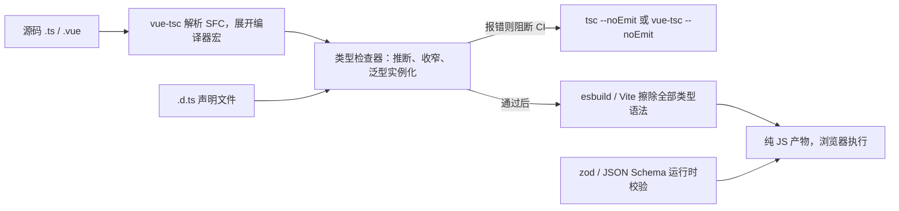

# TypeScript 工程实践与类型体操

## 使用入口：先解决问题，再做验证

在开发期发现数据形状与调用错误。

**先做基本操作**：先启用 strict，为接口和组件声明类型，检查编译与外部输入运行时校验，再学泛型和 infer。初次学习可先完成[本模块基础实践](/doc/Vue/Vue组件与页面基本使用)。

**再逐步深入**：基本 API 与输入输出 → 常见失败和使用边界 → 场景排查与优化 → 本文机制分析与源码。面试先讲用途和自己的操作过程，再回答场景与原理追问。

## 基本使用：类型系统的四块地基

```ts
// ① 结构化类型：不看名字，只看形状
interface Point { x: number; y: number }
interface Vec2  { x: number; y: number }
const p: Point = { x: 1, y: 2 }
const v: Vec2 = p                        // ✅ 合法，形状一致
// 但「对象字面量直接赋值」会做 excess property check，多字段会报错
const bad: Point = { x: 1, y: 2, z: 3 } // ❌ 多余属性 z

// ② unknown 必须先收窄才能用；any 直接放行
function handle(v: unknown) {
  // v.toFixed() ❌
  if (typeof v === 'number') v.toFixed(2)          // ✅ typeof 收窄
  if (typeof v === 'object' && v !== null && 'id' in v) v.id // ✅ in 收窄
}

// ③ 判别联合：用同一个字面量字段做标签，最强收窄模式
type Result<T> = { status: 'ok'; data: T } | { status: 'error'; message: string }
function render(r: Result<User>) {
  if (r.status === 'ok') return r.data.name        // 自动收窄到 ok 分支
  return r.message                                 // 自动收窄到 error 分支
}

// ④ 类型谓词：把自定义判断变成收窄能力
function isUser(v: unknown): v is User {
  return typeof v === 'object' && v !== null && 'id' in v && 'name' in v
}
```

> **一句话结论**：TypeScript 是**结构化类型系统 + 编译期擦除**——类型只在写码和构建时存在，运行时一个字节都不留；Vue3 的所有「类型推导」都建立在泛型 + 编译器宏（`defineProps` / `defineEmits` / `defineModel`）上，理解这两点，类型体操就不再是背 API。

## 30 秒速览

| 概念 | 一句话 | 最容易错的地方 |
|---|---|---|
| 结构化类型 | 只看形状，不看名字（鸭子类型） | 两个字段相同的 interface 可互相赋值 |
| `any` / `unknown` / `never` | 放弃检查 / 安全的未知 / 不可能存在 | `any` 会沿调用链传染，静默吞掉错误 |
| 类型收窄 | `typeof` / `in` / 判别联合 / 类型谓词 | 收窄在回调里会失效（可变变量） |
| 泛型 | 把类型当参数，保留输入与输出的关系 | 写成 `<T>` 却返回具体类型，等于没用 |
| 条件类型 + `infer` | 类型层面的 `if` 与「提取」 | 分发条件类型对联合逐个求值 |
| 映射类型 | 遍历 key 生成新类型 | 忘记 `-?` / `readonly` 修饰符处理 |
| `import type` | 只导入类型，编译后完全消失 | 不加时可能被打包器带进运行时 |
| `satisfies` | 校验形状但保留字面量类型 | 与 `: Type` 注解的区别是「不拓宽」 |

## 一张图看懂类型检查发生在哪



**关键认知**：类型系统管不到外部输入。接口返回、localStorage、URL 参数、表单提交这些**运行时边界**必须用 zod 之类的校验补齐，否则 `as User` 只是自欺欺人。

## 三、泛型、条件类型与 `infer`（类型体操核心四招）

```ts
// 招式 1：约束 + 默认值 + 保留关系
function pick<T extends object, K extends keyof T>(obj: T, keys: K[]): Pick<T, K> {
  return keys.reduce((acc, k) => ({ ...acc, [k]: obj[k] }), {} as Pick<T, K>)
}
const u = pick({ id: 1, name: 'a', age: 20 }, ['id', 'name'])  // 类型精确为 {id:number; name:string}

// 招式 2：条件类型 + infer 提取
type ElementType<T> = T extends (infer U)[] ? U : never
type Awaited2<T> = T extends Promise<infer U> ? Awaited2<U> : T   // 递归解开多层 Promise
type ReturnOf<F> = F extends (...args: any[]) => infer R ? R : never

// 招式 3：映射类型 + 修饰符；-? 去掉可选，readonly 控制只读
type Mutable<T> = { -readonly [K in keyof T]: T[K] }
type DeepPartial<T> = T extends object ? { [K in keyof T]?: DeepPartial<T[K]> } : T
type Getters<T> = { [K in keyof T as `get${Capitalize<string & K>}`]: () => T[K] }

// 招式 4：模板字面量类型做事件名 / 路由约束
type EventName = `on${Capitalize<'click' | 'change'>}`   // 'onClick' | 'onChange'
type Route = `/api/${'user' | 'order'}/${number}`
```

**分发条件类型**：`T extends U ? X : Y` 当 `T` 是联合类型时会**逐个成员**求值再合并，`T = 'a'|'b'` 得到 `X(a)|X(b)`；想关掉分发要写成 `[T] extends [U]`。`Exclude` / `Extract` 就是靠这个实现的。

| 内置工具类型 | 等价实现 | 用途 |
|---|---|---|
| `Partial<T>` | `{ [K in keyof T]?: T[K] }` | 表单草稿、patch 入参 |
| `Required<T>` | `{ [K in keyof T]-?: T[K] }` | 配置补全后 |
| `Pick<T,K>` / `Omit<T,K>` | 映射 + `as` 过滤 key | DTO 裁剪 |
| `Record<K,V>` | `{ [P in K]: V }` | 字典、枚举映射 |
| `ReturnType<F>` / `Parameters<F>` | `infer` 提取 | 从函数反推类型 |
| `Awaited<T>` | 递归解 Promise | 接口返回值 |
| `NonNullable<T>` | `T & {}` | 去掉 null/undefined |

## 四、Vue3 + TS 实战（最容易写错的部分）

```vue
<script setup lang="ts" generic="T extends { id: string | number }">
// Vue 3.3+ 支持泛型组件：列表项类型由父组件传入，全程推导
import { ref, computed, toRef, type Ref } from 'vue'

const props = defineProps<{
  items: T[]
  selected?: T['id']
  modelValue: string
}>()
// 带默认值要用 withDefaults，否则 selected 类型是 T['id'] | undefined
withDefaults(defineProps<{ size?: 'sm' | 'md' }>(), { size: 'md' })

const emit = defineEmits<{
  'update:modelValue': [value: string]
  select: [item: T, index: number]     // 3.3+ 具名元组语法，比旧写法更清晰
}>()

const model = defineModel<string>({ required: true })   // 3.4+
const keyword = ref('')                                 // Ref<string>
const filtered = computed(() => props.items.filter(i => String(i.id).includes(keyword.value)))
const idRef = toRef(props, 'selected')                  // props 不解构，用 toRef 保持响应
</script>
```

| 场景 | 正确写法 | 常见错误 |
|---|---|---|
| props 默认值 | `withDefaults(defineProps<T>(), {...})` | 用运行时 `default` 丢类型推导 |
| 组件实例类型 | `InstanceType<typeof MyComp>` | `ref<MyComp>()`（把组件当值类型） |
| 模板 ref | `const el = ref<HTMLInputElement \| null>(null)` | `ref<HTMLInputElement>()` 初值类型不符 |
| 事件类型 | `(e: Event) => (e.target as HTMLInputElement).value` | 直接 `e.target.value` 报 `EventTarget` 无 value |
| 仅类型导入 | `import type { User } from '@/types'` | 运行时导入导致循环依赖 / 打包冗余 |
| props 解构 | `const { id } = toRefs(props)` 或 3.5 响应式解构 | 直接解构丢响应 |

```ts
// 泛型 composable：请求返回类型随 URL/泛型参数走，调用方零断言
export function useRequest<T>(url: MaybeRefOrGetter<string>) {
  const data = shallowRef<T | null>(null)
  const error = ref<Error | null>(null)
  // ...
  return { data, error }   // 推导为 ShallowRef<T | null>，无需手写返回类型
}
const { data } = useRequest<User[]>('/api/users')   // data: ShallowRef<User[] | null>
```

**工程配置要点**（`tsconfig.json`）：

```jsonc
{
  "compilerOptions": {
    "strict": true,
    "noUncheckedIndexedAccess": true,      // arr[0] 变为 T | undefined，杜绝越界崩溃
    "exactOptionalPropertyTypes": true,    // 区分「没传」与「传了 undefined」
    "isolatedModules": true,               // esbuild 单文件编译必须开
    "verbatimModuleSyntax": true,          // 强制 import type，避免类型被当值导入
    "noEmit": true,                        // 类型检查交给 vue-tsc，产物交给 Vite
    "paths": { "@/*": ["./src/*"] }       // 与 Vite alias 保持一致
  },
  "include": ["src/**/*.ts", "src/**/*.vue", "env.d.ts", "auto-imports.d.ts"]
}
```

质量门禁：`vue-tsc --noEmit && vite build`。只跑 `vite build` 不会做类型检查，CI 里必须有独立的 typecheck 步骤。

## 五、运行时边界：类型擦除后的真实世界

```ts
import { z } from 'zod'
const UserSchema = z.object({ id: z.number(), name: z.string(), role: z.enum(['admin', 'user']) })
type User = z.infer<typeof UserSchema>          // 单一数据源：校验规则即类型

async function getUser(): Promise<User> {
  const raw = await fetch('/api/user').then(r => r.json())  // raw 是 any
  return UserSchema.parse(raw)                             // 不合法直接抛错，而非静默带着坏数据运行
}
```

## 六、生产避坑清单

| 坑 | 后果 | 处理 |
|---|---|---|
| 满屏 `as any` / `@ts-ignore` | 类型系统形同虚设，重构必炸 | 用 `unknown` + 收窄 / zod，实在不行局部 `as` 并写注释 |
| 类型体操过度（20 行条件类型） | 同事看不懂、编译变慢、报错信息不可读 | 优先简单联合 + 函数重载，体操只放在库边界 |
| 用 `enum` | 生成运行时对象，与 `isolatedModules` 有摩擦 | 用 `as const` 对象 + `typeof` 联合 |
| 泛型只写在参数不写返回 | 输入信息丢失，调用方拿到 `any` | 让返回值依赖泛型参数 |
| `import` 类型未加 `type` | 打包出空模块 / 循环依赖 | 开 `verbatimModuleSyntax` 强制 |
| 把类型文件当运行时模块 | 构建产物里多出空 chunk | `.d.ts` 只放声明，常量另建 `.ts` |

## 七、高频追问（含高分/低分特征）

| 追问 | 高分回答要点 | 低分回答 |
|---|---|---|
| TS 运行时还在吗？ | 完全擦除，`interface`/`type`/泛型都不进产物；只有 `enum`、namespace、装饰器等会生成代码 | 「编译成 JS 类型检查也在」 |
| `any` 和 `unknown` 区别？ | any 可任意操作且传染；unknown 必须收窄后才能用，是安全顶类型 | 「都是任意类型」 |
| interface 与 type 怎么选？ | interface 可声明合并、适合对象扩展；type 能做联合/条件/映射 | 「interface 只能定义对象」 |
| `satisfies` 解决什么？ | 校验符合某类型但保留字面量推断，`: Type` 会拓宽丢失字面量 | 「和类型注解一样」 |
| Vue3 怎么做到 props 类型推导？ | 编译宏在 `vue-tsc` 阶段展开为运行时声明，泛型参数被保留用于推导 | 「Vue 自己会检查」 |
| 类型能替代接口校验吗？ | 不能，外部输入是运行时数据，需 zod / JSON Schema 在运行期校验 | 「写了类型就安全了」 |

**延伸阅读**：[组合式 API 与实战解析](/doc/Vue/组合式API与实战解析)、[工程化构建与部署实战](/doc/Vue/工程化构建与部署实战)。
