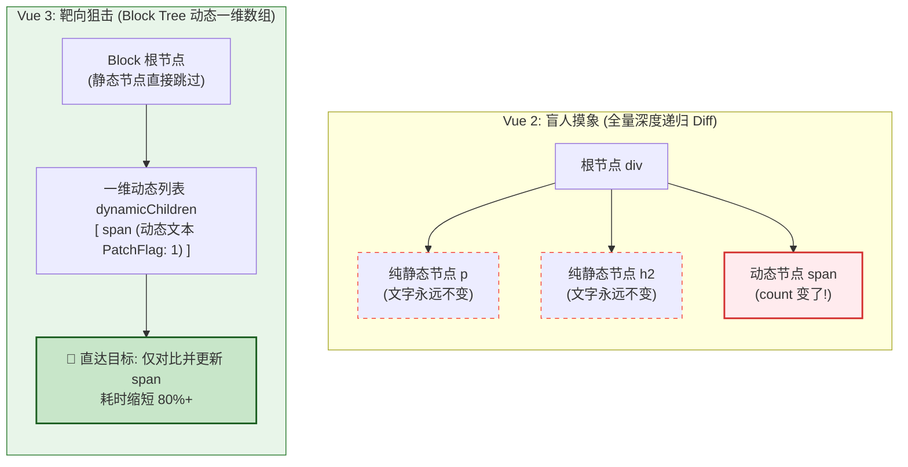
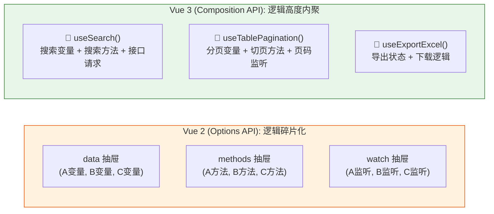

# Vue2与Vue3底层演进与响应式深度对比

## 🎯 招聘面试核心考点
- **面试官设问**：“Vue 3 相比 Vue 2 在底层架构上有哪些质的飞跃？为什么放弃 `Object.defineProperty` 改用 `Proxy`？”
- **深水区追问**：“Vue 3 编译期优化中的 **静态提升（hoistStatic）**、**PatchFlag（动态标记）** 与 **Block Tree（块树）** 是如何让 Diff 性能提升数倍的？为什么 Vue 2 对数组的新增索引或对象新增属性无法监听，必须用 `$set`，而 Vue 3 天然支持？Vue 3 是如何做到彻底支持 **Tree-Shaking** 的？”

---

## 一、 响应式底层机制对决：`Object.defineProperty` vs `Proxy`

### 1. Vue 2 响应式痛点与缺陷（`Object.defineProperty`）
- **初始化递归全量劫持**：组件初始化时，Vue 2 会深度递归遍历 `data` 对象的每一个属性。如果数据层级深、对象体积大，会导致**首屏初始化严重卡顿**。
- **无法监听新增与删除属性**：因为 `defineProperty` 只能劫持对象已有的具体 Key，后追加的 `obj.newProp = 123` 根本无法被拦截，必须使用 hack API：`this.$set(obj, 'newProp', 123)`。
- **数组下标修改无法感知**：直接通过下标 `arr[0] = 100` 或修改 `arr.length` 无法触发更新。Vue 2 被迫重写拦截了数组的 7 个变更方法（`push, pop, shift, unshift, splice, sort, reverse`）。

---

### 2. Vue 3 响应式革命（`Proxy + Reflect`）
- **惰性代理（Lazy Proxy）**：只有当你真正读取了 `obj.a.b` 时，才会触发下一层对象的代理包装，**初始化速度暴增**。
- **代理整个对象，而非单个属性**：无论是新增属性、删除属性，还是通过数组下标赋值，全被 `Proxy` 的 `set` / `deleteProperty` 统一捕获。
- **结合 Reflect 保证 this 指向正确**：`Reflect.get(target, key, receiver)` 确保原型链继承时的 Getter 正确触发依赖收集。

---

### 3. 可运行最小 MVP 对比代码

```javascript
// ================= 1. Vue 2 核心伪代码 (Object.defineProperty) =================
function defineReactive(obj, key, val) {
  // 如果 val 依然是对象，必须递归深层遍历 (大对象直接卡死)
  if (typeof val === 'object' && val !== null) {
    observe(val);
  }
  Object.defineProperty(obj, key, {
    get() {
      console.log(`[Vue 2 依赖收集] 读取属性: ${key}`);
      return val;
    },
    set(newVal) {
      if (newVal !== val) {
        console.log(`[Vue 2 派发更新] 修改属性: ${key} = ${newVal}`);
        val = newVal;
      }
    }
  });
}

// 缺陷体现：无法感知新增属性
const v2Data = {};
defineReactive(v2Data, 'name', '张三');
v2Data.age = 18; // 静默写入，控制台无任何响应，更新丢失！

// ================= 2. Vue 3 核心实现 (Proxy + Reflect) =================
function reactive(target) {
  if (typeof target !== 'object' || target === null) return target;

  return new Proxy(target, {
    get(target, key, receiver) {
      console.log(`[Vue 3 依赖收集] 读取: ${String(key)}`);
      const res = Reflect.get(target, key, receiver);
      // 惰性深层代理：只有读取时才代理子对象！
      return typeof res === 'object' && res !== null ? reactive(res) : res;
    },
    set(target, key, value, receiver) {
      const hadKey = Object.prototype.hasOwnProperty.call(target, key);
      const res = Reflect.set(target, key, value, receiver);
      if (!hadKey) {
        console.log(`[Vue 3 派发更新] 新增属性: ${String(key)} = ${value}`); // 完美支持新增！
      } else {
        console.log(`[Vue 3 派发更新] 修改属性: ${String(key)} = ${value}`);
      }
      return res;
    },
    deleteProperty(target, key) {
      console.log(`[Vue 3 派发更新] 删除属性: ${String(key)}`);
      return Reflect.deleteProperty(target, key);
    }
  });
}

// 验证：完全天然支持新增与数组下标
const v3Data = reactive({ list: ['A'] });
v3Data.age = 25;       // 控制台打印：新增属性: age = 25
v3Data.list[0] = 'B';  // 控制台打印：修改属性: 0 = B
```

---

## 二、 编译期 4 大核心优化（为什么 Vue 3 Diff 性能暴打 Vue 2？）

Vue 2 的 Virtual DOM（虚拟 DOM）在对比时是**全量递归比对（Full Diff）**：即便页面里只有 1 个动态变量，其余 99 个都是纯静态标签，也会逐一比对这 100 个节点。

Vue 3 引入了编译器前置分析，在编译阶段给动态节点打入元数据（PatchFlag），实现“靶向狙击式”更新：



### 1. 静态提升（hoistStatic）
- 将纯静态节点（不依赖任何变量）提升到组件渲染函数外部。
- **收益**：静态 VNode 只创建一次并在内存中永远复用，组件重渲染时**零 VNode 创建开销，零内存 GC 压力**。

### 2. PatchFlag（补丁动态标记）
- 动态节点在编译后会打上一个数字位掩码（`PatchFlags`），精准指明到底是哪个部分会改变：
  - `1`：TEXT（仅文本动态）
  - `2`：CLASS（仅类名动态）
  - `4`：STYLE（仅样式动态）
- 在运行时 Diff 阶段，执行位运算 `if (patchFlag & PatchFlags.TEXT)`，**只比对文本内容，跳过无谓的属性比对**。

### 3. Block Tree（块树扁平化）
- 将包含动态子节点的根容器标记为一个 `Block`。
- `Block` 内部维护一个 `dynamicChildren` 数组，将整棵嵌套树的动态节点**拍平成一维数组**。
- Diff 时直接遍历一维动态数组，**彻底绕过中间所有的静态 DOM 层级**。

### 4. 事件侦听器缓存（cacheHandlers）
- 默认情况下每次重新渲染都会生成一个新的 `@click` 内联函数，导致子组件误以为属性发生变化。
- Vue 3 自动开启事件缓存，复用同一个函数句柄，**避免无用的子组件二次渲染**。

---

## 三、 Options API vs Composition API 心智模型对比

::: tip 🧩 通俗心智模型：四分五裂的抽屉 VS 模块化乐高积木
- **Vue 2 (Options API) 就像“按零件分类的杂物柜”**：
  - 你写一个“搜索栏功能”，它的变量必须放在 `data` 抽屉，方法放在 `methods` 抽屉，联动逻辑放在 `watch` 抽屉。
  - 当一个组件膨胀到 1000 行时，功能A、B、C的代码被打散在各个抽屉里，改一个功能要在整个屏幕上下反复横跳，苦不堪言。
- **Vue 3 (Composition API) 就像“独立完整的乐高套件”**：
  - 功能A的所有变量、计算属性、方法统统封装成 `useSearch()`，功能B封装成 `usePagination()`。
  - 逻辑按**业务功能**高度内聚，甚至可以随时抽离成独立 `.ts` 文件给其他组件复用！
:::



- **类型推导友好**：Composition API 纯函数结构，对 TypeScript 天然兼容，告别 Vue 2 中 `this` 无法类型推断的噩梦。
- **彻底支持 Tree-Shaking**：Vue 3 将全局 API（如 `nextTick`, `ref`, `reactive`）改为具名导出，未用到的 API 自动被打包工具（Vite/Rollup）剔除，使打包体积大幅瘦身！
