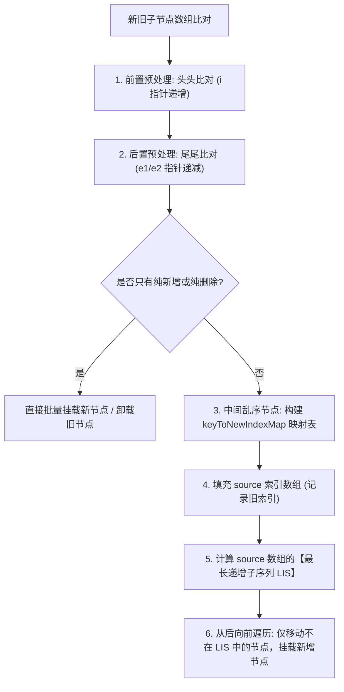

# Vue全阶段面试通关-高级资深架构50道连环炮全景通关

本套题库针对 **高级/资深前端工程师与前端架构师（5年+经验 / 阿里 P7+、腾讯 10+ 级别社招对标）**，以连环追问、底层源码物理推导、架构选型及生产事故攻防为导向。全面覆盖 Vue 3 响应式内核、编译优化 BlockTree、快速 Diff LIS 算法、微前端双沙箱、SSR 水合同构架构、Vite/Rollup 构建工程化、APM 监控与内存泄漏深度排查。

---

## 模块一：响应式内核源码与编译优化（1~13题）

### 01. 详细推导 Vue 3 响应式底层 `targetMap` 的数据结构形态，为什么采用 `WeakMap` 而不是 `Map`？
- **标杆解答**：
  - **数据拓扑结构**：`WeakMap<target, Map<key, Set<ReactiveEffect>>>`。
    - 第一层 `WeakMap`：以被代理的原对象 `target` 为键，值为一个普通的 `Map`；
    - 第二层 `Map`：以对象具体的属性名 `key` 为键，值为一个存储副作用函数实例的 `Set`（即依赖集合 `deps`）；
    - 第三层 `Set`：收集该属性所关联的所有 `ReactiveEffect` 副作用执行单元。
  - **选用 WeakMap 的物理机理**：`WeakMap` 对键对象的引用是**弱引用（Weak Reference）**，不会增加垃圾回收器的引用计数。当业务中被代理的原对象不再被任何外部变量强引用时，V8 引擎在 GC 时会自动回收该对象并自动将其在 `targetMap` 中的映射关系物理抹除，**彻底杜绝了长期运行导致的内存泄漏**。

### 02. Vue 3 依赖收集（`track`）与触发更新（`trigger`）的完整源码执行时序是怎样的？
- **标杆解答**：
  - **`track`（依赖收集）**：
    1. 当访问响应式对象属性时，触发 Proxy 的 `get` 拦截器；
    2. 判断全局指针 `activeEffect` 是否存在（是否处于 `effect` 执行上下文）；
    3. 检查当前是否允许收集依赖（`shouldTrack` 标志位）；
    4. 从 `targetMap` 中逐层查找并初始化 `depsMap` 与 `dep` 集合；
    5. 将当前 `activeEffect` 添加到 `dep` 集合中，同时把当前 `dep` 存入当前 effect 的 `deps` 数组（完成双向引用记录）。
  - **`trigger`（触发更新）**：
    1. 当修改属性时，触发 Proxy 的 `set` 拦截器；
    2. 对比新旧值，若发生改变，调用 `trigger(target, key, value, oldValue)`；
    3. 从 `targetMap` 中取出对应的 `dep` 集合，以及关联的数组长度依赖或遍历依赖（ITERATE_KEY）；
    4. 构造待执行的 effects 集合，过滤掉当前正在执行的 activeEffect 自身（避免递归死循环）；
    5. 遍历集合：若 effect 声明了自定义 `scheduler`（调度器），则调用 `effect.scheduler()`（如 Vue 渲染器的批处理更新）；否则直接同步执行 `effect.run()`。

### 03. Vue 3.4 版本中，响应式内核对依赖追踪进行了怎样的革命性优化？
- **标杆解答**：
  - **Vue 3.4 之前的痛点**：每次 effect 重新执行前，都需要先将自己从所有旧的 `dep` 集合中清理掉（`cleanupEffect`），执行期间再重新遍历添加，造成频繁的 `Set.delete` 与 `Set.add` 内存分配抖动。
  - **3.4 版本引入双向链表与版本标记位（Bitwise Markers）**：
    - 将 `dep` 与 `effect` 的关联关系抽象为 `Link` 双向链表节点；
    - 引入版本号（`globalVersion`）与脏标记位；
    - 在 effect 重新执行时，仅对产生拓扑改变的依赖进行链表解绑与重挂，大幅减少垃圾回收（GC）频率，**整体响应式性能在 3.4 版本提升了近一倍**。

### 04. Vue 3 中的 `computed` 是如何实现依赖脏检查（Dirty Checking）与懒求值的？
- **标杆解答**：
  - `computed` 实例内部持有一个专属的 `ReactiveEffect`，并将调度器设置为一个将脏标记置为 `true` 的函数。
  - **懒求值（Lazy）**：初始化时 `_dirty = true`，且不立即执行 getter。
  - **脏检查**：当外部读取 `computed.value` 时：
    1. 若 `_dirty === true`，调用内部 effect 执行计算，将返回值缓存在 `_value` 中，并将 `_dirty` 置为 `false`；
    2. 若 `_dirty === false`，直接返回上一次缓存的 `_value`，0 计算开销；
    3. 当其依赖的源响应式数据发生改变时，触发 trigger，调用 computed 的 scheduler，仅仅将其内部的 `_dirty` 重新重置为 `true`，**并通知引用该 computed 的外层渲染 effect 准备更新，而不会立即重新计算**。

### 05. 简述 Vue 3 模板编译器（Compiler）从字符串到可执行 Render 函数的完整流水线。
- **标杆解答**：
  - 1. **Parse 阶段（词法分析与语法解析）**：通过正则表达式和有限状态机（FSM）逐字符扫描模板字符串，解析开始标签、属性、文本、指令与闭合标签，构建出树状结构的 **模板抽象语法树（Template AST）**；
  - 2. **Transform 阶段（语义分析与静态优化）**：深度优先遍历 AST，依次执行各种转换插件（如 `v-if` 转换、`v-for` 转换、表达式收集、静态提升分析），打上 `PatchFlags` 动态标记，构建 **JavaScript AST**；
  - 3. **Codegen 阶段（代码生成）**：将 JavaScript AST 转换为符合 JS 语法的最终渲染函数代码字符串（内部包含 `_createElementVNode`、`_toDisplayString` 等运行时辅助函数的调用语句）。

### 06. 什么是 BlockTree 靶向更新？它相比传统的全树 Diff 性能提升在哪里？
- **标杆解答**：
  - **传统 Diff 缺陷**：更新性能受限于“模板整体 DOM 节点的总量”。即使一个包含 1000 个静态节点的组件中只有一个动态变量，传统算法也必须递归遍历 1000 个节点进行新旧比对。
  - **BlockTree 靶向优化**：
    - 编译器在遇到根节点或动态结构边界（`v-if`、`v-for`）时，会将其标记为一个 **Block 节点**；
    - Block 节点内部会维护一个扁平化的 **`dynamicChildren` 数组**，在编译阶段只将包含动态绑定的子节点收集进去；
    - 运行时 Diff 阶段，渲染器**直接跳过外层所有静态节点，仅以 $O(1)$ 的时间复杂度遍历 `dynamicChildren` 数组实施精准靶向比对**，使更新性能与“动态节点的数量”强绑定，彻底解耦模板总节点数。

### 07. 深入解析 `PatchFlags`（补丁标志）的位掩码设计原理。
- **标杆解答**：
  - Vue 3 采用 **二进制位运算（Bitwise Operators）** 来表示 VNode 的动态特征。
  - 每一个动态属性对应一个独立的二进制位：
    - `TEXT = 1` (`1 << 0`，即 `00000001`：动态文本)
    - `CLASS = 1 << 1` (`00000010`：动态 class)
    - `STYLE = 1 << 2` (`00000100`：动态 style)
    - `PROPS = 1 << 3` (`00001000`：动态除 class/style 外的属性)
    - `BAIL = -1` (退出靶向更新，回退到全量比对)
  - **极致性能**：在运行时比对阶段，判断是否需要更新 class 仅需一次位与运算：`if (patchFlag & PatchFlags.CLASS)`。位运算直接在 CPU 寄存器层面以单个时钟周期完成，执行速度比字符串比对或对象属性查找快数十倍。

### 08. 什么是静态提升（Hoist Static）与预字符串化（Pre-stringification）？
- **标杆解答**：
  - **静态提升**：对于完全不包含动态绑定的纯静态元素节点或纯静态属性对象，编译器在 Codegen 阶段会**将其提升到渲染函数的作用域之外作为全局常量**。组件每次重新渲染时，直接复用该物理内存引用，避免了每次重新创建 VNode 对象的内存分配与 GC 压力。
  - **预字符串化**：当检测到连续出现超过 5 个纯静态子节点时，编译器会直接将这组节点序列化为一个巨大的静态 HTML 字符串，通过 `_createStaticVNode("<div><span>...</span></div>", 5)` 输出，浏览器底层直接利用 `innerHTML` 一次性快速解析，大幅降低虚拟节点开销。

### 09. Vue 3.4+ 正在试验的 Vapor Mode（水汽模式）物理原理是什么？与现有的虚拟 DOM 有何本质区别？
- **标杆解答**：
  - **本质区别**：Vapor Mode 是一种**彻底摒弃虚拟 DOM（No Virtual DOM）**的纯响应式代码生成模式，受 Solid.js 启发。
  - **物理机制**：
    - 模板编译器在编译 Vapor SFC 时，不再生成用于描述 UI 的 VNode 树和 `render()` 函数；
    - 而是直接生成**操作真实 DOM 的微型胶水代码**，并将响应式变量直接通过 `effect()` 绑定到真实 DOM 属性的底层 Setter 上；
    - 数据变更时，直接精准触发单条 DOM 指令更新，完全不需要运行虚拟 DOM 树的创建、遍历与 Diff 算法，**将内存占用降低 50% 以上，运行时性能逼近原生 JS**。

---

## 模块二：虚拟 DOM、Diff 算法与自定义渲染器（10~19题）

### 10. 详细描述 Vue 3 中 VNode 的核心数据结构，`ShapeFlags` 是如何分类的？
- **标杆解答**：
  - VNode 是一个纯 JavaScript 对象，核心字段包括：`type`（标签名或组件配置）、`props`、`children`、`key`、`el`（真实 DOM 映射）、`component`（组件实例）、`patchFlag` 与 `shapeFlag`。
  - **`ShapeFlags`（形状标志）**：通过位掩码标识当前 VNode 自身的类型以及其 `children` 的结构类型：
    - `ELEMENT = 1` (普通 DOM 元素)
    - `FUNCTIONAL_COMPONENT = 1 << 1` (函数式组件)
    - `STATEFUL_COMPONENT = 1 << 2` (有状态普通组件)
    - `TEXT_CHILDREN = 1 << 3` (子节点为纯文本)
    - `ARRAY_CHILDREN = 1 << 4` (子节点为数组)
    - `SLOTS_CHILDREN = 1 << 5` (子节点为组件插槽)
  - 判断一个 VNode 是否是有状态组件且带有插槽，只需进行位运算判定。

### 11. 简述 `createRenderer`（自定义渲染器）的工作机制，如何利用它将 Vue 渲染到 Canvas 或终端（Terminal）？
- **标杆解答**：
  - Vue 3 的运行时核心分层为 **`@vue/runtime-core`（纯平台无关的渲染调度逻辑）** 与 **`@vue/runtime-dom`（特定于浏览器的 DOM 操作 API）**。
  - `createRenderer` 接收一组平台特异性的**节点操作契约（NodeOps）**，包括：`createElement`、`createText`、`insert`、`remove`、`patchProp`、`parentNode`、`nextSibling`。
  - 若要将 Vue 渲染到 Canvas 或 Pixi.js，只需用 Canvas 图元绘制方法（如 `new PIXI.Graphics()`、`stage.addChild()`）实现上述 7 个节点操作函数，即可零成本复用 Vue 3 的完整响应式系统、生命周期与组件机制。

### 12. 深入对比 Vue 2 的双端 Diff 算法与 Vue 3 的快速 Diff（Quick Diff）算法的物理设计差异。
- **标杆解答**：
  - **Vue 2 双端 Diff**：维护 4 个物理指针（`oldStartIdx`、`oldEndIdx`、`newStartIdx`、`newEndIdx`），每轮循环执行 4 次双端交叉比对（头头、尾尾、头尾、尾头）；若均未命中，则遍历旧节点的 Key 映射 Map 进行暴力查找。算法在极端反转或乱序场景下比对次数较多。
  - **Vue 3 快速 Diff**：
    1. **前置与后置节点预处理（Sync from start & Sync from end）**：从头到尾比对相同前缀，从尾到头比对相同后缀，迅速消除两端未发生位置移动的稳定节点；
    2. **中间乱序子序列处理**：若仍有中间复杂乱序节点，建立新子节点在旧子序列中的物理位置索引映射表（`source` 数组）；
    3. **最长递增子序列（LIS）计算**：通过 LIS 算法找出**在旧列表中原本就处于相对顺序递增的最长子集**；
    4. **移动最小化**：仅对**不在 LIS 序列中的节点**执行真实的 DOM `insertBefore` 移动，将物理 DOM 操作次数降低至数学理论极限。



### 13. 手写或详细推导 Vue 3 最长递增子序列（LIS）算法中的贪心（Greedy）与二分查找（Binary Search）结合前驱索引数组修正回溯的数学逻辑。
- **标杆解答**：
  - **目标**：输入数组 `arr = [10, 9, 2, 5, 3, 7, 101, 18]`，求最长单调递增子序列的索引集合。
  - **贪心 + 二分策略**：
    - 维护一个结果数组 `result`，存储 LIS 候选序列的索引；
    - 遍历 `arr`：若当前元素大于 `arr[result.last]`，直接将当前索引 push 到 `result` 末尾；
    - 若当前元素小于等于末尾元素，在 `result` 中使用**二分查找（Binary Search）**找到第一个大于等于该元素的索引位置并进行**贪心替换**（让子序列增长潜力最大化）。
  - **前驱节点回溯修正（Backtracking）**：
    - 单纯的贪心替换虽然能保证长度正确，但最终 `result` 中的具体元素组合可能是错误的；
    - Vue 额外维护了一个 `p`（parent 前驱）数组：每次将元素存入或替换时，在 `p[i]` 中记录其在 `result` 中前一个节点的索引；
    - 遍历结束后，从 `result` 的最后一个元素开始，顺着 `p` 数组倒序回溯更新每一个位置，**得出数学上绝对保真的最长递增子序列索引数组**。

### 14. 组件实例化全流程中，`setupComponent` 与 `setupRenderEffect` 分别承担什么物理职责？
- **标杆解答**：
  - **`setupComponent`**：
    1. 初始化组件内部状态，绑定 `props` 与 `slots`；
    2. 创建组件内部的代理上下文对象（`instance.proxy`）；
    3. 调用 `setupStatefulComponent`，正式执行开发者书写的 `<script setup>` 或 `setup()` 函数；
    4. 将 `setup()` 返回的 ref/reactive 数据或方法绑定到组件实例上。
  - **`setupRenderEffect`**：
    1. 实例化一个渲染副作用对象 `instance.update = new ReactiveEffect(componentUpdateFn, () => queueJob(instance.update))`；
    2. 将组件更新函数推入微任务调度器队列；
    3. 首次调用 `instance.update.run()` 触发组件的初次挂载（生成子树 VNode，递归调用 `patch` 转为真实 DOM 并挂载）。

---

## 模块三：微前端、SSR/SSG 与同构状态架构（15~26题）

### 15. 深入剖析微前端框架 `qiankun` 的基于 Proxy 的单实例代理沙箱（`LegacySandbox`）与多实例沙箱（`ProxySandbox`）底层物理原理。
- **标杆解答**：
  - **`LegacySandbox`（单实例）**：代理的是真实的 `window`。当子应用运行时，通过 Proxy 拦截对 `window` 的写入，记录新增属性（`addedPropsMap`）、修改属性（`modifiedPropsMap`）以及原始快照（`currentUpdatedPropsValueMap`）。子应用卸载时，逆向遍历上述 Map，将全局 `window` 强制还原复原。
  - **`ProxySandbox`（多实例沙箱）**：
    - 不直接修改真实全局 `window`；
    - 为每个子应用各自创建一个由空对象构成的 `fakeWindow`；
    - 创建 Proxy 代理：**读取时**优先从当前子应用的 `fakeWindow` 中读取，若没有则回退到真实 `window` 读取；**写入时**严格限制在当前子应用的 `fakeWindow` 内部，绝不污染全局真实环境。因此天然支持同一个页面同时激活并运行多个微前端子应用。

### 16. 微前端框架无界（Wujie）基于“WebComponent + iframe”的双沙箱机制是如何彻底突破 JS 与 CSS 沙箱边界痛点的？
- **标杆解答**：
  - **JS 沙箱隔离（物理级真沙箱）**：无界为每个子应用创建一个独立的 `iframe`，子应用的所有 JavaScript 代码直接运行在该独立的 `iframe` 全局上下文中，彻底享受浏览器底层原生的全局作用域、事件总线与 DOM API 隔离，完全规避了 Proxy 模拟沙箱对 `window.top`、原型链修改或第三方 SDK 污染的漏洞。
  - **CSS 样式隔离与 DOM 挂载（WebComponent）**：
    - 传统 `iframe` 的核心痛点是路由无法同步、弹窗被限制在 iframe 内部尺寸、前进后退历史受阻；
    - 无界通过自定义 WebComponent（Shadow DOM 容器）承载子应用的真实视图渲染；
    - 将子应用在 `iframe` 中生成的真实 DOM 树直接通过通道瞬移、同步渲染到主应用的 WebComponent Shadow DOM 中，样式天然具备 Shadow 作用域完全隔离，而弹窗和尺寸天然享受主应用的完整全屏视口。

### 17. 为什么说 SSR 服务端渲染中直接在单例服务中定义全局响应式变量会导致极其致命的“跨用户数据污染”安全事故？
- **标杆解答**：
  - **物理运行环境本质差异**：
    - 在纯客户端 SPA 中，每个用户独占自己的浏览器进程与独立的 V8 内存堆，全局单例是安全的；
    - 在 Node.js 服务端 SSR 中，**Node 进程是一个长期存活的多用户并发单例进程**。
  - **污染机理**：如果将用户状态、Token、购物车信息定义在一个全局导出的 `ref`、普通对象或 Pinia 全局单例中，所有并发进入 Node 服务的 HTTP 请求会同时共享这同一块内存指针。用户 A 的请求将自身手机号写入该变量，在并发时序下用户 B 的请求直接读取到了用户 A 的敏感数据，造成不可挽回的信息泄露合规事故。
  - **架构法则**：在 SSR 中，**每一次进入的 HTTP 请求必须完整新建一个隔离的 App 实例与 Pinia Store 实例**。

### 18. 深入解析 SSR 客户端激活（Hydration / 水合）的底层物理流程。
- **标杆解答**：
  - 1. **服务端产物直出**：Node 服务端通过 `renderToString(app)` 生成纯 HTML 字符串并写入 HTTP 响应体，客户端浏览器解析出静态 DOM 树并呈现在屏幕上（实现急速 FCP）；
  - 2. **下载同构 JS 代码**：浏览器异步加载客户端打包产物，在客户端重新执行 Vue 渲染逻辑；
  - 3. **节点比对与事件嫁接（Hydration）**：
    - Vue 客户端渲染器并不重新创建新的 DOM 元素；
    - 而是顺着服务端直出的真实 DOM 树进行遍历遍历，将其与客户端生成的虚拟 VNode 树进行一一坐标绑定（`vnode.el = domNode`）；
    - 将组件中声明的事件侦听器（`@click`、`@input`）以及响应式 Effect 正式嫁接绑定到现有的真实 DOM 上，使静态 HTML 激活为可交互的动态应用。

### 19. Nuxt 3 中 `useAsyncData` 的 `dedupe` 机制与状态序列化（Devalue）是如何协同防止客户端二次重复请求的？
- **标杆解答**：
  - **服务端执行与序列化**：当请求进入 Node 服务端，`useAsyncData('key', fetcher)` 执行数据请求，获取结果后将其存入当前请求隔离的全局上下文 `nuxtApp.payload.data['key']` 中，并在直出 HTML 时通过 `devalue` 序列化为内联在 `<script>` 标签中的 JSON 数据；
  - **客户端反序列化与去重**：当页面在浏览器端执行水合激活时，`useAsyncData` 首先根据相同传入的 `'key'` 去检查 `nuxtApp.payload.data` 中是否已经存在预置数据；若存在，则**直接同步提取使用，物理阻断发送第二次 Ajax 网络请求**，实现服务端到客户端的数据无缝同构平移。

---

## 模块四：工程化基建、APM 监控与高可用性能攻防（20~35题）

### 20. 简述 Vite 开发服务器启动时，Connect 中间件、esbuild 依赖预构建与 `ModuleGraph` 内存图谱的物理协同机制。
- **标杆解答**：
  - 1. **冷启动与静态扫描**：Vite 启动轻量 Connect HTTP 服务，同时调用 esbuild 对本地代码进行全量 AST 快速扫描，找出所有裸模块依赖（Bare Imports），利用 esbuild 将它们转换为 ESM 规范并合并输出至 `node_modules/.vite/deps` 缓存；
  - 2. **请求拦截重写**：浏览器发起原生 ESM 请求（如 `/src/main.ts`），Connect 中间件拦截该请求；
  - 3. **图谱维护与编译**：在内存中构建/更新双向有向无环图 `ModuleGraph`（记录节点及其 `importers` 引用者），调用 Vue 插件编译单文件组件，重写导入路径（将裸模块重写为指向 `.vite/deps` 的绝对路径），返回编译后代码并注入协商缓存 ETag。

### 21. Vite 的 HMR 热更新是如何通过 WebSocket 报文与模块图谱（ModuleGraph）实现冒泡查找与局部替换的？
- **标杆解答**：
  - 1. 本地文件监听器（`chokidar`）捕获文件变更事件，提取变更物理路径；
  - 2. 服务端在 `ModuleGraph` 中找到对应的 `ModuleNode`，使其编译缓存失效；
  - 3. **边界冒泡判断**：
    - 检查当前节点是否是 `isSelfAccepting`（自身调用了 `import.meta.hot.accept()`，如 SFC 编译后默认注入的代码）；
    - 若不是，则递归向上遍历其所有父级引用节点（`importers`），直到找到接受热更新声明的边界模块；
    - 若冒泡至入口根模块仍未被拦截，判定局部 HMR 失败，通过 WebSocket 发送 `{ type: 'full-reload' }` 触发整页强刷；
  - 4. 若找到局部边界，向浏览器发送 `{ type: 'update', updates: [...] }` 报文；
  - 5. 浏览器端 `@vite/client` 收到报文，以动态 import 方式拉取带最新时间戳的模块代码，调用回调无刷新替换组件。

### 22. Rollup 打包中 Tree-Shaking 物理生效的三大充要条件是什么？为什么 CommonJS 模块天然无法被安全 Tree-Shaking？
- **标杆解答**：
  - **三大充要条件**：
  1. 源码完全采用静态 ES Module 规范（`import` / `export`）；
  2. 依赖包 `package.json` 显式声明 `"sideEffects": false`（或副作用白名单数组）；
  3. 未被引用的函数赋值表达式必须带有纯函数注解 `/*#__PURE__*/`。
  - **CommonJS 无法安全摇树的根本原因**：CJS 是运行时动态求值的模块规范，支持在 `if/else` 条件语句、函数体内动态调用 `require(dynamicPath)`，且其导出对象支持在运行时任意挂载、突变或遍历属性（`module.exports[dynamicKey] = ...`）。编译器在打包阶段的静态 AST 分析中绝对无法推导运行时的属性消费边界，任何激进的剔除都会引发运行时严重报错。

### 23. 在大型前端工程中，Rollup 的 `manualChunks` 配置不当为什么会导致“循环依赖（Circular Chunk Dependency）”死锁报错？如何根治？
- **标杆解答**：
  - **产生诱因**：若模块 A 引用模块 B，模块 B 又引用模块 A 的某个子工具函数；开发者通过硬编码规则将模块 A 划分到 `chunk-1`，模块 B 划分到 `chunk-2`，导致 Rollup 输出的 JS 物理文件之间形成 `chunk-1.js` 与 `chunk-2.js` 的循环引用。
  - **运行时死锁**：浏览器在加载执行时，因其中一个 chunk 内部导出的符号在求值阶段尚未初始化完成，直接抛出 `ReferenceError: Cannot access 'X' before initialization`。
  - **根治 SOP**：
    - **禁止对具有紧密业务耦合的应用业务源码使用 manualChunks 进行人为跨模块强拆**；
    - 业务代码的代码分割必须完全交由原生的动态导入（`import('./views/Foo.vue')`）由打包器自动进行拓扑切片；
    - `manualChunks` 仅对无循环引用的稳态第三方库（如 `node_modules` 内的 vue、pinia、element-plus）做独立的 vendor 拆包。

### 24. pnpm 是如何通过底层文件系统 CAS（内容寻址存储）和硬链接（Hard Link）彻底根除“幽灵依赖（Phantom Dependencies）”的？
- **标杆解答**：
  - **传统 npm/yarn 缺陷**：采用扁平化提升（Hoisting），将依赖和子依赖平铺在根目录 `node_modules` 下，业务代码直接引用未在 `package.json` 声明的间接依赖仍能运行，未来一旦依赖升级该间接包被移除，生产构建直接瞬间崩溃（幽灵依赖）。
  - **pnpm 隔离物理机制**：
    - 全局 CAS 存储：所有包内容以哈希物理保存在磁盘唯一的 Store 中；
    - 项目本地 `node_modules/.pnpm/` 通过系统底层的**硬链接**映射至全局 Store；
    - 项目各子模块的 `node_modules` 仅通过**符号软链接（Symlink）**精确暴露自身 `package.json` 中声明的依赖，代码绝对无法跳过软链接访问任何未授权的间接依赖，在开发编译期即彻底扼杀幽灵依赖。

### 25. 详细阐述 Chrome DevTools 堆快照（Heap Snapshot）中 `Shallow Size` 与 `Retained Size` 的物理区别，排查脱离 DOM 节点（Detached DOM）的核心操作路径是什么？
- **标杆解答**：
  - **物理区别**：
    - `Shallow Size`：对象自身在物理内存中所占用的字节大小（不包含它引用的其他对象）；
    - `Retained Size`：当该对象被回收销毁后，其支配树（Dominator Tree）所释放的连带全部下游内存空间总和。
  - **排查 Detached DOM 的标准 SOP**：
    1. 在页面执行业务操作（如打开并关闭 10 次包含复杂表格的弹窗）；
    2. 手动在 DevTools Memory 面板点击垃圾桶图标触发 V8 强制垃圾回收；
    3. 录制 Heap Snapshot；
    4. 在 Class filter 搜索框中输入 `Detached`，过滤出所有未挂载在真实文档树上却依然驻留在堆内存中的 DOM 节点；
    5. 按 `Retained Size` 降序排列，展开支配尺寸最大的节点，观察其底部的 **Retainers（保留者引用链）**；
    6. 定位到抓取该 DOM 节点引用的全局变量、未注销的 window 事件监听闭包或全局 Pinia 订阅，实施针对性代码解除。

### 26. Google 核心网页指标（Core Web Vitals）中，LCP、INP、CLS 的物理测量逻辑是什么？其优秀阈值分别是多少？
- **标杆解答**：
  - **LCP（Largest Contentful Paint，最大内容绘制）**：
    - 测量视口内最大可见图片或文本块完成渲染的时间；
    - **优秀标准：`<= 2.5 秒`**。
  - **INP（Interaction to Next Paint，交互到下一次绘制，替代 FID）**：
    - 统计页面生命周期内所有用户交互（点击、轻触、按键）中，从触发到下一帧画面在屏幕上完成渲染的 98% 最差延迟（包含输入延迟、处理耗时、呈现延迟）；
    - **优秀标准：`<= 200 毫秒`**。
  - **CLS（Cumulative Layout Shift，累积布局偏移）**：
    - 测量可见元素在视口内发生非预期位置移动的不稳定度得分累加（`影响比例 × 移动距离比例`）；
    - **优秀标准：`<= 0.1`**。

### 27. 浏览器长任务（Long Tasks，>50ms）为什么会导致页面动画掉帧和输入冻结？如何使用 `scheduler.yield()` 进行时间切片治理？
- **标杆解答**：
  - **冻结机理**：浏览器渲染主线程是单线程事件循环。当一个长任务执行超过 50ms 时，它会彻底独占 CPU。在此期间，用户发起的点击事件回调会被挂起在任务队列中，且屏幕刷新率（如 60Hz 每 16.6ms 一帧）无法获得主线程调度进行样式计算、布局与绘制，导致严重的视觉掉帧与交互冻结。
  - **`scheduler.yield()` 治理**：
    - 将一个庞大的循环计算（如 100,000 条数据处理）拆分为小批次；
    - 每一个批次执行时间接近 16ms 时，主动调用 `await scheduler.yield()`（降级使用 MessageChannel）；
    - 主线程会在此刻让出控制权，浏览器得以优先响应用户的点击输入和执行当前帧的重绘，随后再无缝恢复执行下一批计算，**彻底将 INP 控制在 50ms 以内**。

### 28. Sentry 等前端监控 SDK 捕获的异常在没有源码暴露的情况下，如何利用 SourceMap 的 VLQ 编码实现精准的逆向还原？
- **标杆解答**：
  - **物理原理**：
    - 生产报错堆栈仅包含压缩混淆后的物理坐标，如 `app-1a2b.js:1:4503`；
    - 构建阶段生成的 `.map` 文件内包含 `mappings` 字段，该字段由 Base64 VLQ（可变长字节量）编码的连续分段组成；
    - Sentry 服务端解码 VLQ 分段，每个分段记录了：生成代码列偏移、源文件索引（`sources` 数组）、原始代码起始行号、原始代码起始列号、变量名索引（`names` 数组）；
    - 服务端通过二分查找快速命中映射关系，直接还原出 `src/views/Order.vue` 第 34 行的原始错误上下文。

### 29. 为什么说前端“白屏检测”严禁仅仅依赖 `window.onerror`？手写核心白屏关键路径采样算法。
- **标杆解答**：
  - **局限性**：白屏不仅由代码抛错引发，静态资源 404、路由重定向死锁、样式崩溃或异步组件挂起均不会触发全局 JS 错误，但用户眼前是真实的白屏。
  - **关键路径采样算法（Cross Sampling）**：
    ```typescript
    export function isWhiteScreen(): boolean {
      const w = window.innerWidth
      const h = window.innerHeight
      // 十字交叉采样 18 个特征坐标
      const points = [
        [w / 2, h / 2], [w / 4, h / 4], [w * 3 / 4, h * 3 / 4],
        [w / 2, h / 4], [w / 2, h * 3 / 4], [w / 4, h / 2], [w * 3 / 4, h / 2]
      ]
      let emptyCount = 0
      const emptyTags = ['HTML', 'BODY', '#app', 'DIV.skeleton']

      for (const [x, y] of points) {
        const el = document.elementFromPoint(x, y)
        if (!el || emptyTags.includes(el.tagName) || el.id === 'app') {
          emptyCount++
        }
      }
      // 空白采样点超过 85% 判定为严重白屏
      return emptyCount / points.length >= 0.85
    }
    ```

### 30. 动态高度虚拟列表（Virtual List）中，为什么要建立“前缀和数组”并使用“二分查找”？
- **标杆解答**：
  - **动态高度痛点**：列表项高度不一致且由内容动态决定，无法用 `Math.floor(scrollTop / itemHeight)` 简单求值；
  - **前缀和数组（Prefix Sum）**：记录每一项的 `bottom` 物理距离（`bottom[i] = bottom[i-1] + height[i]`）。由于高度恒为正数，`bottom` 数组天然是一个**严格单调递增的有序数组**；
  - **二分查找优化**：当用户发生滚动产生新的 `scrollTop` 时，在单调递增的 `bottom` 数组中执行二分查找，可以在 $O(\log N)$ 的极致速度下瞬间锁定可视区域的起始索引 `startIndex`，避免在十万级数据下线性遍历 $O(N)$ 造成的滚动严重掉帧。

### 31. 虚拟列表中如果渲染的数据项包含异步图片加载，导致高度突变引起滚动条剧烈跳动，有哪些优雅的工业级解决方案？
- **标杆解答**：
  - 1. **服务端接口协议下发宽高比**：服务端在下发图片 URL 时，强制附带图片的原始宽高（`width` / `height`），前端在模板中利用 CSS `aspect-ratio: width / height` 提前为图片预留物理渲染尺寸，图片下载完成后高度 0 突变；
  - 2. **ResizeObserver 动态修正累积差值**：对渲染中的 DOM 节点挂载 `ResizeObserver` 监听尺寸变更。当某一项发生高度突变时，计算其变化差值 $\Delta d$，**仅级联更新其后续所有缓存项的 `top` 和 `bottom`**，并利用 `requestAnimationFrame` 在下一次重绘前补偿容器的 `scrollTop`，抹平滚动跳跃。

### 32. 跨站脚本攻击（XSS）的核心防御体系：在 Vue 3 应用中如何做到绝对防御？
- **标杆解答**：
  - 1. **默认文本转义**：Vue 的模板插值 <code>&#123;&#123; &#125;&#125;</code> 底层采用 `textContent`，默认将 `<`、`>`、`&` 转义为安全实体字符，天然防御反射型 XSS；
  - 2. **`v-html` 强制消毒**：严格审查所有 `v-html` 指令，必须经过 `DOMPurify.sanitize(html)` 消毒过滤恶意标签（如 `<script>`、`<iframe>`、`onerror=` 属性）；
  - 3. **配置严格的内容安全策略（CSP，Content Security Policy）**：通过 HTTP 响应头配置 `Content-Security-Policy: default-src 'self'; script-src 'self' 'nonce-xxx';`，从浏览器底层阻断未经签名的内联脚本执行；
  - 4. **敏感 Cookie 开启 `HttpOnly`**：将登录态 Session/Token Cookie 设置为 `HttpOnly; Secure; SameSite=Lax`，杜绝即便存在 XSS 漏洞也无法窃取认证凭据。

### 33. 跨站请求伪造（CSRF）的攻击原理是什么？现代 SPA + JWT 架构下为什么天然免疫传统 CSRF？
- **标杆解答**：
  - **传统 CSRF 原理**：受害者在登录受信网站 A 后，浏览器本地存有 Cookie。访问恶意网站 B 时，网站 B 自动向网站 A 发起表单提交或跨域请求，浏览器会自动隐式携带网站 A 的 Cookie，完成越权转账或修改密码。
  - **SPA + JWT 天然免疫原因**：
    - 在现代前后端分离架构中，JWT 通常存储在 `localStorage` 或内存中；
    - 前端发起请求时，必须由 JavaScript 代码通过请求拦截器显式将 Token 添加至自定义 HTTP Header 中（`Authorization: Bearer <token>`）；
    - 恶意第三方网站发起跨站请求时，**浏览器绝对不会、也无法自动将存储在受害者 localStorage 里的 Token 注入到自定义请求头中**；此外，现代浏览器 Cookie 默认配置了 `SameSite=Lax`，阻止第三方站点跨站发送 Cookie。

### 34. 详细解释 CORS 跨域中的“简单请求”与“非简单请求”，为什么会有 OPTIONS 预检请求？
- **标杆解答**：
  - **简单请求**：同时满足：1. 请求方法为 GET / POST / HEAD；2. 请求头仅限标准基础字段（Accept、Accept-Language、Content-Type 为 application/x-www-form-urlencoded、multipart/form-data、text/plain）。
  - **非简单请求**：使用了 PUT / DELETE 方法，或者 Content-Type 为 `application/json`，或者携带了自定义 Header（如 `Authorization`）。
  - **OPTIONS 预检机制**：浏览器为了保护老旧的服务端不被非预期的跨域请求破坏状态，在发送真正的业务请求前，会自动先行发送一次轻量级的 `OPTIONS` 嗅探请求，询问目标服务器是否允许当前来源域（`Origin`）、请求方法（`Access-Control-Allow-Methods`）和自定义头（`Access-Control-Allow-Headers`）。只有当预检获得 204/200 确认通过后，浏览器才会正式发出实际业务请求。

### 35. 终极架构设计：请设计一套高可用、多团队协同的万人级大型企业 Vue 3 前端研发平台治理架构。
- **标杆解答**：
  - **分层治理架构蓝图**：
  1. **代码组织与基建层**：采用 **pnpm-workspace Monorepo**。统一收敛公共 UI 组件库（`@core/ui`）、业务公共 Hooks（`@core/hooks`）、工具库（`@core/utils`）及 TypeScript 类型定义库；配置 Changesets 自动化语义版本管理与私有 npm 发布流水线；
  2. **应用集成与运行层**：采用 **无界（Wujie）微前端架构**。基座应用负责全局 SSO 单点登录、RBAC 动态菜单树解析与微前端应用调度；各业务子团队独立代码仓库、独立流水线秒级部署，通过 WebComponent 双沙箱实现极致隔离与协同；
  3. **研发效能与规范层**：统一 ESLint、Prettier、Commitlint 与 Husky Git Hooks；配合自研 Vite 插件规范业务脚手架，实现统一环境变量注入与自动化 Mock 服务；
  4. **全链路 APM 监控与可观测层**：
     - 集成自研 APM 探针：实时采集 LCP、INP、CLS 核心网页指标；
     - 异常上报：统一拦截 Vue 错误与未捕获 Promise，集成 Sentry 并在 CI 构建流水线自动化上传 SourceMap 后彻底物理剔除 `.map` 文件；
     - 兜底自愈：集成白屏十字采样算法与静态 Chunk 加载 404 自动重试机制；
  5. **持续集成与安全交付层**：统一 Docker 容器化流水线，利用多阶段构建最小化镜像体积；配合 Nginx 开启 Brotli/Gzip 静态预压缩，静态资源推送 CDN 并配置强缓存哈希指纹，实现万无一失的生产高可用交付。
