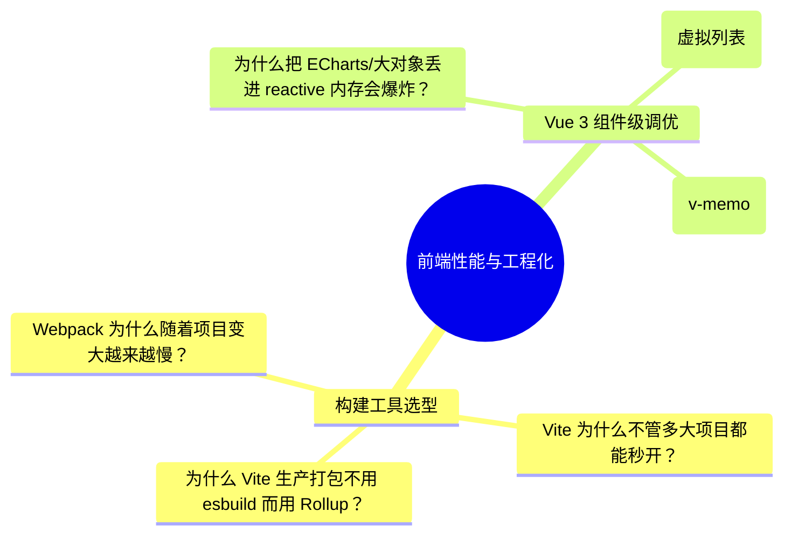
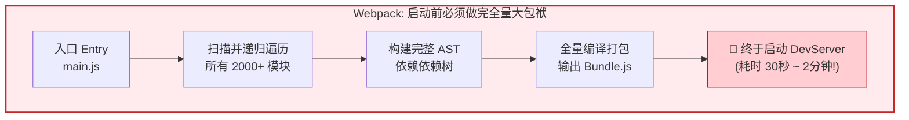
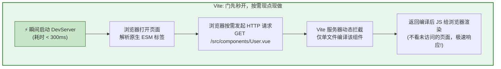
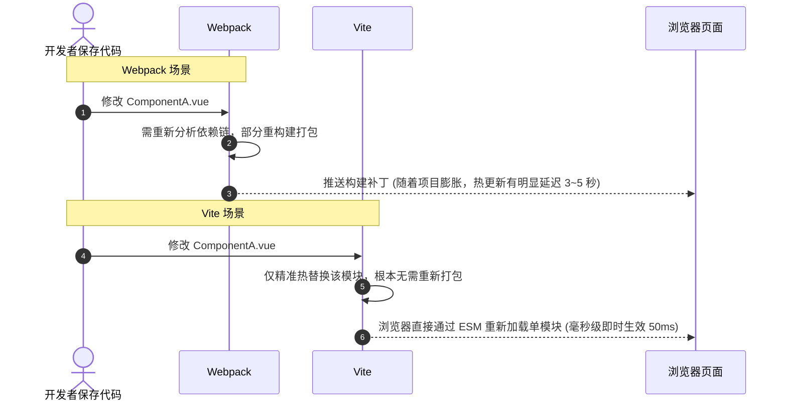
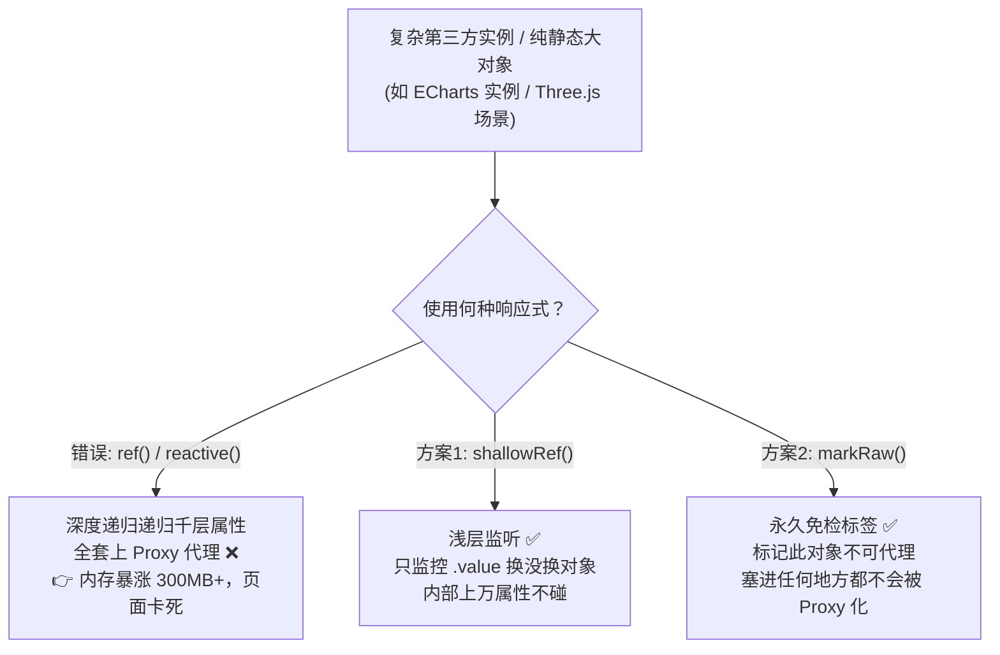
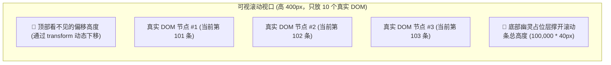

# 🚀 Webpack与Vite架构对比及组件性能优化全集

## 使用入口：先解决问题，再做验证

根据开发/构建表现选择工具并诊断组件开销。

**先做基本操作**：先比较启动、热更新、构建产物和目标浏览器，固定条件实测，再分析依赖处理机制。初次学习可先完成[本模块基础实践](/doc/Vue/Vue组件与页面基本使用)。

**再逐步深入**：基本 API 与输入输出 → 常见失败和使用边界 → 场景排查与优化 → 本文机制分析与源码。面试先讲用途和自己的操作过程，再回答场景与原理追问。

> 💡 **核心目标**：拒绝死记硬背枯燥抽象的专业术语！通过**大白话生活比喻 + 视觉化对比图 + 真实车祸现场复盘**，带你一眼看透工程化构建工具与 Vue 3 组件性能调优的底层本质。

---

## 🎯 搞懂这篇能解决什么？



---

## 一、 Webpack 与 Vite 底层架构原理全面对决

### 1. 通俗心智模型：满汉全席 VS 回转自助餐

很多新手看到“Bundle-based”和“No-bundle ESM”就会发懵，其实它们就像两种截然不同的餐厅上菜模式：

::: tip 🍲 生活化比喻：两种餐厅的经营哲学
* **Webpack 就像【传统满汉全席大酒楼】（Bundle 全量打包）**：
  * 客人还没进门，后厨就**必须先把菜单上的全部 1000 道菜全部洗好、切好、炒完、装入一个超大推车**（全量遍历所有依赖、打包成 Bundle.js）。
  * 哪怕客人今天只想喝一碗白米粥（首屏只看一个页面），后厨也必须把整桌大席全做完才允许开大门（启动服务器）！
  * **致命痛点**：项目越大，菜单越长，启动动辄等 2~5 分钟，程序员每天上班第一件事就是盯着控制台转圈去泡咖啡。

* **Vite 就像【现代化回转火锅店】（No-bundle 原生 ESM）**：
  * **门先秒开，炉子点着**（DevServer 立即秒级就绪，耗时几乎为 0）。
  * 客人入座后，想吃哪一盘肥牛（浏览器打开某页面，遇到 `<script type="module">` 发起 HTTP 请求），厨师才在后厨**现切这一盘**端出来。
  * 客人不吃的菜，后厨看都不看一眼！不管菜单上有一千道还是一万道菜，进店落座开吃**永远只需亚秒级**！
:::

---

### 2. 视觉化流程对比图

#### 🛑 Webpack 开发启动流程（全量打包，耗时长）



#### ⚡ Vite 开发启动流程（按需即时，光速秒开）



---

### 3. 热更新（HMR）谁更胜一筹？

当你在编辑器里改了一行代码并按 `Ctrl + S`：



---

### 4. 核心维度技术全景大矩阵

| 评估维度 | 🍲 Webpack（传统大包袱） | ⚡ Vite（现代新纪元） |
| :--- | :--- | :--- |
| **开发启动机制** | **全量打包（Bundle）**：必须把所有依赖编译完才就绪 | **按需即时编译（No-Bundle）**：利用浏览器原生 ESM，用到哪个编译哪个 |
| **底层预构建工具** | 基于 Node.js（JavaScript 运行，慢） | **基于 Go 语言编写的 esbuild**（比 JS 构建快 10~100 倍） |
| **热更新速度 (HMR)** | 随项目模块量增加而**线性变慢**（需重编译依赖链） | **始终保持毫秒级**（直接精确让浏览器单模块刷新） |
| **生产打包引擎** | 依然是 Webpack（配置极为繁琐，插件链长） | **采用成熟的 Rollup**（Tree-shaking 彻底，构建产物精简） |

> 🙋‍♂️ **深度追问：Vite 既然在开发环境用 esbuild 这么快，为什么在生产打包不用 esbuild，而选 Rollup？**  
> 
> 💡 **通俗大白话解释**：
> - **esbuild 就像短跑冠军（速度快到飞起）**：它用 Go 写的，编译纯 JS 极快，但他在“精细化工艺”上有短板——比如复杂的**按路由自动代码分割（Code Splitting）**、**CSS 抽离与哈希指纹**、以及第三方生态插件支持不够丰富。
> - **Rollup 就像老牌钟表匠（做工精细、生态完善）**：它在代码拆包、清除死代码（Tree-Shaking）和精简包体积方面极致成熟稳定。所以 Vite 采用“**开发期要速度选 esbuild，生产期要稳定和极致体积选 Rollup**”的双剑合璧策略！

---

## 二、 组件级性能调优四大杀手锏

---

### 1. 响应式瘦身：`shallowRef` 与 `markRaw`（防内存爆炸）

#### 💥 真实生产灾难：给一万箱货物里的每个螺丝钉都装上 GPS
- **错误做法**：新手经常顺手把 **ECharts 图表实例、Three.js 3D场景对象、或者后端返回的几万条纯静态数据** 统统丢进 `ref()` 或 `reactive()`：
  ```ts
  // ❌ 灾难！Vue 会深度递归遍历该对象里的上万个内部属性，全套上 Proxy 代理！
  const myChart = ref(echarts.init(dom))
  ```
- **后果**：浏览器瞬间分配数十万个 Proxy 监听对象，**内存暴涨数百兆，页面疯狂掉帧甚至直接崩溃白屏**！

#### 🛡️ 解决方案：贴上“免检通行证”



#### 核心代码规范：
```vue
<script setup lang="ts">
import { shallowRef, markRaw } from 'vue'
import * as echarts from 'echarts'

// 1. shallowRef：只代理 .value 的指向，绝不对对象内部做深层递归代理！
const chartInstance = shallowRef<echarts.ECharts | null>(null)

// 2. markRaw：显式标记对象为“永远不可被响应式代理”，哪怕后续塞进 reactive 也完全免疫
const rawBigDataset = markRaw({
  points: new Array(50000).fill({ x: 1, y: 2 }), // 5 万条原始坐标数据
})

function initChart() {
  const chart = echarts.init(document.getElementById('chart'))
  // 使用 markRaw 标记第三方库实例，安全存入 shallowRef
  chartInstance.value = markRaw(chart)
}
</script>
```

---

### 2. 虚拟列表（Virtual List）：十万条数据丝滑滚动的秘密

#### 🪟 通俗心智模型：高铁车窗理论
- **现实场景**：后端接口一次性返回 10 万条订单数据。
- 如果真在页面上生成 10 万个真实 DOM 节点（`<div class="item">`），浏览器的 DOM 树会直接卡死。
- **虚拟列表的精髓**：
  - 高铁外面的风景有 10 万公里，但**乘客只能透过面前这扇固定大小的“车窗”（可视区域）看世界**！
  - 无论外面有 10 万条数据，**屏幕里永远只渲染正在窗户里露面的 10~15 个真实 DOM**。
  - 上下用一个看不见的“透明占位层”撑开 10 万条数据的总高度，欺骗滚动条；当用户滚动时，动态计算并替换当前窗口里的 15 个数据项！



#### 极简可运行虚拟列表 MVP：
```vue
<script setup lang="ts">
import { ref, computed } from 'vue'

// 1. 模拟 10 万条海量数据
const allItems = Array.from({ length: 100000 }, (_, i) => ({ id: i, text: `订单记录 #${i + 1}` }))

const itemHeight = 40       // 每行固定高度 40px
const containerHeight = 400  // 可视容器高度 400px
const visibleCount = Math.ceil(containerHeight / itemHeight) // 可视区最多容纳 10 条

const scrollTop = ref(0)

// 2. 根据滚动距离，计算当前视口该展示哪一段数据 (加 2 条缓冲区防止快速滑动白屏)
const startIndex = computed(() => Math.floor(scrollTop.value / itemHeight))
const endIndex = computed(() => Math.min(startIndex.value + visibleCount + 2, allItems.length))

// 3. 永远只切片出 10~12 条真实 DOM 渲染到屏幕上！
const visibleData = computed(() => allItems.slice(startIndex.value, endIndex.value))

// 4. 计算当前真实 DOM 应该向下偏移多少距离，跟随滚动条
const offsetY = computed(() => startIndex.value * itemHeight)

function handleScroll(e: Event) {
  scrollTop.value = (e.target as HTMLElement).scrollTop
}
</script>

<template>
  <!-- 外层滚动视口容器 -->
  <div class="virtual-container" :style="{ height: `${containerHeight}px` }" @scroll="handleScroll">
    <!-- 1. 撑开真实总高度的幽灵层 (10万 * 40px = 400万像素高，产生真实滚动条) -->
    <div class="phantom" :style="{ height: `${allItems.length * itemHeight}px` }"></div>

    <!-- 2. 真实渲染的内容列表，利用 translateY 偏移跟随视口滑动 -->
    <div class="content-list" :style="{ transform: `translateY(${offsetY}px)` }">
      <div v-for="item in visibleData" :key="item.id" class="list-item" :style="{ height: `${itemHeight}px` }">
        {{ item.text }}
      </div>
    </div>
  </div>
</template>

<style scoped>
.virtual-container {
  overflow-y: auto;
  position: relative;
  border: 1px solid #42b883;
}
.phantom {
  position: absolute;
  left: 0; top: 0; right: 0;
  z-index: -1;
}
.content-list {
  position: absolute;
  left: 0; top: 0; right: 0;
}
.list-item {
  box-sizing: border-box;
  border-bottom: 1px solid #eee;
  display: flex;
  align-items: center;
  padding-left: 15px;
}
</style>
```

---

### 3. Vue 3.2+ 杀手锏：`v-memo` 记忆子树

#### 📸 通俗心智模型：门禁人脸免检
- 传统 `v-for` 渲染包含 1000 个复杂的卡片列表。当你只是点击其中某一个卡片切换“选中高亮”时：
  - Vue 的 Diff 算法默认会对所有 1000 个卡片全部走一遍虚拟 DOM 对比，白白浪费 CPU。
- **`v-memo` 的作用**：就像给每个卡片发一张**人脸识别通行证**。
  - 你明确告诉 Vue：`v-memo="[item.id, item.selected === selectedId]"`。
  - 只要这个卡片的 ID 和它的选中状态**没发生改变**，Diff 引擎连看都不看它一眼，直接复用上一次的渲染成果！这在数千项列表局部交互时能带来数倍的性能飞跃。

```vue
<!-- 只有当当前卡片的 id 或其选中态变化时才触发 Diff，其余 999 项直接跳过比对！ -->
<div 
  v-for="item in userList" 
  :key="item.id" 
  v-memo="[item.id, item.selected === selectedId]"
  class="card"
>
  <p>{{ item.name }}</p>
  <span>{{ item.phone }}</span>
  <button :class="{ active: item.selected === selectedId }">选中</button>
</div>
```

---

### 4. 路由与组件动态懒加载（`defineAsyncComponent`）

把平时用不到的重型弹窗、报表组件做成异步拆包，首屏打开时完全不用下载它们的代码：

```vue
<script setup lang="ts">
import { defineAsyncComponent, ref } from 'vue'

const showDialog = ref(false)

// ⚡ 异步按需懒加载：只有当用户真正点击按钮时，浏览器才会发起 HTTP 请求拉取这块 JS！
const AsyncHeavyDialog = defineAsyncComponent(() =>
  import('./components/HeavyReportDialog.vue')
)
</script>

<template>
  <button @click="showDialog = true">打开复杂报表弹窗</button>
  <!-- 未点击前，此组件代码压根不在首屏 Bundle 里面 -->
  <AsyncHeavyDialog v-if="showDialog" @close="showDialog = false" />
</template>
```

---

## 🏁 总结口诀（核心实战速记）

> 💡 **构建工具一句话**：
> “Webpack 满汉全席全打包，项目越大越难熬；Vite 旋转火锅门秒开，原生 ESM 现切现烧！”
>
> 💡 **组件调优一句话**：
> “大对象莫入 reactive，shallowRef 免检显神威；十万数据上虚拟窗，v-memo 记忆免白跑！”
