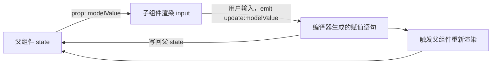

# v-model 原理与实战解析

## 使用入口：先解决问题，再做验证

实现输入和自定义组件的数据双向协作。

**先做基本操作**：先做原生 input 和自定义表单组件，验证值/事件/校验，再解释 props 与 emit 协议。初次学习可先完成[本模块基础实践](/doc/Vue/Vue组件与页面基本使用)。

**再逐步深入**：基本 API 与输入输出 → 常见失败和使用边界 → 场景排查与优化 → 本文机制分析与源码。面试先讲用途和自己的操作过程，再回答场景与原理追问。

## 基本使用：四种 v-model 写法

```vue
<!-- ① 手写完整版：面试写这个，证明懂原理 -->
<script setup lang="ts">
const props = defineProps<{ modelValue: string }>()
const emit = defineEmits<{ 'update:modelValue': [value: string] }>()
function onInput(e: Event) {
  emit('update:modelValue', (e.target as HTMLInputElement).value)
}
</script>
<template><input :value="props.modelValue" @input="onInput" /></template>
```

```vue
<!-- ② computed 中转：需要对值做转换时最稳 -->
<script setup lang="ts">
const props = defineProps<{ modelValue: string }>()
const emit = defineEmits(['update:modelValue'])
const inner = computed({
  get: () => props.modelValue,
  set: v => emit('update:modelValue', v.trim()),
})
</script>
<template><input v-model="inner" /></template>
```

```vue
<!-- ③ Vue 3.4+ defineModel：官方宏，代码量最少 -->
<script setup lang="ts">
const model = defineModel<string>({ default: '' })
// 编译器自动注入 modelValue prop + update:modelValue emit；直接赋值即可
</script>
<template><input v-model="model" /></template>
```

```vue
<!-- ④ 多个 v-model + 自定义修饰符 -->
<script setup lang="ts">
const props = defineProps<{
  title: string
  titleModifiers?: { capitalize?: boolean }
  visible: boolean
}>()
const emit = defineEmits<{
  'update:title': [v: string]
  'update:visible': [v: boolean]
}>()
function onInput(e: Event) {
  let v = (e.target as HTMLInputElement).value
  if (props.titleModifiers?.capitalize) v = v.charAt(0).toUpperCase() + v.slice(1)
  emit('update:title', v)
}
</script>
<!-- 父组件：<MyComp v-model:title.capitalize="t" v-model:visible="show" /> -->
```

> **一句话结论**：`v-model` 不是双向绑定黑盒，而是编译期语法糖——**父传 prop + 子发 `update:xxx` 事件**，本质仍是单向数据流；Vue3 把它统一成 `modelValue` / `update:modelValue`，因此天然支持多个 `v-model`。

## 30 秒速览

| 用法 | 编译后等价于 | 适用 |
|---|---|---|
| `<input v-model="text">` | `:value="text"` + `@input="text = $event.target.value"` | 原生文本框 |
| `<input type="checkbox" v-model="checked">` | `:checked` + `@change` | 复选框 |
| `<select v-model="sel">` | `:value` + `@change`，配合 `option` 选中态 | 下拉 |
| `<MyComp v-model="text">` | `:modelValue="text"` + `@update:modelValue="v => text = v"` | 自定义组件（Vue3） |
| `<MyComp v-model:title="t">` | `:title="t"` + `@update:title="v => t = v"` | 多个双向绑定 |
| `<MyComp v-model.capitalize="t">` | 额外传入 `modelModifiers: { capitalize: true }` | 自定义修饰符 |

## 一张图看懂数据闭环



关键点：**子组件永远不直接修改 prop**，只把新值「报上去」；父组件收到事件后自己更新状态，再经 prop 流回子组件。所以 `defineProps` 里的 `modelValue` 仍是只读的，直接赋值会告警且不生效。

## 二、Vue2 → Vue3 变化对照

| 维度 | Vue2 | Vue3 |
|---|---|---|
| 默认 prop | `value` | `modelValue` |
| 默认事件 | `input` | `update:modelValue` |
| 改名方式 | 组件选项 `model: { prop, event }` | `v-model:xxx` 参数，无需选项 |
| 绑定数量 | 1 个（多个要靠 `.sync`） | 任意多个，`v-model:a` / `v-model:b` |
| `.sync` 修饰符 | 存在 | 已移除，统一由带参数 `v-model` 取代 |
| 自定义修饰符 | 无 | `modelModifiers` / `xxxModifiers` prop |

迁移口诀：`value + input + .sync` → `modelValue + update:modelValue + v-model:arg`。

## 四、原生元素上的特殊处理

| 元素 | 绑定的 DOM 属性 | 监听事件 | Vue 额外做的事 |
|---|---|---|---|
| `input[type=text]` / `textarea` | `value` | `input` | 中文输入法组合期间不更新（`compositionstart/end`），避免拼音被打断 |
| `input[type=checkbox]` | `checked` | `change` | 绑定数组时按 `value` 自动增删元素，支持 `true-value` / `false-value` |
| `input[type=radio]` | `checked` | `change` | 与 `value` 比较决定是否选中 |
| `select` | `value` | `change` | 多选时绑定数组，`option` 需 `:value` 绑定对象而非字符串 |

修饰符行为：`.lazy` 把 `input` 换成 `change`（失焦才同步）、`.number` 用 `parseFloat` 转数字（空串保持原值，不是 0）、`.trim` 去首尾空格。这三个由编译器生成运行时辅助代码，**不会**自动出现在自定义组件上。

## 五、生产避坑清单

| 现象 | 根因 | 处理 |
|---|---|---|
| 子组件改了值，父组件没变 | 直接给 `props.modelValue` 赋值，或事件名写错大小写 | 只 `emit('update:modelValue', v)`，事件名严格匹配 |
| `v-model` 绑对象，改深层字段不生效 | 父传的是 `reactive` 对象，子改 `obj.name` 其实是绕过了 emit | 拆成多个 `v-model`，或整体 emit 新对象 `{...props.modelValue, name: v}` |
| `defineModel` 报错找不到宏 | Vue < 3.4 或构建工具未开启宏编译 | 升级 Vue 3.4+；Vite 项目确认 `@vitejs/plugin-vue` 版本匹配 |
| 输入中文时值频繁跳变 | 自己用 `@input` 手写且未处理 IME | 用原生 `v-model`，或自行处理 `compositionend` |
| `.number` 后拿到字符串 | `parseFloat` 失败时 Vue 返回原值 | 在业务层显式 `Number(v)` 并校验 `NaN` |
| 封装 UI 组件库时透传失败 | `inheritAttrs` 与 `v-model` 落点冲突 | 用 `defineOptions({ inheritAttrs: false })` + `v-bind="$attrs"` 明确落点 |

> **设计建议**：通用表单组件对外只暴露 `modelValue` 一个契约，内部状态一律由 prop 派生；需要「未保存草稿」这类临时态才允许本地 `ref`，并在提交或重置时显式与 prop 同步。

## 六、高频追问（含高分/低分特征）

| 追问 | 高分回答要点 | 低分回答 |
|---|---|---|
| `v-model` 是双向绑定吗？ | 不是；是 prop + emit 的语法糖，仍遵循单向数据流，编译期展开 | 「是，Vue 提供双向绑定」 |
| Vue3 为什么改 `modelValue`？ | 统一命名、支持参数化多个绑定、移除 `.sync` 减少概念 | 「换个名字而已」 |
| 一个组件能有几个 `v-model`？ | 任意多个，用 `v-model:arg` 区分，对应 `arg` prop 与 `update:arg` 事件 | 「只能一个」 |
| `defineModel` 原理？ | 编译宏，展开成 `modelValue` prop + `update:modelValue` emit + 自定义 ref 拦截 set | 「新的响应式 API」 |
| 修饰符怎么自定义？ | 声明 `xxxModifiers` prop，在 emit 前按标记处理值 | 「不支持自定义」 |
| 为什么改 prop 会告警？ | 父组件重渲染会覆盖子组件的修改，导致状态来源不一致 | 「Vue 不允许」但说不出原因 |

**延伸阅读**：[组件通信与实战解析](/doc/Vue/组件通信与实战解析)、[响应式原理与实战解析](/doc/Vue/响应式原理与实战解析)。
