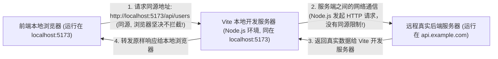

# Axios 企业级封装请求拦截响应处理与 Token 传递

在任何现代 Web 应用中，网络数据交互是驱动业务运行的核心血管。虽然浏览器原生提供了 `fetch` API，但其缺少开箱即用的超时控制、请求拦截、统一错误分发及数据自动序列化能力。Axios 凭借精巧的 **拦截器责任链（Interceptor Pipeline）** 机制，成为了企业级前端开发的绝对标配。本专题带你从零构建一套符合大厂生产规范的 Axios 模块化封装体系，并彻底搞懂开发环境 Vite 代理跨域的物理机制。

---

## 核心设计哲学与网络请求链路

### 1. 企业级 Axios 拦截器责任链数据流转图

```mermaid
flowchart LR
    A["业务组件发起请求: http.get('/user/info')"] --> B["请求拦截器 (Request Interceptor)"]
    B --> C["1. 自动注入 Authorization Bearer Token<br/>2. 追加时间戳防 GET 缓存<br/>3. 开启全局 Loading 进度条"]
    C --> D["向远程服务端发送真实 HTTP 请求"]
    D --> E["收到服务端 HTTP 响应报文"]
    E --> F["响应拦截器 (Response Interceptor)"]
    F --> G{"HTTP 状态码 / 业务 Code 判定"}
    G -->|成功 (Code: 200)| H["自动剥除外壳，直出业务 data 实体"]
    G -->|Token 过期 (401)| I["清空本地脏 Token，强制重定向至登录页"]
    G -->|系统异常 (500)| J["统一弹出 ElementPlus/AntD 全局错误通知 Toast"]
    H --> K["业务代码无感接收纯粹数据: const res = await ..."]
```

---

## 保姆级核心代码演示

### 1. 通用类型契约与 Axios 封装主文件（`src/utils/http.ts`）

支持完备的 TypeScript 泛型推导，彻底告别 `any`：

```typescript
import axios, { 
  type AxiosInstance, 
  type AxiosRequestConfig, 
  type AxiosResponse, 
  type InternalAxiosRequestConfig 
} from 'axios'

// 1. 定义后端约定的通用接口外层包装格式
export interface ApiResponse<T = any> {
  code: number
  message: string
  data: T
}

// 2. 创建自定义的 Axios 实例
const service: AxiosInstance = axios.create({
  // 开发环境下通过环境变量读取，通常以 '/api' 开头供 Vite 代理拦截
  baseURL: import.meta.env.VITE_API_BASE_URL || '/api',
  timeout: 10000 // 10 秒超时
})

// 3. 请求拦截器 (Request Interceptor)
service.interceptors.request.use(
  (config: InternalAxiosRequestConfig) => {
    // 从本地读取全局 Token
    const token = localStorage.getItem('ACCESS_TOKEN')
    if (token && config.headers) {
      // 统一注入工业级标准 Authorization 请求头
      config.headers['Authorization'] = `Bearer ${token}`
    }

    // 针对 GET 请求追加时间戳参数，杜绝浏览器对 GET 请求的强缓存陷阱
    if (config.method?.toUpperCase() === 'GET') {
      config.params = {
        ...config.params,
        _t: Date.now()
      }
    }

    return config
  },
  (error) => {
    console.error('[请求发起失败]:', error)
    return Promise.reject(error)
  }
)

// 4. 响应拦截器 (Response Interceptor)
service.interceptors.response.use(
  (response: AxiosResponse<ApiResponse>): any => {
    const res = response.data

    // 假设后端约定：code 为 200 或 0 代表业务逻辑完全成功
    if (res.code === 200 || res.code === 0) {
      // 核心优化：直接将内部核心 data 实体剥离并返回，业务组件调用时少写一层 .data！
      return res.data
    }

    // 处理已知的业务错误状态码
    if (res.code === 40101 || res.code === 401) {
      handleUnauthorized()
    } else {
      // 全局轻量报错提示
      alert(`[业务错误 ${res.code}]: ${res.message || '未知业务异常'}`)
    }

    return Promise.reject(new Error(res.message || 'Error'))
  },
  (error) => {
    // 捕获 HTTP 协议层面的网络异常（如 401, 403, 404, 500, 网络断开）
    console.error('[网络响应异常]:', error)

    if (error.response) {
      const status = error.response.status
      switch (status) {
        case 401:
          handleUnauthorized()
          break
        case 403:
          alert('权限不足：您无权访问该资源！')
          break
        case 404:
          alert('网络请求地址不存在 (404)！')
          break
        case 500:
          alert('服务端内部系统崩溃 (500)！')
          break
        default:
          alert(`网络异常: HTTP ${status}`)
      }
    } else if (error.message.includes('timeout')) {
      alert('网络请求超时，请检查您的网络连接后重试！')
    } else {
      alert('网络连接断开，请检查网络！')
    }

    return Promise.reject(error)
  }
)

// 401 统一未授权处理
function handleUnauthorized(): void {
  localStorage.removeItem('ACCESS_TOKEN')
  alert('登录凭证已失效，请重新登录！')
  // 平滑跳转至登录页并携带当前路由
  window.location.href = `/login?redirect=${encodeURIComponent(window.location.pathname)}`
}

// 5. 导出强类型的轻量请求工具函数
export const http = {
  get<T = any>(url: string, config?: AxiosRequestConfig): Promise<T> {
    return service.get(url, config)
  },
  post<T = any>(url: string, data?: any, config?: AxiosRequestConfig): Promise<T> {
    return service.post(url, data, config)
  },
  put<T = any>(url: string, data?: any, config?: AxiosRequestConfig): Promise<T> {
    return service.put(url, data, config)
  },
  delete<T = any>(url: string, config?: AxiosRequestConfig): Promise<T> {
    return service.delete(url, config)
  }
}

export default service
```

---

### 2. 模块化 API 接口定义与组件无感消费（`src/api/user.ts`）

业务接口严格分层，禁止在组件中硬编码 URL：

```typescript
// src/api/user.ts
import { http } from '../utils/http'

export interface UserDetail {
  userId: number
  username: string
  email: string
  balance: number
}

// 强类型声明接口返回值为 UserDetail
export function fetchUserProfileApi(id: number) {
  return http.get<UserDetail>(`/user/profile/${id}`)
}
```

在具体业务组件中使用：
```vue
<script setup lang="ts">
import { ref, onMounted } from 'vue'
import { fetchUserProfileApi, type UserDetail } from '../api/user'

const user = ref<UserDetail | null>(null)
const loading = ref<boolean>(false)

async function loadData() {
  loading.value = true
  try {
    // 此时 res 具备完美的 TypeScript 智能补全，且无需额外写 res.data.data！
    const res = await fetchUserProfileApi(1001)
    user.value = res
  } catch (err) {
    // 错误已被拦截器统一全局报警提示，此处仅需处理局部降级
  } finally {
    loading.value = false
  }
}

onMounted(() => {
  loadData()
})
</script>
```

---

## 开发环境 Vite 代理跨域物理机制剖析

初学者在本地连接后端接口时，最常遇到的拦路虎就是浏览器的 **跨域同源策略拦截（CORS Error）**。

### 为什么在 `vite.config.ts` 中配置代理能彻底解决跨域？



> **核心物理本质**：
> **跨域限制是浏览器特有的“自卫安全策略”！** 服务器与服务器之间（Node.js 到远程后端）进行数据通信，根本不受同源策略的任何约束！Vite 开发服务器在本地充当了一个“双向中继代理人（Reverse Proxy）”。

### 标准 Vite 代理配置（`vite.config.ts`）

```typescript
// vite.config.ts
import { defineConfig } from 'vite'
import vue from '@vitejs/plugin-vue'

export default defineConfig({
  plugins: [vue()],
  server: {
    port: 5173,
    proxy: {
      // 只要请求路径以 '/api' 开头，就将请求代理转发给真实后端目标地址
      '/api': {
        target: 'https://api.mybackend.com', // 目标真实后端服务地址
        changeOrigin: true,                  // 必须开启：将请求头中的 Host 伪装修改为目标地址
        rewrite: (path) => path.replace(/^\/api/, '') // 路径重写：把 /api 前缀剔除掉
      }
    }
  }
})
```

---

## 生产级避坑指南与排障 SOP

### 1. 区分 HTTP 协议状态码与业务应用状态码

- **高频误区**：
  许多初学者以为只要进入了 `interceptors.response.use` 的第一个成功回调，接口就一定是成功的。
- **真相**：
  只要服务端的 HTTP 状态码返回的是 **200 OK**，请求就会进入成功回调！但很多后端接口在发生业务错误时（如密码错误、权限不足、余额不足），依然返回 HTTP 200，只是在 JSON 报文体中携带 `{ code: 40003, message: "密码错误" }`。
- **排障 SOP**：
  在响应拦截器的成功分支中，**必须首先核验业务 `res.code === 200`**；如果不满足，必须通过 `Promise.reject(new Error(res.message))` 手动将其抛入异常流，防止错误的脏数据流向业务组件。

---

### 2. 避免每个接口重复弹窗导致的“弹窗轰炸”

- **故障场景**：页面初始化时同时并发调用了 5 个不同模块的接口，如果此时恰逢 Token 过期失效，5 个接口几乎在同一时间均被拦截器判定为 401，界面上瞬间接连弹出 5 次“请重新登录”的警报弹窗！
- **治理 SOP**：
  在封装层维护一个模块级单例防抖锁变量 `let isRefreshing = false`。一旦第一个 401 触发了弹窗并重定向，锁立即上锁，后续并发的 401 请求一律静默阻断，杜绝弹窗雪崩。

---

## 中级必考面试题与标准对标回答

### 面试题 1：请详细说明在 Axios 拦截器中主要能做哪些核心通用事情？

- **标准应答**：
  1. **请求拦截器（Request Interceptor）核心事务**：
     - **鉴权凭证统一注入**：从持久化存储（localStorage / Pinia）读取 Token，自动附加在 `config.headers.Authorization` 中；
     - **防缓存机制**：针对 GET 请求统一追加时间戳或随机数，避免 IE/部分现代浏览器对非变动 GET 请求的激进本地缓存；
     - **全局加载态联动**：在请求发起瞬间开启顶部全局进度条（如 NProgress），提升用户体感；
     - **并发请求去重与取消**：基于请求特征（Method + URL + Params）维护请求映射表，遇到重复未完成请求自动调用 `AbortController` 提前中断取消。
  2. **响应拦截器（Response Interceptor）核心事务**：
     - **响应报文格式扁平化**：直接从 Axios 默认的包装对象中剥除外壳，将真正的业务数据 `res.data` 直接返回；
     - **全局 HTTP 异常状态分发**：根据网络层错误码（401、403、404、500）执行统一的错误提示，避免每个业务组件重复书写 `try-catch` 弹窗；
     - **401 Token 无感刷新与重定向**：捕捉 Token 失效，自动跳转登录页或触发后台无感刷新机制。

---

### 面试题 2：前端本地配置的 Vite `server.proxy` 代理在项目打包部署上线后依然生效吗？生产环境跨域通常如何解决？

- **标准应答**：
  1. **生产环境绝对不生效**：`vite.config.ts` 中的 `server.proxy` 是依托于 Vite 本地启动的 **Node.js 临时开发服务器（Connect 中间件）** 运行的。当项目执行 `npm run build` 打包后，产物仅仅是一堆静态的 HTML、CSS、JS 文件，本地的 Node.js 代理服务器完全不复存在，因此该配置在生产环境完全无效。
  2. **生产环境跨域的标准解决架构**：
     - **方案 A（工业级首选：Nginx 反向代理）**：在前端静态资源托管的 Nginx 服务器中配置反向代理规则，把类似 `/api/` 的前缀自动代理转发给后端的真实内网集群；
     - **方案 B（CORS 服务端跨域资源共享）**：由后端网关（如 Spring Cloud Gateway、Go/Node 服务端）在响应头中显式配置 `Access-Control-Allow-Origin: *`（或指定合法前端域名），允许浏览器跨源访问。
