# Pinia 现代化状态管理核心实践对比 Vuex 4

在 Vue 2 以及 Vue 3 早期，Vuex 长期作为官方唯一钦定的全局状态管理库。然而，其强制要求区分“同步突变（Mutation）与异步动作（Action）”的严苛范式、复杂繁琐的命名空间嵌套模块（Namespaced Modules），以及对 TypeScript 极其糟糕的类型推断支持，长期受到业务开发者的诟病。Vue 官方团队随后推出了全新的状态中枢 **Pinia**，并正式将其确立为 Vue 3 的官方新一代标准。本专题从底层架构对比、Setup Store 规范到真实持久化实战，全方位解析 Pinia 的核心体系。

---

## 核心设计哲学与架构对比

### 1. Pinia 为什么能全面取代并彻底淘汰 Vuex 4？

```mermaid
flowchart TD
    subgraph VuexArchitecture["Vuex 4 沉重架构: 繁琐且类型推导断层"]
        A1["Component 派发 dispatch('user/fetch')"] --> B1["Actions (处理异步)"]
        B1 --> C1["提交 commit('SET_USER')"]
        C1 --> D1["Mutations (必须同步修改 State)"]
        D1 --> E1["State (深层嵌套 modules)"]
        E1 --> F1["Getters"]
    end

    subgraph PiniaArchitecture["Pinia 现代化扁平架构: 极致清爽且天然 TS 友好"]
        A2["Component 直接调用: userStore.fetchUser()"]
        A2 --> B2["Actions: 既可同步也可异步，直接修改 State!"]
        B2 --> C2["State: 每一个 Store 都是一个扁平独立的 Composable"]
        C2 --> D2["Getters: 等价于 computed"]
    end
```



### 2. 核心技术指标横向评测

| 评估维度 | Vuex 4 | Pinia |
| :--- | :--- | :--- |
| **Mutation 概念** | **强制存在**。必须严格区分同步 mutation 与异步 action | **彻底废除**！Actions 同时支持同步与异步，直接就地修改 State |
| **TypeScript 支持** | **极度糟糕**。需要写大量繁重的类型定义文件与字符串类型映射 | **第一公民级完美支持**。无须任何辅助类型，自动完成极致推导 |
| **模块化机制** | 单一状态树，嵌套 `modules: { a: { modules: { b } } }`，易引发命名混乱 | **天然扁平化**。每个 Store 是一个独立定义、按需引入的 Hook |
| **组合式 API 契合度** | 依赖 Options 式语法，在 setup 中使用 `useStore()` 体验割裂 | 原生支持 **Setup Store** 语法（`defineStore('id', () => { ... })`） |
| **打包体积** | 约 10KB 左右 | **仅约 1KB**，几乎零运行时开销，天然支持 Tree-Shaking |

---

## 保姆级核心代码演示

### 1. 现代化 Setup Store 定义（`src/stores/useUserStore.ts`）

在 Vue 3 中，极力推荐使用符合 Composition API 直觉的 **Setup Store（函数式写法）**：

```typescript
import { defineStore } from 'pinia'
import { ref, computed } from 'vue'

export interface UserProfile {
  id: number
  username: string
  role: 'admin' | 'user'
  score: number
}

// defineStore 接收唯一标识 ID 与 Setup 函数
export const useUserStore = defineStore('user', () => {
  // 1. State: 每一个 ref / reactive 变量就代表一个 State 状态
  const token = ref<string>(localStorage.getItem('TOKEN') || '')
  const profile = ref<UserProfile | null>(null)
  const isLoggingIn = ref<boolean>(false)

  // 2. Getters: 每一个 computed 计算属性就代表一个 Getter
  const isLoggedIn = computed<boolean>(() => Boolean(token.value))
  const isAdmin = computed<boolean>(() => profile.value?.role === 'admin')
  const userScore = computed<number>(() => profile.value?.score || 0)

  // 3. Actions: 每一个普通函数就代表一个 Action（支持 async/await）
  async function login(usernameInput: string): Promise<boolean> {
    isLoggingIn.value = true
    try {
      // 模拟 500ms 异步接口请求
      await new Promise(r => setTimeout(r, 500))
      
      const mockToken = `TOKEN_${Date.now()}`
      token.value = mockToken
      localStorage.setItem('TOKEN', mockToken)

      profile.value = {
        id: 1001,
        username: usernameInput,
        role: usernameInput.toLowerCase() === 'admin' ? 'admin' : 'user',
        score: 80
      }
      return true
    } catch (err) {
      console.error('登录失败:', err)
      return false
    } finally {
      isLoggingIn.value = false
    }
  }

  function logout(): void {
    token.value = ''
    profile.value = null
    localStorage.removeItem('TOKEN')
  }

  function addScore(points: number): void {
    if (profile.value) {
      // Pinia 允许直接原地修改状态，无需繁琐的 commit mutation！
      profile.value.score += points
    }
  }

  // 4. 必须将需要暴露的状态、计算属性和方法全部 return 出去
  return {
    token,
    profile,
    isLoggingIn,
    isLoggedIn,
    isAdmin,
    userScore,
    login,
    logout,
    addScore
  }
})
```

---

### 2. 在业务组件中消费与 `storeToRefs` 解构（`src/views/UserCenterView.vue`）

展示如何安全解构 State 与触发 Action：

```vue
<template>
  <div class="user-center">
    <h2>个人中心与 Pinia 状态消费实战</h2>

    <!-- 未登录视图 -->
    <div v-if="!isLoggedIn" class="login-box">
      <input v-model="loginName" placeholder="输入用户名 (输入 admin 体验管理员)..." />
      <button :disabled="isLoggingIn" class="btn" @click="handleLogin">
        {{ isLoggingIn ? '登录中...' : '点击登录' }}
      </button>
    </div>

    <!-- 已登录视图 -->
    <div v-else class="profile-box">
      <p>当前登录用户: <strong>{{ profile?.username }}</strong></p>
      <p>权限角色: <span class="badge" :class="isAdmin ? 'badge-admin' : 'badge-user'">
        {{ isAdmin ? '超管管理员' : '普通用户' }}
      </span></p>
      <p>当前积分 (Getter): <strong class="score-text">{{ userScore }}</strong> 分</p>

      <div class="actions">
        <!-- 方式 A: 直接调用 Store 的 Action 函数 -->
        <button class="btn action-btn" @click="userStore.addScore(10)">通过 Action 增加 10 积分</button>

        <!-- 方式 B: 使用 $patch 批量修改多个状态 -->
        <button class="btn patch-btn" @click="handleBatchPatch">通过 $patch 批量增补</button>

        <!-- 退出登录 -->
        <button class="btn logout-btn" @click="userStore.logout">退出登录</button>
      </div>
    </div>
  </div>
</template>

<script setup lang="ts">
import { ref } from 'vue'
import { storeToRefs } from 'pinia'
import { useUserStore } from '../stores/useUserStore'

const loginName = ref<string>('admin')

// 1. 实例化 Store
const userStore = useUserStore()

// 2. 核心要点：解构 State 与 Getters 时，必须使用 storeToRefs！
// 严禁直接 const { isLoggedIn, profile } = userStore，否则响应式彻底丢失！
const { isLoggedIn, isAdmin, profile, userScore, isLoggingIn } = storeToRefs(userStore)

async function handleLogin(): Promise<void> {
  const success = await userStore.login(loginName.value)
  if (success) {
    alert('登录成功！已存入 Pinia 全局状态！')
  }
}

// 演示 $patch 批量修改
function handleBatchPatch(): void {
  // $patch 能够将多次内部改动合并为一次单一的变更通知，减少监听器的高频触发
  userStore.$patch((state) => {
    if (state.profile) {
      state.profile.score += 50
      state.profile.username += '_VIP'
    }
  })
}
</script>

<style scoped>
.user-center {
  max-width: 550px; margin: 30px auto; padding: 24px; background: white;
  border-radius: 12px; border: 1px solid #e2e8f0; font-family: sans-serif;
  box-shadow: 0 4px 16px rgba(0,0,0,0.06);
}
.login-box { display: flex; gap: 10px; margin-top: 16px; }
.login-box input { flex: 1; padding: 8px 12px; border: 1px solid #cbd5e1; border-radius: 6px; }
.btn { padding: 8px 16px; border: none; border-radius: 6px; cursor: pointer; font-size: 13px; font-weight: 500; }
.profile-box { margin-top: 16px; font-size: 14px; color: #334155; }
.badge { padding: 2px 8px; border-radius: 10px; font-size: 12px; font-weight: bold; }
.badge-admin { background-color: #fef3c7; color: #d97706; }
.badge-user { background-color: #e0f2fe; color: #0284c7; }
.score-text { color: #dc2626; font-size: 16px; }
.actions { display: flex; gap: 10px; margin-top: 16px; flex-wrap: wrap; }
.action-btn { background-color: #3b82f6; color: white; }
.patch-btn { background-color: #10b981; color: white; }
.logout-btn { background-color: #ef4444; color: white; }
</style>
```

---

## 生产级避坑指南与排障 SOP

### 1. 为什么解构 Pinia 的 Store 必须使用 `storeToRefs` 而不能直接用 `toRefs`？

- **物理成因**：
  如果直接写 `toRefs(userStore)`，虽然能把 State 和 Getters 转换为 Ref，但 `userStore` 上挂载的**所有 Actions 函数也会被强行转成无意义的 Ref**！导致你后续调用 `userStore.login()` 报错。
- **`storeToRefs` 的原理**：
  `storeToRefs` 是 Pinia 专用的辅助函数。它在底层会智能识别并**跳过所有的 Action 方法以及非响应式属性**，仅仅把 State 和 Getters 精准提炼并转换为 `Ref`，既保持了响应式，又避免了方法被破坏。

---

### 2. 状态持久化方案：引入 `pinia-plugin-persistedstate`

在生产中，刷新页面后 Pinia 内存中的状态会丢失。不要在每个 Action 里手动写 `localStorage.setItem`，最佳实践是接入插件：
```typescript
// main.ts
import { createApp } from 'vue'
import { createPinia } from 'pinia'
import piniaPluginPersistedstate from 'pinia-plugin-persistedstate'
import App from './App.vue'

const pinia = createPinia()
pinia.use(piniaPluginPersistedstate) // 注册持久化插件

const app = createApp(App)
app.use(pinia)
app.mount('#app')
```
在具体的 Store 中仅需配置一行 `persist: true`，插件即可自动在状态变动时将其序列化写入 `localStorage`，并在刷新页面时自动水合还原。

---

## 中级必考面试题与标准对标回答

### 面试题 1：Pinia 为什么废除了 Vuex 中的 Mutation 概念？

- **标准应答**：
  1. **历史遗留原因**：在 Vuex 中引入 Mutation，最初是为了配合早期的 DevTools 追踪状态变动。Vuex 规定 Mutation 必须是同步函数，因为如果是异步的，DevTools 根本无法捕捉到状态究竟是在何时被哪次调用所改变的，导致时间旅行调试失效。
  2. **Pinia 的架构进化**：Pinia 重新设计了底层的变更追踪协议（通过 `$subscribe` 和 `$onAction`）。DevTools 现在能够完美直接追踪由 Action 发起的异步状态变动；既然 Action 已经能够透明、安全地处理异步和同步更新，保留 Mutation 只会徒增枯燥重复的模板代码，因此 Pinia 果断将其彻底剔除，使数据流转更加直观扁平。

---

### 面试题 2：Pinia 的 Options Store 和 Setup Store 各有什么优缺点？在现代企业级项目中推荐哪种？

- **标准应答**：
  1. **Options Store（对象选项式）**：
     - *优点*：类似 Vuex 的书写结构（`state: () => ({})`，`getters: {}`，`actions: {}`），老项目迁移上手成本低；
     - *局限*：无法在内部自由使用其他 Composition API 或注入自定义 Hooks。
  2. **Setup Store（函数组合式，推荐）**：
     - *优点*：语法与 Vue 3 `<script setup>` 完全一模一样（`ref()` 就是 State，`computed()` 就是 Getters，普通函数就是 Actions）；可以在 Store 内部极其自然地调用其他的 Store 或自定义 Hooks，灵活性与 TypeScript 推导达到极致；
     - *结论*：现代企业级 Vue 3 项目强烈推荐统一采用 **Setup Store**。
