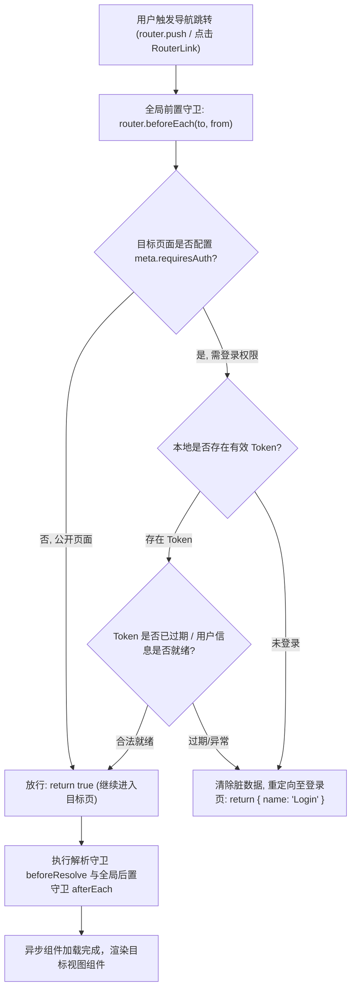

# Vue Router 4 核心实战动态路由参数传递与导航守卫

在现代前端单页应用（SPA, Single Page Application）中，浏览器实际上只加载了一个唯一的 `index.html`。实现“在不刷新整页的前提下，根据 URL 地址栏的改变平滑切换展示不同的视图页面”，完全依赖于前端路由中枢。Vue Router 4 是专门配合 Vue 3 深度重构的现代化路由解决方案。本专题从路由模式选型、动态传参避坑到企业级权限导航守卫，全景拆解 Vue Router 4 的核心实战技能。

---

## 核心设计哲学与导航守卫流转全景

### 1. Hash 模式 vs HTML5 History 模式底层物理对比

| 路由模式 | 工厂函数 | URL 表现形式 | 底层浏览器监听事件 | 生产部署要求 |
| :--- | :--- | :--- | :--- | :--- |
| **Hash 模式** | `createWebHashHistory()` | `http://app.com/#/user/detail` | 监听 `window.onhashchange` 事件 | **极度简单**。Hash 改变绝不向服务器发送请求，无需后端/Nginx 任何额外配置 |
| **History 模式** | `createWebHistory()` | `http://app.com/user/detail` | 基于 HTML5 `history.pushState()` 与 `window.onpopstate` | **必须 Nginx 配置配合**。刷新页面时浏览器会向服务器真实请求该路径，若未配置 `try_files` 会报 404 |

---

### 2. 全局前置导航守卫（`beforeEach`）决策状态机

用户点击链接到页面渲染完成，路由守卫在底层经历严格的决策验证流水线：



---

## 保姆级核心代码演示

### 1. 路由配置与全局鉴权守卫（`src/router/index.ts`）

在 Vue Router 4 中，废弃了必须调用 `next()` 的陈旧语法，推荐使用更符合直觉的 **返回值（Return Value）控制法**：

```typescript
import { createRouter, createWebHistory, type RouteRecordRaw } from 'vue-router'

// 1. 定义路由表（全量开启路由懒加载以缩减首屏体积）
const routes: RouteRecordRaw[] = [
  {
    path: '/',
    redirect: '/dashboard'
  },
  {
    path: '/login',
    name: 'Login',
    component: () => import('../views/LoginView.vue'),
    meta: { title: '用户登录', requiresAuth: false }
  },
  {
    path: '/dashboard',
    name: 'Dashboard',
    component: () => import('../views/DashboardView.vue'),
    meta: { title: '系统仪表盘', requiresAuth: true } // 需要鉴权
  },
  {
    // 动态路径参数路由：以冒号 :id 声明
    path: '/user/:userId',
    name: 'UserProfile',
    component: () => import('../views/UserProfileView.vue'),
    meta: { title: '用户详情', requiresAuth: true }
  },
  {
    // 404 捕获所有未定义路由
    path: '/:pathMatch(.*)*',
    name: 'NotFound',
    component: () => import('../views/NotFoundView.vue')
  }
]

// 2. 创建路由实例
const router = createRouter({
  history: createWebHistory(),
  routes
})

// 3. 全局前置守卫：Vue Router 4 最佳实践
router.beforeEach((to, from) => {
  // 设置动态网页标题
  document.title = (to.meta.title as string) || '管理系统'

  const userToken = localStorage.getItem('ACCESS_TOKEN')

  // 判断目标路由是否需要鉴权
  if (to.meta.requiresAuth) {
    if (!userToken) {
      // 未登录：直接返回待重定向的目标路由对象，并携带 redirect 参数用于登录后跳回
      return {
        name: 'Login',
        query: { redirect: to.fullPath }
      }
    }
  }

  // 返回 true 或不返回任何值表示验证通过，允许通行
  return true
})

export default router
```

---

### 2. 参数传递：`query` vs 动态路由 `params`（`src/views/DashboardView.vue`）

展示编程导航跳转与不同传参方式的选用：

```vue
<template>
  <div class="dashboard-page">
    <h2>系统控制台 (导航跳转演示)</h2>

    <div class="nav-cards">
      <!-- 方式 1: 动态路由传参 (/user/1001) -->
      <button class="nav-btn" @click="goToUserProfile(1001)">
        跳转至用户 1001 详情 (动态路由 /user/:userId)
      </button>

      <!-- 方式 2: Query 明文查询参数 (/user/1001?tab=security&from=dashboard) -->
      <button class="nav-btn" @click="goToUserWithQuery(1002)">
        跳转至用户 1002 (携带 Query 查询参数)
      </button>
    </div>
  </div>
</template>

<script setup lang="ts">
import { useRouter } from 'vue-router'

const router = useRouter()

// 1. 动态路由匹配：URL 会呈现为 /user/1001
function goToUserProfile(id: number): void {
  router.push({
    name: 'UserProfile',
    params: { userId: id.toString() }
  })
}

// 2. Query 参数传参：URL 会呈现为 /user/1002?tab=security&role=admin
function goToUserWithQuery(id: number): void {
  router.push({
    path: `/user/${id}`,
    query: {
      tab: 'security',
      role: 'admin'
    }
  })
}
</script>

<style scoped>
.dashboard-page { max-width: 600px; margin: 30px auto; padding: 20px; font-family: sans-serif; }
.nav-cards { display: flex; flex-direction: column; gap: 12px; margin-top: 20px; }
.nav-btn {
  padding: 10px 16px; background-color: #3b82f6; color: white; border: none;
  border-radius: 6px; cursor: pointer; font-size: 14px; text-align: left;
}
</style>
```

---

### 3. 在目标页面提取参数（`src/views/UserProfileView.vue`）

展示 `useRoute` 的安全提取与响应式参数监听：

```vue
<template>
  <div class="profile-card">
    <h3>用户档案中心</h3>
    <p>动态路由 Params 参数 userId: <strong class="val">{{ route.params.userId }}</strong></p>
    <p>URL Query 参数 tab: <strong class="val">{{ route.query.tab || '默认基础页' }}</strong></p>
    <p>URL Query 参数 role: <strong class="val">{{ route.query.role || '无' }}</strong></p>

    <!-- 模拟同页面内切换用户 ID -->
    <button class="btn" @click="switchUser(9999)">原地切换至用户 9999</button>
  </div>
</template>

<script setup lang="ts">
import { useRoute, useRouter, watch } from 'vue-router'

const route = useRoute()
const router = useRouter()

// 核心要点：在同一个路由组件内（比如从 /user/1001 切到 /user/9999）
// 组件实例不会被重新创建，onMounted 也不会再次执行！必须 watch 监听 route.params 的变化！
watch(
  () => route.params.userId,
  (newId) => {
    if (newId) {
      console.log('检测到路由参数变动，重新拉取用户数据，新 ID:', newId)
      // fetchUserData(newId)
    }
  }
)

function switchUser(newId: number): void {
  router.push(`/user/${newId}`)
}
</script>

<style scoped>
.profile-card {
  max-width: 500px; margin: 30px auto; padding: 24px; background: white;
  border-radius: 10px; border: 1px solid #e2e8f0; font-family: sans-serif;
}
.val { color: #2563eb; }
.btn {
  margin-top: 16px; padding: 8px 14px; background: #10b981; color: white;
  border: none; border-radius: 6px; cursor: pointer;
}
</style>
```

---

## 生产级避坑指南与排障 SOP

### 1. 动态路由在同一个组件间跳转时不触发数据刷新的 Bug

- **故障现象**：
  从 `/user/101` 点击相关推荐链接跳转到 `/user/102`。URL 地址确实变成了 102，但页面上的用户信息依然展示着 101 的数据！
- **物理成因**：
  Vue Router 极其重视性能。因为前后两个路由使用的是同一个组件 `UserProfileView`，Vue **直接复用了当前组件实例**，完全不会触发组件的销毁（`onUnmounted`）与重建（`onMounted`）！
- **标准排障 SOP（两种解决方案）**：
  - **方案 A（推荐，性能最高）**：使用 `watch(() => route.params.id, (newId) => { ... })` 监听参数变更并重新拉取接口；
  - **方案 B（暴力刷新法）**：在 `<router-view :key="route.fullPath" />` 上绑定完整的 URL 路径作为 key，强制 Vue 每次路由变动都无条件销毁旧组件并全量重新创建新组件。

---

### 2. Vue Router 4 废除“隐式内存传参”带来的重大变迁

- **Vue 2 老写法（已被 Vue 4 正式废弃）**：
  ```javascript
  // ❌ 在 Vue Router 4 中如果 path 没有匹配的 :secret 参数，secret 将被直接丢弃！
  router.push({ name: 'User', params: { secret: '123' } })
  ```
  **现象**：用户在当前页面还能拿到，一旦按浏览器 F5 刷新，`params.secret` 瞬间变为 `undefined`！
- **规范方案**：
  - 如果参数必须在 URL 中体现并支持刷新保活：使用 **Query 参数** 或 **动态路径参数 `path: '/user/:secret'`**；
  - 如果参数不需要出现在 URL 中，但希望刷新后还能获取：使用 HTML5 原生提供的 **`history.state`**：
    ```typescript
    router.push({ path: '/user', state: { secret: '123' } })
    // 在目标页面读取：history.state.secret
    ```

---

## 中级必考面试题与标准对标回答

### 面试题 1：Vue Router 的导航守卫有哪些？各自的触发执行顺序是怎样的？

- **标准应答**：
  导航守卫按作用范围分为：**全局守卫**、**路由独享守卫** 和 **组件内守卫**。完整的导航解析触发执行顺序为：
  1. 导航被触发（如调用 `router.push`）；
  2. 在即将离开的失活组件里调用离开守卫：`beforeRouteLeave`；
  3. 调用全局前置守卫：`router.beforeEach`；
  4. 在重用的组件里调用更新守卫：`beforeRouteUpdate`；
  5. 在路由配置里调用路由独享守卫：`beforeEnter`；
  6. 解析异步路由组件；
  7. 在被激活的目标组件里调用进入守卫：`beforeRouteEnter`；
  8. 调用全局解析守卫：`router.beforeResolve`；
  9. 导航被确认；
  10. 调用全局后置钩子：`router.afterEach`；
  11. 触发 DOM 更新与渲染。

---

### 面试题 2：Vue Router 4 中导航守卫的 `next()` 为什么被官方淡化推荐？现代推荐怎么写？

- **标准应答**：
  1. **传统 `next()` 的历史痛点**：在 Vue 2 中，每一个守卫分支中必须严格调用且只能调用一次 `next()`。如果开发者由于逻辑复杂遗漏了 `next()`，页面将永久卡在空白加载态；如果在一个 `if-else` 分支中因为未加 `return` 不小心重复调用了多次 `next()`，控制台将疯狂抛出未定义重定向错误。
  2. **Vue Router 4 现代化规范**：改为基于 **Promise 返回值（Return Value）**：
     - 放行通过：直接写 `return true` 或不写 `return`；
     - 拦截取消当前导航：写 `return false`；
     - 重定向跳转：直接返回目标路由对象，如 `return { name: 'Login' }` 或 `return '/login'`。
     代码更贴合现代 async/await 直觉，彻底消除了多次调用 `next()` 引发的死锁 Bug。
