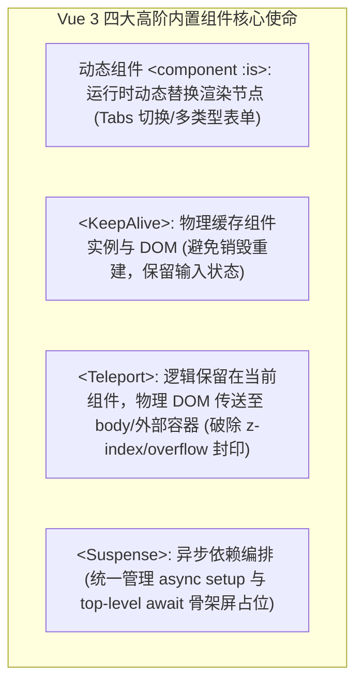

# 动态组件与内置组件 KeepAlive-Teleport-Suspense 全解

在构建高阶企业级应用时，静态的模板标签往往无法满足复杂灵活的业务交互需求（如动态表单引擎、多标签页切换缓存、模态弹窗脱离父级视口渲染、异步加载骨架屏占位）。Vue 内置了一系列极具表现力的核心组件：**动态组件 `<component :is="...">`**、**缓存保活组件 `<KeepAlive>`**、**传送门组件 `<Teleport>`** 以及 **异步协调组件 `<Suspense>`**。本专题从底层机制、运行生命周期到多标签页缓存与弹窗踩坑，全景展开实战推导。

---

## 核心设计哲学与四大内置组件机制



---

## 保姆级核心代码演示

### 1. 动态组件与 `<KeepAlive>` 多标签缓存实战

用户在填写表单时切换到“预览”Tab，随后切换回来，期望之前的输入内容毫发无损地保留，且不重复请求接口：

```vue
<template>
  <div class="tabs-container">
    <h2>多标签页动态组件与 KeepAlive 缓存实战</h2>

    <!-- Tab 切换头部 -->
    <div class="tab-header">
      <button 
        :class="{ active: currentTab === 'TabForm' }" 
        @click="currentTab = 'TabForm'"
      >
        表单填写页 (带 KeepAlive 缓存)
      </button>
      <button 
        :class="{ active: currentTab === 'TabPreview' }" 
        @click="currentTab = 'TabPreview'"
      >
        信息预览页
      </button>
    </div>

    <!-- 
      KeepAlive 核心属性:
      1. include: 仅缓存名称匹配的组件（必须与组件内部的 name 严格一致！）
      2. max: 最大缓存实例数（采用 LRU 最近最少使用算法淘汰溢出项）
    -->
    <div class="tab-body">
      <KeepAlive :include="['TabForm']" :max="5">
        <component :is="activeComponent" />
      </KeepAlive>
    </div>
  </div>
</template>

<script setup lang="ts">
import { ref, computed } from 'vue'
import TabForm from './TabForm.vue'
import TabPreview from './TabPreview.vue'

const currentTab = ref<'TabForm' | 'TabPreview'>('TabForm')

// 动态映射当前待激活的组件实例
const activeComponent = computed(() => {
  return currentTab.value === 'TabForm' ? TabForm : TabPreview
})
</script>

<style scoped>
.tabs-container {
  max-width: 600px;
  margin: 20px auto;
  padding: 20px;
  background: white;
  border-radius: 12px;
  border: 1px solid #e2e8f0;
  box-shadow: 0 4px 16px rgba(0,0,0,0.06);
}

.tab-header { display: flex; gap: 10px; margin-bottom: 16px; }
.tab-header button {
  padding: 8px 16px; border: 1px solid #cbd5e1; background: #f8fafc;
  border-radius: 6px; cursor: pointer; font-size: 13px; font-weight: 500;
}
.tab-header button.active {
  background: #3b82f6; color: white; border-color: #3b82f6;
}
.tab-body { padding: 16px; background: #f8fafc; border-radius: 8px; }
</style>
```

#### 被缓存子组件（`TabForm.vue`）中的独有生命周期

```vue
<template>
  <div class="tab-content">
    <h4>用户登记表 (被 KeepAlive 保护中)</h4>
    <label>输入草稿: </label>
    <input v-model="draftText" placeholder="在此输入草稿，切走后再切回来观察是否保留..." />
    <p class="active-status">上次激活时间: {{ lastActivatedTime }}</p>
  </div>
</template>

<script setup lang="ts">
import { ref, onMounted, onUnmounted, onActivated, onDeactivated } from 'vue'

// 声明组件名称（必须与 KeepAlive 的 include 保持一致）
defineOptions({
  name: 'TabForm'
})

const draftText = ref<string>('')
const lastActivatedTime = ref<string>('未激活')

onMounted(() => {
  console.log('>>> [TabForm 挂载] onMounted 只在初次加载时执行一次！')
})

onUnmounted(() => {
  console.log('>>> [TabForm 卸载] 因为被 KeepAlive 缓存，切换 Tab 时我绝对不会被卸载！')
})

// ===================== KeepAlive 独占生命周期 =====================
onActivated(() => {
  // 当切回此 Tab 时触发，非常适合在此处执行轻量级的“页面数据保活刷新”
  lastActivatedTime.value = new Date().toLocaleTimeString()
  console.log('>>> [TabForm 唤醒] onActivated 触发！')
})

onDeactivated(() => {
  // 当切离此 Tab 时触发，适合在此处暂挂一些动画或暂停视频播放
  console.log('>>> [TabForm 沉睡] onDeactivated 触发！')
})
</script>

<style scoped>
.tab-content { display: flex; flex-direction: column; gap: 10px; font-size: 13px; }
input { padding: 8px; border: 1px solid #cbd5e1; border-radius: 4px; }
.active-status { font-size: 12px; color: #10b981; }
</style>
```

---

### 2. `<Teleport>` 传送门破除样式与层叠上下文封印

在实际项目中，当父容器设置了 `overflow: hidden` 或者带有 `transform: translate(0, 0)`、`filter` 等 CSS 属性时，原生 DOM 的 `position: fixed` 会被硬生生限制在当前父容器坐标系内，导致模态框无法全屏居中覆盖，或者被意外截断。

使用 `<Teleport to="body">` 可以将弹窗的真实 DOM 物理传送移动至 `document.body` 顶层，同时**组件内部的响应式通信逻辑完整保留在当前组件上下文**中：

```vue
<template>
  <div class="clipped-parent">
    <p>当前父容器具有 overflow: hidden 和 transform 属性</p>
    <button class="open-btn" @click="isModalOpen = true">打开全屏居中弹窗</button>

    <!-- 
      Teleport 核心语法:
      to="body" 或 to="#modal-target" 
      只要是合法的 CSS 选择器，该区域的 DOM 就会被物理搬移到指定容器下 
    -->
    <Teleport to="body">
      <div v-if="isModalOpen" class="fullscreen-mask">
        <div class="fullscreen-dialog">
          <h3>通过 Teleport 传送到 body 的模态框</h3>
          <p>此时弹窗彻底脱离了被裁切的父容器，完美在视口全屏居中！</p>
          <button @click="isModalOpen = false">关闭</button>
        </div>
      </div>
    </Teleport>
  </div>
</template>

<script setup lang="ts">
import { ref } from 'vue'

const isModalOpen = ref<boolean>(false)
</script>

<style scoped>
.clipped-parent {
  width: 300px;
  height: 120px;
  overflow: hidden; /* 容易产生裁切的父容器 */
  transform: translateZ(0); /* 容易破坏 position: fixed 视口原点的属性 */
  background: #f1f5f9;
  padding: 16px;
  border: 1px dashed #94a3b8;
}

.fullscreen-mask {
  position: fixed;
  top: 0; left: 0; width: 100vw; height: 100vh;
  background: rgba(0, 0, 0, 0.5);
  display: flex; align-items: center; justify-content: center;
  z-index: 9999;
}

.fullscreen-dialog {
  background: white; padding: 24px; border-radius: 8px; width: 320px; text-align: center;
}
</style>
```

---

### 3. `<Suspense>` 异步依赖编排与骨架屏占位

在子组件中使用顶级 `await`（Top-level await）拉取数据时，父组件可通过 `<Suspense>` 提供无缝的 Loading 骨架屏降级：

```vue
<template>
  <div class="suspense-wrapper">
    <Suspense>
      <!-- default 插槽：真正要渲染的异步子组件 -->
      <template #default>
        <AsyncUserProfile />
      </template>

      <!-- fallback 插槽：异步依赖未就绪前的加载占位骨架屏 -->
      <template #fallback>
        <div class="skeleton-card">
          <div class="skeleton-avatar"></div>
          <div class="skeleton-line"></div>
          <div class="skeleton-line short"></div>
        </div>
      </template>
    </Suspense>
  </div>
</template>

<script setup lang="ts">
import AsyncUserProfile from './AsyncUserProfile.vue'
</script>
```

---

## 生产级避坑指南与排障 SOP

### 1. `<KeepAlive>` 结合 `<router-view>` 时的错误嵌套语法

- **高频翻车代码（Vue 2 老写法直接套用在 Vue 3 中引发白屏）**：
  ```vue
  <!-- ❌ 错误写法：Vue 3 中不能直接在 router-view 外层包 KeepAlive！ -->
  <KeepAlive>
    <router-view />
  </KeepAlive>
  ```
- **标准化 SOP（Vue 3 官方标准作用域插槽写法）**：
  ```vue
  <!-- ✅ 正确规范写法：利用 router-view 的作用域插槽动态解构 Component -->
  <router-view v-slot="{ Component }">
    <KeepAlive :include="['UserListView']">
      <component :is="Component" />
    </KeepAlive>
  </router-view>
  ```

---

### 2. `<KeepAlive>` 的 `include` 属性与组件 `name` 不匹配导致缓存失效

- **排查 SOP**：
  1. `<KeepAlive :include="['MyPage']">` 匹配的**并不是路由文件的文件名**，而是**组件内部导出的 `name` 属性**！
  2. 在 `<script setup>` 中，如果不写任何名字，默认以文件名推导。但若开启了混淆压缩或文件名与路由不一致，缓存就会失效；
  3. **解决方案**：在 Vue 3.3+ 中显式使用 `defineOptions({ name: 'MyPage' })` 声明名字。

---

## 中级必考面试题与标准对标回答

### 面试题 1：`<KeepAlive>` 组件缓存的底层机制是什么？被缓存的组件在切换时会触发哪些生命周期钩子？

- **标准应答**：
  1. **底层物理机制**：`<KeepAlive>` 不会销毁组件的真实 DOM 节点。当组件失活（Deactivated）时，KeepAlive 将该组件的真实 DOM 节点**从当前的宿主页面 DOM 树中移动（Detach）到一个由其内部持有的隐藏内存容器中**；当再次切回激活时，直接将这块物理 DOM **重新插入（Insert）回页面中**，同时内部状态完整保留，避免了重复的 `createElement` 与全量组件重新初始化开销。
  2. **生命周期流转**：
     - **首次加载**：依次触发 `onBeforeMount` → `onMounted` → `onActivated`；
     - **切离页面**：**不触发 `onBeforeUnmount` 和 `onUnmounted`**，而是仅仅触发 **`onDeactivated`**；
     - **再次切回**：**不重新触发 `onMounted`**，而是直接触发 **`onActivated`**。

---

### 面试题 2：`<Teleport>` 解决了什么样式难题？传送到外部的组件其数据流会受到影响吗？

- **标准应答**：
  1. **解决的样式痛点**：解决了 CSS 中父容器设置了 `overflow: hidden`、`z-index` 层叠上下文受限，或者带有 `filter`、`transform` 等属性导致子组件的 `position: fixed` 全屏遮罩、气泡提示（Tooltip）、下拉菜单被意外裁切、遮挡或坐标偏移的问题。
  2. **数据流完整性**：**完全不影响任何逻辑数据流**！`<Teleport>` 改变的仅仅是 DOM 节点的最终**物理挂载位置（Physical Mount Target）**；而在 Vue 内部的**虚拟组件树（Virtual Component Tree）**中，该组件依然稳稳属于原父组件的子节点，父子之间的 `props` 传参、`emit` 事件监听、`provide/inject` 依赖注入全部原封不动按既有规则顺畅运行。
