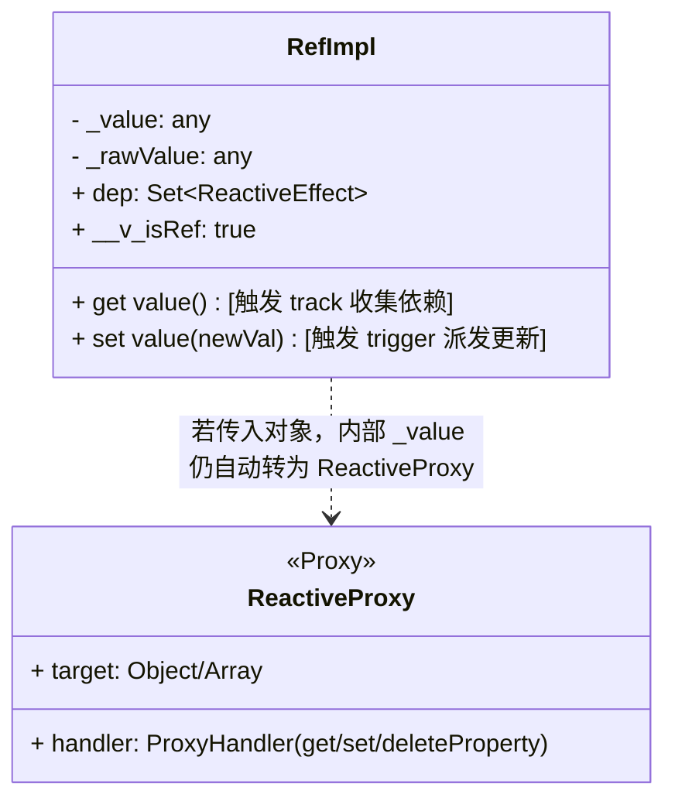

# 响应式核心 API 选型 ref 与 reactive 及 toRef-toRefs 避坑

在 Vue 3 的日常开发中，`ref` 和 `reactive` 是构建响应式状态的两大核心基石。然而，很多中级开发者在实际团队协作中依然被诸多细节困扰：“到底什么时候用 `ref`，什么时候用 `reactive`？”、“为什么直接解构或整体重新赋值 `reactive` 页面就会死掉？”、“什么时候该用 `shallowRef` 来给万级大列表做性能减负？”。本专题从底层内存模型、团队工程规范到避坑代码，全景解析响应式核心 API 的科学选型与最佳实践。

---

## 核心底层机制与物理内存模型

### 1. `ref` 与 `reactive` 的底层数据结构物理差异

在底层实现上，Vue 3 针对基本类型和复杂对象采用了完全不同的内存包装策略：



- **`ref(val)`**：创建一个 **`RefImpl` 类的实例对象**。
  - 对于基本数据类型（数字、字符串、布尔值），直接通过自身的 `get value()` 和 `set value()` 访问器拦截读写；
  - 如果传给 `ref` 的是一个复杂对象，`RefImpl` 内部会自动调用 `toReactive(val)`，将其底层 `_value` 包装为一个由 `reactive()` 生成的 `Proxy` 对象；
- **`reactive(obj)`**：底层直接调用 ES6 的 **`new Proxy(target, mutableHandlers)`**。
  - 它直接针对宿主对象建立读写代理，无需通过 `.value` 访问；
  - **局限性**：ES6 `Proxy` 只能代理引用对象类型（Object、Array、Map、Set），**完全无法代理基本数据类型**（如直接传一个数字 `reactive(100)` 会抛出严重控制台警告并失效）。

---

## 选型矩阵与团队工程化实践

| API | 底层结构 | 推荐使用场景 | 核心优势 | 必须牢记的坑点 |
| :--- | :--- | :--- | :--- | :--- |
| **`ref`** | `RefImpl` 包装类 | **单值、基本类型、需要整体替换的复杂对象（如接口返回的整包数据）** | 可以直接整体重新赋值（`user.value = res.data`）不丢失响应式 | 在 JS 代码中必须写 `.value` |
| **`reactive`** | 原生 `Proxy` 代理 | **固定结构的对象、复杂深层表单模型** | 模板和逻辑中都无需写 `.value`，字段级更新更符合直觉 | **严禁直接解构，严禁直接整体重新赋值** |
| **`shallowRef`** | 浅层 `RefImpl` | **超大数组、万级数据列表、ECharts/Mapbox 三方实例** | 仅监听 `.value` 引用替换，深层属性完全不建立 Proxy 代理，性能极高 | 修改内部嵌套字段（`list.value[0].title = 'x'`）不会触发视图更新 |
| **`shallowReactive`** | 浅层 `Proxy` | 仅根层级属性响应，深层保持原生 | 极少使用，适用于局部浅层状态 | 深层属性变动不触发视图渲染 |
| **`toRefs`** | 转换函数 | 将 `reactive` 对象的每个属性转为独立的 `ref` | **解决 reactive 解构后丢失响应式的银弹** | 返回的是一个包含多个 ref 的普通对象 |
| **`readonly`** | 只读 `Proxy` | 共享状态分发给子组件或外部消费者 | 防止下游意外篡改上游数据源，保障单向数据流 | 写入时控制台直接抛红告警 |

> **大厂工程规范推荐**：
> 绝大多数成熟大厂规范（如 Vue 官方团队与 VueUse 库）推荐：**优先统一使用 `ref` 作为默认响应式方案**。
> 原因很简单：`ref` 的心智模型极其纯粹统一，支持任意数据类型，支持整体赋值替换，且解构自由，团队协作时心智负担最低。

---

## 保姆级核心代码演示与避坑实战

### 综合演示组件（`src/components/ReactivePitfallsDemo.vue`）

```vue
<template>
  <div class="demo-wrapper">
    <h2>响应式核心 API 选型与避坑实战</h2>

    <!-- 场景 1: reactive 整体赋值陷阱与正确破局 -->
    <div class="card-box">
      <h4>1. reactive 重新赋值问题</h4>
      <p>当前用户: {{ userState.name }} | 年龄: {{ userState.age }}</p>
      <div class="btns">
        <button class="err-btn" @click="handleWrongReassign">
          错误赋值 (直接 state = {...} 响应断裂)
        </button>
        <button class="ok-btn" @click="handleCorrectReassign">
          正确赋值 (Object.assign 或改用 ref)
        </button>
      </div>
    </div>

    <!-- 场景 2: toRefs 解构实战 -->
    <div class="card-box">
      <h4>2. toRefs 安全解构实战</h4>
      <p>解构变量实时渲染: 标题: {{ title }} | 计数: {{ count }}</p>
      <button class="ok-btn" @click="count++">增加计数 (count++)</button>
    </div>

    <!-- 场景 3: shallowRef 万级大列表性能极致优化 -->
    <div class="card-box">
      <h4>3. shallowRef 优化超大数据性能</h4>
      <p>大列表渲染项数: {{ bigDataList.length }} 条</p>
      <div class="btns">
        <button class="ok-btn" @click="loadBigData">整体替换大列表 (秒级响应)</button>
        <button class="warn-btn" @click="tryModifyShallowItem">
          修改首项 (尝试修改深层，视图不更新)
        </button>
        <button class="ok-btn" @click="forceTriggerShallow">
          使用 triggerRef 强刷深层改动
        </button>
      </div>
    </div>
  </div>
</template>

<script setup lang="ts">
import { reactive, ref, shallowRef, triggerRef, toRefs } from 'vue'

// ===================== 1. reactive 整体赋值陷阱 =====================
let userState = reactive({
  name: '李四',
  age: 25
})

function handleWrongReassign(): void {
  // ❌ 极其经典的翻车：直接让变量指向一个全新的字面量对象！
  // 原有的 Proxy 代理对象被孤立，userState 变量退化为普通对象，响应式彻底死掉！
  userState = {
    name: '王五',
    age: 30
  } as any
  alert('执行了 userState = { ... }，界面绝不会更新！')
}

function handleCorrectReassign(): void {
  // ✅ 破局方案 A（保持 reactive）：使用 Object.assign 合并属性，不破坏原 Proxy 引用
  Object.assign(userState, {
    name: '王五',
    age: 30
  })

  // ✅ 破局方案 B（根本性推荐）：如果该对象一开始就经常需要整包替换，直接用 ref() 定义！
  // const userRef = ref({ name: '李四', age: 25 })
  // userRef.value = { name: '王五', age: 30 } // 完美响应且语义清晰
}

// ===================== 2. toRefs 安全解构 =====================
const dashboardState = reactive({
  title: '系统仪表盘',
  count: 100
})

// ✅ 正确解构：toRefs 将每个字段转换为带有 .value 的 Ref，依然连接着原 Proxy
const { title, count } = toRefs(dashboardState)

// ===================== 3. shallowRef 性能极限优化 =====================
interface BigItem {
  id: number
  info: string
}

// shallowRef 仅监听 .value 的改变，对内部对象不做昂贵的深度递归 Proxy 代理！
const bigDataList = shallowRef<BigItem[]>([])

function loadBigData(): void {
  const mockData: BigItem[] = Array.from({ length: 5000 }, (_, i) => ({
    id: i + 1,
    info: `核心日志序列号_${i + 1}`
  }))
  // 整体替换 .value，由于替换了引用指针，触发视图秒级更新！
  bigDataList.value = mockData
}

function tryModifyShallowItem(): void {
  if (bigDataList.value.length > 0) {
    // 改变了深层属性，由于没有深层代理，页面不会自动更新
    bigDataList.value[0].info = '【已被篡改的内容】'
    alert('已修改 bigDataList.value[0]，但页面并未更新，符合 shallowRef 预期！')
  }
}

function forceTriggerShallow(): void {
  // 使用 triggerRef 手动强制触发与该 shallowRef 关联的依赖更新
  triggerRef(bigDataList)
  alert('执行了 triggerRef(bigDataList)，页面成功完成强制刷新！')
}
</script>

<style scoped>
.demo-wrapper {
  max-width: 600px;
  margin: 20px auto;
  padding: 24px;
  background: #ffffff;
  border-radius: 12px;
  box-shadow: 0 4px 18px rgba(0, 0, 0, 0.08);
  font-family: sans-serif;
}

.card-box {
  padding: 16px;
  background-color: #f8fafc;
  border: 1px solid #e2e8f0;
  border-radius: 8px;
  margin-bottom: 16px;
}

.card-box h4 { margin: 0 0 10px 0; color: #1e293b; font-size: 14px; }
.card-box p { font-size: 13px; color: #475569; margin: 6px 0 12px 0; }

.btns { display: flex; gap: 8px; flex-wrap: wrap; }

button {
  padding: 7px 14px;
  border: none;
  border-radius: 6px;
  cursor: pointer;
  font-size: 12px;
  font-weight: 500;
}

.ok-btn { background-color: #10b981; color: white; }
.err-btn { background-color: #ef4444; color: white; }
.warn-btn { background-color: #f59e0b; color: white; }
</style>
```

---

## 生产级避坑指南与排障 SOP

### 1. 数组清空或重新赋值的致命翻车

- **错误代码**：
  ```typescript
  let list = reactive([1, 2, 3])
  
  // 业务中需要清空或从接口拉取新数组
  list = [] // ❌ 响应式断裂！页面永远停留旧状态
  ```
- **标准化 SOP（三种正确解法）**：
  1. **方案一（推荐）：声明为 `ref([])`**：
     ```typescript
     const list = ref<number[]>([1, 2, 3])
     list.value = [] // 完美支持重新赋值
     list.value = res.data // 接口整包替换丝滑更新
     ```
  2. **方案二：操作数组长度清空**：
     ```typescript
     list.length = 0 // 保留原 Proxy，正确触发视图更新
     ```
  3. **方案三：使用 `splice` 替换**：
     ```typescript
     list.splice(0, list.length, ...newArray)
     ```

---

### 2. 第三方复杂实例（ECharts / Mapbox / Monaco）千万不要用 `reactive` 或深度 `ref`

- **生产灾难**：
  将 ECharts 实例或者大型地图 SDK 实例放进 `ref()` 或 `reactive()` 中：
  ```typescript
  const myChart = ref(echarts.init(dom))
  ```
  在控制台频繁报出 `Maximum call stack size exceeded`（调用栈溢出）或者图表缩放极其卡顿！
- **物理成因**：
  ECharts 实例内部拥有极其庞杂的私有属性、嵌套原型链和自循环引用。Vue 3 的深层响应式系统会递归遍历其成千上万个属性并全部套上 Proxy 代理，不仅拖垮初始化 CPU 性能，更会在内部触发死循环。
- **排障 SOP**：
  第三方复杂类实例**必须使用普通变量**，或者使用 **`shallowRef`** 或 **`markRaw`** 明确告知 Vue“跳过对此对象的代理”：
  ```typescript
  import { shallowRef, markRaw } from 'vue'

  // 方案 A：使用 shallowRef（只代理外层引用）
  const chartInstance = shallowRef(null)

  // 方案 B：使用 markRaw 永久打上不可代理标签
  const chart = markRaw(echarts.init(dom))
  ```

---

## 中级必考面试题与标准对标回答

### 面试题 1：请从底层原理说明，为什么 `reactive` 不能直接整体赋值？而 `ref` 却可以？

- **标准应答**：
  1. **`reactive` 是原生 Proxy 代理**：`const state = reactive(obj)` 返回的是一个指向目标对象的 `Proxy` 实例。如果执行 `state = newObj`，在 JavaScript 内存层面只是把本地的 `state` 变量指针重新指向了一个普通的新对象，**原有的 `Proxy` 对象直接被废弃抛弃**，新的普通对象没有任何依赖拦截能力，因此后续任何读写都无法被 Vue 捕获，响应式彻底断裂。
  2. **`ref` 是包装对象（Wrapper Object）**：`const stateRef = ref(obj)` 返回的是一个固定不变的 `RefImpl` 包装实例对象，该实例在内存中的引用指针永远不变。当执行 `stateRef.value = newObj` 时，触发的是 `RefImpl` 原型上已经定义好的 `set value(newVal)` 访问器方法，在 `setter` 内部会自动触发依赖派发更新，并将新的值安全转换为响应式，因此引用指针不丢失，视图稳定更新。

---

### 面试题 2：`toRef` 与 `toRefs` 的区别是什么？它们在什么时候是绝对必需的？

- **标准应答**：
  1. **核心功能差异**：
     - `toRef(sourceObject, 'key')`：专门针对源对象的**某一个指定属性**创建一个 Ref，该 Ref 与源对象的该字段保持双向引用；
     - `toRefs(sourceObject)`：遍历源对象的所有属性，把每一个属性都转换为 Ref，最终返回一个包含这些 Ref 的普通对象。
  2. **绝对必需的场景**：
     - **解构响应式对象时**：直接解构会丢失响应式，必须通过 `const { name, age } = toRefs(userState)` 保持响应式连接；
     - **在自定义 Hooks 返回状态时**：Hook 内部聚合的 `reactive` 对象在向外暴露时，使用 `toRefs` 能够允许调用方在组件内随心所欲地解构赋值，而不破坏任何响应式能力。
