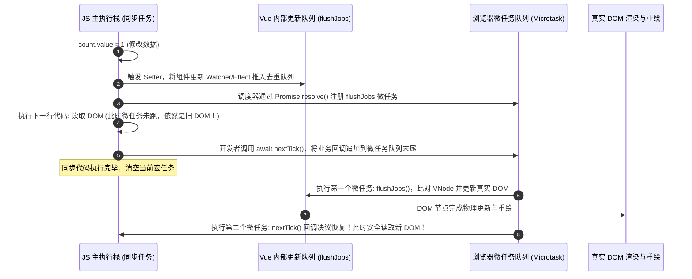

# 异步更新与 nextTick 的业务实战与 DOM 更新时序

在前端交互开发中，很多初学者常常会遇到这样的怪象：“我明明在代码第一行修改了数据，为什么在紧接着的第二行通过 `document.getElementById` 去获取 DOM 的宽度，拿到的依然是旧值？”、“弹窗通过 `v-if` 打开后，为什么立即调用 `input.focus()` 会直接报错找不到节点？”。这一切的核心根源，都在于 **Vue 的响应式更新不是同步修改真实 DOM 的，而是基于微任务（Microtask）的异步批处理队列**。本专题从底层事件循环机制、核心实战场景到避坑规范，全景解析 `nextTick` 的工作哲学。

---

## 核心设计哲学与事件循环时序

### 1. 为什么 Vue 的 DOM 更新必须是“异步合批（Asynchronous Batching）”的？

假设有一个计数器变量 `count`，我们执行了如下同步循环：

```typescript
for (let i = 0; i < 1000; i++) {
  count.value = i
}
```
- **如果 DOM 更新是同步的**：浏览器的真实 DOM 树将被强制连续清空、重排（Reflow）、重绘（Repaint）整整 1000 次！这会瞬间彻底挤爆 CPU 算力，导致浏览器标签页直接卡死掉帧；
- **Vue 的异步合批机制**：
  > **生活类比**：就像**快递驿站的集装箱发货**。每来一件快递，驿站绝不会立即开一辆大货车专门送去派件；而是把 1000 件快递全部放到当日集装箱里。等当前所有的同步发货指令全部下发完毕，在紧接着的**微任务时机（Microtask）**，一次性开着大货车将这批包裹统一送去上屏渲染。最终真实 DOM 只更新 1 次（直接跳到 999），性能提升上千倍！

### 2. EventLoop 与 `nextTick` 的宏微观时序图



---

## 保姆级核心代码演示与三大典型场景

### 演示组件（`src/components/NextTickDemo.vue`）

涵盖输入框自动聚焦、聊天列表自动触底滚动、元素物理尺寸精准测量：

```vue
<template>
  <div class="nexttick-wrapper">
    <h2>nextTick 核心业务场景全景实战</h2>

    <!-- 场景 1: 条件渲染后输入框自动聚焦 -->
    <div class="card-section">
      <h4>场景 A: 动态展开输入框并自动获取焦点</h4>
      <div v-if="!isEditing">
        <span>当前昵称: <strong>{{ nickname }}</strong></span>
        <button class="btn btn-primary" @click="handleEdit">点击修改昵称</button>
      </div>

      <div v-else class="edit-row">
        <!-- 绑定模板引用 inputRef -->
        <input 
          ref="inputRef" 
          v-model="nickname" 
          class="input-control"
          placeholder="请输入新昵称" 
        />
        <button class="btn btn-success" @click="isEditing = false">保存</button>
      </div>
    </div>

    <!-- 场景 2: 数据更新后精准测量 DOM 物理尺寸 -->
    <div class="card-section">
      <h4>场景 B: 文本内容变动后获取实际高度</h4>
      <button class="btn btn-primary" @click="handleAddContent">追加长文本</button>
      
      <!-- 带有动态内容的盒子 -->
      <div ref="contentBoxRef" class="content-box">
        {{ longContent }}
      </div>
      <p class="measure-text">测量的 DOM 物理高度: <strong class="highlight">{{ boxHeight }}px</strong></p>
    </div>

    <!-- 场景 3: 聊天列表追加消息后自动滚动触底 -->
    <div class="card-section">
      <h4>场景 C: 消息列表自动滚动至最底部 (类似微信聊天)</h4>
      <div ref="chatContainerRef" class="chat-container">
        <div v-for="(msg, i) in messageList" :key="i" class="msg-bubble">
          {{ msg }}
        </div>
      </div>
      <button class="btn btn-primary" @click="handleSendMsg">发送一条新消息</button>
    </div>
  </div>
</template>

<script setup lang="ts">
import { ref, nextTick } from 'vue'

// ===================== 场景 1 相关逻辑 =====================
const isEditing = ref<boolean>(false)
const nickname = ref<string>('全栈架构师')
const inputRef = ref<HTMLInputElement | null>(null)

async function handleEdit(): Promise<void> {
  // 1. 修改数据，触发 v-if 展开
  isEditing.value = true

  // ❌ 错误做法：直接调用 inputRef.value.focus()
  // 此时当前同步任务还没结束，v-if 对应的 input DOM 节点压根还没被创建！直接抛 null 崩溃！

  // ✅ 正确做法：等待 DOM 异步更新渲染完成
  await nextTick()
  inputRef.value?.focus()
}

// ===================== 场景 2 相关逻辑 =====================
const longContent = ref<string>('这是一段初始基础短文本。')
const boxHeight = ref<number>(0)
const contentBoxRef = ref<HTMLDivElement | null>(null)

async function handleAddContent(): Promise<void> {
  longContent.value += ' 随着业务数据动态增加，容器产生换行，内容变得越来越长。'
  
  // 立即测量依然是旧高度！
  console.log('未加 nextTick 测得的高度（旧高度）:', contentBoxRef.value?.clientHeight)

  // 使用 nextTick 等待重绘完成
  await nextTick()
  if (contentBoxRef.value) {
    boxHeight.value = contentBoxRef.value.clientHeight
    console.log('加了 nextTick 测得的高度（新高度）:', boxHeight.value)
  }
}

// ===================== 场景 3 相关逻辑 =====================
const messageList = ref<string[]>([
  '系统: 欢迎进入实时聊天室！',
  '张三: 大家好！'
])
const chatContainerRef = ref<HTMLDivElement | null>(null)

async function handleSendMsg(): Promise<void> {
  messageList.value.push(`用户消息: ${new Date().toLocaleTimeString()} 发送了一条长消息`)

  // 必须等待 Vue 把这行 li 真正渲染并撑高容器，再去修改 scrollTop！
  await nextTick()
  if (chatContainerRef.value) {
    chatContainerRef.value.scrollTop = chatContainerRef.value.scrollHeight
  }
}
</script>

<style scoped>
.nexttick-wrapper {
  max-width: 600px; margin: 20px auto; padding: 24px; background: white;
  border-radius: 12px; border: 1px solid #e2e8f0; font-family: sans-serif;
  box-shadow: 0 4px 16px rgba(0,0,0,0.06);
}
.card-section {
  padding: 16px; background-color: #f8fafc; border: 1px solid #e2e8f0;
  border-radius: 8px; margin-bottom: 16px;
}
.card-section h4 { margin: 0 0 12px 0; color: #1e293b; font-size: 14px; }
.btn {
  padding: 6px 12px; border: none; border-radius: 4px; cursor: pointer;
  font-size: 12px; font-weight: 500; margin-top: 8px;
}
.btn-primary { background-color: #3b82f6; color: white; }
.btn-success { background-color: #10b981; color: white; margin-left: 8px; }
.input-control { padding: 6px 10px; border: 1px solid #cbd5e1; border-radius: 4px; }

.content-box {
  margin-top: 10px; padding: 10px; background: white; border: 1px dashed #cbd5e1;
  border-radius: 6px; font-size: 13px; line-height: 1.6; color: #334155;
}
.measure-text { font-size: 13px; color: #64748b; margin-top: 6px; }
.highlight { color: #dc2626; font-size: 15px; }

.chat-container {
  height: 120px; overflow-y: auto; background: white; border: 1px solid #cbd5e1;
  border-radius: 6px; padding: 10px; display: flex; flex-direction: column; gap: 8px;
}
.msg-bubble {
  background-color: #eff6ff; padding: 6px 10px; border-radius: 6px;
  font-size: 12px; color: #1e40af; align-self: flex-start;
}
</style>
```

---

## 生产级避坑指南与排障 SOP

### 1. 语法选择：回调函数形式 vs `async / await` 形式

- **传统回调写法（不推荐，容易产生回调地狱）**：
  ```typescript
  nextTick(() => {
    // 逻辑写在回调内
    inputRef.value?.focus()
  })
  ```
- **现代工程级写法（强烈推荐）**：
  ```typescript
  // 利用 async/await 扁平化时序流
  async function handleAction() {
    isExpanded.value = true
    await nextTick()
    inputRef.value?.focus()
  }
  ```
  `nextTick()` 在没有传入任何回调参数时，底层会直接返回一个 **`Promise` 实例**，能够被 `await` 完美消费，代码完全以线性自上而下的直觉呈现。

---

### 2. 避免在循环内部滥用 `await nextTick()`

- **性能陷阱**：
  ```typescript
  // ❌ 极差的性能写法：人为阻断异步合批！
  for (let i = 0; i < 100; i++) {
    list.value.push(i)
    await nextTick() // 强行强迫 Vue 每次循环都刷新一次 DOM，丧失了合批优化的意义！
  }
  ```
- **标准化 SOP**：所有的状态变更一律在当前同步线程中批量修改完毕，仅在最后一步**调用且只调用一次 `await nextTick()`**。

---

## 中级必考面试题与标准对标回答

### 面试题 1：请详细解释 `nextTick` 的底层工作原理是什么？它属于宏任务还是微任务？

- **标准应答**：
  1. **底层机制**：`nextTick` 是基于浏览器事件循环（Event Loop）中的 **微任务（Microtask）** 实现的。Vue 内部在检测到响应式数据变动时，不会立即同步操作真实 DOM，而是把组件的更新渲染函数封装为一个 Job 推入一个异步队列（Queue），并利用 `Promise.resolve().then(...)` 开启一个微任务；
  2. **时序保证**：当开发者调用 `nextTick(callback)` 时，Vue 只是把该回调函数按序追加到同一个微任务执行队列的末尾。根据 FIFO（先进先出）原则，**浏览器的微任务调度器必定会先执行完前面的“DOM 渲染 Job”，紧接着才执行开发者的 `nextTick` 回调**，因此回调触发的时刻，真实 DOM 必定已经完成了最新的物理绘制更新。

---

### 面试题 2：在日常业务开发中，什么情况下必须使用 `nextTick`？请举出至少两个真实场景？

- **标准应答**：
  核心使用准则是：**“修改了响应式数据后，紧接着需要基于最新渲染出来的真实 DOM 进行物理操作”**。典型场景包括：
  1. **条件渲染组件聚焦**：通过修改布尔值（`v-if`）让之前隐藏的输入框显示出来，并希望立即调用原生 `input.focus()` 聚焦；若不加 `nextTick`，由于 DOM 尚未创建，调用直接抛出空指针异常；
  2. **视口滚动触底**：聊天室发送新消息、长数据列表加载新条目后，需要让容器的 `scrollTop` 自动滚动到最底部（`container.scrollHeight`）；必须等待新 DOM 渲染撑高容器后，才能计算出准确的滚动高度；
  3. **基于 DOM 尺寸初始化图表**：容器的宽高是基于百分比或 flex 动态撑开的，动态修改了数据或切换了 Tabs 后，必须在 `nextTick` 中调用 ECharts 的 `resize()` 或 `new ECharts()`，否则图表会被渲染为 0 像素。
