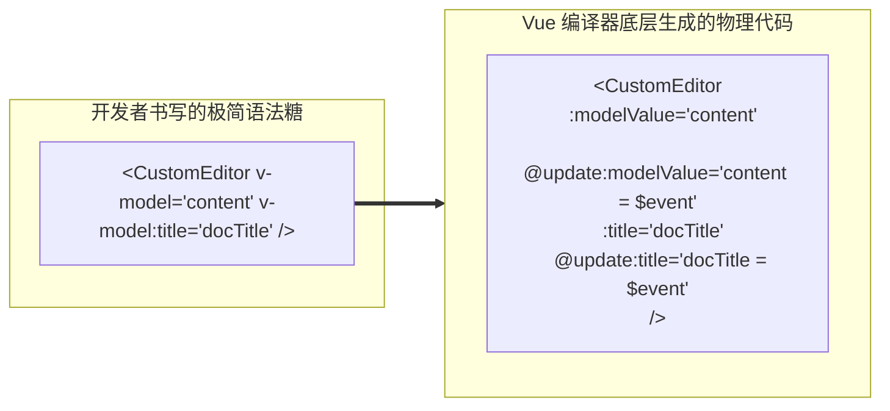

# 组件高级 v-model 多绑定与 defineModel 宏深度实战

在 Vue 组件化开发中，如果子组件仅仅是一个纯展示性的数据呈现者，单向数据流（Props 下行 + Emit 上行）足够胜任；但如果子组件是一个需要频繁双向同步状态的复杂交互控件（如自定义日期区间选择器、支持直接在卡片上修改标题的输入框、模态弹窗的可视化开关），反复手写 `:visible="dialogVisible" @update:visible="dialogVisible = $event"` 会产生海量冗余样板代码。Vue 3 彻底打破了 Vue 2 单组件只能拥有一个 `v-model` 的限制，支持 **多 `v-model` 命名绑定**，并在 Vue 3.4+ 推出了革命性的 **`defineModel()` 编译宏**。本专题带你从底层语法糖展开到生产级实战。

---

## 核心设计哲学与底层语法糖演进

### 1. 组件级 `v-model` 的底层物理展开模型

当我们在一个自定义组件上写下 `v-model` 时，Vue 编译器在底层将其精准解构为一对 **Prop 属性输入** 与 **Event 事件输出**：



- **默认绑定**：属性名为 **`modelValue`**，事件名为 **`update:modelValue`**；
- **具名绑定（如 `v-model:title`）**：属性名为 **`title`**，事件名为 **`update:title`**。

---

### 2. 传统写法 vs Vue 3.4+ `defineModel()` 降维打击对比

| 对比维度 | 传统 Vue 3.0~3.3 手工展开写法 | Vue 3.4+ `defineModel()` 宏写法 |
| :--- | :--- | :--- |
| **样板代码量** | 必须同时书写 `defineProps(['modelValue'])` 和 `defineEmits(['update:modelValue'])` | 仅需一行：`const model = defineModel()` |
| **子组件内部修改方式** | 严禁直接改 Prop，必须写专门的方法 `emit('update:modelValue', newVal)` | **直接作为常规 Ref 赋值**：`model.value = newVal`，系统自动发射更新事件！ |
| **双向绑定多字段** | 声明多个 props 和多个 `update:xxx` 事件，代码成倍膨胀 | 声明多个 `defineModel('xxx')`，代码量锐减 70% |

---

## 保姆级核心代码演示

### 1. 传统 Vue 3.0~3.3 规范实现（`src/components/LegacyUserEditor.vue`）

在子组件中手动维护 Prop 和 Emit 的规范闭环：

```vue
<template>
  <div class="editor-box">
    <h4>传统 v-model 多绑定实现</h4>
    <div class="row">
      <label>文档标题 (v-model:title):</label>
      <input 
        :value="title" 
        @input="handleTitleInput" 
        class="input-field"
      />
    </div>

    <div class="row">
      <label>正文内容 (默认 v-model / modelValue):</label>
      <textarea 
        :value="modelValue" 
        @input="handleContentInput" 
        class="textarea-field"
      ></textarea>
    </div>
  </div>
</template>

<script setup lang="ts">
// 1. 必须声明对应名称的 props
const props = defineProps<{
  modelValue: string // 默认绑定的属性名
  title: string      // 具名绑定的属性名
}>()

// 2. 必须声明对应的 update:xxx 事件
const emit = defineEmits<{
  (e: 'update:modelValue', value: string): void
  (e: 'update:title', value: string): void
}>()

function handleTitleInput(e: Event): void {
  const target = e.target as HTMLInputElement
  emit('update:title', target.value)
}

function handleContentInput(e: Event): void {
  const target = e.target as HTMLTextAreaElement
  emit('update:modelValue', target.value)
}
</script>

<style scoped>
.editor-box {
  padding: 16px; background: #f8fafc; border: 1px solid #e2e8f0; border-radius: 8px;
  display: flex; flex-direction: column; gap: 12px; font-family: sans-serif;
}
.row { display: flex; flex-direction: column; gap: 6px; font-size: 13px; }
.input-field, .textarea-field {
  padding: 8px; border: 1px solid #cbd5e1; border-radius: 4px; font-size: 13px;
}
</style>
```

---

### 2. Vue 3.4+ 现代 `defineModel()` 极致清爽写法（`src/components/ModernUserEditor.vue`）

利用 `defineModel` 消除所有繁琐的 props 和 emits 样板声明：

```vue
<template>
  <div class="editor-box modern-theme">
    <h4>Vue 3.4+ defineModel 现代化双向绑定</h4>
    
    <div class="row">
      <label>文档标题 (具名 defineModel('title')):</label>
      <!-- 
        神奇之处：在子组件内部，titleModel 表现为一个完完全全的普通 Ref！
        直接在子组件内部对其 v-model，系统会自动向父组件发射 update:title 事件！
      -->
      <input v-model="titleModel" class="input-field" />
    </div>

    <div class="row">
      <label>正文内容 (默认 defineModel()):</label>
      <textarea v-model="contentModel" class="textarea-field"></textarea>
    </div>

    <div class="row">
      <label>开关控制 (带默认值和类型约定的 defineModel):</label>
      <label class="switch-label">
        <input v-model="isPublished" type="checkbox" /> 
        立即发布文章
      </label>
    </div>
  </div>
</template>

<script setup lang="ts">
// 声明 1：默认的双向绑定（对应父组件的 v-model="content"）
const contentModel = defineModel<string>({ default: '' })

// 声明 2：具名的双向绑定（对应父组件的 v-model:title="docTitle"）
const titleModel = defineModel<string>('title', { required: true })

// 声明 3：布尔值双向绑定（带类型与默认值）
const isPublished = defineModel<boolean>('published', { default: false })
</script>

<style scoped>
.modern-theme {
  border-color: #93c5fd; background-color: #eff6ff;
}
.editor-box {
  padding: 16px; border: 1px solid #e2e8f0; border-radius: 8px;
  display: flex; flex-direction: column; gap: 12px; font-family: sans-serif;
}
.row { display: flex; flex-direction: column; gap: 6px; font-size: 13px; }
.input-field, .textarea-field {
  padding: 8px; border: 1px solid #93c5fd; border-radius: 4px; font-size: 13px;
}
.switch-label { display: flex; align-items: center; gap: 6px; cursor: pointer; }
</style>
```

---

### 3. 父组件同时使用多个 `v-model`（`src/components/ParentEditorHost.vue`）

```vue
<template>
  <div class="parent-host">
    <h2>文章发布总控中心 (父组件)</h2>

    <div class="preview-panel">
      <p>父状态预览：标题 = 【{{ docTitle }}】 | 发布状态 = 【{{ isPub ? '已发布' : '草稿' }}】</p>
      <p class="content-preview">正文预览：{{ docContent }}</p>
    </div>

    <!-- 
      父组件优雅绑定 3 个双向数据流：
      1. 默认绑定正文: v-model="docContent"
      2. 具名绑定标题: v-model:title="docTitle"
      3. 具名绑定状态: v-model:published="isPub"
    -->
    <ModernUserEditor 
      v-model="docContent" 
      v-model:title="docTitle" 
      v-model:published="isPub" 
    />
  </div>
</template>

<script setup lang="ts">
import { ref } from 'vue'
import ModernUserEditor from './ModernUserEditor.vue'

// 父组件持有源数据
const docTitle = ref<string>('Vue 3.4 架构演进实战')
const docContent = ref<string>('defineModel 彻底革新了组件双向绑定的编写体验...')
const isPub = ref<boolean>(true)
</script>

<style scoped>
.parent-host {
  max-width: 650px; margin: 20px auto; padding: 24px;
  background: white; border-radius: 12px; border: 1px solid #e2e8f0;
  box-shadow: 0 4px 16px rgba(0,0,0,0.06); font-family: sans-serif;
}
.preview-panel {
  padding: 12px; background: #f8fafc; border-radius: 6px; margin-bottom: 20px;
  font-size: 13px; color: #334155;
}
.content-preview { color: #64748b; font-style: italic; }
</style>
```

---

## 生产级避坑指南与排障 SOP

### 1. 自定义修饰符支持机制（如 `v-model.capitalize`）

- **业务需求**：希望在父组件写 `v-model.capitalize="myText"` 时，子组件自动将输入的字母全部转为大写。
- **底层工作机制**：
  当父组件添加修饰符时，Vue 会自动向子组件传入一个名为 **`modelModifiers`** 的 Prop（若是具名属性，则是 `[name]Modifiers`）。
- **`defineModel` 优雅处理修饰符**：
  ```typescript
  // 子组件中解构获取修饰符配置
  const [model, modifiers] = defineModel({
    set(value: string) {
      // 若父组件加了 .capitalize 修饰符，在写入前自动转换
      if (modifiers.capitalize) {
        return value.charAt(0).toUpperCase() + value.slice(1)
      }
      return value
    }
  })
  ```

---

### 2. 为什么在 Vue 3.4 之前不能在子组件内部直接给 Prop 赋值？

- **物理成因**：
  如果子组件尝试 `props.modelValue = 'xxx'`，因为 Vue 的 `props` 被 Proxy 锁死为只读，直接抛出 `target is readonly`。
- **`defineModel()` 为什么能直接赋值？**
  `defineModel()` 返回的不是普通的只读 Prop，而是一个由 Vue 内部专门构建的 **可写 Ref（Writable Ref）**。当你在子组件执行 `model.value = 'xxx'` 时，其底层的 `set` 拦截器并没有去强行修改 Prop，而是**自动在底层帮我们执行了 `emit('update:modelValue', 'xxx')`**！从而在保持单向数据流完整性的同时，赋予了开发者宛如操作本地变量一般的极致体验。

---

## 中级必考面试题与标准对标回答

### 面试题 1：Vue 3 相比 Vue 2，在组件 `v-model` 上做了哪些重大革新？

- **标准应答**：
  1. **突破单一绑定限制**：Vue 2 的组件上默认只能绑定一个 `v-model`（若要绑定多个只能借助 `.sync` 修饰符）；Vue 3 废除了 `.sync` 修饰符，原生支持在单个组件上同时挂载**无限个具名 `v-model:xxx`**；
  2. **默认 Prop 与事件名规范化**：Vue 2 默认属性是 `value`，事件是 `input`；Vue 3 将默认属性统一重构为 **`modelValue`**，事件名重构为 **`update:modelValue`**，使命名更加语义化；
  3. **宏编译降维**：Vue 3.4+ 引入 `defineModel` 宏，将传统的双重样板代码（`props` + `emits` + 自定义处理函数）缩减为单行声明，并在底层自动派发更新事件。

---

### 面试题 2：`defineModel()` 返回的是什么对象？它的底层原理是什么？

- **标准应答**：
  1. **对象类型**：`defineModel()` 返回的是一个 **可读可写的自定义 Ref 对象（Custom Ref / Writable Computed）**；
  2. **底层实现机理**：
     - 当外部读取该 Ref 时（`model.value`），其内部 Getter 直接返回父组件传入的只读 `props.modelValue`；
     - 当在子组件内部对该 Ref 进行写入赋值时（`model.value = newVal`），其内部 Setter **绝不强行篡改只读的 Prop**，而是自动触发调用系统预先绑定的 `emit('update:modelValue', newVal)`，将新值向上发射给父组件更新源数据，从而完美契合单向数据流。
