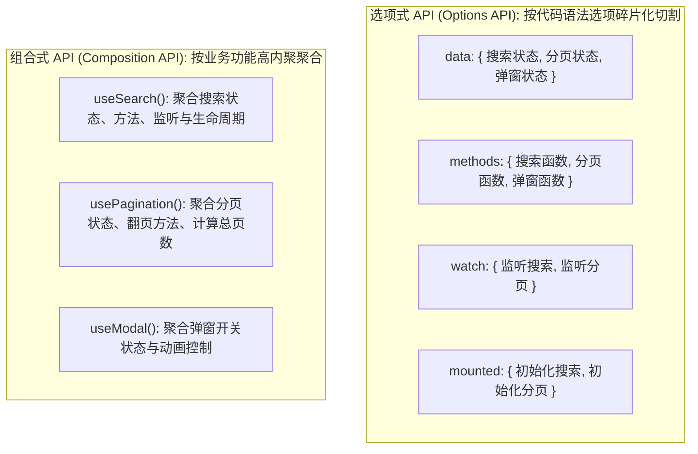

# 组合式 API 对比选项式 API 与自定义 Hooks 复用实战

随着前端项目业务体量的极速膨胀，组件代码从早期的几十行膨胀到成百上千行，组件内部的状态管理与跨组件逻辑复用成为了决定大型应用可维护性的胜负手。Vue 2 时代的 **选项式 API（Options API）** 与 **Mixins（混入）** 机制由于在大型复杂场景下的天然架构缺陷，逐渐让位于 Vue 3 的 **组合式 API（Composition API）** 与 **自定义组合式函数（Custom Hooks）**。本专题从设计哲学、架构演进到生产级 Hooks 封装，全方位拆解这一现代化工程变革。

---

## 核心设计哲学与架构演进对比

### 1. Options API 与 Composition API 代码组织形态对比

在 Options API 中，同一个业务逻辑（如“用户列表分页检索”）的代码会被强行切割并散落在 `data`、`computed`、`methods`、`watch`、`mounted` 等多个互不相邻的选项中。当维护一个 800 行的组件时，开发者为了理清一个功能，必须在编辑器里频繁上下大幅滚动滚动条。

而在 Composition API 中，**同一个业务功能的所有状态、计算属性、方法和生命周期被紧密聚合在一起**：



### 2. 为什么自定义 Hooks 能彻底杀死 Vue 2 的 Mixins？

Vue 2 时代唯一的跨组件逻辑复用方案是 Mixins，但在大厂生产实践中，Mixins 被普遍视为“代码噩梦”：
1. **命名冲突（Naming Collisions）**：两个 Mixin 如果不巧定义了同名的 `data` 变量或方法，后引入的会无声无息地覆盖先引入的，排查极其困难；
2. **隐式依赖与来源不明（Implicit Dependencies）**：在组件模板中看到一个 `totalCount` 变量，打开 `<script>` 翻遍了 `data` 根本找不到，不知道是引入的 5 个 Mixin 中的哪一个注入进来的，代码如同黑盒；
3. **无法传参定制**：Mixin 无法像普通函数一样灵活接收外部参数动态生成逻辑。

> **自定义 Hooks 的破局之道**：
> Custom Hook 本质上就是一个普通的 **返回响应式对象的 JavaScript 函数**。它遵循纯函数的输入输出契约：**支持传参定制、变量显式解构重命名（杜绝命名冲突）、来源极其清晰（通过 import 明确追踪）**。

---

## 生产级 Custom Hooks 封装实战

### 1. 通用表格分页管理 Hook（`src/composables/useTablePagination.ts`）

在企业级中后台系统中，几乎每个列表页都需要：当前页码、每页条数、总条数、翻页函数、每页容量切换。将其抽象为 Hook：

```typescript
import { ref, computed } from 'vue'

export interface PaginationOptions {
  defaultPage?: number
  defaultPageSize?: number
}

export function useTablePagination(
  fetchDataCallback: () => void | Promise<void>,
  options: PaginationOptions = {}
) {
  // 1. 响应式分页状态
  const currentPage = ref<number>(options.defaultPage || 1)
  const pageSize = ref<number>(options.defaultPageSize || 10)
  const total = ref<number>(0)

  // 2. 衍生计算属性：总页数
  const totalPages = computed(() => {
    return Math.ceil(total.value / pageSize.value) || 1
  })

  // 3. 翻页动作
  function changePage(targetPage: number): void {
    if (targetPage < 1 || targetPage > totalPages.value) return
    currentPage.value = targetPage
    // 触发外部传入的数据拉取函数
    fetchDataCallback()
  }

  // 4. 修改每页显示数量
  function changePageSize(newSize: number): void {
    pageSize.value = newSize
    currentPage.value = 1 // 重置回第一页
    fetchDataCallback()
  }

  // 5. 重置分页
  function resetPagination(): void {
    currentPage.value = 1
    total.value = 0
  }

  // 6. 显式返回供组件解构使用
  return {
    currentPage,
    pageSize,
    total,
    totalPages,
    changePage,
    changePageSize,
    resetPagination
  }
}
```

---

### 2. 通用异步请求状态管理 Hook（`src/composables/useRequest.ts`）

封装网络请求中极其繁琐的 `loading`、`data`、`error` 与防重复点击状态：

```typescript
import { ref } from 'vue'

export function useRequest<T, P extends any[]>(
  apiFn: (...args: P) => Promise<T>
) {
  const loading = ref<boolean>(false)
  const data = ref<T | null>(null)
  const error = ref<Error | null>(null)

  async function execute(...args: P): Promise<T | null> {
    loading.value = true
    error.value = null
    try {
      const result = await apiFn(...args)
      data.value = result
      return result
    } catch (err: any) {
      error.value = err
      console.error('[useRequest 捕获异常]:', err)
      return null
    } finally {
      loading.value = false
    }
  }

  return {
    loading,
    data,
    error,
    execute
  }
}
```

---

### 3. 在具体业务组件中优雅组装使用（`src/views/UserManagementView.vue`）

展示两个 Hooks 像拼装积木一样的极致可读性：

```vue
<template>
  <div class="page-container">
    <h2>用户数据管理系统 (Hooks 组合模式)</h2>

    <!-- 搜索栏 -->
    <div class="search-bar">
      <input v-model="searchKeyword" placeholder="搜索用户名..." class="search-input" />
      <button class="btn search-btn" :disabled="loading" @click="handleSearch">
        {{ loading ? '查询中...' : '查询' }}
      </button>
    </div>

    <!-- 表格内容 -->
    <div class="table-card">
      <div v-if="loading" class="loading-mask">数据加载中...</div>

      <table class="data-table">
        <thead>
          <tr>
            <th>ID</th>
            <th>用户名</th>
            <th>角色</th>
            <th>注册时间</th>
          </tr>
        </thead>
        <tbody>
          <tr v-for="user in userList" :key="user.id">
            <td>{{ user.id }}</td>
            <td>{{ user.name }}</td>
            <td>{{ user.role }}</td>
            <td>{{ user.createTime }}</td>
          </tr>
        </tbody>
      </table>

      <!-- 底部分页器：完全由 useTablePagination 驱动 -->
      <div class="pagination-footer">
        <span>共 {{ total }} 条记录，第 {{ currentPage }} / {{ totalPages }} 页</span>
        <div class="page-btns">
          <button 
            :disabled="currentPage <= 1 || loading" 
            @click="changePage(currentPage - 1)"
          >
            上一页
          </button>
          <button 
            :disabled="currentPage >= totalPages || loading" 
            @click="changePage(currentPage + 1)"
          >
            下一页
          </button>
        </div>
      </div>
    </div>
  </div>
</template>

<script setup lang="ts">
import { ref, onMounted } from 'vue'
import { useTablePagination } from '../composables/useTablePagination'
import { useRequest } from '../composables/useRequest'

interface UserItem {
  id: number
  name: string
  role: string
  createTime: string
}

const searchKeyword = ref<string>('')
const userList = ref<UserItem[]>([])

// 1. 模拟后端 API
async function mockFetchUsersApi() {
  console.log(`正在拉取第 ${currentPage.value} 页数据，关键词: "${searchKeyword.value}"`)
  // 模拟 400ms 延时
  await new Promise(r => setTimeout(r, 400))
  
  // 模拟返回数据与总条数
  total.value = 45
  userList.value = Array.from({ length: pageSize.value }, (_, i) => ({
    id: (currentPage.value - 1) * pageSize.value + i + 1,
    name: `用户_${searchKeyword.value || 'VIP'}_${i + 1}`,
    role: i % 2 === 0 ? '管理员' : '普通用户',
    createTime: '2026-11-17'
  }))
}

// 2. 接入 useRequest 获得 loading 状态与执行包装
const { loading, execute: fetchUsers } = useRequest(mockFetchUsersApi)

// 3. 接入 useTablePagination 获得完整分页驱动能力
const { 
  currentPage, 
  pageSize, 
  total, 
  totalPages, 
  changePage 
} = useTablePagination(fetchUsers, { defaultPageSize: 5 })

// 4. 搜索按钮触发
function handleSearch(): void {
  currentPage.value = 1
  fetchUsers()
}

// 5. 挂载时拉取初始数据
onMounted(() => {
  fetchUsers()
})
</script>

<style scoped>
.page-container {
  max-width: 800px;
  margin: 20px auto;
  padding: 24px;
  background-color: #ffffff;
  border-radius: 12px;
  box-shadow: 0 4px 18px rgba(0,0,0,0.06);
  font-family: sans-serif;
}

.search-bar { display: flex; gap: 10px; margin-bottom: 20px; }
.search-input { flex: 1; padding: 8px 12px; border: 1px solid #d1d5db; border-radius: 6px; }
.btn { padding: 8px 16px; border-radius: 6px; border: none; cursor: pointer; }
.search-btn { background-color: #3b82f6; color: white; }

.table-card { position: relative; border: 1px solid #e5e7eb; border-radius: 8px; overflow: hidden; }
.loading-mask {
  position: absolute; top: 0; left: 0; width: 100%; height: 100%;
  background: rgba(255,255,255,0.7); display: flex; align-items: center; justify-content: center;
  font-size: 14px; color: #2563eb; font-weight: bold;
}

.data-table { width: 100%; border-collapse: collapse; text-align: left; font-size: 13px; }
.data-table th, .data-table td { padding: 12px 14px; border-bottom: 1px solid #f1f5f9; }
.data-table th { background-color: #f8fafc; color: #475569; font-weight: 600; }

.pagination-footer {
  padding: 12px 16px; display: flex; justify-content: space-between; align-items: center;
  background-color: #f8fafc; font-size: 13px; color: #64748b;
}

.page-btns { display: flex; gap: 8px; }
.page-btns button {
  padding: 6px 12px; border: 1px solid #cbd5e1; background: white; border-radius: 4px;
  cursor: pointer; font-size: 12px;
}
.page-btns button:disabled { opacity: 0.5; cursor: not-allowed; }
</style>
```

---

## 生产级避坑指南与排障 SOP

### 1. 编写自定义 Hook 时严禁返回破坏响应式的普通解构值

- **典型翻车写法**：
  ```typescript
  export function useCounter() {
    const state = reactive({ count: 0 })
    function increment() { state.count++ }

    // ❌ 翻车：直接返回解构的 count，外部解构后彻底失去响应式！
    return {
      count: state.count, 
      increment
    }
  }
  ```
- **标准化 SOP**：
  在 Hook 导出状态时，**必须返回 `ref` 对象**，或者使用 **`toRefs`** 将内部的 `reactive` 对象属性全量转化为 `ref` 后再暴露返回：
  ```typescript
  export function useCounter() {
    const state = reactive({ count: 0 })
    function increment() { state.count++ }

    // ✅ 正确规范：toRefs 确保外部无论是直接使用还是解构均保持响应式连接
    return {
      ...toRefs(state),
      increment
    }
  }
  ```

---

### 2. 在 Hook 内部注册的全局监听器必须在 `onUnmounted` 中成对注销

- **物理成因**：
  若在 `useWindowResize` 或 `useMousePosition` 内部调用了 `window.addEventListener('resize', ...)`，如果忘记在该 Hook 内部编写 `onUnmounted(() => window.removeEventListener(...))`，每一个引入该 Hook 的组件在销毁后，全局事件回调依然会持续堆积在浏览器内存中，引发隐蔽的持续性内存泄漏。

---

## 中级必考面试题与标准对标回答

### 面试题 1：请对比 Vue 3 的 Composition API 和 Vue 2 的 Mixins，说明为什么行业全面转向自定义 Hooks？

- **标准应答**：
  1. **变量命名冲突彻底根除**：Mixins 的属性和方法会被平铺混入到组件实例的原型或上下文中，不同 Mixin 之间一旦出现同名属性，后加载者会覆盖先加载者；而自定义 Hooks 是普通函数，返回值是普通对象，外部在调用时可以像解构 ES 模块一样进行**自由重命名**（如 `const { loading: tableLoading } = useTable()`），从语言底层根绝了命名冲突。
  2. **代码可溯性与清晰度**：Mixins 隐式注入属性，模板中使用的变量难以确认具体来自哪个 Mixin，破坏了代码的可维护性；自定义 Hooks 的所有变量和函数均通过 `import` 显式解构返回，来源一清二楚。
  3. **参数传递与动态闭包**：Mixins 难以动态传参；自定义 Hooks 是真正的函数，可以在调用时传入任何配置参数，利用 JavaScript 闭包机制按需返回定制化的响应式能力。

---

### 面试题 2：使用 Composition API 抽取自定义 Hooks 时，有哪些必须遵守的工程规范？

- **标准应答**：
  1. **命名规范**：遵循业界统一的约定，函数名称必须以小写 **`use`** 开头（如 `useUser`、`useTable`、`useStorage`），以清晰表明其为一个符合 Vue 响应式规则的组合式函数；
  2. **响应式保持**：返回的响应式数据必须是 `Ref` 或 `toRefs` 包装后的对象，严禁直接返回丢失代理的基本数据类型；
  3. **副作用自闭环**：Hook 内部若开启了定时器、建立了 DOM/Window 事件监听、建立了 WebSocket 长连接，**必须在 Hook 自身内部使用 `onUnmounted` 钩子完成注销清理**，做到“谁创建、谁销毁”，防止让调用方组件承担清理负担。
