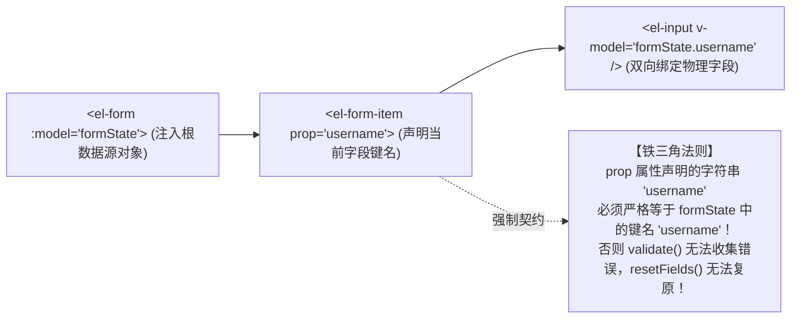

# 表单组件库集成与复杂数据校验实战

在中后台管理系统（Admin Dashboard）中，80% 以上的日常业务场景都在处理数据录入、编辑与查询。无论是 Element Plus 的 `el-form` 还是 Ant Design Vue 的 `a-form`，表单组件库的核心机制均高度相似。然而，很多开发者在面对“动态增删表单项”、“跨字段联动校验（如两次密码必须一致）”、“异步接口防抖校验（如检查手机号是否已被注册）”以及“重置表单时残留错误提示”等复杂场景时，经常因为对表单底层运行机制理解不深而反复踩坑。本专题带你吃透企业级表单的最佳实战方案。

---

## 核心设计哲学与表单校验链路

### 1. 组件库 Form 的“铁三角”映射法则

任何成熟的表单组件库，其内部校验与重置机制完全依托于 **“三大核心属性的绝对一致性”**：



1. **`:model`**：绑定的必须是一个 **响应式对象（Object）**，不能是普通的 Ref 基本类型，供 `Form` 实例作为全局根上下文向下注入；
2. **`prop`**：声明在 `form-item` 上的**相对路径字符串**（如 `'username'` 或 `'contacts.0.phone'`），校验引擎根据这个路径去 `:model` 对象中读取真实数据；
3. **`v-model`**：直接绑定对应的数据路径。

---

## 保姆级核心代码演示

### 复杂动态表单与异步联动校验演示组件（`src/components/AdvancedFormDemo.vue`）

涵盖基础规则、异步接口查重、跨字段密码比对、动态增删多条联系人：

```vue
<template>
  <div class="form-wrapper">
    <h2>企业级用户注册与多项联系人登记表单</h2>

    <form class="custom-form" @submit.prevent="handleSubmit">
      <!-- 1. 基础用户名输入与异步查重校验 -->
      <div class="field-item">
        <label>用户登录名 (带异步接口唯一性校验):</label>
        <div class="input-wrap">
          <input 
            v-model.trim="formModel.username" 
            placeholder="请输入 4-12 位字母或数字" 
            class="base-input"
            @blur="validateField('username')"
          />
          <span v-if="isValidatingUsername" class="loading-tag">正在联网核验唯一性...</span>
        </div>
        <span v-if="errors.username" class="error-msg">{{ errors.username }}</span>
      </div>

      <!-- 2. 密码与跨字段二次确认比对 -->
      <div class="field-item">
        <label>登录密码:</label>
        <input 
          v-model="formModel.password" 
          type="password" 
          placeholder="请输入至少 6 位密码" 
          class="base-input"
          @blur="validateField('password')"
        />
        <span v-if="errors.password" class="error-msg">{{ errors.password }}</span>
      </div>

      <div class="field-item">
        <label>确认登录密码 (联动比对):</label>
        <input 
          v-model="formModel.confirmPassword" 
          type="password" 
          placeholder="再次输入相同密码" 
          class="base-input"
          @blur="validateField('confirmPassword')"
        />
        <span v-if="errors.confirmPassword" class="error-msg">{{ errors.confirmPassword }}</span>
      </div>

      <!-- 3. 动态表单项（可自由添加/删除多位紧急联系人） -->
      <div class="dynamic-section">
        <div class="section-header">
          <label>紧急联系人列表 (动态数组表单):</label>
          <button type="button" class="btn add-row-btn" @click="handleAddContact">+ 添加联系人</button>
        </div>

        <div v-for="(contact, index) in formModel.contacts" :key="contact.id" class="dynamic-row">
          <div class="row-cell">
            <input 
              v-model.trim="contact.name" 
              placeholder="联系人姓名" 
              class="base-input small" 
            />
          </div>
          <div class="row-cell">
            <input 
              v-model.trim="contact.phone" 
              placeholder="11位手机号" 
              class="base-input small" 
            />
          </div>
          <button 
            type="button" 
            class="btn remove-btn" 
            :disabled="formModel.contacts.length <= 1"
            @click="handleRemoveContact(index)"
          >
            删除
          </button>
        </div>
        <span v-if="errors.contacts" class="error-msg">{{ errors.contacts }}</span>
      </div>

      <!-- 底部控制按钮 -->
      <div class="actions">
        <button type="submit" class="btn submit-btn" :disabled="isSubmitting">
          {{ isSubmitting ? '系统提交中...' : '整体验证并提交' }}
        </button>
        <button type="button" class="btn reset-btn" @click="handleResetForm">
          重置表单至初始态
        </button>
      </div>
    </form>
  </div>
</template>

<script setup lang="ts">
import { reactive, ref } from 'vue'

// 1. 定义联系人数据接口
interface ContactItem {
  id: number
  name: string
  phone: string
}

// 2. 表单核心模型
const formModel = reactive({
  username: '',
  password: '',
  confirmPassword: '',
  contacts: [
    { id: 1, name: '', phone: '' }
  ] as ContactItem[]
})

// 3. 错误信息收集池
const errors = reactive<Record<string, string>>({
  username: '',
  password: '',
  confirmPassword: '',
  contacts: ''
})

const isValidatingUsername = ref<boolean>(false)
const isSubmitting = ref<boolean>(false)
let globalContactId = 2

// 模拟后端数据库已有用户
const takenUsernames = ['admin', 'root', 'superman', 'zhangsan']

// ===================== 单字段校验规则引擎 =====================
async function validateField(field: string): Promise<boolean> {
  let isFieldValid = true

  switch (field) {
    case 'username':
      if (!formModel.username) {
        errors.username = '用户名不能为空！'
        return false
      }
      if (formModel.username.length < 4 || formModel.username.length > 12) {
        errors.username = '用户名长度必须在 4 至 12 位之间！'
        return false
      }
      
      // 异步联网校验
      isValidatingUsername.value = true
      errors.username = ''
      await new Promise(r => setTimeout(r, 400)) // 模拟接口延时
      isValidatingUsername.value = false

      if (takenUsernames.includes(formModel.username)) {
        errors.username = `很遗憾，用户名 "${formModel.username}" 已被他人占用！`
        return false
      }
      errors.username = ''
      break

    case 'password':
      if (!formModel.password) {
        errors.password = '登录密码不能为空！'
        return false
      }
      if (formModel.password.length < 6) {
        errors.password = '密码长度不能少于 6 位！'
        return false
      }
      errors.password = ''
      // 若确认密码已填，触发跨字段联动重新核验
      if (formModel.confirmPassword) {
        validateField('confirmPassword')
      }
      break

    case 'confirmPassword':
      if (!formModel.confirmPassword) {
        errors.confirmPassword = '请再次输入确认密码！'
        return false
      }
      if (formModel.confirmPassword !== formModel.password) {
        errors.confirmPassword = '两次输入的密码不一致，请仔细检查！'
        return false
      }
      errors.confirmPassword = ''
      break
  }

  return isFieldValid
}

// ===================== 动态增删联系人 =====================
function handleAddContact(): void {
  formModel.contacts.push({
    id: globalContactId++,
    name: '',
    phone: ''
  })
}

function handleRemoveContact(index: number): void {
  formModel.contacts.splice(index, 1)
}

// ===================== 全表单提交整体验证 =====================
async function handleSubmit(): Promise<void> {
  isSubmitting.value = true

  // 1. 验证静态单项
  const isUserValid = await validateField('username')
  const isPwdValid = await validateField('password')
  const isConfirmValid = await validateField('confirmPassword')

  // 2. 验证动态数组
  let isContactsValid = true
  errors.contacts = ''
  for (const c of formModel.contacts) {
    if (!c.name || !c.phone) {
      errors.contacts = '所有紧急联系人的姓名和手机号均必须完整填写！'
      isContactsValid = false
      break
    }
    if (!/^1[3-9]\d{9}$/.test(c.phone)) {
      errors.contacts = `手机号 "${c.phone}" 格式不正确！`
      isContactsValid = false
      break
    }
  }

  isSubmitting.value = false

  if (isUserValid && isPwdValid && isConfirmValid && isContactsValid) {
    alert(`全表单验证 100% 通过！\n提交数据:\n${JSON.stringify(formModel, null, 2)}`)
  } else {
    alert('表单填写存在错误，请检查标红提示！')
  }
}

// ===================== 表单复原重置 =====================
function handleResetForm(): void {
  formModel.username = ''
  formModel.password = ''
  formModel.confirmPassword = ''
  formModel.contacts = [{ id: 1, name: '', phone: '' }]

  // 清空错误提示
  Object.keys(errors).forEach(key => {
    errors[key] = ''
  })
}
</script>

<style scoped>
.form-wrapper {
  max-width: 600px; margin: 20px auto; padding: 24px; background: white;
  border-radius: 12px; border: 1px solid #e2e8f0; font-family: sans-serif;
  box-shadow: 0 4px 16px rgba(0,0,0,0.06);
}
.custom-form { display: flex; flex-direction: column; gap: 16px; margin-top: 16px; }
.field-item { display: flex; flex-direction: column; gap: 6px; }
label { font-size: 13px; font-weight: 500; color: #374151; }

.base-input {
  padding: 8px 12px; border: 1px solid #d1d5db; border-radius: 6px; font-size: 13px; outline: none;
}
.base-input:focus { border-color: #3b82f6; }
.small { flex: 1; }

.input-wrap { display: flex; align-items: center; gap: 8px; }
.loading-tag { font-size: 12px; color: #3b82f6; font-style: italic; }
.error-msg { font-size: 12px; color: #ef4444; }

.dynamic-section {
  padding: 14px; background-color: #f8fafc; border: 1px dashed #cbd5e1; border-radius: 8px;
}
.section-header { display: flex; justify-content: space-between; align-items: center; margin-bottom: 10px; }
.dynamic-row { display: flex; gap: 8px; margin-bottom: 8px; align-items: center; }
.row-cell { flex: 1; display: flex; }

.btn { padding: 8px 16px; border: none; border-radius: 6px; cursor: pointer; font-size: 13px; font-weight: 500; }
.add-row-btn { background-color: #10b981; color: white; padding: 4px 10px; font-size: 12px; }
.remove-btn { background-color: #fee2e2; color: #b91c1c; padding: 6px 10px; font-size: 12px; }
.remove-btn:disabled { opacity: 0.5; cursor: not-allowed; }

.actions { display: flex; gap: 12px; margin-top: 10px; }
.submit-btn { background-color: #3b82f6; color: white; flex: 1; }
.submit-btn:disabled { background-color: #93c5fd; cursor: not-allowed; }
.reset-btn { background-color: #e5e7eb; color: #374151; }
</style>
```

---

## 生产级避坑指南与排障 SOP

### 1. 为什么调用 `resetFields()` 后表单没有被重置为空，而是变成了“最初的值”？

- **高频误区**：
  很多初学者以为 `resetFields()` 的作用是“清空所有输入框为 `""`”。
- **真相**：
  组件库（如 Element Plus）的 `resetFields()` 是将表单重置为 **页面初次挂载（`mounted`）完成时的那个初始值（Initial State）**！
- **经典踩坑场景**：
  在进入编辑弹窗时，开发者在 `onMounted` 里立即执行了 `formModel.username = '从接口拉取的老数据'`。此时表单组件初次渲染捕获到的“初始值”直接变成了“老数据”，后续用户点击重置按钮时，`resetFields()` 就会忠实地恢复为老数据，无法清空！
- **排障 SOP**：
  在给表单赋值编辑回显数据前，使用 **`nextTick`** 延迟赋值，确保表单组件初次渲染捕获到的是纯净的空表单模板。

---

### 2. 动态表单项增删时出现校验错乱

- **成因**：在 `<div v-for="(item, index) in list" :key="index">` 中使用了 `index` 作为 key。当删除第二项时，第三项的 index 补位变为 2，组件库根据路径匹配报错信息，导致第二项的错误提示直接诡异地漂移到了第三项身上！
- **铁律**：**动态表单项遍历的 `key` 必须绑定唯一稳定生成的 ID（如 `item.id`），绝对禁止使用 `index`！**

---

## 中级必考面试题与标准对标回答

### 面试题 1：在使用 UI 组件库（如 Element Plus）的 `el-form` 时，`prop` 属性的核心作用是什么？如果漏写会引发什么后果？

- **标准应答**：
  1. **核心寻址与校验依据**：`prop` 声明了当前表单项在根 `:model` 响应式对象内部的物理字段寻址路径字符串（例如 `prop="userInfo.phone"`）。组件库内部的校验引擎（如 `async-validator`）依托该路径从 `:model` 中精准提取当前待校验的输入值，并从 `rules` 规则表中匹配对应的校验逻辑；
  2. **漏写的严重后果**：
     - 当前输入框失去自动校验能力（哪怕配置了必填规则，失焦或提交时均无法触发验证提示）；
     - 调用 `formRef.value.resetFields()` 时，该漏写 `prop` 的表单项将被直接忽略，**无法自动复原重置**。

---

### 面试题 2：如何实现一个跨字段密码一致性校验（Confirm Password）自定义规则？

- **标准应答**：
  在组件库中，可通过传入 `validator: (rule, value, callback) => void` 自定义异步函数实现：
  ```typescript
  const validatePassConfirm = (rule: any, value: string, callback: any) => {
    if (value === '') {
      callback(new Error('请再次输入密码！'))
    } else if (value !== formModel.password) {
      // 读取表单模型中已填写的原密码进行比对
      callback(new Error('两次输入密码不一致!'))
    } else {
      // 校验通过，必须调用无参 callback() 放行
      callback()
    }
  }
  ```
  核心在于利用闭包在验证第二个字段时，动态读取第一个字段的最新响应式状态进行等值判定。
