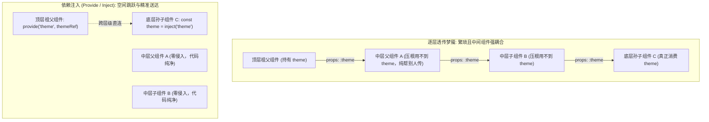

# 跨层级组件通信 provide-inject 与全局事件总线替代方案

在前端中大型复杂应用中，组件树的层级往往极其深邃（例如：祖父组件 → 父组件 → 子组件 → 孙子组件，甚至更深）。如果采用传统的 `props` 和 `$emit`，处于底层的深层组件想要获取顶层的数据，中间所有互不相干的过渡组件都必须机械地逐层转发这些属性和事件，这种现象在业界被称为 **“逐层透传的梦魇（Prop Drilling）”**。Vue 3 提供了 **`provide` / `inject`（依赖注入）** 体系；同时针对 Vue 3 官方彻底废除全局事件总线（`$on` / `$off`）的架构变革，社区推出了以 `mitt` 为代表的现代化轻量级替代方案。本专题带你吃透跨层级通信的最佳实践与避坑要点。

---

## 核心设计哲学与架构对比

### 1. 逐层透传（Prop Drilling）vs 依赖注入（Provide / Inject）



> **生活类比**：
> - **Prop Drilling**：就像公司开会传话，董事长想告诉最基层的实习生一句话，必须让总经理传给总监、总监传给部门经理、部门经理传给组长，组长再告诉实习生。中层管理人员沦为没有感情的传话筒，一旦中间某个人漏传，信息瞬间断链；
> - **Provide / Inject**：就像董事长直接在公司的内部广播大喇叭里喊话（`provide`），所有有需要的员工只要戴上耳机（`inject`）就能在工位上直接收听到，完全绕过中间层级。

---

## 保姆级核心代码演示

### 1. 使用 TypeScript 强类型约束的 `InjectionKey`（`src/types/injectionKeys.ts`）

为了在大型 TypeScript 项目中获得完美的参数类型提示，避免魔法字符串（Magic Strings），官方推荐定义 `InjectionKey`：

```typescript
import type { InjectionKey, Ref } from 'vue'

export interface ThemeContext {
  theme: Ref<'light' | 'dark'>
  toggleTheme: () => void // 遵循单向数据流：提供修改状态的函数
}

// 定义一个带有明确类型约定的全局唯一 InjectionKey
export const ThemeContextKey: InjectionKey<ThemeContext> = Symbol('ThemeContextKey')
```

---

### 2. 顶层祖先组件提供数据（`src/components/AncestorProvider.vue`）

```vue
<template>
  <div class="ancestor-box" :class="currentTheme">
    <h3>顶层祖先组件 (Provider)</h3>
    <p>当前全系统主题模式: <strong>{{ currentTheme }}</strong></p>
    <button class="toggle-btn" @click="handleToggleTheme">顶层切换主题</button>

    <hr class="divider" />
    
    <!-- 引入中间过渡组件，中间组件对 theme 毫无感知！ -->
    <MiddleComponent />
  </div>
</template>

<script setup lang="ts">
import { ref, provide } from 'vue'
import MiddleComponent from './MiddleComponent.vue'
import { ThemeContextKey } from '../types/injectionKeys'

// 1. 顶层组件维护真实状态源
const currentTheme = ref<'light' | 'dark'>('light')

function handleToggleTheme(): void {
  currentTheme.value = currentTheme.value === 'light' ? 'dark' : 'light'
}

// 2. 注入上下文：不仅注入响应式数据，更注入修改该数据的函数！
provide(ThemeContextKey, {
  theme: currentTheme,
  toggleTheme: handleToggleTheme
})
</script>

<style scoped>
.ancestor-box {
  padding: 24px;
  border-radius: 12px;
  border: 1px solid #cbd5e1;
  transition: all 0.3s ease;
  font-family: sans-serif;
}

.light { background-color: #f8fafc; color: #0f172a; }
.dark { background-color: #1e293b; color: #f8fafc; }

.toggle-btn {
  padding: 8px 14px;
  background-color: #3b82f6;
  color: white;
  border: none;
  border-radius: 6px;
  cursor: pointer;
}

.divider { margin: 16px 0; border: none; border-top: 1px solid #cbd5e1; }
</style>
```

---

### 3. 中间无感知层与最深层孙子组件（`src/components/DeepDescendant.vue`）

最深层的孙子组件直接跨级提取并消费主题数据：

```vue
<template>
  <div class="descendant-card">
    <h4>最深层孙子组件 (Consumer)</h4>
    <p>接收到的主题状态: <span class="theme-tag">{{ themeContext?.theme.value }}</span></p>

    <!-- 孙子组件直接调用顶层注入的方法触发变更 -->
    <button class="sub-btn" @click="themeContext?.toggleTheme">
      孙子组件触发：跨级切换主题
    </button>
  </div>
</template>

<script setup lang="ts">
import { inject } from 'vue'
import { ThemeContextKey } from '../types/injectionKeys'

// 使用 inject 提取顶层注入的上下文，并传入默认回退兜底对象
const themeContext = inject(ThemeContextKey, undefined)

if (!themeContext) {
  console.warn('警告：ThemeContextKey 未在任何上层祖先组件中被 provide！')
}
</script>

<style scoped>
.descendant-card {
  padding: 16px;
  background-color: #ffffff;
  border: 1px solid #e2e8f0;
  border-radius: 8px;
  color: #1e293b;
}

.theme-tag {
  font-weight: bold;
  color: #2563eb;
}

.sub-btn {
  padding: 6px 12px;
  background-color: #10b981;
  color: white;
  border: none;
  border-radius: 4px;
  cursor: pointer;
  font-size: 12px;
}
</style>
```

---

## 跨组件通信：Vue 3 替代全局 EventBus 的工业方案（`mitt`）

在 Vue 2 中，很多开发者习惯创建 `const bus = new Vue()` 并调用 `bus.$emit` 和 `bus.$on` 实现任意两个毫无血缘关系的组件跨界通信。

### 为什么 Vue 3 官方彻底移除了 `$on`、`$off`、`$once`？
1. **架构松散与状态不可控**：事件在全应用任意角落随机发射、随机监听，使得数据流像“蜘蛛网”一样错综复杂，几乎无法追踪状态来源；
2. **极高频的内存泄漏灾难**：如果开发者在一个被频繁创建销毁的组件中写了 `bus.$on`，一旦忘了在 `destroyed` 中调用 `bus.$off`，每打开一次页面就会堆积一个重复监听闭包，引发严重内存泄漏与单次点击多次响应的 Bug。

### 现代化轻量级替代方案：`mitt` 库实战

在完全没有父子层级关系，但又不想为此引入沉重状态管理（如 Pinia）的兄弟组件跨界通信场景，推荐使用仅 200 字节的 `mitt`：

```typescript
// src/utils/eventBus.ts
import mitt from 'mitt'

// 1. 定义事件类型映射表
type Events = {
  'user-login': { userId: number; username: string }
  'notice-refresh': void
}

// 2. 导出类型安全的事件总线实例
export const eventBus = mitt<Events>()
```

在组件 A 中发射事件：
```typescript
import { eventBus } from '../utils/eventBus'

function notifyLoginSuccess() {
  eventBus.emit('user-login', { userId: 1001, username: '技术主管' })
}
```

在组件 B 中监听并**严格注销**：
```typescript
import { onMounted, onUnmounted } from 'vue'
import { eventBus } from '../utils/eventBus'

function handleUserLogin(data: { userId: number; username: string }) {
  console.log('接收到全局登录通知:', data.username)
}

onMounted(() => {
  eventBus.on('user-login', handleUserLogin)
})

// 核心规范：组件卸载前必须成对注销监听，杜绝内存泄漏！
onUnmounted(() => {
  eventBus.off('user-login', handleUserLogin)
})
```

---

## 生产级避坑指南与排障 SOP

### 1. 注入端直接修改 `provide` 传递的响应式对象破坏单向数据流

- **违规操作**：
  祖先组件注入了 `provide('userInfo', userRef)`。
  深层子组件直接写 `userInfo.value.name = '恶意修改'`。
- **治理 SOP**：
  1. 如果只希望子组件只读消费，祖先组件在提供时应使用 **`readonly()`** 包装：
     ```typescript
     provide('userInfo', readonly(userRef))
     ```
  2. 如果子组件需要发起修改，祖先组件必须**同时注入一个修改该状态的函数**，由源头统一收拢状态修改权。

---

### 2. 避免使用纯字符串作为 `provide` 的 Key

- **隐患**：在大型多人协同项目中，如果 A 开发者写了 `provide('config', ...)`，B 开发者也在外层父组件写了 `provide('config', ...)`，会导致深层组件拿到的数据被意外覆盖。
- **规范**：统一使用 ES6 的 **`Symbol()`** 或 TypeScript 的 **`InjectionKey<T>`** 作为唯一 Key。

---

## 中级必考面试题与标准对标回答

### 面试题 1：`provide` 与 `inject` 是响应式的吗？如何保证下游组件拿到的一定是最新数据？

- **标准应答**：
  1. **响应式本质取决于提供的数据源类型**：如果 `provide('key', 普通非响应式数值)`，下游 `inject` 拿到的仅仅是一个死数据，不会随上游变化而自发更新；
  2. **保证响应式的规范写法**：在 `provide` 时，**必须传入 `ref`、`reactive` 或由它们生成的计算属性 `computed`**。这样下游通过 `inject` 拿到的实质是同一个 `RefImpl` 内存对象指针，任何上游变动都会通过依赖收集系统精确触发下游组件的自动重新渲染。

---

### 面试题 2：为什么 Vue 3 官方移除了 `$on` / `$off` 等事件 API？在什么场景下应该使用 `provide/inject`，什么场景下该用 Pinia？

- **标准应答**：
  1. **移除 `$on` 的根本考量**：`$on` 和 `$emit` 原先混杂在同一个 Vue 实例上，造成了事件监听与 DOM 原生事件的语义混淆；且跨组件 EventBus 极其容易产生未解绑的幽灵监听导致严重内存泄漏，阻碍了大型应用的代码可追溯性。
  2. **技术选型边界**：
     - **`provide / inject` 适用场景**：**存在明确祖孙/父子树状嵌套关系的局部组件树**（例如封装通用的 `ElForm` 与 `ElFormItem`、树形控件 `ElTree`、多级折叠面板），数据只在这棵局部组件子树内流转，无需污染全局；
     - **Pinia 状态管理适用场景**：**全应用跨路由、跨页面、毫无血缘关系的全局共享状态**（如全局用户登录态 Token、购物车全局列表、系统多语言与全局权限列表），具备完备的 DevTools 调试追踪与时间旅行能力。
