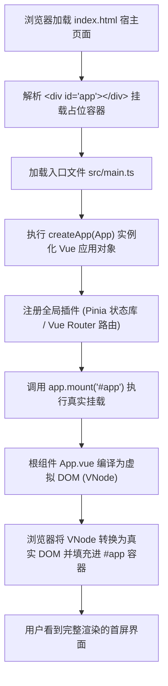

# Vue 3 项目初始化与 SFC 单文件组件结构全解

在现代前端开发中，Vue 3 凭借简洁的心智模型、强类型的 TypeScript 支持以及极致的构建速度，成为了构建企业级单页应用（SPA）的首选框架之一。对于初学者而言，彻底理解 Vue 3 应用的启动流程以及单文件组件（Single File Component, SFC）的核心结构，是踏入 Vue 世界并打牢地基的第一步。

---

## 白话原理解释与应用启动全景

### 什么是单文件组件（SFC）？

在传统原生 Web 开发中，HTML（结构）、JavaScript（逻辑）、CSS（样式）通常存放在三个独立的文件中，开发者在多文件之间频繁跳转，心智负担极重。

Vue 创新性地提出了 **SFC（Single File Component，单文件组件，即 `.vue` 文件）** 概念：
> **生活类比**：SFC 就像是一个高度集成的“乐高积木块”。这块积木自身拥有骨架（HTML 模板）、灵魂（JS/TS 业务逻辑）和外衣（CSS 样式）。一个复杂庞大的前端系统，就是由无数个这样高内聚、易复用的独立积木块拼装而成的。

### Vue 3 应用启动与挂载时序

当用户在浏览器打开一个 Vue 页面时，系统底层的启动加载流程如下：



---

## 保姆级核心代码演示与结构剖析

### 1. 入口文件启动代码（`src/main.ts`）

```typescript
// 从 vue 核心包中按需导入 createApp 工厂函数
import { createApp } from 'vue'
// 导入全局样式文件
import './style.css'
// 导入根组件 App.vue
import App from './App.vue'

// 1. 创建 Vue 应用实例（App 为根组件）
const app = createApp(App)

// 2. 可以在此处注册全局能力（如路由、状态管理、全局组件）
// app.use(router)
// app.use(pinia)

// 3. 将应用挂载到 index.html 中 id 为 'app' 的真实 DOM 节点上
app.mount('#app')
```

### 2. 标准单文件组件（SFC）模板规范（`src/components/UserCard.vue`）

在 Vue 3 中，推荐采用 `<script setup lang="ts">` 组合式语法糖，代码极其精简且具备完备的类型推导：

```vue
<template>
  <!-- 模板区域：负责定义组件的 HTML 骨架 -->
  <div class="user-card">
    <div class="avatar-box">
      
    </div>
    
    <div class="info-box">
      <h3 class="user-name">{{ userName }}</h3>
      <p class="user-role">{{ roleDescription }}</p>
      <p class="login-count">登录次数：<span class="count-tag">{{ loginCount }}</span></p>
    </div>

    <div class="action-box">
      <button class="primary-btn" @click="handleIncrement">增加登录计数</button>
      <button class="reset-btn" @click="handleReset">重置</button>
    </div>
  </div>
</template>

<script setup lang="ts">
// 逻辑区域：负责定义组件的响应式数据与业务交互
import { ref, computed } from 'vue'

// 1. 定义基础响应式数据
const userName = ref<string>('张三')
const avatarUrl = ref<string>('https://api.dicebear.com/7.x/avataaars/svg?seed=Felix')
const loginCount = ref<number>(1)

// 2. 定义计算属性（基于已有数据衍生出的新数据）
const roleDescription = computed(() => {
  return loginCount.value >= 10 ? 'VIP 核心用户' : '普通注册用户'
})

// 3. 定义交互处理函数
function handleIncrement(): void {
  loginCount.value += 1
}

function handleReset(): void {
  loginCount.value = 0
}
</script>

<style scoped>
/* 样式区域：scoped 属性保证样式仅在当前组件内部生效，杜绝全局污染 */
.user-card {
  width: 320px;
  padding: 20px;
  border-radius: 12px;
  background-color: #ffffff;
  box-shadow: 0 4px 16px rgba(0, 0, 0, 0.08);
  font-family: -apple-system, BlinkMacSystemFont, "Segoe UI", Roboto, sans-serif;
  box-sizing: border-box;
}

.avatar-box {
  text-align: center;
  margin-bottom: 12px;
}

.avatar {
  width: 80px;
  height: 80px;
  border-radius: 50%;
  border: 2px solid #3b82f6;
}

.info-box {
  text-align: center;
  margin-bottom: 16px;
}

.user-name {
  margin: 0 0 6px 0;
  font-size: 18px;
  color: #1f2937;
}

.user-role {
  margin: 0 0 8px 0;
  font-size: 14px;
  color: #6b7280;
}

.login-count {
  font-size: 13px;
  color: #4b5563;
}

.count-tag {
  font-weight: bold;
  color: #3b82f6;
}

.action-box {
  display: flex;
  gap: 10px;
  justify-content: center;
}

button {
  padding: 8px 16px;
  border-radius: 6px;
  border: none;
  cursor: pointer;
  font-size: 13px;
  transition: opacity 0.2s;
}

button:hover {
  opacity: 0.85;
}

.primary-btn {
  background-color: #3b82f6;
  color: #ffffff;
}

.reset-btn {
  background-color: #e5e7eb;
  color: #374151;
}
</style>
```

---

## 初学者高频踩坑与排错调试指南

### 踩坑 1：在 JS 代码中访问 `ref` 变量忘记加 `.value`

- **典型现象**：
  在 `<script setup>` 中计算或打印数据时，发现控制台打印出来的是一个包含了 `_rawValue`、`_value` 等复杂属性的 `RefImpl` 对象，而不是基础数值；或者执行 `loginCount += 1` 报类型错误或值变成 `[object Object]1`。
- **物理成因**：
  Vue 3 的 `ref()` 函数为了让基本数据类型（数字、字符串、布尔值）也能被侦测到读写变化，将其包装成了一个带有 getter/setter 的对象。在 JavaScript 逻辑中必须显式通过 `.value` 访问；只有在 `<template>` 模板中，Vue 编译器才会自动帮我们执行解包（Unwrap），无需手动写 `.value`。
- **正误对照**：
  ```typescript
  // 错误写法
  loginCount = loginCount + 1 // 破坏了 RefImpl 对象引用
  
  // 正确写法
  loginCount.value += 1
  ```

---

### 踩坑 2：Vue 3 模板中只能有一个根节点的陈旧认知（Fragments 特性）

- **现象与疑问**：
  很多阅读了 Vue 2 老教程的学习者，习惯性地在每个组件的最外层必须包裹一个无意义的 `<div>`，否则编译报错。
- **避坑解密**：
  Vue 3 引入了 **Fragments（片段）** 特性。一个组件的 `<template>` 内部**允许存在多个平级根节点**。Vue 内部会自动创建一个虚拟的 Fragment 节点来承载它们。
  ```vue
  <!-- Vue 3 完美支持多根节点，不再强求外层包裹单个 div -->
  <template>
    <header>页头</header>
    <main>主要内容</main>
    <footer>页脚</footer>
  </template>
  ```
  > 注意：如果组件存在多个根节点，外部传进来的 `class` 和 `style` 等透传属性（Attributes）将不知道绑定给谁，控制台会抛出警告。此时若需要透传，建议用单个根节点或显式通过 `v-bind="$attrs"` 指定接收者。

---

### 踩坑 3：修改了样式却不生效，未理解 `<style scoped>` 的工作边界

- **典型现象**：
  在子组件或者引入了 Element Plus 等第三方组件库时，在带有 `scoped` 的 `<style>` 中修改其内部样式（如 `.el-button`），发现完全不生效。
- **排障 SOP**：
  1. 打开 Chrome 开发者工具审查元素，观察发现当前组件的 DOM 标签上自动多出了类似 `data-v-7ba5bd90` 的属性标记；
  2. 检查 CSS 样式选择器，发现被自动编译成了 `.user-card[data-v-7ba5bd90]`；
  3. 第三方组件内部的子 DOM 节点并没有被打上当前组件的 `data-v-hash` 标记，因此普通 CSS 选择器无法命中；
  4. **解决方案**：使用 `:deep()` 深度选择器（样式穿透）：
     ```css
     /* 正确穿透修改子组件内部样式的语法 */
     :deep(.el-button) {
       border-radius: 20px;
     }
     ```

---

## 初级必考面试题与标准对标回答

### 面试题 1：Vue 3 的 `createApp()` 与 Vue 2 的 `new Vue()` 相比，底层架构带来了什么核心好处？

- **标准应答**：
  1. **全局配置隔离（避免测试与多应用污染）**：
     在 Vue 2 中，所有的全局配置（如 `Vue.use()`、`Vue.component()`、`Vue.mixin()`）都会直接修改 `Vue` 构造函数的原型或全局静态属性。如果一个单页面中启动了两个独立的 Vue 根实例，或者在进行前端单元测试时，不同应用之间的全局状态和注册组件会互相污染。
  2. **应用实例独立性**：
     Vue 3 通过 `createApp()` 工厂函数返回一个全新的应用实例（Application Instance）。所有的插件注册（`app.use`）、全局组件（`app.component`）均挂载在当前 `app` 实例作用域下，完全实现多应用实体的严格沙箱隔离。
  3. **更利于 Tree-Shaking 瘦身**：
     全局 API 变为实例 API 或直接按需导入（如 `nextTick`、`reactive`），未被引用的方法在打包构建时可被 Rollup/Webpack 彻底摇树剔除，大幅削减产物体积。

---

### 面试题 2：单文件组件中的 `<script setup>` 语法糖相比传统写法有哪些显著优势？

- **标准应答**：
  1. **代码量极大削减**：无需显式书写 `export default { setup() { ... return { ... } } }` 样板代码，顶层声明的所有变量、函数以及导入的组件均在模板中**自动可用**，免去冗长的 `return` 清单；
  2. **极佳的运行时性能**：模板会被编译为与 `<script setup>` 同一作用域下的内联渲染函数，无需通过组件实例代理（Proxy）在不同上下文之间读取变量，执行速度更快；
  3. **第一公民级的 TypeScript 体验**：原生支持纯类型声明宏（如 `defineProps<Props>()` 与 `defineEmits<Emits>()`），具备完备的高性能编译期静态类型推导，开发体验极其丝滑。
