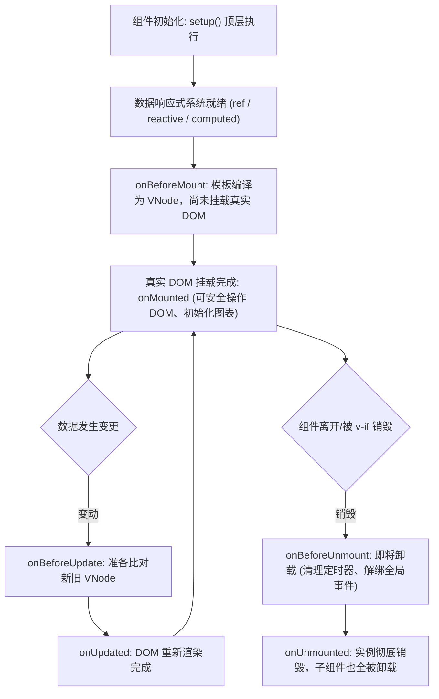

# Vue 生命周期全流程 Vue2 与 Vue3 对比及资源清理避坑

在前端组件化架构中，每一个组件实例从被创建出来、挂载到浏览器屏幕上、随数据变动而更新，直到最终被从页面中移除销毁，经历了一段完整的“生命历程”。Vue 赋予了开发者在这些关键物理时刻切入自定义业务逻辑的能力，这些切入点被称为 **生命周期钩子（Lifecycle Hooks）**。掌握生命周期的执行时序与资源销毁清理规范，是写出高稳定性、零内存泄漏代码的基石。

---

## 白话原理解释与全流程时序图

### 组件的一生：人生成长生活类比

> **生活类比**：
> 1. **创建阶段（Creation / setup）**：**怀胎十月、起草蓝图**。大脑（数据响应式、计算属性、方法）已经发育就绪，但人还没有出生落地，周围看不到任何外部物理世界（无法访问真实 DOM）；
> 2. **挂载阶段（Mounting / onMounted）**：**呱呱坠地、登上舞台**。组件被正式渲染并插入到浏览器的 HTML 真实 DOM 树中，从此可以量出身高体重（获取 DOM 尺寸，初始化 ECharts 图表）；
> 3. **更新阶段（Updating / onUpdated）**：**随时打扮、换装焕新**。组件内部的数据变了，虚拟 DOM 重新比对并重新渲染视图；
> 4. **销毁阶段（Unmounting / onUnmounted）**：**寿终正寝、搬家退租**。组件从页面中彻底移除。搬家前必须交割退租，把屋里的水电关掉、租约退订（清除定时器、解绑全局滚动监听），否则会引发长久的“幽灵资源占用”（内存泄漏）。

### Vue 3 核心生命周期流转图



---

## Vue 2 与 Vue 3 生命周期映射全景

| 阶段 | Vue 2 Options 选项式 API | Vue 3 Composition 组合式 API | 关键特征与安全操作界限 |
| :--- | :--- | :--- | :--- |
| **初始化创建** | `beforeCreate` | `setup()` 顶层逻辑 | 实例刚初始化，**严禁访问任何 DOM** |
| **初始化创建** | `created` | `setup()` 顶层逻辑 | 数据、方法就绪，适合初始化状态；**仍无法访问 DOM** |
| **挂载前** | `beforeMount` | `onBeforeMount` | 虚拟 DOM 已生成，真实 DOM 尚未插入页面 |
| **挂载后** | `mounted` | `onMounted` | **真实 DOM 挂载完毕**，可获取 DOM 尺寸、初始化三方库 |
| **更新前** | `beforeUpdate` | `onBeforeUpdate` | 响应式数据已修改，DOM 尚未重新渲染 |
| **更新后** | `updated` | `onUpdated` | DOM 已完成重绘更新，严禁在此钩子内再次无条件修改数据 |
| **卸载前** | `beforeDestroy` | `onBeforeUnmount` | 组件即将销毁，**执行资源清理的最黄金时机** |
| **卸载后** | `destroyed` | `onUnmounted` | 组件物理销毁完毕，关联的子组件也全被解绑 |

---

## 保姆级核心代码演示与资源清理实战

### 包含完整生命周期与防内存泄漏演示组件（`src/components/LifecycleDemo.vue`）

```vue
<template>
  <div class="lifecycle-card">
    <h3>实时倒计时与窗口监听组件</h3>
    
    <div class="monitor-box">
      <p>当前倒计时: <span class="highlight-num">{{ countdownSeconds }}s</span></p>
      <p>当前浏览器窗口宽度: <span class="highlight-num">{{ windowWidth }}px</span></p>
    </div>

    <!-- DOM 测量目标节点 -->
    <div ref="boxElementRef" class="target-box">
      <span>挂载后测量的物理高度: {{ boxHeight }}px</span>
    </div>
  </div>
</template>

<script setup lang="ts">
import { 
  ref, 
  onBeforeMount, 
  onMounted, 
  onBeforeUpdate, 
  onUpdated, 
  onBeforeUnmount, 
  onUnmounted 
} from 'vue'

// 1. 响应式状态
const countdownSeconds = ref<number>(60)
const windowWidth = ref<number>(window.innerWidth)
const boxHeight = ref<number>(0)

// 2. 绑定 DOM 引用的 Ref
const boxElementRef = ref<HTMLDivElement | null>(null)

// 3. 需被释放的全局资源引用
let timerId: ReturnType<typeof setInterval> | null = null

function handleWindowResize(): void {
  windowWidth.value = window.innerWidth
  console.log('[事件触发] 窗口宽度改变为:', window.innerWidth)
}

// ===================== 生命周期钩子演示 =====================

console.log('1. [setup 顶层执行]：组件实例正在创建，此时 DOM 节点为:', boxElementRef.value) // null

onBeforeMount(() => {
  console.log('2. [onBeforeMount]：DOM 挂载前，DOM 节点依旧为:', boxElementRef.value) // null
})

onMounted(() => {
  console.log('3. [onMounted]：DOM 挂载完成！此时安全获取 DOM 元素:', boxElementRef.value)
  
  // 测量 DOM 真实物理高度
  if (boxElementRef.value) {
    boxHeight.value = boxElementRef.value.clientHeight
  }

  // 模拟业务 A：启动定时器
  timerId = setInterval(() => {
    if (countdownSeconds.value > 0) {
      countdownSeconds.value--
    }
  }, 1000)

  // 模拟业务 B：向全局 window 添加事件监听器
  window.addEventListener('resize', handleWindowResize)
})

onBeforeUpdate(() => {
  console.log('4. [onBeforeUpdate]：数据变动，DOM 即将更新')
})

onUpdated(() => {
  console.log('5. [onUpdated]：DOM 更新重绘完毕')
})

onBeforeUnmount(() => {
  console.log('6. [onBeforeUnmount]：组件即将销毁，立刻执行资源清理！')
  
  // 核心避坑：必须彻底清理定时器！
  if (timerId) {
    clearInterval(timerId)
    timerId = null
    console.log('>>> [资源清理成功] 定时器已清除')
  }

  // 核心避坑：必须解绑全局事件监听！
  window.removeEventListener('resize', handleWindowResize)
  console.log('>>> [资源清理成功] window resize 监听已移除')
})

onUnmounted(() => {
  console.log('7. [onUnmounted]：组件已被彻底销毁')
})
</script>

<style scoped>
.lifecycle-card {
  padding: 20px;
  background-color: #ffffff;
  border-radius: 10px;
  border: 1px solid #e2e8f0;
  box-shadow: 0 4px 12px rgba(0, 0, 0, 0.05);
  font-family: sans-serif;
}

.monitor-box {
  background-color: #f8fafc;
  padding: 12px;
  border-radius: 6px;
  margin: 12px 0;
  font-size: 14px;
}

.highlight-num {
  font-weight: bold;
  color: #2563eb;
}

.target-box {
  height: 80px;
  display: flex;
  align-items: center;
  justify-content: center;
  background-color: #eff6ff;
  border: 2px dashed #93c5fd;
  border-radius: 6px;
  color: #1e40af;
  font-size: 13px;
}
</style>
```

---

## 初学者高频踩坑与排错调试指南

### 踩坑 1：在 `setup` 顶层直接操作真实 DOM 导致 `null` 崩溃

- **典型翻车现场**：
  ```typescript
  <script setup lang="ts">
  import { ref } from 'vue'
  
  const myCanvas = ref<HTMLCanvasElement | null>(null)
  
  // ❌ 致命错误：在 setup 顶层直接访问
  const ctx = myCanvas.value.getContext('2d') // 控制台崩溃：Cannot read properties of null (reading 'getContext')
  </script>
  ```
- **物理成因**：
  `<script setup>` 顶层的代码在执行时，浏览器甚至还没开始解析 `<template>` 里的任何 DOM 节点，此时 `myCanvas.value` 严格为 `null`！
- **铁律**：**所有需要读取、计算真实 DOM 节点（如初始化 ECharts、获取 Canvas 上下文、操作 Swiper 轮播）的逻辑，必须包裹在 `onMounted(() => { ... })` 钩子中执行！**

---

### 踩坑 2：组件销毁时遗忘清理定时器导致严重的内存泄漏与 CPU 飙高

- **现象**：
  用户在列表页与详情页之间来回反复切换 10 次。
  打开浏览器任务管理器，发现该页面的内存持续暴涨，且即使退回到列表页，控制台依然在疯狂打印详情页的 `setInterval` 日志！
- **物理成因**：
  `setInterval` 和挂在 `window` 上的 `addEventListener` 属于**浏览器全局运行环境（BOM）持有的长生命周期引用**。组件即使在 Vue 的虚拟 DOM 树中被销毁了，只要定时器闭包依然持有对组件内部数据的引用，V8 引擎的垃圾回收器（GC）就**坚决无法回收该组件的内存空间**，导致该组件永久驻留内存，成为“僵尸组件”。
- **排障 SOP**：
  所有在 `onMounted` 中建立的全局定时器、Window 事件监听、WebSocket 连接、第三方实例，**必须在 `onBeforeUnmount` 中成对调用 `clearInterval`、`removeEventListener`、`ws.close()`、`chart.dispose()` 彻底注销释放！**

---

## 初级必考面试题与标准对标回答

### 面试题 1：接口请求到底应该放在哪个生命周期里？为什么？

- **标准应答**：
  1. **纯客户端单页应用（SPA）标准**：
     在 Vue 3 Composition API 中，普通接口请求建议放在 **`setup()` 顶层** 或 **`onMounted`** 中。
     - 放在 `setup()` 顶层：代码书写最为自然，接口越早发起，越能减少首屏白屏等待时间；
     - 如果请求需要依赖当前页面的某些 DOM 参数（例如需要先获取容器宽高才去请求对应分辨率的图片），则**必须放在 `onMounted` 中**。
  2. **服务端渲染（SSR）考量**：
     在 SSR 架构（如 Nuxt）中，`onMounted` 钩子**只会在客户端浏览器执行，绝对不会在 Node.js 服务端执行**。如果接口是为了服务端渲染 HTML 骨架（供 SEO 抓取），必须使用 SSR 专用的 `useAsyncData` 或放在服务端执行的钩子中；如果是非首屏必需的次级接口，建议明确放在 `onMounted` 中仅供客户端浏览器拉取。

---

### 面试题 2：Vue 2 的 `destroyed` 和 Vue 3 的 `onUnmounted` 有何区别？在卸载阶段一般处理哪些核心事务？

- **标准应答**：
  1. **命名与架构演进**：Vue 3 将 `beforeDestroy` / `destroyed` 重命名为更语义化的 `onBeforeUnmount` / `onUnmounted`（与挂载 `mount` 形成完美对仗），底层机制保持一致；
  2. **卸载阶段的核心事务清单（必须在 `onBeforeUnmount` 执行）**：
     - **清除定时器**：清除 `setInterval` 和 `setTimeout`；
     - **解绑全局原生事件**：清除绑定在 `window`、`document` 或父容器上的 `resize`、`scroll`、`keydown` 监听器；
     - **断开长连接**：关闭 `WebSocket` 连接与 `EventSource` (SSE) 流；
     - **销毁三方复杂实例**：显式调用富文本编辑器（wangeditor / monaco）、地图 SDK、ECharts 图表实例的 `.destroy()` 或 `.dispose()` 方法，防止跨组件内存泄漏。
