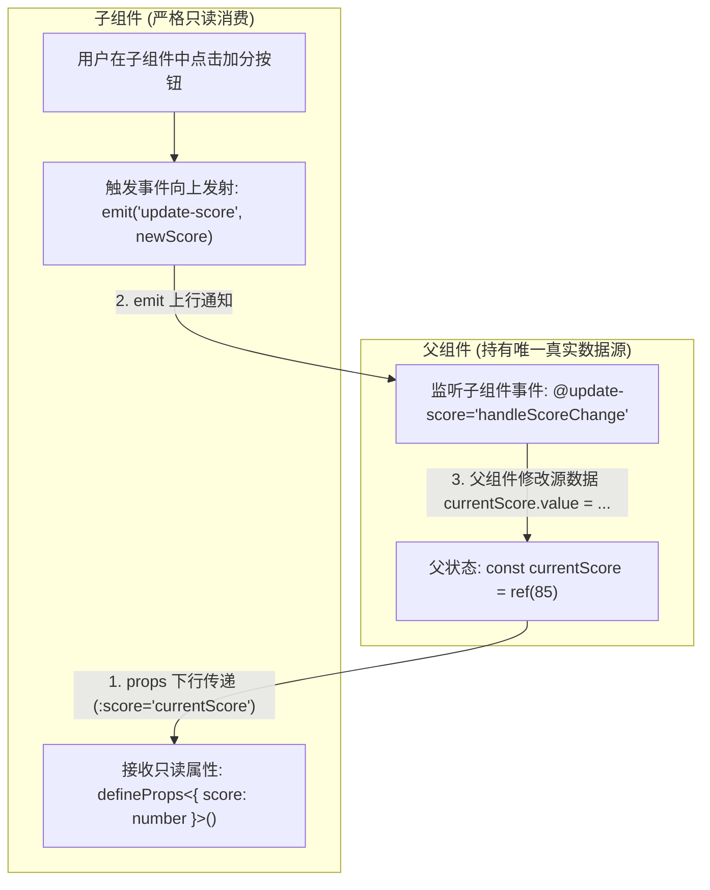

# 组件基础通信 props 与 emit 及单向数据流原则

组件化开发的核心思想是将一个庞大繁琐的页面拆分为若干个小巧、独立、可复用的子组件。组件拆分后，**数据如何在父子组件之间安全、高效地流动**，便成为了日常业务开发最基础的必修课。Vue 遵循经典的 **“Props 向下传递，Events 向上发射”** 架构，并确立了坚不可摧的 **单向数据流原则（One-Way Data Flow）**。本专题将从零带你吃透父子组件通信的语法与工程规范。

---

## 白话原理解释与组件流转全景

### 1. 父子通信与单向数据流生活类比

> **生活类比**：
> - **父传子（`props`）**：就像**公司总部给下属分公司下发业务指标公文**。分公司可以阅读公文内容，根据公文要求开展工作；
> - **单向数据流铁律**：分公司**绝对无权擅自在公文原件上涂改数字**！如果允许分公司随意修改原件，其他分公司和总部的数据就会瞬间大乱；
> - **子传父（`emit`）**：分公司如果遇到指标需要调整的情况，正确的做法是**向上级总部提交申请报告（发射一个事件 Emit）**，由总部亲自修改源头数据后，再统一重新向下分发。

### 2. 父子通信全链路数据流转图



---

## 保姆级核心代码演示

### 1. 子组件（`src/components/ScoreCard.vue`）

在 Vue 3 `<script setup>` 中，使用 `defineProps` 接收属性，使用 `defineEmits` 声明自定义事件：

```vue
<template>
  <div class="score-card">
    <div class="header">
      <span class="subject-title">【科目】{{ subject }}</span>
      <span class="status-badge" :class="passStatusClass">{{ passStatusText }}</span>
    </div>

    <div class="body">
      <p class="score-num">{{ score }} <span class="unit">分</span></p>
    </div>

    <div class="footer">
      <!-- 点击按钮时，不直接修改 score，而是通过 emit 向上级父组件发通知 -->
      <button class="btn add-btn" @click="handleAdjust(10)">加 10 分</button>
      <button class="btn minus-btn" @click="handleAdjust(-10)">减 10 分</button>
    </div>
  </div>
</template>

<script setup lang="ts">
import { computed } from 'vue'

// 1. 定义 Props 接口约束
interface Props {
  subject: string
  score: number
  passingLine?: number // 可选属性
}

// 2. 使用 withDefaults 给 defineProps 赋予默认值
const props = withDefaults(defineProps<Props>(), {
  passingLine: 60
})

// 3. 声明子组件对外派发的事件清单与入参类型约束
const emit = defineEmits<{
  (e: 'change-score', newScore: number): void
  (e: 'log-action', message: string): void
}>()

// 4. 基于 Props 的只读计算属性
const passStatusText = computed(() => {
  return props.score >= props.passingLine ? '已及格' : '不及格'
})

const passStatusClass = computed(() => {
  return props.score >= props.passingLine ? 'badge-pass' : 'badge-fail'
})

// 5. 交互处理：严禁直接 props.score += delta！
function handleAdjust(delta: number): void {
  const targetScore = Math.max(0, Math.min(100, props.score + delta))
  
  // 向父组件发射事件，告知新分数
  emit('change-score', targetScore)
  emit('log-action', `用户对 ${props.subject} 执行了调整，分值变更为: ${targetScore}`)
}
</script>

<style scoped>
.score-card {
  width: 260px;
  padding: 16px;
  background: #ffffff;
  border-radius: 10px;
  border: 1px solid #e2e8f0;
  box-shadow: 0 2px 8px rgba(0, 0, 0, 0.04);
  font-family: sans-serif;
}

.header {
  display: flex;
  justify-content: space-between;
  align-items: center;
}

.subject-title { font-weight: bold; font-size: 15px; }

.status-badge {
  font-size: 11px;
  padding: 2px 6px;
  border-radius: 4px;
}

.badge-pass { background-color: #dcfce7; color: #15803d; }
.badge-fail { background-color: #fee2e2; color: #b91c1c; }

.score-num {
  font-size: 32px;
  font-weight: 800;
  color: #1e293b;
  margin: 16px 0;
  text-align: center;
}

.unit { font-size: 14px; font-weight: normal; color: #64748b; }

.footer {
  display: flex;
  gap: 10px;
}

.btn {
  flex: 1;
  padding: 6px;
  border: none;
  border-radius: 6px;
  cursor: pointer;
  font-size: 12px;
  font-weight: 500;
}

.add-btn { background-color: #3b82f6; color: white; }
.minus-btn { background-color: #f1f5f9; color: #334155; }
</style>
```

---

### 2. 父组件（`src/components/ParentScoreManager.vue`）

```vue
<template>
  <div class="parent-container">
    <h2>学生期末成绩总控台 (父组件)</h2>
    <p class="summary-text">当前语文科目总分源: <strong class="score-highlight">{{ chineseScore }}</strong></p>

    <!-- 
      使用子组件:
      1. 通过 :subject 和 :score 向下传递 Props
      2. 通过 @change-score 监听子组件向外发射的事件
    -->
    <div class="cards-layout">
      <ScoreCard 
        subject="语文" 
        :score="chineseScore" 
        :passing-line="60"
        @change-score="handleChineseScoreChange"
        @log-action="handleChildLog"
      />

      <ScoreCard 
        subject="数学" 
        :score="mathScore" 
        :passing-line="70"
        @change-score="newVal => mathScore = newVal"
      />
    </div>

    <div v-if="latestLog" class="log-board">
      <span class="log-title">子组件活动日志：</span>
      <span class="log-content">{{ latestLog }}</span>
    </div>
  </div>
</template>

<script setup lang="ts">
import { ref } from 'vue'
import ScoreCard from './ScoreCard.vue'

// 父组件持有源头状态
const chineseScore = ref<number>(85)
const mathScore = ref<number>(55)
const latestLog = ref<string>('')

// 处理子组件传上来的新分数
function handleChineseScoreChange(newScore: number): void {
  console.log('父组件成功拦截到成绩变更通知，新分数为:', newScore)
  chineseScore.value = newScore
}

function handleChildLog(msg: string): void {
  latestLog.value = msg
}
</script>

<style scoped>
.parent-container {
  max-width: 600px;
  margin: 20px auto;
  padding: 24px;
  background-color: #f8fafc;
  border-radius: 12px;
  border: 1px solid #cbd5e1;
}

.score-highlight { color: #2563eb; font-size: 18px; }
.cards-layout { display: flex; gap: 20px; margin: 20px 0; }

.log-board {
  padding: 10px 14px;
  background-color: #e2e8f0;
  border-radius: 6px;
  font-size: 13px;
  color: #334155;
}

.log-title { font-weight: bold; }
</style>
```

---

## 初学者高频踩坑与排错调试指南

### 踩坑 1：在子组件内部直接修改 Props 属性引发的警告与灾难

- **典型错误代码**：
  在子组件方法中图省事：
  ```typescript
  function handleDirectAdd() {
    // ❌ 严重违反单向数据流！控制台抛出警告：
    // Set operation on key "score" failed: target is readonly.
    props.score += 10
  }
  ```
- **物理成因**：
  在 Vue 3 中，`defineProps` 返回的 `props` 对象被包装为 **浅层只读（Shallow Readonly）**。子组件任何强行写入操作都会直接被 Proxy 的 `set` 拦截器拒绝并抛出红色告警。
- **如果子组件确实需要把 Prop 当作初始值并自行修改，怎么办？**
  定义一个**本地局部状态**接收其初值：
  ```typescript
  // ✅ 正确破局：使用本地 ref 承接初始值，后续修改自身局部变量
  const localScore = ref(props.score)
  localScore.value += 10
  ```

---

### 踩坑 2：传递数字或布尔值时忘记加 `:` 变成了普通字符串

- **典型翻车现场**：
  ```vue
  <!-- ❌ 错误传递：传递过去的是纯字符串 "100" 和字符串 "false" -->
  <MyChild score="100" is-active="false" />
  ```
  在子组件内部做判断：
  ```typescript
  if (props.isActive) {
    // 即使你传了 "false"，因为非空字符串在 JS 中转换为布尔值是 true！
    // 导致条件永远成立，引发反直觉 Bug！
  }
  ```
- **铁律**：
  **凡是希望传递数字、布尔值、数组、对象、变量等 JavaScript 原生类型的，属性前面必须加冒号 `:`（即 `v-bind:`）！只有传递纯静态字符串常量时才可以省略冒号！**
  ```vue
  <!-- ✅ 正确传递：加上冒号，双引号内部的内容作为 JS 表达式求值 -->
  <MyChild :score="100" :is-active="false" />
  ```

---

## 初级必考面试题与标准对标回答

### 面试题 1：什么是单向数据流？Vue 为什么要强制遵循单向数据流？

- **标准应答**：
  1. **定义**：单向数据流规定了父子组件之间的数据流向只能是“自顶向下”的（父到子）。所有的 Prop 都使得其父子组件之间形成了一个**单向下行绑定**：父级属性的更新会向下流动到子组件中，但反过来不行。
  2. **核心工程学原因**：**防止子组件意外修改父组件的状态，从而导致整个应用的数据流向变得错乱且不可预测**。如果每个子组件都能随意就地突变父级数据，一旦出现 Bug，开发者将完全无法追踪究竟是哪一个子组件在什么时刻改脏了数据。通过单向数据流，数据只能在持有它的父组件中被修改，状态变更历史清晰可追溯。

---

### 面试题 2：`<script setup>` 中 `defineProps` 和 `defineEmits` 需要手动 `import` 吗？它们属于什么机制？

- **标准应答**：
  1. **不需要手动导入**：`defineProps` 和 `defineEmits` 是由 Vue 编译器专门提供的 **编译期宏（Compiler Macros）**。在 `<script setup>` 中它们是全局自动可用的，无需写 `import { defineProps } from 'vue'`；如果手动引入反而会触发 ESLint 的无用导入警告。
  2. **物理运行机制**：它们只在 `<script setup>` 被 Vue 编译器预处理时生效，编译器会静态分析它们声明的属性与事件签名，并自动将它们转换为组件最终的运行时配置，在打包生成的实际代码中，这些宏会被自动消除，完全不占用运行时额外代码体积。
