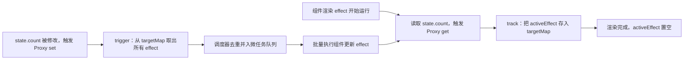

# 响应式原理与实战解析

## 使用入口：先解决问题，再做验证

让状态改变正确驱动视图并避免依赖失效。

**先做基本操作**：先用 ref/reactive/computed 做表单和派生值，复现解构与异步更新，再手写依赖追踪。初次学习可先完成[本模块基础实践](/doc/Vue/Vue组件与页面基本使用)。

**再逐步深入**：基本 API 与输入输出 → 常见失败和使用边界 → 场景排查与优化 → 本文机制分析与源码。面试先讲用途和自己的操作过程，再回答场景与原理追问。

## 基本使用：`ref` 与 `reactive` 的选择

| 场景 | 推荐 | 原因 |
|---|---|---|
| 数字/字符串/布尔等单值 | `ref` | Proxy 不能代理基础类型，必须包装 |
| 需要整体替换的数据（接口返回对象） | `ref({})` | `state.value = res` 引用替换不丢响应 |
| 表单这类固定结构对象 | `reactive` | 模板里少写 `.value`，字段级更新更自然 |
| 大列表 / 后端返回的万级数组 | `shallowRef` | 只要整体替换响应，不要为每元素建 Proxy |
| 第三方实例、地图/图表对象 | `markRaw` 或普通变量 | 被 Proxy 包住会破坏实例内部 `this` 与私有字段 |
| 从 props / store 取单个字段 | `toRef` / `computed` | 保持引用连接，解构不丢响应 |

**解构丢失响应的三种修复**（面试高频）：

```ts
const state = reactive({ count: 0, name: 'a' })
const { count } = state            // ❌ 取出的是普通数字 0，与代理无关
const { count } = toRefs(state)    // ✅ 每个字段转成 ref，仍连着原代理
const count = computed(() => state.count) // ✅ getter 每次重新读取
const props = defineProps<{ id: string }>()
const id = toRef(props, 'id')      // ✅ props 必须用 toRef，不能解构
```

> 反直觉点：`reactive` 生成的代理**不能被解构、不能被整体赋值、不能作为 props 直接展开**，所以团队规范里更推荐统一用 `ref`——心智负担最小。

> **一句话结论**：Vue3 的响应式 = `Proxy` 拦截读写 + `track` 把「当前正在运行的 effect」记进依赖表 + `trigger` 把依赖取出来重新调度；`ref` / `reactive` / `computed` / `watch` 全都是这套机制上的不同封装，**不是四套独立原理**。

## 30 秒速览

| 概念 | 本质 | 一句话记忆 | 最容易踩的坑 |
|---|---|---|---|
| `reactive` | `Proxy` 代理对象 | 读写被拦截，天然深层响应 | 整体替换对象会断开引用 |
| `ref` | `{ value }` 的 `RefImpl` 包装类 | 基础类型靠包装成对象才能被代理 | 模板外必须写 `.value` |
| `computed` | 带 `dirty` 标记的惰性 effect | 依赖不变就不重算 | 在 getter 里做副作用 |
| `watch` | 注册 effect + 调度回调 | 拿新旧值做副作用 | `deep: true` 递归遍历大对象 |
| `watchEffect` | 立即执行一次并自动收集依赖 | 用到谁就依赖谁 | 依赖不明确，易意外触发 |

## 一张图看懂数据流



关键点：**读才收集，写才触发**。`setup` 里定义变量不会有任何依赖，只有模板渲染或 `watchEffect` 真正读取属性时才建立关联。这也解释了为什么「响应式丢失」几乎都发生在「值被提前取出来」的场景。

## 一、Vue2 与 Vue3 的实现差异（面试必答）

| 维度 | Vue2 `Object.defineProperty` | Vue3 `Proxy` + `Reflect` |
|---|---|---|
| 拦截粒度 | 逐个属性递归定义 getter/setter | 代理整个对象，惰性递归 |
| 新增/删除属性 | 拦截不到，必须用 `Vue.set` / `Vue.delete` | 原生支持 `delete obj.key` |
| 数组下标赋值 / `length` | 需重写 7 个变异方法 | 直接拦截，无需补丁 |
| `Map` / `Set` / `WeakMap` | 不支持 | 通过集合适配器支持 |
| 初始化开销 | 启动时全量递归，大对象明显变慢 | 访问到才代理，首屏更快 |
| 兼容性 | 支持 IE9+ | 不支持 IE（Proxy 无法 polyfill） |

`Reflect` 不是可有可无的：当对象存在继承链或访问器属性时，`Reflect.get(target, key, receiver)` 把 `receiver` 指向代理对象，保证 `this` 正确，否则「父类 getter 里读子类属性」会漏收集依赖。

## 二、手写 60 行 mini 响应式（把原理讲透的最短代码）

```ts
type EffectFn = () => void
let activeEffect: EffectFn | null = null
const targetMap = new WeakMap<object, Map<PropertyKey, Set<EffectFn>>>()

function track(target: object, key: PropertyKey) {
  if (!activeEffect) return
  let depsMap = targetMap.get(target)
  if (!depsMap) targetMap.set(target, (depsMap = new Map()))
  let deps = depsMap.get(key)
  if (!deps) depsMap.set(key, (deps = new Set()))
  deps.add(activeEffect)
}

function trigger(target: object, key: PropertyKey) {
  const deps = targetMap.get(target)?.get(key)
  if (!deps) return
  // 复制一份再遍历：避免 effect 内部再次修改依赖导致 Set 边遍历边扩容
  ;[...deps].forEach(fn => fn())
}

function reactive<T extends object>(obj: T): T {
  return new Proxy(obj, {
    get(target, key, receiver) {
      track(target, key)
      const res = Reflect.get(target, key, receiver)
      // 惰性深层代理：只有读到嵌套对象时才包装
      return typeof res === 'object' && res !== null ? reactive(res) : res
    },
    set(target, key, value, receiver) {
      const old = target[key as keyof T]
      const ok = Reflect.set(target, key, value, receiver)
      if (old !== value) trigger(target, key) // 值没变不触发，避免无效渲染
      return ok
    },
    deleteProperty(target, key) {
      const had = Object.prototype.hasOwnProperty.call(target, key)
      const ok = Reflect.deleteProperty(target, key)
      if (had && ok) trigger(target, key)
      return ok
    },
  })
}

function effect(fn: EffectFn) {
  const run = () => {
    activeEffect = run
    try { fn() } finally { activeEffect = null }
  }
  run()
}

function ref(value: unknown) {
  return {
    get value() { track(this, 'value'); return value },
    set value(v) { if (v !== value) { value = v; trigger(this, 'value') } },
  }
}

function computed<T>(getter: () => T) {
  let cached!: T
  let dirty = true          // 脏标记 = 缓存是否失效
  const runner = () => { cached = getter(); dirty = false; return cached }
  effect(() => { if (dirty) runner() })  // 依赖变化时只置脏，不立刻重算
  const obj = {
    get value() {
      // 读取 computed 时也要 track，才能让使用它的组件跟着更新
      track(obj, 'value')
      if (dirty) runner()
      if (activeEffect) {/* 由外层 effect 收集依赖 */}
      return cached
    },
  }
  return obj
}

const state = reactive({ count: 0 })
effect(() => console.log('count =', state.count))
state.count++        // 打印 count = 1
delete state.count   // Vue3 能触发，Vue2 完全无感
```

真实 Vue3 在此基础上多了三件事，答辩时补上就到位了：

1. **effect 栈**（`effectStack`）：解决嵌套组件渲染时 `activeEffect` 被内层覆盖，Vue3 用 `shouldTrack` + 栈保存父级；
2. **调度器 `scheduler`**：`trigger` 不直接执行 effect，而是压入 `queueJob` 队列，同一个组件在一次同步代码里改 100 次也只渲染一次，`nextTick` 就是这个微任务队列；
3. ** cleanup**：分支切换（`v-if` 从 A 变 B）后要清掉旧依赖，否则已不可见的字段变化仍会触发渲染。

## 四、`computed` 缓存与 `watch` 调度

| 对比项 | `computed` | `watch` / `watchEffect` |
|---|---|---|
| 是否返回值 | 是（派生状态） | 否（执行副作用） |
| 首次执行 | 首次**读取**时才执行（惰性） | `watchEffect` 立即执行；`watch` 默认不立即 |
| 缓存 | 有，`dirty` 标记控制 | 无 |
| 依赖来源 | 显式 getter 内自动收集 | `watch` 需指定源，回调里读的不算依赖 |
| 适合 | 过滤列表、拼接展示值 | 发请求、写日志、操作 DOM、同步 localStorage |
| `flush` | — | `pre`（默认，组件更新前）/ `post`（DOM 更新后）/ `sync`（同步，慎用） |

```ts
// ❌ 经典错误：把异步结果当 computed，返回值永远是 Promise，且副作用无法清理
const user = computed(async () => await api.getUser(id.value))

// ✅ 正确：watch + 竞态保护
const user = shallowRef<User | null>(null)
let seq = 0
watch(id, async (newId, _old, onCleanup) => {
  const cur = ++seq
  let cancelled = false
  onCleanup(() => { cancelled = true })   // 依赖再变时自动取消上一次
  const data = await api.getUser(newId)
  if (!cancelled && cur === seq) user.value = data   // 丢弃过期响应
}, { immediate: true, flush: 'post' })
```

`watch` 的源写成 `() => state.obj` 时是**浅监听**，只有整体替换才触发；要看内部字段变化必须 `{ deep: true }`（递归遍历全对象，大对象很贵），更优解是精确监听 `() => state.obj.name`。

## 五、生产避坑清单

| 现象 | 根因 | 处理 |
|---|---|---|
| 改了数据页面不变 | 解构 / 整体替换 / `markRaw` / 新增属性在 Vue2 | 用 `toRefs`、`ref.value =`、`Vue.set` |
| 一次改 100 次渲染 100 次 | 用了 `flush: 'sync'` 或混用 jQuery 手动改 DOM | 改回默认 `pre`，让调度器批处理 |
| 大表格卡顿 | 深层 Proxy + `deep watch`，每行每格都建依赖 | `shallowRef` + 整体替换 + `v-memo` |
| 组件卸载后仍发请求 | `watch`/`watchEffect` 未绑定作用域或没清理 | `onScopeDispose` / `onCleanup` 里 `abort()` |
| 内存一直涨 | 全局 `effect` 常驻、事件总线未解绑 | `effectScope()` 统一 `stop()` |
| `Map`/`Set` 改了不更新 | 直接操作原始集合对象绕过代理 | 用 `reactive(new Map())` 并操作代理对象本身 |

```ts
// 用 effectScope 一次性回收一组响应式副作用（composable 的标准写法）
import { effectScope, onScopeDispose } from 'vue'
export function useFeature() {
  const scope = effectScope()
  const state = scope.run(() => {
    const list = shallowRef<Item[]>([])
    watchEffect(() => fetchList(list.value.length))
    return { list }
  })!
  onScopeDispose(() => scope.stop())
  return state
}
```

## 六、高频追问（含高分/低分特征）

| 追问 | 高分回答要点 | 低分回答 |
|---|---|---|
| Vue3 为什么用 Proxy 还要 `Reflect`？ | 保证 receiver 正确，继承/访问器场景下依赖不漏收集 | 「为了兼容 ES6」 |
| `ref` 为什么基础类型也能响应？ | 包装成 `RefImpl` 对象，对 `value` 做 getter/setter | 「Proxy 代理了数字」 |
| 修改数据后 DOM 立刻更新了吗？ | 没有，调度器 `queueJob` 合批后进微任务，`await nextTick()` 才能拿到 | 「同步更新」 |
| `computed` 为什么比 `method` 快？ | `dirty` 缓存 + 依赖级失效，模板重渲染多次也只算一次 | 「有缓存」但说不出何时失效 |
| Vue3 响应式相比 Vue2 有没有退化？ | 有：不兼容 IE、Proxy 无法 polyfill、极深对象的代理创建有一次性成本 | 「全面更好」 |
| 怎么排查「数据变了视图没变」？ | 先看是否解构/整体替换 → 是否被 `markRaw`/`shallowRef` → 是否 `v-if` 分支切换 → devtools 看依赖 | 直接说「加个 `key` 强制刷新」 |

**延伸阅读**：[Vue2 与 Vue3 底层演进与响应式深度对比](/doc/Vue/Vue2与Vue3底层演进与响应式深度对比)（源码级差异）、[nextTick 与异步更新队列](/doc/Vue/nextTick与异步更新队列深度解析)（调度器细节）。
