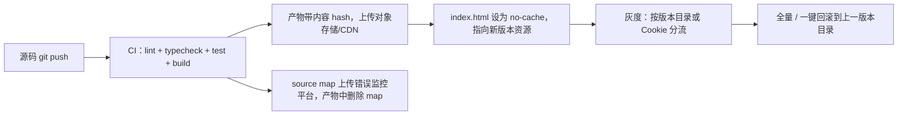
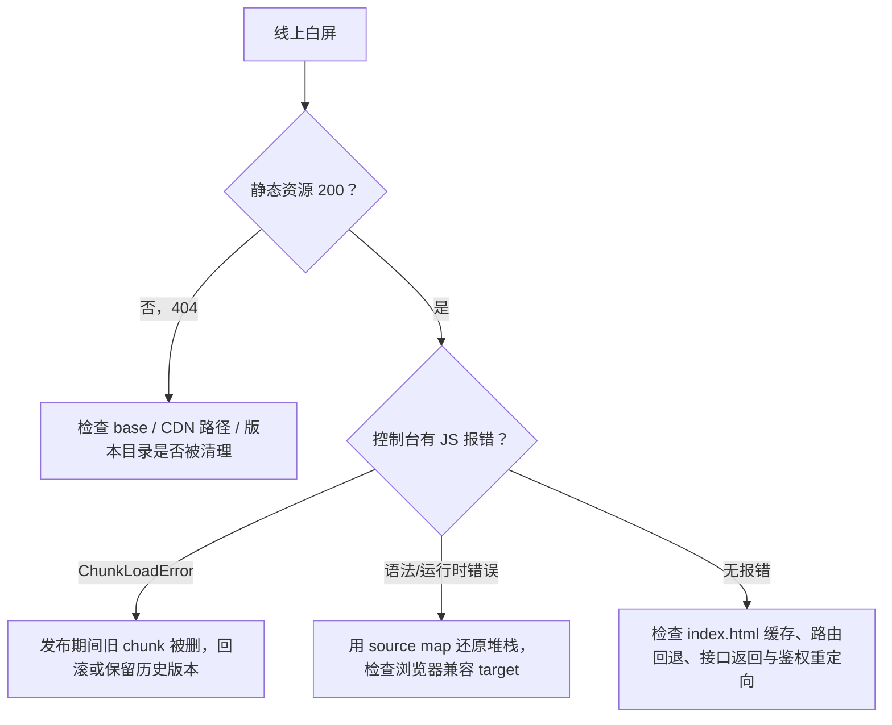

# 工程化构建与部署实战

## 使用入口：先解决问题，再做验证

将前端产物部署并支持深层路由与版本更新。

**先做基本操作**：先运行构建/预览并部署静态资源，测试环境配置、刷新和旧版本缓存，再讲 Vite 与分包。初次学习可先完成[本模块基础实践](/doc/Vue/Vue组件与页面基本使用)。

**再逐步深入**：基本 API 与输入输出 → 常见失败和使用边界 → 场景排查与优化 → 本文机制分析与源码。面试先讲用途和自己的操作过程，再回答场景与原理追问。

> **一句话结论**：Vite 开发快是因为「原生 ESM 按需编译 + esbuild 预构建依赖」，生产构建仍走 Rollup 做完整打包；上线事故 90% 出在 **base 路径、history 回退、缓存策略、回滚方案**这四件事，而不是构建速度。

## 30 秒速览

| 阶段 | 关键配置 | 一句话 |
|---|---|---|
| 开发 | `server.proxy`、`optimizeDeps.include` | 不打包源码，浏览器按模块请求 |
| 构建 | `build.rollupOptions.output.manualChunks` | 拆 vendor，避免单 chunk 过大 |
| 路径 | `base`、`router history` | 子路径部署必须设 base，且 Nginx 配回退 |
| 环境 | `.env.*` + `import.meta.env` | 只有 `VITE_` 前缀会注入客户端 |
| 缓存 | 文件名 hash + index.html no-cache | 静态资源长期缓存，入口永不缓存 |
| 发布 | CI 质量门禁 + 版本目录 + CDN 切换 | 可灰度、可一键回滚 |
| 观测 | source map 上传 + 前端监控 | 线上报错能定位回源码行列 |

## 一张图看懂从代码到线上



## 二、Vite 为什么快（以及什么时候不快）

| 阶段 | Vite | Webpack |
|---|---|---|
| 冷启动 | 启动 dev server 即就绪，源码不打包 | 全量构建依赖图后才可访问 |
| 依赖处理 | esbuild 预构建成单个 ESM 文件并强缓存 | loader 逐个处理 |
| 源码转换 | 浏览器请求到哪个模块才编译哪个 | 全量编译 |
| HMR | 只让相关模块失效，与总项目大小无关 | 随项目增大线性变慢 |
| 首屏大项目 | 请求瀑布可能变多，需 `optimizeDeps.include` 预打包 | 相对平稳 |
| 生产构建 | Rollup（生态插件略少于 Webpack） | webpack 自身 |

> 面试加分点：Vite 的快是**把打包成本从「启动时」挪到「首次请求时」**，并不是消灭了编译；所以巨型项目首屏请求瀑布明显，解决办法是预构建依赖与路由预取。

## 三、生产级 `vite.config.ts`

```ts
import { defineConfig, loadEnv } from 'vite'
import vue from '@vitejs/plugin-vue'
import { visualizer } from 'rollup-plugin-visualizer'
import { fileURLToPath, URL } from 'node:url'

export default defineConfig(({ mode }) => {
  const env = loadEnv(mode, process.cwd(), '')
  return {
    // 子路径部署（如 GitHub Pages /limin-Face-Doc/）必须设置，否则资源 404
    base: env.VITE_BASE || '/',
    plugins: [
      vue(),
      process.env.ANALYZE === '1' && visualizer({ open: true, gzipSize: true }),
    ].filter(Boolean),
    resolve: { alias: { '@': fileURLToPath(new URL('./src', import.meta.url)) } },
    server: {
      proxy: { '/api': { target: 'http://localhost:8080', changeOrigin: true } },
    },
    build: {
      target: 'es2020',
      sourcemap: 'hidden',       // 生成 map 供上传，但不在产物里暴露引用
      chunkSizeWarningLimit: 600,
      rollupOptions: {
        output: {
          // 按依赖稳定性拆包：框架层几乎不变，业务包每次变，命中缓存收益最大
          manualChunks(id) {
            if (id.includes('node_modules')) {
              if (id.includes('echarts') || id.includes('monaco')) return 'heavy'
              if (id.includes('vue') || id.includes('pinia') || id.includes('vue-router')) return 'vue-vendor'
              return 'vendor'
            }
          },
          chunkFileNames: 'assets/[name]-[hash].js',
          assetFileNames: 'assets/[name]-[hash][extname]',
        },
      },
    },
    experimental: { renderBuiltUrl: (filename) => `${env.VITE_CDN}/${filename}` },
  }
})
```

`manualChunks` 的两个坑：**别把所有 node_modules 打成一个 vendor**（单文件仍然巨大且任一依赖升级全失效）；**别把循环依赖的模块拆散**（会产生运行时 `Cannot access before initialization`）。

## 四、环境变量与安全边界

```bash
.env                # 所有环境
.env.development    # 本地
.env.production     # 生产
.env.production.local  # 本地覆盖，应进 .gitignore
```

```ts
// 只有 VITE_ 前缀会注入客户端代码，其余仅在构建时 Node 侧可见
const api = import.meta.env.VITE_API_BASE
const secret = import.meta.env.DB_PASSWORD  // ❌ 无 VITE_ 前缀，客户端拿到 undefined
```

**红线**：任何写进前端代码的密钥都等同于公开。`VITE_` 变量只能放 API 地址、功能开关、appid 这类可公开信息；真正的密钥放后端，由服务端代理第三方接口。

## 五、部署四大事故与排查决策树

| 现象 | 最可能原因 | 快速验证 |
|---|---|---|
| 白屏、控制台 404 | `base` 不对 / 资源被 CDN 缓存旧版本 | 看 Network 里 JS 请求路径是否带部署子路径 |
| 刷新子路由 404 | Nginx 未配 history 回退 | 直接访问 `/user/1` 返回 index.html 吗 |
| 改了代码但线上没变 | index.html 被 CDN 缓存 | `curl -I` 看 index.html 的 Cache-Control |
| 偶发 `ChunkLoadError` | 发布时旧版本的懒加载 chunk 被删 | 版本目录保留至少 2 个版本，或资源永久保留 |

```nginx
# history 模式必备：静态资源直接返回，其余全部回退到 index.html
server {
  listen 80;
  root /usr/share/nginx/html;
  location /assets/ {
    add_header Cache-Control "public, max-age=31536000, immutable";  # 带 hash，可永久缓存
    try_files $uri =404;
  }
  location = /index.html {
    add_header Cache-Control "no-cache, no-store, must-revalidate";   # 入口绝不缓存
  }
  location / {
    try_files $uri $uri/ /index.html;                                  # SPA 路由回退
  }
}
```



## 六、CI 质量门禁与回滚

```yaml
# .github/workflows/frontend.yml（核心片段）
- run: npm ci
- run: npm run lint && npm run typecheck && npm run test:unit -- --run
- run: npm run build
- run: node scripts/upload-sourcemap.js && rm -rf dist/**/*.map
- run: node scripts/deploy.js --version=${{ github.sha }}
```

发布策略要点：

1. **版本目录**：`/app/v1.2.3/`、`/app/v1.2.4/` 并存，Nginx/CDN 只切软链或变量，回滚 = 切回上一个目录，秒级完成；
2. **不要覆盖同名文件**：带 hash 的资源天然不冲突，但 index.html 必须最后上传，避免入口指向还不存在的 chunk；
3. **灰度**：按 Cookie / 用户 ID 分流到新版本目录，观察错误率与 LCP 再全量；
4. **质量门禁**：`lint` + `typecheck` + `test` + `build` 全绿才允许发布；产物体积超阈值直接失败，防止有人把 `echarts` 全量打进首屏。

## 七、高频追问（含高分/低分特征）

| 追问 | 高分回答要点 | 低分回答 |
|---|---|---|
| Vite 为什么比 Webpack 快？ | dev 用原生 ESM 按需编译 + esbuild 预构建，成本从启动挪到首次请求；prod 仍用 Rollup | 「esbuild 用 Go 写的所以快」 |
| 生产为什么不用 esbuild？ | 生态插件、代码分割、CSS 处理、Tree-shaking 成熟度不如 Rollup | 「配置不支持」 |
| 发布后白屏怎么查？ | 先 Network 看 404 → 看 index.html 缓存 → history 回退 → source map 还原报错 | 「清缓存刷新」 |
| 缓存策略怎么设计？ | hash 资源 immutable 长缓存，index.html no-cache，CDN 边缘缓存配合版本目录 | 「全部设 max-age」 |
| 怎么做到快速回滚？ | 不可变版本产物 + 入口/软链切换，不删旧版本 chunk | 「重新构建上一版代码」 |
| 环境变量会不会泄露密钥？ | 会，`VITE_` 前缀全部打进客户端；密钥必须留后端 | 「.env 不会被打包」 |

**延伸阅读**：[Webpack 与 Vite 架构对比及组件性能优化全集](/doc/Vue/Webpack与Vite架构对比及组件性能优化全集)、[性能优化与实战总结](/doc/Vue/性能优化与实战总结)、[Docker 容器化与 CI/CD](/doc/DevOps/Docker容器化与CICD自动化部署实战)。
