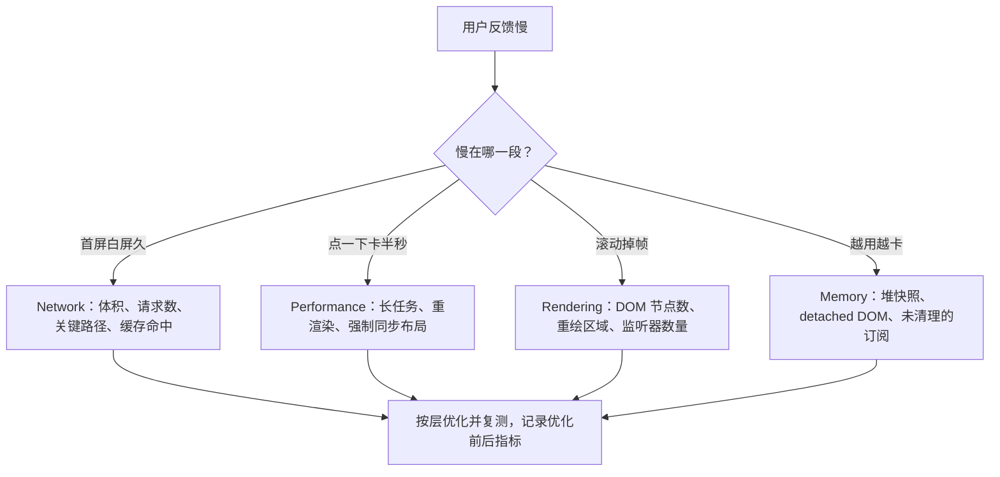

# 性能优化与实战总结

## 使用入口：先解决问题，再做验证

改善页面体验并证明优化收益。

**先做基本操作**：先在目标设备记录加载、长任务、帧与内存，定位最大瓶颈，复测同一场景再展开实现机制。初次学习可先完成[本模块基础实践](/doc/Vue/Vue组件与页面基本使用)。

**再逐步深入**：基本 API 与输入输出 → 常见失败和使用边界 → 场景排查与优化 → 本文机制分析与源码。面试先讲用途和自己的操作过程，再回答场景与原理追问。

> **一句话结论**：性能优化的顺序永远是**先量化定位，再分层下手**——网络层（体积/缓存）→ 编译层（静态提升/patchFlag）→ 响应式层（减少依赖）→ 渲染层（减少 vnode 与 DOM）→ 交互层（长任务拆分）。凭感觉加 `v-if`、`memo` 基本都优化错了地方。

## 30 秒速览

| 层 | 指标 | 手段 | 收益量级 |
|---|---|---|---|
| 网络 | FCP / LCP | 路由懒加载、拆包、CDN、预连接、图片压缩 | 首屏 -30%~60% |
| 编译 | 渲染耗时 | `<script setup>` 静态提升、patchFlag、编译期常量 | 中等，框架自动给 |
| 响应式 | 重渲染次数 | `shallowRef` / `markRaw` / `computed` / 精确 watch | 大列表场景显著 |
| 渲染 | DOM 节点数 | `v-memo` / `v-once` / 虚拟列表 / 组件拆分 | 万级列表数量级提升 |
| 交互 | INP / 长任务 | 防抖节流、`requestIdleCallback`、Web Worker | 卡顿感知明显 |
| 内存 | 堆占用 | 清理副作用、避免全局缓存无限增长 | 长时间停留不崩 |

## 一张图看懂排查路径



**先建基线**：LCP < 2.5s、INP < 200ms、CLS < 0.1（Core Web Vitals）。没有基线就无法判断优化是否有效，也无法防止后续劣化。

## 二、编译期：Vue 已经替你做的优化

```vue
<!-- 源码 -->
<template>
  <div class="title">静态标题</div>
  <div>{{ msg }}</div>
</template>
```

```ts
// 编译产物（示意）
const _hoisted = createElementVNode('div', { class: 'title' }, '静态标题', -1 /* HOISTED */)
function render(_ctx, _cache) {
  return createElementBlock('div', null, [
    _hoisted,                                            // 每次渲染复用同一个 vnode
    createElementVNode('div', null, toDisplayString(_ctx.msg), 1 /* TEXT patchFlag */),
  ])
}
```

| 机制 | 作用 | 前提 |
|---|---|---|
| 静态提升 `_hoisted` | 静态节点提到 render 外，只创建一次 | 纯静态内容 |
| `patchFlag` | 更新时只比对动态部分（TEXT / CLASS / PROPS） | 模板编译，非手写 render |
| Block Tree | 动态节点收集到扁平数组，跳过静态子树遍历 | `<script setup>` 模板 |
| 静态属性缓存 | 事件/静态 props 缓存复用 | 编译器自动 |
| `cacheHandlers` | 内联箭头函数缓存，避免子组件无谓更新 | 编译器自动 |

**结论**：用 `<script setup>` + 模板写法，编译器自动做这些优化；手写 `h()` render 函数反而可能丢失 patchFlag。

## 三、响应式层：减少无效依赖与重渲染

```ts
// 场景：后端返回 10000 条列表数据
const list = ref<Item[]>([])              // ❌ deep reactive：为每个元素的每个字段建 Proxy，内存与耗时剧增
const list = shallowRef<Item[]>([])       // ✅ 只在整体替换时触发；元素本身不需响应
list.value = await api.getList()          // 必须整体赋值，不能 push（shallowRef 不追踪 .value 内部）

// 场景：第三方实例
const chart = shallowRef<ECharts | null>(null)
chart.value = markRaw(echarts.init(el))   // ✅ 禁止 Proxy 包裹，避免破坏实例内部 this

// 场景：只用到一个字段
const total = computed(() => list.value.reduce((n, i) => n + i.price, 0)) // ✅ 带缓存
watch(() => list.value.length, fetchMore)  // ✅ 精确监听，胜过 { deep: true }
```

| 手段 | 适用 | 注意 |
|---|---|---|
| `shallowRef` / `shallowReactive` | 大对象、只读列表、接口返回值 | 内部字段变化不触发，需整体替换 |
| `markRaw` | 图表/地图/编辑器实例、常量配置 | 一旦标记不可撤销 |
| `computed` | 重复使用的派生值 | 别在 getter 里做副作用 |
| `v-memo="[dep]"` | 大列表行，仅 dep 变化才更新该行 | Vue 3.2+，需与 `v-for` 同一元素 |
| `v-once` | 永不变化的静态区块 | 之后完全脱离响应式 |

```vue
<!-- 万级列表：v-memo 让未变化的行连 vnode diff 都跳过 -->
<div v-for="item in list" :key="item.id" v-memo="[item.name, item.selected]">
  {{ item.name }} - {{ expensiveFormat(item.ts) }}
</div>
```

## 四、渲染层：DOM 数量才是滚动卡顿的主因

| 方案 | 适用规模 | 说明 |
|---|---|---|
| 稳定 `key` | 必做 | 用业务 id，别用 index；插入/排序时 index 会导致整串节点错误复用 |
| 分页 / 无限滚动 | < 几千 | 实现简单，但 DOM 会持续累积 |
| 虚拟列表 | 万级以上 | 只渲染可视区 ± 缓冲区，`vue-virtual-scroller` / `@tanstack/vue-virtual` |
| 组件拆分 | 通用 | 把高频变化的部分拆成子组件，让重渲染范围收敛 |
| `defineAsyncComponent` | 弹窗/大组件 | 首屏不加载，配合 `Suspense` 与 loading 占位 |

```ts
// 高频状态收敛在子组件：父组件不再因为输入框每次按键而整体重渲染
const SearchBox = defineComponent({ setup() {
  const kw = ref('')
  return () => h('input', { value: kw.value, onInput: e => kw.value = (e.target as HTMLInputElement).value })
}})
```

**`key` 的经典事故**：列表用 index 作 key，且每行含输入框/勾选态，删除第一行后第二行的输入状态会「串」到第一行——因为 Vue 按 key 复用了 DOM 节点。

## 五、网络与首屏

```ts
// 路由懒加载：每个页面独立 chunk
const routes = [
  { path: '/', component: () => import('@/views/Home.vue') },
  { path: '/report', component: () => import('@/views/Report.vue') },
]
```

| 手段 | 做法 | 坑 |
|---|---|---|
| 路由懒加载 | 动态 `import()` | 别把所有页面塞进一个 chunk |
| 预取 | `<link rel="prefetch">` / `router` 预加载下一页 | 过度预取反而抢首屏带宽 |
| 按需引入 | 组件库 `unplugin-vue-components`、lodash-es 具名导入 | 全量 `import _ from 'lodash'` 多几百 KB |
| 图片 | WebP/AVIF、`loading="lazy"`、响应式 `srcset` | LCP 图片不能懒加载，会适得其反 |
| 字体 | `font-display: swap` + 子集化 | 中文字体不子集化常有数 MB |
| 压缩 | Brotli > Gzip，构建时预生成 `.br` | 需服务端按 `Accept-Encoding` 返回 |
| 预连接 | `<link rel="preconnect" href="https://api.xxx.com">` | 只对真正的关键域名加 |

## 六、交互长任务与内存

```ts
// 长任务拆分：避免一次同步循环阻塞主线程 200ms+
async function processInChunks(items: Item[]) {
  for (let i = 0; i < items.length; i += 500) {
    doHeavyWork(items.slice(i, i + 500))
    await new Promise(r => setTimeout(r, 0))   // 让出主线程给渲染/输入
  }
}
```

- 高频输入用防抖（搜索）/ 节流（滚动、resize），并配合 `AbortController` 取消过期请求；
- 计算密集型任务（大文件解析、加密）丢给 Web Worker，别占着主线程；
- 用 `onRenderTracked` / `onRenderTriggered` 打印「哪个 key 触发了本次渲染」，比盲猜有效；
- 长时间停留页面变卡，优先查：未 `clearInterval` 的定时器、未解绑的全局事件、无限增长的缓存 Map、detached DOM 节点。

## 七、优化前后对照表（写进简历/答辩用）

| 场景 | 优化前 | 优化后 | 关键动作 |
|---|---|---|---|
| 后台首页 | LCP 4.2s / 主包 1.8MB | LCP 1.6s / 主包 420KB | echarts 懒加载 + manualChunks + 路由级拆包 |
| 万行表格 | 滚动 12fps、内存 600MB | 稳定 55fps、内存 90MB | 虚拟列表 + shallowRef + v-memo |
| 实时大屏 | 每秒全量重渲染 | 仅变动卡片更新 | markRaw 实例 + 按 id 拆分组件 + 精确 watch |
| 长列表搜索 | 输入卡顿、结果乱序 | 无感输入 | 300ms 防抖 + AbortController + 竞态序号 |

> 答辩要点：**每个优化都要给出指标、定位手段、改动点、复测结果**。「我加了缓存」「用了虚拟列表」没法证明效果。

## 八、高频追问（含高分/低分特征）

| 追问 | 高分回答要点 | 低分回答 |
|---|---|---|
| 首屏慢怎么系统性排查？ | 先量化 FCP/LCP → Network 瀑布 → 产物分析 → 关键路径 → 缓存，逐层定位 | 「压缩代码、加 CDN」 |
| `key` 为什么不能用 index？ | 插入/删除/排序导致节点错误复用，带状态的子组件会串数据 | 「性能更好」 |
| `shallowRef` 解决什么问题？ | 避免为深层大对象创建 Proxy 与依赖，降低内存与首屏耗时 | 「更快」但说不出限制 |
| `v-memo` 与 `computed` 区别？ | v-memo 跳过 vnode diff，computed 缓存派生值，作用层级不同 | 「都是缓存」 |
| Vue 编译器做了哪些优化？ | 静态提升、patchFlag、Block Tree、事件缓存，前提是模板 + `<script setup>` | 「虚拟 DOM 快」 |
| 优化完怎么证明有效？ | 固定环境与数据集，对比 LCP/INP/长任务数/内存快照，防止回归 | 「感觉变快了」 |

**延伸阅读**：[渲染机制与 Diff 算法深度解析](/doc/Vue/渲染机制与Diff算法深度解析)、[工程化构建与部署实战](/doc/Vue/工程化构建与部署实战)、[Webpack 与 Vite 架构对比](/doc/Vue/Webpack与Vite架构对比及组件性能优化全集)。
