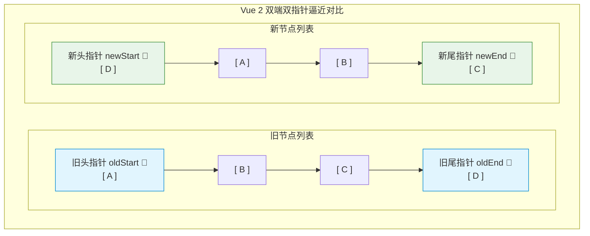
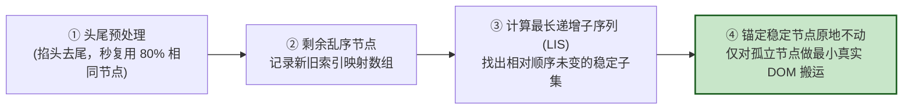

# 渲染机制与Diff算法深度剖析

## 使用入口：先解决问题，再做验证

理解列表更新、组件复用和 key 引起的错位。

**先做基本操作**：先实现带输入的列表并在头部增删，比较稳定业务 key 与 index 的表现，再分析算法。初次学习可先完成[本模块基础实践](/doc/Vue/Vue组件与页面基本使用)。

**再逐步深入**：基本 API 与输入输出 → 常见失败和使用边界 → 场景排查与优化 → 本文机制分析与源码。面试先讲用途和自己的操作过程，再回答场景与原理追问。

## 🎯 核心技术原理与实战归纳
- **核心设问与思考**：“Vue 的虚拟 DOM（VNode）到底是什么？为什么直接操作真实 DOM 慢，而虚拟 DOM 快？”
- **深水区追问**：“**Vue 2 的‘双端 Diff’（双指针）**与 **Vue 3 的‘快速 Diff’（最长递增子序列 LIS）**底层算法有何本质区别？为什么用 `index` 作为 `key` 会导致**输入框内容错乱、复选框勾选漂移**的生产重大 Bug？请现场手写一个复现用例！”

---

## 一、 虚拟 DOM 的本质与性能哲学

### 1. 虚拟 DOM 真的比原生 DOM 快吗？
- **核心认知纠偏**：**虚拟 DOM 并不比原生最优化的 DOM 操作快**！如果用原生 JS 极其精准地修改某一个文本节点（如 `el.textContent = 'hello'`），其速度一定是最快的。
- **虚拟 DOM 的真正价值**：
  1. **研发效率与性能下限保障**：在面对极其复杂的大型动态 UI 时，开发者不可能手动精确计算每一个 DOM 节点的最小变更。虚拟 DOM 通过声明式写法，**保证了在任意复杂场景下的性能下限足够好**。
  2. **跨平台（跨端）抽象底座**：虚拟 DOM 本质就是一个纯粹的 JavaScript 普通对象。它不仅能渲染到浏览器的 DOM，还能渲染到 **Android/iOS 原生视图（Weex/uni-app）、Canvas、服务端 SSR（Node.js）**。

```javascript
// 一个标准的 VNode 虚拟节点本质就是一个轻量 JS 对象
const vnode = {
  type: 'div',
  props: { id: 'app', class: 'container' },
  children: [
    { type: 'span', children: 'Hello Vue' }
  ]
}
```

---

## 二、 核心算法对决：Vue 2 双端 Diff vs Vue 3 快速 Diff (LIS)

### 1. Vue 2 双端 Diff（4 指针相互逼近比对）
Vue 2 采用的是经典的**双端双指针比较法**。它在旧子节点列表和新子节点列表两端分别设置 2 个指针（共 4 个指针）：
- `oldStartIdx` / `oldEndIdx`
- `newStartIdx` / `newEndIdx`

::: tip 🎯 通俗心智模型：四人两头包抄打地鼠
Vue 2 的双端 Diff 就像**新旧两队人马分别派两人从头尾向中间包抄**。旧队有“旧头、旧尾”，新队有“新头、新尾”，双方四目相对，两头尝试找相同的人。
:::



#### 四种贪心比对策略（顺次检查）：
1. `oldStart` vs `newStart`（头头相同，不移动真实 DOM，指针后移）
2. `oldEnd` vs `newEnd`（尾尾相同，不移动真实 DOM，指针前移）
3. `oldStart` vs `newEnd`（旧头等于新尾，说明节点移到了后面，将真实 DOM 节点移动到 `oldEnd` 之后）
4. `oldEnd` vs `newStart`（旧尾等于新头，说明节点移到了前面，将真实 DOM 节点移动到 `oldStart` 之前）
5. 若上述四步均未命中：拿 `newStart` 的 Key 去旧节点列表建立的 `keyMap` 哈希表中查找。找到则移动并置为 `undefined`，找不到则直接创建新 DOM。

---

### 2. Vue 3 快速 Diff（基于最长递增子序列 LIS，极大减少 DOM 移动）
Vue 3 借鉴了 `ivi` 和 `inferno` 框架的 Diff 算法思想：

::: tip 搬家与换座位的最省力法则：最长递增子序列（LIS）
* **大白话比喻**：班级调座位，旧排队顺序是 `[A, B, C, D]`，新排队顺序是 `[A, C, B, D]`。
* 如果全班每个人都站起来走动一遍，教室立刻大乱（频繁操作真实 DOM 开销极大！）。
* **Vue 3 的数学智慧**：找出那些**本来前后相对顺序就没变的最大群人**（如 `A`、`B`、`D` 构成最长递增子序列），**勒令他们屁股焊死在椅子上别动**！全班只有落单的 `C` 一个人站起来换位置。真实 DOM 移动次数从全量移动骤降至极少数！
:::



---

## 三、 生产事故复现：为什么严禁使用 `index` 作为 `key`？

### 1. 致命缺陷代码复现（删除列表项引发勾选状态错乱）

```vue
<!-- 错误写法：:key="index" -->
<template>
  <div>
    <button @click="deleteFirstUser">删除第一个用户</button>
    <ul>
      <li v-for="(user, index) in list" :key="index">
        <input type="checkbox" />
        {{ user.name }}
      </li>
    </ul>
  </div>
</template>

<script setup>
import { ref } from 'vue'
const list = ref([
  { id: 'u1', name: '张三 (原第1项)' },
  { id: 'u2', name: '李四 (原第2项)' },
  { id: 'u3', name: '王五 (原第3项)' }
])

function deleteFirstUser() {
  list.value.shift() // 删掉张三
}
</script>
```

### 2. 灾难现场与底层根因剖析
1. **用户操作**：勾选第 1 项【张三】前面的复选框，然后点击【删除第一个用户】按钮。
2. **Bug 表现**：页面上的【张三】文本确实消失了，**但【李四】前面的复选框居然变成了勾选状态**！用户勾选的数据凭空“篡改”移位！
3. **Diff 底层根因**：
   - 原列表长度为 3，索引为 `0, 1, 2`。删除张三后，剩余两项的索引重新变成了 `0, 1`。
   - Vue 在 Diff 比较旧节点的 `key=0` 与新节点的 `key=0` 时，发现 **key 相同、标签类型 `<input>` 也相同**，直接断定：“**该节点完全可以复用！**”。
   - 于是 Vue 仅仅更新了后面的文本内容，但由于复选框的状态属于底层无响应式状态的 DOM 原生属性，Vue 选择保留了原 `key=0` 节点的选中状态，直接引发严重业务逻辑错乱！
4. **铁律**：列表项必须使用业务唯一不变的主键（如 `user.id`、`order.sn`）作为 `key`！
